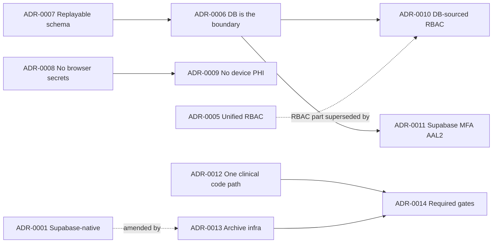

# Architectural Decisions: Conformance Review & Proposed ADRs

> CareSync HIMS repository audit, 2026-11-01. Commit `43ab8f7`. Per `docs/agents/domain.md`, contradictions with existing ADRs are surfaced explicitly rather than silently overridden. §1 tests each accepted ADR against the code. §2 proposes new ADRs (status **Proposed**; they need team review before adoption, and should then be copied into `docs/adr/` with the next numbers).

## 1. Conformance review of existing ADRs

| ADR | Decision (summary) | Conforms? | Evidence | Recommendation |
|---|---|---|---|---|
| **0001** Supabase-native backend | Supabase (Postgres + RLS, Auth, Edge Functions, Storage) is the only runtime backend. Kong and microservices are archived. | ⚠️ **Partially.** The runtime conforms: the SPA talks only to Supabase. The repository does not: `services/*` keep a divergent schema, Kong and compose files commit credentials, k8s manifests are broken, and docs still claim "rate limiting via Kong". | ARCH-16, DB-19, OPS-05, OPS-06, SECF-19; `docs/SYSTEM_ARCHITECTURE.md` §OWASP | Keep the ADR. Amend it with ADR-0013 (physically archive non-runtime infrastructure). |
| **0002** Seven canonical roles and billing boundary | Exactly 7 roles. Billing data is limited to admin and receptionist. | ❌ **Not enforced.** RLS lets every hospital member read and write invoices, because the hardening migration fails and the old policies remain (DB-07, DB-03). The client invents a non-canonical `billing_manager` role (FUNC-33). Consultation completion has the doctor create invoices, which the client then blocks (FUNC-25). | DB-07, FUNC-33, FUNC-25 | Keep the ADR. Implement it in RLS (S0-04) and route invoice creation through an RPC callable from consultation completion under a service context (S1-01). |
| **0003** Sequential multi-role discharge | doctor → pharmacist → billing → nurse → completed, with rollback and optimistic concurrency. | ⚠️ **Partially.** The forward path and the edge-function role gating exist. Rejection dead-ends, AMA is broken, the DB transition function trusts caller IDs, and table UPDATE is open to any member, so the sequence is bypassable (CLIN-11, DB-10). The initiation modal crashes (CLIN-28). | CLIN-11, CLIN-28, DB-10 | Keep the ADR. Enforce transitions with a DB trigger (S1-02). The ADR file is corrupted: control characters replaced "billing" and "nurse" (`^H`illing, newline+"urse"); fix the text. |
| **0004** Pharmacist-gated dispensing | initiated → pending_approval → approved → dispensed → completed, rejected "at the database CHECK constraint, the edge function and the service layer". | ❌ **Not as stated.** No effective CHECK or transition constraint exists: `20260617000001` has no effect, and `20260223000001` was undone by `20260223043658` (DB-10). The UI enforces order with buttons only. Doctors can update status, and "Details" lets anyone re-dispense (CLIN-03). The dispensing audit table does not exist (ARCH-05). The module's actor role resolves to `'authenticated'` (CLIN-27). | DB-10, CLIN-03, ARCH-05, CLIN-27 | Keep the ADR. Its "Consequences" section currently over-claims. Mark it *not yet implemented* until S1-02 lands. Fix the control-character corruption ("`^G`pproved"). |
| **0005** Unified typed RBAC, scoped cryptography, fail-closed CDS | One RBAC source (`types/rbac.ts`), phi-crypto scoped by an RLS probe, fail-closed allergy and DDI checks, a durable lab escalation queue, monotonic DB hardening. | ❌ **Largely not in effect.** Seven RBAC layers remain and diverge in 50 cases (SECF-07). The phi-crypto oracle remains (EDGE-04). Fail-closed CDS lives only in unreached modules (CLIN-01, ARCH-04). The escalation queue is not driven and does not match the schema (EDGE-03). The hardening migration fails (DB-03). | SECF-07, EDGE-04, CLIN-01, ARCH-04, EDGE-03, DB-03 | Supersede the RBAC part with ADR-0010 (the database as the RBAC source). Keep the CDS invariant and enforce it through ADR-0012. |

**Process observation.** Each of ADR-0003, 0004 and 0005 records a decision *and* asserts that it has been implemented. Their compliance was then "verified" by tests that grep source text (TEST-08). Recommendation: ADRs record decisions only. Implementation status lives in the issue tracker, and verification lives in behavioral tests linked from the ADR.

## 2. Proposed ADRs

### ADR-0006 (Proposed): The database is the security boundary; privileged mutations go through checked RPCs

- **Context:** Most edge functions use the service-role key and re-implement authorization by hand. Several get tenancy wrong (EDGE-01, EDGE-06, EDGE-07, EDGE-08). Financial and clinical state changes are made by direct client UPDATEs authorized in the UI (FUNC-33, CLIN-03).
- **Decision:**
  1. All multi-row or privileged mutations are PostgreSQL functions (`SECURITY DEFINER`, `SET search_path = ''`, explicit `auth.uid()`-derived role and tenant checks, single transaction, audit insert included).
  2. Edge functions call the database with the *caller's JWT* by default. The service-role key is reserved for platform jobs triggered by cron and is never reachable from a tenant request.
  3. Clients may not UPDATE state-machine columns or monetary columns directly (column privileges or a trigger).
- **Consequences:** Authorization lives in one auditable place and is testable with pgTAP. More logic sits in SQL, so the team needs the matching skills. Edge functions shrink.

### ADR-0007 (Proposed): The live schema is the source of truth, and migrations must replay

- **Context:** 108 SQL files are never applied, at least 15 applied files fail, and the generated types cover 44 of 232 tables (DB-03, DB-14, DB-21).
- **Decision:** Squash to a baseline taken from a production dump. Each later migration must pass `supabase db reset` in CI on an empty database and `supabase db diff` against staging. Types are regenerated in CI and drift fails the build. Migrations never mutate PHI without a reviewed data-migration plan (DB-11).
- **Consequences:** Environments become reproducible, and claims about deployed controls become testable.

### ADR-0008 (Proposed): No secrets and no third-party PHI processing in the browser

- **Context:** The OpenAI, Anthropic and Twilio credentials are read from `VITE_*` variables (SECF-03). AI calls would send PHI straight from the browser to vendors.
- **Decision:** Every third-party call that needs a credential or carries PHI goes through an edge function with server-held secrets, a vendor under a BAA, PHI minimization and audit logging. A CI bundle scan fails on known secret variable names.
- **Consequences:** Somewhat more latency, centralized cost control and compliance evidence.

### ADR-0009 (Proposed): No PHI persistence on client devices beyond the session

- **Context:** The Workbox cache keeps Supabase responses for 24 hours, localStorage holds plaintext offline data, and the query cache survives logout (SECF-04, SECF-05, SECF-06).
- **Decision:** The service worker caches only static assets. PHI may live only in memory, or in encrypted IndexedDB with a per-session key (E-19). Logout clears every client store. Shared-workstation mode is the default.
- **Consequences:** Offline capability is limited until E-19 is delivered.

### ADR-0010 (Proposed; supersedes the RBAC part of ADR-0005): Role permissions are stored in the database and generated for the client

- **Context:** Seven RBAC layers diverge (SECF-07). The UI guards use an `admin: '*'` wildcard. RLS checks membership, not role (DB-02).
- **Decision:** A `role_permissions` table, keyed by the 7 canonical roles, is read by the RLS helper functions. `src/types/rbac.ts` is generated from it. Client guards are UX only. A parity test runs in CI.
- **Consequences:** One change point for permissions, and the per-role manager classes are deleted.

### ADR-0011 (Proposed): Use Supabase Auth MFA (AAL2) instead of custom TOTP

- **Context:** The custom 2FA tables and edge functions are not enforced server-side, the live hook uses `Math.random`, and the secrets are not valid base32 (EDGE-05, ARCH-06, EDGE-12).
- **Decision:** Adopt Supabase Auth MFA factors. RLS requires `auth.jwt()->>'aal' = 'aal2'` for the admin and doctor roles, and any role that hospital policy configures. Delete the custom 2FA functions after migrating users.
- **Consequences:** Users re-enroll once. Enforcement becomes server-side and standard.

### ADR-0012 (Proposed): One live code path per clinical-safety capability, enforced by tooling

- **Context:** Remediated deep modules are tested but not imported by the UI, which still uses legacy code (CLIN-01, ARCH-04, ARCH-06).
- **Decision:** For each capability (CDS, dispensing, escalation, NEWS2, discharge), the deep module is the *only* implementation. dependency-cruiser runs over all of `src` and forbids importing the legacy paths. Clinical acceptance tests must go through the UI import path (component or E2E), not only through the module API.
- **Consequences:** Legacy safety code is deleted, and tests prove what clinicians actually run.

### ADR-0013 (Proposed; amends ADR-0001): Physically archive non-runtime infrastructure

- **Context:** The microservices, Kong, k8s, compose files and mobile skeleton remain in `main`, with credentials and broken builds (ARCH-16, OPS-05, OPS-06).
- **Decision:** Move them to an `archive/` branch or a separate repository, keep only what the runtime path needs, and document the actual hosting (Lovable or a static CDN) in a deployment ADR.
- **Consequences:** Less noise and attack surface, and accurate documentation.

### ADR-0014 (Proposed): Merge requires real, required quality gates

- **Context:** No branch protection. The type check covers 0 files. CI gates are neutralized. Playwright collects 0 tests (OPS-01, ARCH-01, OPS-03, TEST-01).
- **Decision:** `main` is protected. The required checks are type-check (app + node), the full unit suite, lint, the RLS matrix, edge authz tests, a Playwright smoke test, the dependency audit (runtime high or above), and build. `continue-on-error` and `|| true` are banned in required jobs.
- **Consequences:** Short-term slowdown while the existing failures are fixed, then long-term confidence.

## 3. Decision dependency map

