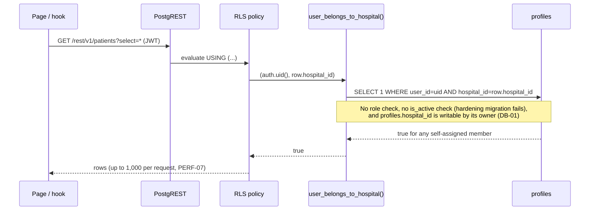
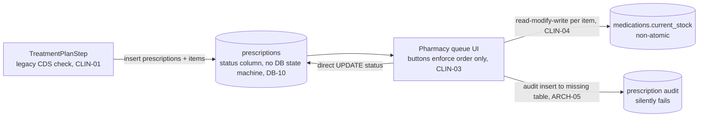
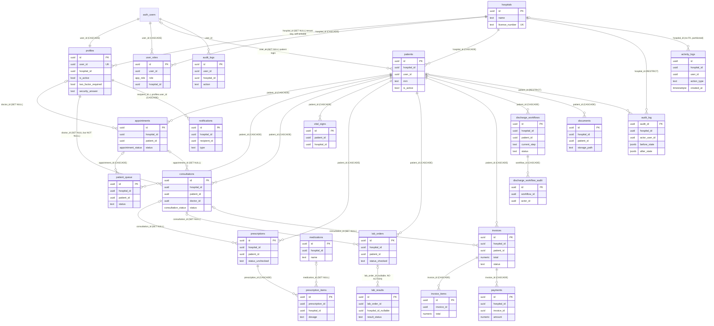

# Database & Data Flow Audit

> CareSync HIMS repository audit, 2026-11-01. Commit `43ab8f7`. **Static analysis only.** No live database was reachable, so every statement about the *deployed* schema is inferred from the migrations and from the generated `src/integrations/supabase/types.ts` (last regenerated 2026-09-08). Each finding carries its own CONFIRMED/LIKELY/SUSPECTED status.

## 1. Executive view

The repository does not contain a reliable, replayable definition of the production database:

- **The migrations cannot rebuild the schema.** At least 15 of the 64 timestamp-named migration files contain a statement that fails in PostgreSQL. The Supabase CLI stops at the first failure. The key security hardening migrations are among the failing files (DB-03).
- **108 SQL files are never applied by the CLI.** These are `legacy/` (98), `phase5/` (5) and the `tier*.sql` files, whose names do not match the timestamp convention. Several runtime tables exist *only* there, for example `lab_critical_alerts` (DB-21).
- **The code and the declared schema have diverged.** The frontend references 212 tables and 45 RPCs. Of those, 66 tables and 16 RPCs are defined nowhere or only in unapplied files. The generated types cover 44 of the 232 tables defined in migrations (DB-14, ARCH-02).
- **Tenant isolation relies on one helper,** `user_belongs_to_hospital()`. It is membership-only, and its input (`profiles.hospital_id`) is user-writable (DB-01, DB-02).

Until the live schema is dumped and reconciled with the repository, no claim about RLS, constraints or state-machine enforcement can be signed off. Reconciliation is task **S0-01** in [IMPLEMENTATION_ROADMAP.md](./IMPLEMENTATION_ROADMAP.md).

## 2. Lead verification

| ID | Evidence | Result |
|---|---|---|
| DB-01 | `20260204000011_misc.sql:274-276`: the profile UPDATE policy has `USING (user_id = auth.uid())`, no `WITH CHECK` and no column restriction. The INSERT policy checks only `user_id`. No later migration or trigger guards `hospital_id`. | CONFIRMED |
| DB-03 | The parameter rename via `CREATE OR REPLACE` in `20260311000007:11` and `20260909000001:11`. `types.ts:3328-3330` still lists `_user_id` / `_hospital_id`. | CONFIRMED |
| DB-04 | The NULL-comparison guard and the default PUBLIC EXECUTE on a SECURITY DEFINER purge of `public.audit_log` (`20260313000004:324-351`). | CONFIRMED in code. Deployment unknown. |
| `scripts/validate-migrations.mjs` | Executed: "69/69 reversible, ALL MIGRATIONS REVERSIBLE". It scans text patterns only. It never parses or runs SQL, so it cannot detect the failures behind DB-03. | CONFIRMED (tool limitation, see DB-21) |
| `scripts/validate-rls.ts` | `.catch(() => ({ data: null, error: null }))` at :69 turns any connection or query failure into a pass. | CONFIRMED (see OPS-02) |

## 3. Critical data-flow traces

### 3.1 Read of patient PHI (e.g. `patients`, `consultations`, `prescriptions`)



### 3.2 Prescription → pharmacist approval → dispense → stock



### 3.3 Invoice adjustments and payments

`InvoiceAdjustmentModal` → direct `invoices` UPDATE (FUNC-33). `EnhancedPaymentModal` → `payments` insert, then an `invoices` UPDATE with no transaction (FUNC-06). RLS lets every hospital member read and write invoices (DB-07). There are no ledger rows for refunds.

## 4. Data integrity, deletion and backup summary

| Concern | Current state | Findings |
|---|---|---|
| Referential integrity | FKs are present on core tables. Destructive `ON DELETE CASCADE` paths exist from patients to clinical records. | DB-12 |
| Soft delete / retention | No soft-delete pattern. Hard deletes are possible through RLS and admin tools. Migrations hard-delete or rewrite PHI across tenants. | DB-11, DB-12, FUNC-10 |
| State machines | The discharge and prescription lifecycles are not enforced by CHECK constraints or triggers. | DB-10 |
| Audit trail | `activity_logs` is append-only. `audit_logs` immutability is not applied. Inserts are open to anyone. A public purge function exists. | DB-04, DB-08, EDGE-09 |
| Money | See the functional audit for floating-point and atomicity issues in payment recording. | FUNC-05, FUNC-06, FUNC-07 |
| Backups / DR | There is no tested backup or restore path. The `backup-manager` restore is destructive across tenants. The DR runbook describes commands that do not exist. | DB-18, EDGE-02, OPS-08 |
| Local vs cloud storage | PHI sits in the PWA Cache Storage (24 h), `localStorage` (offline nurse data), IndexedDB and sessionStorage (JWT). | SECF-04, SECF-06, SECF-23 |

## 5. Detailed findings (DB-xx), inventories, function timeline and ERD

Scope: static analysis only (no live DB). Inputs: `supabase/migrations/**`, `services/*/migrations`, `src/integrations/supabase/types.ts`, `scripts/validate-*.{ts,mjs}`, `scripts/apply-rls-migration.mjs`, `supabase/functions/backup-manager`, DB docs. Method: a comment/dollar-quote-aware parser replayed the 64 CLI-applicable migrations in filename order and tracked final tables, RLS flags, policies (create/drop by name, incl. rename carry-over), functions (last definition wins), grants and triggers. Then a grep cross-check of `.from('…')` / `.rpc('…')` in `src/` and `supabase/functions/`.

Semantics used throughout:
- RLS policies are PERMISSIVE and combine with OR, so a single broad policy cancels every narrower one on the same command.
- `CREATE OR REPLACE FUNCTION` cannot rename parameters.
- Enum literal coercion happens when a policy or statement is parsed.
- plpgsql bodies are only checked when they run.
- Supabase CLI applies top-level `^[0-9]+_.*\.sql$` files in order and stops at the first error.

### Headline numbers

| Metric | Value |
|---|---|
| Relations created by applied migrations | 231 `CREATE TABLE` + 1 renamed (`activity_logs_legacy`) = 232 |
| Tables in generated `types.ts` (live snapshot, regenerated 2026-09-08) | 44 |
| Tables with RLS never enabled | **35** (+4 with RLS on and zero policies) |
| Final policy set | 521 policies on 196 relations; 67 key on `auth.jwt()->>'role'` (never true); 437 use un-wrapped `auth.uid()` |
| SECURITY DEFINER functions (final definitions) | 75, of which **46 have no `SET search_path`** |
| Migration files the CLI will NOT apply | **108** (98 `legacy/`, 5 `phase5/`, 5 top-level `tier*.sql`), plus 8 SQL files under `services/` |
| Applied files containing a statement that errors on a clean replay | ≥15 of 64. Six also fail against the live enum/column set (20260309000001, 20260311000005/6/7, 20260331, 20260909000001) |
| Code → DB drift | 212 distinct tables referenced. **66 undefined** in applied migrations and types (54 defined nowhere, 12 only in unapplied files). 45 RPCs called, **16 undefined anywhere**. 104 code-used tables missing from `types.ts` |
| Defined but unused | 82 tables (excluding partitions), 47 callable functions |

---

### Prior-claim verification

| Claim (source) | Claimed fix | Verdict | Evidence |
|---|---|---|---|
| SEC-008: `user_belongs_to_hospital` requires `is_active` (issue 06, ADR-0005 §5) | `20260909000001:11-24` | **NOT IN EFFECT. Migration cannot apply** | 1. Live function has params `(_user_id, _hospital_id)`: `misc.sql:238` and `types.ts:3328-3330` (`Args: { _hospital_id: string; _user_id: string }`). `CREATE OR REPLACE … (p_user_id UUID, p_hospital_id UUID)` raises `cannot change name of input parameter "_user_id"`. The same defect exists at `20260311000007:11`. 2. Line 85 references a table that only exists in an unapplied file (`REFERENCES public.lab_critical_alerts(id)`; created only at `tier4_2_4_lab_workflows.sql:124`). 3. Line 172 `WHERE role = 'super_admin'` is not a valid `app_role` label. Even if it applied: staff deactivation deletes `user_roles` rows and never sets `is_active=false` (`src/components/staff/DeactivateStaffDialog.tsx:66-70`). `profiles.is_active` is self-writable (DB-01). About 60 policies bypass the helper with raw `profiles` subqueries. |
| RBAC-002: invoices readable only by admin/receptionist (issue 05) | `20260909000001:29-49` | **NOT IN EFFECT; ineffective even if applied** | The migration fails (above). The permissive policies `"Staff can view invoices in their hospital"` (`misc.sql:827`), `"Staff can create invoices"` (`:831`) and `"Staff can update invoices"` (`:835`) are never dropped and OR with the new policy. The new policy's role check is a tautology: `AND ur.hospital_id = hospital_id` (`:44`). Unqualified `hospital_id` binds to `ur`. See DB-07. |
| SEC-004: append-only `audit_logs`/`activity_logs` + hospital-scoped insert (issue 07) | `20260909000001:51-80,133-165,184-213` | **PARTIAL** | `activity_logs` trigger: present in `20260622000003:27-30` (independent file, OK). `audit_logs` trigger: not applied (migration fails). Hospital-scoped insert: ineffective because `"System can insert logs" … WITH CHECK (true)` (`20260223000002:89-91`) is never dropped. The 20260313 trail table `audit_log` relies only on RLS, and an anon-callable SECURITY DEFINER function deletes from it (DB-04). See DB-08. |
| REL-002: discharge transitions row-locked & hospital-scoped (issue 17) | `20260909000004` | **PARTIAL / bypassable** | `FOR UPDATE` is present (`:24-28`). The function is SECURITY DEFINER and granted to `authenticated` (`:56`), and to anon by Supabase default. It trusts caller-supplied `p_hospital_id`/`p_actor_id` and arbitrary `p_next_step`/`p_next_status`. Separately, any hospital member can PATCH `discharge_workflows` directly (`20260311000003:68-84`). See DB-10. Not reachable via `db push` if an earlier migration fails. |
| ADR-0004: "direct transition to dispensed is rejected at the database CHECK constraint" | — | **FALSE** | `prescriptions.status TEXT NOT NULL DEFAULT 'pending'` (`misc.sql:651`) has no CHECK and no transition trigger. See DB-10. |
| `20260617000001`: non-admin staff can only read their own activity logs | `20260617000001` | **INEFFECTIVE** | It drops `"Hospital staff can view activity logs"`, which moved to `activity_logs_legacy` on rename (`20260223000002:23`). `"Hospital staff can read own hospital logs"` (`20260223000002:81-87`) and `activity_logs_hospital_read` (`20260311000007:48`) still grant every hospital member read access. |
| `20260223000001`: role self-assignment fix | `assign_patient_role` checks `p_user_id = auth.uid()` | **REGRESSED** | `20260223043658:20-37` (sorts later) re-defines it without the caller check or the existing-role guard. Both versions also `ON CONFLICT (user_id, role)` with no matching unique key (only `UNIQUE (user_id, role, hospital_id)`, `misc.sql:54`), so the function always errors. See DB-15. |
| `20260622000002`: "prescription_items … no policy existed" | adds `prescription_items_hospital_isolation` | **CLAIM FALSE; widens access** | Four role-scoped policies already existed (`misc.sql:722-746`). The new `FOR ALL` policy (`:54-57`) lets any hospital member insert, update or delete items. See DB-09. |
| `docs/RLS_AUDIT_REPORT.md:116-117`: "All PHI tables have role-based access control" | — | **FALSE** | See DB-02 and DB-13. |

### Timeline of key security function definitions (filename order; the last row in each group is effective)

| Function | Definitions | Effective / notes |
|---|---|---|
| `user_belongs_to_hospital` | `misc.sql:238` `(_user_id,_hospital_id)` no `is_active` → `20260311000007:11` (**fails**, param rename) → `20260909000001:11` (**fails**, param rename) | `misc.sql:238`: no `is_active` check. Live types confirm `_user_id` names. |
| `has_role(_user_id, _role)` | `misc.sql:211` only | Not hospital-scoped. A role row in hospital A grants that role everywhere. |
| `get_user_hospital_id(_user_id)` | `misc.sql:227` only | SECURITY DEFINER, executable by anyone, no caller check. |
| `assign_patient_role` | `20260223000001:33` (caller check) → `20260223043658:20` (**no caller check**) | Regression; also always errors (ON CONFLICT mismatch). |
| `complete_patient_prep` | `core_schema:10` → `20260220000001:6` → `20260223100000:172` | Final: SECURITY DEFINER, no hospital or role check. |
| `prevent_activity_log_mutation` | `20260622000003:17` | Effective. |
| `prevent_audit_log_mutation` | `20260909000001:52` | Never applied (migration fails). |
| `transition_discharge_workflow` | `20260909000004:5` | Trusts caller-supplied tenant and actor. |
| `log_security_event` | 3 different signatures (`00008:571`, `misc:4346`, `20260220070446:60`) | Three overloads coexist, so PostgREST overload resolution can be ambiguous. |

---

### DB-01: Tenant key `profiles.hospital_id` (and `is_active`, 2FA, lockout flags) is self-writable, enabling cross-tenant PHI access
- Severity: P0
- Category: Security
- Status: CONFIRMED (policy present in both the Lovable baseline and consolidated lineage; no later DROP; no column-guard trigger)
- Module: Auth / multi-tenancy (profiles, RLS helper)
- Location: supabase/migrations/20260204000011_misc.sql:274-280; supabase/migrations/legacy/20251231100404_fdb444e1-…sql:266-268; supabase/migrations/20260223113000_patient_record_onboarding_rpc.sql:45-55,117-119; supabase/migrations/20260204000001_core_schema.sql:244; src/pages/patient/PatientRegisterPage.tsx:181-191
- Evidence:
  ```sql
  CREATE POLICY "Users can update their own profile"
    ON public.profiles FOR UPDATE
    USING (user_id = auth.uid());            -- no WITH CHECK, no column restriction
  CREATE POLICY "Users can insert their own profile"
    ON public.profiles FOR INSERT WITH CHECK (user_id = auth.uid());
  ```
- Actual behavior / Expected behavior:
  - Actual: any signed-in user can `UPDATE profiles SET hospital_id=<any>, is_active=true, two_factor_required=false, two_factor_enabled=true, locked_until=NULL` on their own row. They can also INSERT a first profile with any `hospital_id`. Because `user_belongs_to_hospital()` and roughly 60 raw `profiles` subqueries treat `profiles.hospital_id` as the tenant membership, the user immediately passes "Staff can view patients/consultations/prescriptions/lab_orders/medical_records/documents/invoices/payments" for that hospital, plus storage `documents/<hospital_id>/…`.
  - A tenant UUID is obtainable without guessing. `ensure_patient_record_for_user(p_user_id := self)` falls back to the oldest hospital (`ORDER BY h.created_at ASC LIMIT 1`, `20260223113000:51-54`), and the caller can then read `hospital_id` from their own patient row (`core_schema:244`).
  - Expected: tenant membership, activation and security flags are server-assigned only (invitation or admin RPC).
- Reproduction: static analysis. Chain: sign up → `rpc('ensure_patient_record_for_user',{p_user_id:<self>,…})` → `select hospital_id from patients where user_id=<self>` → `update profiles set hospital_id=<that> where user_id=<self>` → `select * from patients`.
- Root cause: tenant membership is stored in a user-owned row protected only by row-ownership RLS. There are no column privileges and no BEFORE UPDATE guard.
- Impact: full read and broad write of every patient record in any reachable tenant by any internet user who can sign up (patient self-registration exists). Deactivated users can re-activate themselves. 2FA enforcement (`20260622000001`) and account lockout are bypassable. HIPAA §164.312(a)(1) breach.
- Recommendation:
  - `REVOKE UPDATE ON public.profiles FROM authenticated; GRANT UPDATE (first_name,last_name,phone,avatar_url) ON public.profiles TO authenticated;` and the same pattern for INSERT. Alternatively add a BEFORE INSERT/UPDATE trigger that raises if `hospital_id`, `is_active`, `is_staff`, `two_factor_*`, `failed_login_attempts`, `locked_until` or `clearance_level` change and `auth.role() <> 'service_role'`.
  - Create profiles server-side (auth hook or invitation RPC).
  - Remove the "oldest hospital" fallback.
  - Move membership to a `hospital_memberships(user_id, hospital_id, role, is_active)` table writable only by SECURITY DEFINER admin RPCs.
- Effort: M
- Acceptance criteria: as `authenticated`, `update profiles set hospital_id=gen_random_uuid()` returns a permission error. Same for `is_active`, `two_factor_required` and `locked_until`. pgTAP test proves a user cannot gain `user_belongs_to_hospital()=true` for a hospital they were not invited to.

### DB-02: "Staff" policies check only hospital membership (no role), so patients and deactivated staff keep full PHI access
- Severity: P0
- Category: Security
- Status: CONFIRMED (policy text and frontend deactivation path); runtime reach LIKELY
- Module: RLS (patients, appointments, patient_queue, consultations, prescriptions, lab_orders, lab_results, medical_records, documents, invoices, payments, messages, patient_consents, health_metrics, storage)
- Location: supabase/migrations/20260204000011_misc.sql:299-309,312-318,361-367,1131,1742,827-837,865-871,7954-7959; supabase/migrations/20260309000003_pharmacy_lab_portal_rls.sql:114; supabase/migrations/20260309000001_fix_broken_rls_policies.sql:260; src/components/staff/DeactivateStaffDialog.tsx:66-70; src/pages/patient/PatientRegisterPage.tsx:181-191
- Evidence:
  ```sql
  CREATE POLICY "Staff can view patients in their hospital" ON public.patients FOR SELECT
    USING (public.user_belongs_to_hospital(auth.uid(), hospital_id));
  CREATE POLICY "Staff can manage appointments" ON public.appointments FOR ALL
    USING (public.user_belongs_to_hospital(auth.uid(), hospital_id));
  ```
  ```ts
  // DeactivateStaffDialog.tsx:66 – deactivation only deletes roles; profile.hospital_id stays
  await supabase.from('user_roles').delete().eq('user_id', staff.user_id).eq('hospital_id', profile.hospital_id);
  ```
- Actual behavior / Expected behavior:
  - Actual: any account whose `profiles.hospital_id` is set passes these policies, regardless of role. That includes patient accounts linked by hospital code (`PatientRegisterPage.tsx:187`) and "deactivated" staff whose roles were deleted. It grants read of all patients, invoices and lab results. It also grants write or delete on appointments, queue, messages and health_metrics (`FOR ALL`).
  - Expected: PHI policies require an active staff role in that hospital, and patient access goes only through `patients.user_id = auth.uid()` paths.
- Reproduction: static analysis. Deactivate a staff user via the UI, then call `select count(*) from patients` with their existing refresh token.
- Root cause: "staff" was modelled as "has a profile in hospital". `has_role()` is global, not per hospital. The deactivation flow does not touch the profile.
- Impact: terminated employees retain indefinite PHI read/write (HIPAA §164.308(a)(3)(ii)(C) termination procedures). A linked patient can read every other patient in the hospital.
- Recommendation:
  - Introduce `is_active_staff(hospital_id, roles[])` (SECURITY DEFINER, STABLE, `SET search_path=''`) that joins an active membership plus role for that hospital, and use it in every staff policy. Drop the role-less `FOR ALL` policies.
  - Deactivation must set membership inactive and revoke sessions (`auth.admin.signOut`/ban).
  - Patient profiles must never carry `hospital_id`; use `patients.user_id`.
- Effort: L
- Acceptance criteria: a user with a profile in hospital H but no staff role gets 0 rows from `patients`, `invoices`, `lab_results`, `consultations` (except their own patient row). After deactivation, all staff queries return 0 rows within one request.

### DB-03: Migration chain is not replayable and the 2026-03..09 hardening migrations fail, so claimed fixes are not deployed
- Severity: P0
- Category: Database
- Status: CONFIRMED (PostgreSQL semantics; corroborated by `types.ts`)
- Module: Migrations
- Location:
  - Fails on any DB: supabase/migrations/20260311000007_rls_hardening.sql:11; 20260909000001_harden_invoices_and_active_user_rls.sql:11,85,172; 20260309000001_fix_broken_rls_policies.sql:101; 20260311000005_lab_critical_acknowledgements.sql:80; 20260311000006_medication_reconciliation_workflow.sql:108,120; 20260331_break_glass_overrides.sql:43-47,61-62; 20260325_create_prescription_approval_workflows.sql:88-91
  - Fails on a clean replay: 20260204000001_core_schema.sql:158-166,634-640; 20260204000003_billing.sql:63-94; 20260204000008_security_compliance.sql:66-72,849,854; 20260204000011_misc.sql:767,5998,7143; 20260223000002_activity_logs_partitioning.sql:23,68
- Evidence:
  ```sql
  -- live/types: user_belongs_to_hospital(_user_id, _hospital_id)  (types.ts:3328-3330)
  CREATE OR REPLACE FUNCTION public.user_belongs_to_hospital(p_user_id UUID, p_hospital_id UUID) -- 20260909000001:11 → ERROR 42P13
  alert_id UUID NOT NULL REFERENCES public.lab_critical_alerts(id)  -- :85, table only in unapplied tier4_2_4:124
  UPDATE public.user_roles SET role = 'admin' WHERE role = 'super_admin';  -- :172, not an app_role label
  JOIN public.profiles pr ON pr.id = p.profile_id   -- 20260309000001:101, patients.profile_id never exists
  CREATE POLICY invoices_prevent_patient_insert ON public.invoices FOR INSERT TO public USING (false) …  -- billing.sql:90, INSERT cannot have USING
  CREATE TRIGGER audit_prescriptions AFTER SELECT OR INSERT … -- security_compliance.sql:854, no SELECT triggers
  ```
- Actual behavior / Expected behavior:
  - Actual, clean replay: `20260204000001` deletes from and alters `public.consultations` (lines 158-166) before `misc.sql:114` creates it. `misc.sql:767` re-creates `invoices` already created at `billing.sql:38`. 37 duplicate index, policy or trigger names exist in `misc.sql` alone. `CREATE INDEX CONCURRENTLY` (`portal_documents.sql:167-173`) runs inside a transaction.
  - Actual, deployment: because the CLI aborts at the first error, every file after `20260309000001` (including the 20260909 "fixes") is unreachable via `supabase db push`.
  - Corroborating evidence: `types.ts` (regenerated 2026-09-08) exposes 44 tables vs 232 in migrations. `profiles` there has no `is_active` (it would make the new helper body fail validation). `activity_logs` there has `severity`/`new_values`, which the partitioned table in `20260223000002:26-38` lacks. The live DB therefore follows the Lovable lineage, not this chain.
  - Expected: a linear, replayable chain where `supabase db reset` reproduces production.
- Reproduction: static analysis; `supabase db reset` on an empty project fails at `20260204000001`.
- Root cause: legacy migrations were concatenated into "consolidated" files in the wrong order. Hand-written hardening was never executed against a real database. `scripts/validate-migrations.mjs` reports "69/69 passed" because it only checks for DROP/TRUNCATE.
- Impact: security remediation tracked as "resolved" (issues 05, 06, 07, 17) is absent. No environment (CI, staging, DR rebuild) can be produced from the repository. The schema of record is unknown.
- Recommendation:
  - `supabase db dump --schema public` from production into a single baseline migration and move everything else to an archive outside `supabase/migrations`.
  - Re-author fixes as small forward migrations that keep param names (`_user_id`, `_hospital_id`), drop the referenced policies by name, avoid non-enum literals, and `CREATE EXTENSION IF NOT EXISTS moddatetime WITH SCHEMA extensions`.
  - Add CI that runs `supabase db reset` plus pgTAP on every PR.
- Effort: L
- Acceptance criteria: `supabase db reset` succeeds from scratch in CI. `supabase migration list --linked` shows local = remote. Regenerated `types.ts` matches migrations (0 diff).

### DB-04: Anyone can erase the HIPAA audit trail via `purge_old_audit_logs_staging_only()`
- Severity: P0
- Category: Security
- Status: LIKELY (depends on 20260313000004 being applied and Supabase default EXECUTE grants)
- Module: Audit (`public.audit_log`)
- Location: supabase/migrations/20260313000004_audit_testing_compliance_utilities.sql:324-347; supabase/migrations/20260313000001_audit_trail_core_infrastructure.sql:61-69
- Evidence:
  ```sql
  IF current_setting('app.environment', true) != 'staging' THEN   -- NULL != 'staging' → NULL → branch skipped
    RAISE EXCEPTION 'Audit log purge only allowed in staging environment!';
  END IF;
  DELETE FROM public.audit_log WHERE event_time < now() - (p_days_retention || ' days')::INTERVAL;
  $$ LANGUAGE plpgsql SECURITY DEFINER;   -- no REVOKE / GRANT anywhere
  ```
- Actual behavior / Expected behavior:
  - Actual: when `app.environment` is unset (the default), the guard evaluates NULL and the DELETE runs as the function owner. The owner bypasses the RLS-only "append-only" policies (`audit_log` has no immutability trigger). With no REVOKE, EXECUTE is held by PUBLIC/anon, so `POST /rest/v1/rpc/purge_old_audit_logs_staging_only {"p_days_retention":0}` wipes the trail.
  - Expected: no purge path in production; audit tables protected by a trigger as well as RLS.
- Reproduction: static analysis.
- Root cause: test utility shipped in a production migration; NULL-unsafe guard; missing grants.
- Impact: destruction of audit evidence (HIPAA §164.312(b)); covers any other attack.
- Recommendation:
  - `DROP FUNCTION public.purge_old_audit_logs_staging_only(int);`
  - Also drop `test_setup_prescription_audit_scenario` and `test_setup_invoice_audit_scenario` (`:11,:84`, granted to `authenticated`).
  - Attach `prevent_audit_log_mutation` triggers to `audit_log`, `prescription_audit`, `invoice_adjustment_audit` and `lab_result_audit`.
  - Use `IS DISTINCT FROM` in any future guard.
- Effort: S
- Acceptance criteria: the function does not exist. `DELETE FROM audit_log` as the service role raises `insufficient_privilege`.

### DB-05: SECURITY DEFINER RPCs accept tenant/patient/actor IDs without verifying the caller (cross-tenant read/write)
- Severity: P1
- Category: Security
- Status: LIKELY (static; EXECUTE for anon assumed from Supabase default privileges, since `REVOKE … FROM PUBLIC` does not remove anon's explicit grant)
- Module: RPC layer
- Location:
  - supabase/migrations/20260909000004_discharge_workflow_row_locking.sql:5-56
  - 20260313000004_audit_testing_compliance_utilities.sql:164,200,273 (+GRANT to authenticated)
  - 20260222000001_fix_dashboard_stats_rpc.sql:6-9,195-196
  - 20260223100000_production_backend_hardening.sql:172-190
  - 20260204000001_core_schema.sql:707
  - 20260223113000_patient_record_onboarding_rpc.sql:3-59
  - 20260204000011_misc.sql:227,1862-1895,8765
- Evidence:
  ```sql
  SELECT * INTO v_workflow FROM public.discharge_workflows
   WHERE id = p_workflow_id AND hospital_id = p_hospital_id FOR UPDATE;   -- p_hospital_id is caller-supplied
  UPDATE … SET current_step = p_next_step, status = p_next_status, last_action_by = p_actor_id …
  GRANT EXECUTE ON FUNCTION get_dashboard_stats(UUID) TO anon;          -- returns monthlyRevenue, pendingAmount, counts
  ```
- Actual behavior / Expected behavior:
  - `transition_discharge_workflow`: any caller can move any workflow to any step or status and attribute it to anyone.
  - `export_audit_trail_for_patient`, `find_audit_anomalies` and `find_high_risk_amendments` return `before_state`/`after_state` PHI for any `(hospital, patient)`.
  - `get_dashboard_stats` (explicitly anon) returns revenue and census for any hospital.
  - `complete_patient_prep` writes vitals, allergy verification and queue state for any patient.
  - `get_health_trends` reads any patient's metrics.
  - `get_user_hospital_id` maps any user to their tenant.
  - `increment_failed_login`/`reset_failed_login` let anyone lock out or un-lock any account.
  - Expected: each function derives tenant and actor from `auth.uid()` and checks role plus membership before acting, or is granted to `service_role` only.
- Reproduction: static analysis (`supabase.rpc('transition_discharge_workflow', {...})` with a JWT from any tenant).
- Root cause: definer functions written as if called only by trusted edge functions, but exposed through PostgREST.
- Impact: cross-tenant PHI disclosure, tampering with clinical workflow state (patients discharged without pharmacy or billing sign-off), and account-lockout DoS.
- Recommendation: for each function, either `REVOKE EXECUTE … FROM PUBLIC, anon, authenticated; GRANT … TO service_role`, or add a guard such as `IF NOT is_active_staff(v_hospital_id, ARRAY['nurse']) THEN RAISE …`. Derive `p_actor_id`/`p_hospital_id` from `auth.uid()`. Enforce `STEP_ROLE_MAP` and `NEXT_STEP` inside `transition_discharge_workflow`. Remove `GRANT … TO anon` on `get_dashboard_stats`.
- Effort: M
- Acceptance criteria: pgTAP checks that `has_function_privilege('anon', oid, 'EXECUTE')` is false for every SECURITY DEFINER function except an allow-list. Calling each RPC with a foreign `hospital_id` raises.

### DB-06: SECURITY DEFINER hygiene: 46/75 lack `search_path`; audit-forgery helpers are publicly executable
- Severity: P2
- Category: Security
- Status: CONFIRMED (definitions); exploitability LIKELY
- Module: RPC layer / audit
- Location: supabase/migrations/20260313000001_audit_trail_core_infrastructure.sql:347-405,411-461; 20260313000003_billing_lab_result_audit_triggers.sql:75,311,388 (+GRANT authenticated); 20260313000002_prescription_approval_logging_triggers.sql:233,313,438-451; 20260220070446_38d9e7dc-…sql:60-75; 20260204000011_misc.sql:5175,5211,5229,6395,6427
- Evidence:
  ```sql
  CREATE OR REPLACE FUNCTION public.log_audit_event(p_hospital_id UUID, p_actor_user_id UUID, p_actor_role TEXT, …)
  … INSERT INTO public.audit_log (...) VALUES (p_hospital_id, p_actor_user_id, p_actor_role, …)
  $$ LANGUAGE plpgsql SECURITY DEFINER;     -- no SET search_path, no REVOKE, no caller check
  ```
- Actual behavior / Expected behavior:
  - Actual: callers can write audit rows for any hospital, attributed to any user and role. This applies to `log_audit_event`, `create_amendment_audit`, `create_invoice_adjustment`, `amend_lab_result`, `invalidate_lab_result`, `reverse_prescription`, `amend_prescription_dosage` and `log_security_event`.
  - 46 definer functions run with the caller's `search_path` (object-shadowing risk), e.g. `log_audit_event`, `export_audit_trail_for_patient`, `get_doctor_stats` and `set_system_setting`.
  - Expected: audit writes come only from triggers or `service_role`. Every definer function pins `SET search_path = ''` and schema-qualifies its objects.
- Reproduction: static analysis.
- Root cause: no function-security convention or linting.
- Impact: forged or poisoned audit trails undermine forensic value. Privilege escalation is possible if any writable schema precedes `public` in a role's search_path.
- Recommendation: add `SET search_path = ''` to all 46 functions. Revoke EXECUTE on audit writers from PUBLIC, anon and authenticated. Run Supabase `splinter` lints (`function_search_path_mutable`, `security_definer_*`) in CI.
- Effort: M
- Acceptance criteria: `select proname from pg_proc where prosecdef and proconfig is null and pronamespace='public'::regnamespace` returns 0 rows. anon/authenticated cannot EXECUTE audit writer functions.

### DB-07: ADR-0002 billing boundary not enforced: every hospital member can read/create/update invoices and record payments
- Severity: P1
- Category: Security
- Status: CONFIRMED
- Module: Billing (invoices, invoice_items, payments)
- Location: supabase/migrations/20260204000011_misc.sql:827-837,840-863,865-871; supabase/migrations/20260909000001_harden_invoices_and_active_user_rls.sql:36-46; supabase/migrations/20260204000003_billing.sql:63-87
- Evidence:
  ```sql
  CREATE POLICY "Staff can view invoices in their hospital" ON public.invoices FOR SELECT
    USING (user_belongs_to_hospital(auth.uid(), hospital_id));
  CREATE POLICY "Staff can create payments" ON public.payments FOR INSERT
    WITH CHECK (user_belongs_to_hospital(auth.uid(), hospital_id));
  -- 20260909000001:44 (tautology): AND ur.hospital_id = hospital_id
  ```
- Actual behavior / Expected behavior:
  - Actual: doctors, nurses, pharmacists, lab technicians, and patients linked to a hospital can SELECT, INSERT and UPDATE invoices and invoice_items and INSERT payments (marking bills paid).
  - The "hardened" policy is moot (OR semantics) and its role-hospital check compares `ur.hospital_id` to itself.
  - `billing.sql` policies reference the non-existent `public.hospital_roles` and `profiles.auth_id`.
  - Expected: only admin and receptionist of the same hospital write billing; patients read only their own invoices.
- Reproduction: static analysis (doctor JWT → `from('invoices').select('*')`).
- Root cause: legacy permissive policies were never dropped; unqualified column in a correlated subquery.
- Impact: ADR-0002 and HIPAA minimum-necessary violation; fraudulent payment entries and invoice edits.
- Recommendation: drop `"Staff can view/create/update invoices"`, `"Staff can view/create/update invoice items"` and `"Staff can create payments"`. Recreate them with `is_active_staff(hospital_id, ARRAY['admin','receptionist'])`. Qualify outer columns (`invoices.hospital_id`). Make payments append-only with a CHECK `amount > 0`.
- Effort: S
- Acceptance criteria: doctor/nurse/pharmacist/lab_technician get 0 rows and a 403 on insert for invoices, invoice_items and payments. Admin and receptionist of the same hospital succeed; admin of another hospital gets 0 rows.

### DB-08: Audit/activity logging integrity: open insert, cross-tenant admin read, partitions without RLS, parallel audit stores
- Severity: P1
- Category: Security
- Status: CONFIRMED (policies); REST reachability of partitions SUSPECTED (depends on PostgREST schema-cache handling of partitions)
- Module: Audit (activity_logs, audit_logs, audit_log)
- Location: supabase/migrations/20260223000002_activity_logs_partitioning.sql:53-65,81-91; 20260204000008_security_compliance.sql:66-72; 20260204000011_misc.sql:5105-5121; 20260909000001_harden_invoices_and_active_user_rls.sql:184-213; 20260313000001_audit_trail_core_infrastructure.sql:15,61-79
- Evidence:
  ```sql
  CREATE POLICY "System can insert logs" ON activity_logs FOR INSERT WITH CHECK (true);
  CREATE TABLE activity_logs_2026_q2 PARTITION OF activity_logs …   -- no ENABLE ROW LEVEL SECURITY on q2/q3/q4
  CREATE POLICY "Admin can view all audit logs" ON audit_logs FOR SELECT USING (
    EXISTS (SELECT 1 FROM user_roles WHERE user_id = auth.uid() AND role IN ('admin', 'compliance_officer')));  -- no hospital filter
  ```
- Actual behavior / Expected behavior:
  - Actual:
    - Any authenticated user can insert activity-log rows for any hospital and user.
    - Partitions `activity_logs_2026_q2/q3/q4` have RLS disabled, so a direct query on a partition ignores the parent's policies.
    - Any admin of any tenant reads all tenants' `audit_logs` (if that policy compiled).
    - `audit_logs_authenticated_insert` allows `user_id IS NULL` rows for any hospital.
    - Three overlapping stores exist (`activity_logs`, `audit_logs`, `audit_log`) plus four domain audit tables. Only `activity_logs` has a trigger.
    - The partitioning migration is self-labelled "DRAFT" and contains manual "Replace the dates" steps.
  - Expected: a single append-only, hospital-scoped audit store written by triggers or `service_role`, with RLS on every partition.
- Reproduction: static analysis.
- Root cause: incremental, uncoordinated audit designs; DRAFT migration placed in the applied directory.
- Impact: audit forgery and cross-tenant audit disclosure; HIPAA §164.312(b) evidence unreliable.
- Recommendation: drop `"System can insert logs"` and `"Admin can view all audit logs"`. Run `ALTER TABLE activity_logs_2026_q* ENABLE ROW LEVEL SECURITY` and set up a partition-creation function that enables RLS. Consolidate on one audit table with a trigger plus `REVOKE INSERT … FROM authenticated` (write via a definer function that derives the actor).
- Effort: M
- Acceptance criteria: inserting an activity log with a foreign `hospital_id` fails. `select relname from pg_class where relkind in ('r','p') and relnamespace='public'::regnamespace and not relrowsecurity` returns 0 rows. An admin of hospital A gets 0 audit rows for hospital B.

### DB-09: Broad `FOR ALL` hospital-only policies override role restrictions (prescription items, messages, queues)
- Severity: P1
- Category: Security
- Status: CONFIRMED
- Module: Pharmacy / messaging / queues
- Location: supabase/migrations/20260622000002_prescription_items_hospital_id.sql:23-36,54-57; 20260204000011_misc.sql:722-746,7954-7966,6653; 20260223100000_production_backend_hardening.sql:65-70
- Evidence:
  ```sql
  CREATE POLICY "prescription_items_hospital_isolation" ON public.prescription_items FOR ALL TO authenticated
    USING (hospital_id = (SELECT hospital_id FROM public.profiles WHERE user_id = auth.uid()))
    WITH CHECK (hospital_id = (SELECT hospital_id FROM public.profiles WHERE user_id = auth.uid()));
  CREATE POLICY "messages_hospital_access" ON messages FOR ALL USING (
    hospital_id IN (SELECT hospital_id FROM profiles WHERE user_id = auth.uid()));
  ```
- Actual behavior / Expected behavior:
  - `prescription_items`: any hospital member can change `dosage`, `frequency` or `quantity`, or delete items. Earlier, only doctors could create and only pharmacists, doctors or admins could update. Because the trigger only fills `hospital_id` when it is NULL, a caller can also attach an item stamped with their own hospital to another hospital's `prescription_id` (cross-tenant injection into the foreign patient's prescription view).
  - `messages`: every member can read, update or delete all private messages in the hospital. The insert check falls back to USING, so `sender_id` can be spoofed.
  - `lab_queue_hospital_access` and `hospital_staff_prescription_queue_access`: any member can update or delete queue entries, bypassing the pharmacist/lab-tech-only policies.
  - Expected: role-scoped write policies; parent-consistency enforced.
- Reproduction: static analysis.
- Root cause: tenant-isolation policies added as `FOR ALL` without realising permissive OR semantics.
- Impact: medication-safety risk (dose tampering), confidentiality breach of clinician-patient messages, and queue manipulation.
- Recommendation:
  - Change the isolation policies to `AS RESTRICTIVE` (AND-combined) or limit them to `FOR SELECT`.
  - In the trigger, always set `NEW.hospital_id := (SELECT hospital_id FROM prescriptions WHERE id = NEW.prescription_id)` and reject a mismatch.
  - Restrict message access to sender or recipient.
- Effort: S
- Acceptance criteria: a nurse or receptionist UPDATE on `prescription_items` fails. A non-participant gets 0 rows from `messages`. An item insert with a foreign `prescription_id` fails.

### DB-10: Clinical state machines (ADR-0003 discharge, ADR-0004 prescription) are not enforced by the database
- Severity: P1
- Category: Database
- Status: CONFIRMED
- Module: Discharge workflow, prescription dispensing
- Location: supabase/migrations/20260311000003_patient_discharge_workflow.sql:7-10,68-84,97-106; 20260909000004_discharge_workflow_row_locking.sql:34-50; 20260204000011_misc.sql:645-656,716-719; 20260325_create_prescription_approval_workflows.sql:20-22,67-85; docs/adr/0004-strict-pharmacist-gated-prescription-dispensing.md
- Evidence:
  ```sql
  status TEXT NOT NULL DEFAULT 'pending',                         -- prescriptions: no CHECK, no transition trigger
  CREATE POLICY "Pharmacists can update prescriptions" ON public.prescriptions FOR UPDATE
    USING (user_belongs_to_hospital(auth.uid(), hospital_id) AND (has_role(auth.uid(),'pharmacist') OR has_role(auth.uid(),'doctor') OR has_role(auth.uid(),'admin')));
  CREATE POLICY "discharge_workflows_hospital_update" ON public.discharge_workflows FOR UPDATE
    USING (hospital_id IN (SELECT hospital_id FROM public.profiles WHERE user_id = auth.uid())) …
  ```
- Actual behavior / Expected behavior:
  - Discharge: any hospital member (any role) can PATCH `current_step='completed'`. The RPC accepts any `p_next_step`. No DB guard prevents skipping pharmacist or billing. `status` and `current_step` can disagree (`completed` vs `in_progress`). `discharge_workflow_audit` lets any member insert rows with any `actor_id`.
  - Prescriptions: doctors and admins (not only pharmacists) can set `status='dispensed'` directly. `prescription_approval_workflows` has a status CHECK but no transition rule.
  - Expected: BEFORE UPDATE triggers validating `(OLD.step → NEW.step, role)` against ADR transition tables; `status` CHECK constraints; audit actor = `auth.uid()`.
- Reproduction: static analysis (`update discharge_workflows set current_step='completed' where id=…` as a receptionist).
- Root cause: transition logic lives only in the edge function (service role); RLS is not role-aware.
- Impact: a patient can be released without medication reconciliation or billing clearance; medication dispensed without pharmacist verification.
- Recommendation: add `CHECK (status IN (...))` on prescriptions. Add a trigger with a transition table keyed by `(from, to)` → allowed roles (use `has_role` per hospital). Revoke direct UPDATE on workflow tables from `authenticated` (route through the RPC). Make the audit insert derive `actor_id`.
- Effort: M
- Acceptance criteria: direct UPDATE of `discharge_workflows.current_step` by any non-service role fails. `prescriptions` status `pending→dispensed` fails; `approved→dispensed` by a pharmacist succeeds.

### DB-11: Migrations mutate and hard-delete production PHI across all tenants
- Severity: P1
- Category: Database
- Status: CONFIRMED
- Module: Migrations / data integrity
- Location: supabase/migrations/20260328065831_fix_test_data_and_genders.sql:2-33; 20260204000001_core_schema.sql:146-166; 20260221000001_normalize_mrn_format.sql:4-11
- Evidence:
  ```sql
  UPDATE patients SET gender = 'female'
  WHERE first_name IN ('Jane', 'Sarah', 'Emily', 'Lisa', 'Maria', …);      -- all hospitals, no audit
  DELETE FROM patients WHERE first_name LIKE '%Creator%' OR last_name LIKE '%Creator%' …;  -- cascades to 36 tables
  ```
- Actual behavior / Expected behavior:
  - Actual: these production migrations perform the following without hospital scoping or audit.
    - Rewrite real patients' gender from first-name heuristics; gender drives reference ranges and dosing.
    - Hard-delete patients (cascading to consultations, prescriptions, medical_records, documents and invoices).
    - Delete "duplicate" consultations and queue rows.
    - Rewrite MRNs with `LPAD(…,8)`, which truncates IDs longer than 8 digits and can collide with `UNIQUE (hospital_id, mrn)`.
  - Expected: test-data fixes run only in seed scripts; production data corrections are reviewed, scoped, audited and reversible.
- Reproduction: static analysis.
- Root cause: dev/test clean-up committed as schema migrations.
- Impact: silent clinical-data corruption and PHI destruction (HIPAA integrity §164.312(c)).
- Recommendation: remove data-mutating statements from migrations (convert to no-ops, record in `schema_migrations`). Move clean-up into `supabase/seed.sql`. Audit production for affected rows (compare against backups).
- Effort: S
- Acceptance criteria: CI lint rejects `UPDATE|DELETE` on PHI tables in `supabase/migrations/*` without an allow-list annotation.

### DB-12: Integrity gaps: destructive cascades, no soft-delete, missing CHECKs, constraint that blocks repeat visits
- Severity: P2
- Category: Database
- Status: CONFIRMED
- Module: Schema
- Location: supabase/migrations/20260204000011_misc.sql:58-87,114-120,182-198,645-672,767-786,800-812; 20260204000001_core_schema.sql:164-167; 20260204000005_laboratory.sql:36-53
- Evidence:
  ```sql
  ALTER TABLE public.consultations ADD CONSTRAINT unique_active_consultation
    UNIQUE (patient_id, doctor_id, status) DEFERRABLE INITIALLY DEFERRED;   -- includes 'completed'
  doctor_id UUID REFERENCES public.profiles(id) ON DELETE SET NULL NOT NULL,  -- contradictory
  patient_id UUID NOT NULL REFERENCES public.patients(id) ON DELETE CASCADE   -- invoices, prescriptions, …
  ```
- Actual behavior / Expected behavior:
  - `unique_active_consultation` prevents a second *completed* consultation for the same patient and doctor (returning patients cannot be closed out).
  - 234 `ON DELETE CASCADE` FKs: 36 tables cascade from `patients` and 89 from `hospitals`. One delete erases clinical history, while `audit_log.patient_id … ON DELETE RESTRICT` makes deletes fail unpredictably.
  - No `deleted_at`/soft-delete anywhere.
  - `prescriptions.status`, `invoices.status` and `patient_queue.status` are free TEXT.
  - `lab_results.hospital_id` and `lab_order_id` are nullable; `lab_results` has no `patient_id` (yet `amend_lab_result` selects it).
  - No CHECK on `payments.amount > 0`, `invoices.total = subtotal + tax - discount` or `paid_amount <= total`.
  - `patients.user_id` is not unique (one login can map to many patient rows; RPCs use `LIMIT 1`).
  - Positives: money is `numeric(10,2)` (no float); timestamps are `timestamptz`; MRN is unique per hospital.
  - Expected: retention-safe soft delete for PHI; `RESTRICT` from patients; enum/CHECK on states.
- Reproduction: static analysis.
- Root cause: schema grew by accretion without a data-model owner.
- Impact: blocked clinical workflows and irreversible PHI loss on any delete.
- Recommendation: replace `unique_active_consultation` with a partial unique index `WHERE status <> 'completed'`. Switch patient FKs to `ON DELETE RESTRICT` and add `deleted_at` plus RLS filters. Add status CHECKs and invoice arithmetic CHECKs. Add `UNIQUE (user_id)` on `patients` where not null. Make `lab_results.hospital_id` NOT NULL.
- Effort: M
- Acceptance criteria: a second completed consultation for the same pair succeeds. Deleting a patient with history fails. Invalid statuses are rejected.

### DB-13: 35 tables have RLS disabled (several hold PHI); 4 have RLS with zero policies
- Severity: P1
- Category: Security
- Status: CONFIRMED (in repo chain; not present in the live `types.ts` snapshot, so live exposure is unknown)
- Module: RLS
- Location:
  - supabase/migrations/20260204000011_misc.sql:2537,2637,2665,2694,2723,2752,7782
  - 20260204000007_analytics_ai.sql:10,40,55,70,143,160,175,193,210,225,241,256,273
  - 20260204000004_pharmacy.sql:43,57,69,82,94,136
  - 20260204000010_monitoring_ops.sql:34,69,82,94
  - 20260204000001_core_schema.sql:319
  - 20260204000005_laboratory.sql:75
  - 20260223000002_activity_logs_partitioning.sql:53,58,63
- Evidence:
  ```sql
  CREATE TABLE IF NOT EXISTS mar_administrations (            -- misc.sql:2694, no ENABLE ROW LEVEL SECURITY anywhere
    patient_id UUID REFERENCES patients(id) NOT NULL, hospital_id UUID … administration_notes TEXT, side_effects_observed TEXT …
  ```
- Actual behavior / Expected behavior:
  - Actual, PHI-bearing tables without RLS: `mar_administrations`, `medication_schedules`, `medication_reconciliation`, `care_plan_items`, `care_plan_compliance`, `refill_requests`, `patient_risk_scores`, `risk_scores`, `clinical_outcomes`, `ai_clinical_analyses`, `patient_quality_compliance`, `patient_cohort_membership`, `population_interventions`, `intervention_outcomes`, `activity_logs_2026_q2/q3/q4`.
  - Actual, ops tables without RLS: `backup_jobs`, `backup_schedules`, `disaster_recovery_log`, `system_alerts`, `provider_scorecards`, `quality_measures`, `population_cohorts`, `ai_model_performance`.
  - Actual, reference tables without RLS: `drug_interactions`, `dose_adjustments`, `pediatric_dosing`, `pregnancy_lactation_safety`, `therapeutic_classes`, `sig_templates`, `lab_interpretation_rules`, `clinical_guidelines`, `clinical_templates`, `patient_education_materials`.
  - With Supabase default table grants, these are readable and writable by `anon`/`authenticated` through `/rest/v1`. Dosing reference tables (`pediatric_dosing`, `dose_adjustments`) being writable is a patient-safety issue.
  - RLS on with zero policies (deny-all): `lab_equipment_errors`, `workflow_queues`, `inter_role_messages`; `two_factor_secrets` is intentional (`20260518044514`).
  - Expected: RLS on every `public` table; reference data read-only.
- Reproduction: static analysis; `select relname from pg_class … where not relrowsecurity`.
- Root cause: no CI gate. `scripts/validate-rls.ts` discards its RLS query result (`:62-69`) and exits 0 in CI (`:15-20`).
- Impact: unauthenticated PHI read/write if these tables exist live; tampering with dosing references.
- Recommendation: enable RLS on all 35, with hospital-scoped policies for PHI and `FOR SELECT TO authenticated USING (true)` plus a service-role-only write for reference tables. Add a pgTAP/splinter gate (`rls_disabled_in_public`).
- Effort: S
- Acceptance criteria: zero `public` relations without RLS in CI; anon `GET /rest/v1/mar_administrations` returns 401/empty.

### DB-14: Schema drift: code references 66 tables and 16 RPCs that do not exist; `types.ts` covers only 44 of 232 tables
- Severity: P1
- Category: Database
- Status: CONFIRMED (static cross-reference)
- Module: Frontend data layer / edge functions
- Location: src/** and supabase/functions/** (`.from()`/`.rpc()`); src/integrations/supabase/types.ts; e.g. src/modules/critical-lab-escalation/adapters/SupabaseLabEscalationAdapter.ts:27, src/lib/clinical-notes.manager.ts:58, src/components/features/telehealth/TelehealthPrescriptionIssuance.tsx:167, supabase/functions/critical-lab-check/index.ts:87,310,382, src/hooks/useLegalHold.ts:127
- Evidence:
  ```
  code tables total 212 (src 196, edge functions 67); undefined in applied migrations+types: 66
   defined only in unapplied files (12): appointment_no_shows appointment_recurrence_patterns clinical_note_observations
     clinical_note_signatures clinical_note_versions clinical_notes drug_interaction_cache lab_critical_alerts
     lab_critical_ranges lab_result_notifications prescription_auto_refill_policies telehealth_sessions
   defined nowhere (54): admissions appointment_slots audit_trail automation_deployments bed_history beds billing
     billing_aging_analysis billing_invoices certifications collaboration_events consultation_feedback critical_lab_alerts
     custom_workflows device_readings doctors equipment escalations expenses facilities hospital_formulary innovation_pipeline
     insurance_payments inventory invoice_payments iot_devices message_history notification_preferences on_call_schedule
     patient_allergy_profiles patient_devices patient_medications patient_outcomes policy_violations
     prescription_approval_workflow_audit procedures protocol_compliance_logs qa_rules queue queue_entries report_templates
     reports scheduled_reports staff staff_members staff_shifts system_integrations system_logs telehealth_chat_messages
     unified_patient_records user_feedback user_permissions workflow_audit_logs workflow_executions
  rpcs used 45; undefined anywhere 16: check_rls_enabled decrement_refills export_forensic_report_pdf generate_dur_report
     get_all_tables get_clinical_pharmacy_stats get_dur_statistics get_overdue_samples get_role_performance_stats
     get_workflow_metrics get_workflow_performance_metrics increment increment_escalation run_dur_analysis
     sync_patient_data toggle_legal_hold
  ```
- Actual behavior / Expected behavior:
  - Actual:
    - These calls return PostgREST 404 (`PGRST205`/`PGRST202`) at runtime. Clinically relevant examples: critical-lab escalation (`lab_critical_alerts`, `on_call_schedule`, `lab_critical_ranges`), clinical notes, telehealth prescribing (`telehealth_sessions` vs. the real `telemedicine_sessions`), medication reconciliation (`patient_medications`), and legal hold.
    - 104 tables the code uses exist only in the (non-deploying) migration chain, not in `types.ts`, so they are untyped (`as any`).
    - Defined but unused: 82 tables and 47 callable functions (e.g. `abac_policies`, `workflow_states`, `walk_in_registrations`, `export_audit_trail_for_patient`, `purge_old_audit_logs_staging_only`).
    - Docs drift: `docs/DATABASE.md:5-15` documents `patient_id`/`medical_record_number` columns that do not exist (`id`, `mrn`).
  - Expected: every table and RPC used by code exists in migrations and in regenerated types; `tsc` fails on unknown tables.
- Reproduction: static analysis (script results above).
- Root cause: features merged against imagined schemas; types not regenerated from a DB built from migrations; widespread `as any`.
- Impact: silent feature failure in safety-critical paths (critical lab escalation is fail-open); large dead schema surface.
- Recommendation: regenerate `types.ts` from a DB built by `db reset`. Ban `.from(x as any)` with a lint rule. For each of the 66 tables and 16 RPCs, either migrate them (from `phase5/`/`tier*`) or delete the code. Drop unused tables and functions after confirming no live data.
- Effort: L
- Acceptance criteria: a script listing `.from()`/`.rpc()` names minus `pg_class`/`pg_proc` returns 0 in CI.

### DB-15: Onboarding RPCs are broken at runtime (patient registration, staff invitation, patient role)
- Severity: P1
- Category: Functional
- Status: LIKELY (plpgsql errors raised on first execution)
- Module: Auth onboarding
- Location: supabase/migrations/20260224000001_register_patient_atomic.sql:36-58; 20260205000001_accept_staff_invitation.sql:5,18-22; 20260223043658_95c4822c-…sql:20-37; 20260223000001_fix_role_self_assignment.sql:54-56; src/pages/patient/PatientRegisterPage.tsx:198; supabase/functions/accept-invitation-signup/index.ts:124
- Evidence:
  ```sql
  SELECT id INTO v_role_id FROM roles WHERE name = 'patient' LIMIT 1;        -- no "roles" table
  INSERT INTO user_roles (user_id, role_id) …                                -- no role_id column
  JOIN profiles pr ON pr.id = p.profile_id                                   -- no patients.profile_id
  p_token TEXT … WHERE token = p_token                                       -- token is UUID → "operator does not exist: uuid = text"
  ON CONFLICT (user_id, role) DO NOTHING;   -- only UNIQUE (user_id, role, hospital_id) exists → 42P10
  ```
- Actual behavior / Expected behavior:
  - Actual: `register_patient` (called by the patient sign-up page) and `accept_staff_invitation` (called by the invitation edge function) error on every call. `assign_patient_role` always errors, and its last definition also dropped the caller check.
  - Expected: working, caller-bound onboarding RPCs.
- Reproduction: static analysis.
- Root cause: functions written against a different schema; plpgsql bodies are not validated at creation; no tests against a real DB.
- Impact: patients and invited staff cannot onboard through the DB path, which pushes the client into ad-hoc profile inserts (feeding DB-01).
- Recommendation:
  - Rewrite `register_patient` against `user_roles(role app_role, hospital_id)` and `patients.user_id`, and enforce `p_user_id = auth.uid()`.
  - Change `p_token` to `uuid`.
  - Use `ON CONFLICT (user_id, role, hospital_id)`.
  - Add pgTAP tests executing each RPC.
- Effort: S
- Acceptance criteria: pgTAP `lives_ok` for each RPC with valid input; `throws_ok` when `p_user_id <> auth.uid()`.

### DB-16: Dead or mis-keyed policies give a false sense of protection
- Severity: P2
- Category: Technical debt
- Status: CONFIRMED
- Module: RLS
- Location: supabase/migrations/20260204000011_misc.sql:5721-5734,5990-6000 (67 policies total); 20260204000001_core_schema.sql:631-653; 20260325_create_prescription_approval_workflows.sql:45-49; 20260331_break_glass_overrides.sql:39-47; 20260311000005:81; 20260311000006:109,121; 20260311000007:95,148,202; 20260909000001:44,206; 20260204000010_monitoring_ops.sql:110-114
- Evidence:
  ```sql
  USING (auth.jwt() ->> 'role' IN ('pharmacist', 'admin'));   -- JWT role claim is always 'authenticated'
  USING (hospital_id = (SELECT hospital_id FROM profiles WHERE id = auth.uid()));   -- profiles.id ≠ auth uid
  AND (ur.hospital_id = hospital_id OR hospital_id IS NULL)    -- both sides bind to ur → any admin anywhere (feature_flags)
  ```
- Actual behavior / Expected behavior:
  - Actual:
    - 67 policies keyed on `auth.jwt()->>'role'` never match.
    - 10 use `profiles.id = auth.uid()` (never match). `vital_signs`, `health_metrics`, `symptom_analyses` and `patient_consents` compare `auth.uid() = patient_id` (wrong key).
    - 8 correlated subqueries compare `ur.hospital_id` with itself. In `feature_flags_admin_write` and `lab_critical_ack_physician_update`, this would let an admin or nurse of any tenant write another tenant's rows once the enum errors are fixed.
    - Break-glass: `(SELECT role … ) IN ('emergency_physician','icu_nurse','head_pharmacist','admin')` uses non-enum labels (compile error), and a scalar subquery errors for multi-role users.
  - Expected: policies that compile, bind correctly and are covered by tests.
- Reproduction: static analysis.
- Root cause: copy-paste patterns from other stacks; unqualified columns.
- Impact: features silently deny-all (break-glass, prescription approval insert). Latent cross-tenant writes when "fixed" naively.
- Recommendation: delete jwt-role and `profiles.id` policies. Always qualify outer columns (`feature_flags.hospital_id`). Model break-glass roles in `app_role` or a separate table. Add pgTAP policy tests per role.
- Effort: M
- Acceptance criteria: `grep -E "auth\.jwt\(\) ->> 'role'|profiles WHERE id = auth.uid\(\)|ur\.hospital_id = hospital_id"` over active migrations returns 0.

### DB-17: Storage `documents` bucket: any hospital member can read/overwrite/delete any PHI document
- Severity: P2
- Category: Security
- Status: CONFIRMED
- Module: Storage
- Location: supabase/migrations/20260204000011_misc.sql:2135-2180,2232-2285; 20260204000010_monitoring_ops.sql:104-114
- Evidence:
  ```sql
  CREATE POLICY "Hospital staff can delete documents" ON storage.objects FOR DELETE TO authenticated
  USING (bucket_id = 'documents' AND (storage.foldername(name))[1] IN (
    SELECT hospital_id::text FROM public.profiles WHERE user_id = auth.uid()));
  ```
- Actual behavior / Expected behavior:
  - Actual: seven overlapping policies grant SELECT, INSERT, UPDATE and DELETE on `documents/<hospital_id>/…` to anyone whose (self-editable, DB-01) `profiles.hospital_id` matches. There is no role or per-patient scoping, so linked patients and deactivated staff are included. The `backups` bucket policy uses the dead `auth.jwt()->>'role'='admin'` check (service-role only in practice; acceptable but misleading).
  - Expected: object access derived from the `documents` table row (patient, role); deletes restricted to admins; versioning on.
- Reproduction: static analysis.
- Root cause: folder-prefix tenant check only.
- Impact: PHI document disclosure and destruction.
- Recommendation: replace with policies joining `public.documents` on `storage_path = name` plus `is_active_staff(...)`. Disallow DELETE except admin. Drop duplicate policies.
- Effort: S
- Acceptance criteria: a patient or non-clinical user cannot list or download another patient's document; a nurse cannot delete objects.

### DB-18: No real backup/restore path; `backup-manager` restore is broken and cross-tenant destructive; DR runbook not executable
- Severity: P1
- Category: Infrastructure
- Status: CONFIRMED (code); PITR status SUSPECTED (not determinable from repo)
- Module: Backup / DR
- Location: supabase/functions/backup-manager/index.ts:23-26,34,97-100,123-126,159-177; docs/operations/DISASTER_RECOVERY_RUNBOOK.md:3,60-90,256-300; docker-compose.prod.yml:175-183; docker-compose.yml:113-117
- Evidence:
  ```ts
  const { data, error } = await supabase.from(table).select('*');            // service role, all tenants, PostgREST row cap
  .upload(`${timestamp.split('T')[0]}/${backupId}.json`, backupContent);       // write path
  .download(`${backup_id}.json`);                                              // read path differs
  await supabase.from(tableName).delete().neq('id', '00000000-0000-0000-0000-000000000000');  // wipes table for ALL hospitals
  ```
- Actual behavior / Expected behavior:
  - `backup-manager`:
    - Any hospital `admin` can export every tenant's rows (no `hospital_id` filter; caller-chosen `tables`) into a JSON blob, which PostgREST silently truncates at max-rows.
    - `CRITICAL_TABLES` includes non-existent `billing` and `users`.
    - Restore downloads a different path than was written, so it normally fails. If the dated path is supplied, it service-role-deletes the whole table for all hospitals and re-inserts the snapshot.
    - `backup_jobs`/`backup_schedules` have no RLS (DB-13).
  - `scripts/backup.sh` does not exist.
  - Runbook: claims RPO <5 min (`:3`) but "RPO: last automated backup (daily at 2 AM UTC)" (`:257`). It uses CLI commands that do not exist in this form (`supabase backup ls --remote`, `supabase db restore --backup-id`) and `kubectl`/primary-secondary replicas, which do not apply to Supabase/Lovable Cloud (ADR-0001). PITR is not configured or evidenced anywhere.
  - `docker-compose*.yml` mounts `supabase/migrations` into vanilla `postgres:15` init (no `auth`/`storage` schemas), which cannot succeed.
  - Expected: managed Supabase daily backups plus PITR add-on (RPO ≤ 5 min), a documented and rehearsed restore to a branch project, and logical `pg_dump` exports encrypted off-platform.
- Reproduction: static analysis.
- Root cause: a home-grown JSON "backup" replaced platform backups; runbook copied from a k8s template.
- Impact: unverifiable recovery and a stated RPO/RTO that cannot be met. A malicious or mistaken tenant admin can roll back all tenants.
- Recommendation:
  - Delete the `restore_backup` action (or gate it to `service_role` with tenant-scoped upserts).
  - Rely on Supabase PITR; schedule `supabase db dump`/`pg_dump --format=custom` to encrypted object storage.
  - Rewrite the runbook with real commands (Dashboard → Database → Backups / PITR restore, or `supabase backups list|restore`) and run a quarterly restore drill.
  - Remove the migrations mount from docker-compose.
- Effort: M
- Acceptance criteria: documented restore drill achieves the stated RPO/RTO. The edge function cannot delete rows outside the caller's hospital. The runbook commands execute.

### DB-19: `services/*` define a parallel, divergent schema (contradicts ADR-0001)
> **Consolidation note:** this finding duplicates **ARCH-16** and is kept for its evidence. The register counts it once, under ARCH-16.

- Severity: P3
- Category: Architecture
- Status: CONFIRMED
- Module: services (patient, clinical, laboratory, pharmacy, appointment)
- Location: services/patient-service/migrations/001_create_patients_table.sql:7-33,78-89; services/pharmacy-service/supabase/migrations/20260129_pharmacy_sync_tables.sql:18-25; services/laboratory-service/supabase/migrations/20260129_laboratory_sync_tables.sql:11-50; services/clinical-service/migrations/001_create_clinical_schema.sql:8-41; docker-compose.prod.yml:113-114
- Evidence:
  ```sql
  medical_record_number VARCHAR(50) NOT NULL,     -- Supabase: mrn TEXT
  status VARCHAR(20) … ('active','inactive','deceased','deleted')   -- Supabase: is_active BOOLEAN
  CREATE POLICY patients_hospital_access ON patients FOR ALL USING (hospital_id IN (
      SELECT hospital_id FROM user_hospital_access WHERE user_id = current_setting('app.current_user_id', true)::uuid));
  hospital_id VARCHAR(255) NOT NULL, … INDEX idx_sync_conflicts_hospital (hospital_id),   -- MySQL syntax in PG
  ```
- Actual behavior / Expected behavior:
  - Actual: services ship their own `patients`, `consultations`, `medical_records`, `lab_orders`, `lab_results` and `appointments` with different column names, types and status vocabularies. RLS there relies on a non-existent `user_hospital_access` table and caller-settable GUCs. `pharmacy-service` SQL is not valid PostgreSQL. Services are still deployed in `docker-compose.prod.yml`.
  - Expected (per ADR-0001): Supabase is the only runtime store; services archived.
- Reproduction: static analysis.
- Root cause: abandoned microservice track not removed.
- Impact: a second PHI store with weaker controls if deployed; developer confusion.
- Recommendation: move `services/` to an archive branch, remove them from compose files, and delete the `*_sync_tables` migrations.
- Effort: S
- Acceptance criteria: no SQL under `services/` on main; compose files reference no service DBs.

### DB-20: RLS performance: per-row `auth.uid()`, non-inlinable helpers, stacked permissive policies, missing indexes
- Severity: P3
- Category: Performance
- Status: LIKELY
- Module: RLS / indexing
- Location: final policy set (521 policies); supabase/migrations/20260204000011_misc.sql:58-87 (patients); 20260204000009_portal_documents.sql:167-173
- Evidence:
  ```
  auth.uid() un-wrapped: 437/521 policies; user_belongs_to_hospital(...) calls: 179 (SECURITY DEFINER sql → not inlinable)
  permissive SELECT policies per table (all OR-evaluated): appointments 6, prescriptions 6, consultations 6, vital_signs 6, audit_logs 6
  patient-self policies filter patients.user_id = auth.uid() — no index on patients(user_id)
  FK columns without a leading index (approx.): 290/668 (e.g. prescriptions.consultation_id, invoices.appointment_id, lab_orders.consultation_id)
  ```
- Actual behavior / Expected behavior:
  - Actual: helpers are `STABLE` (good), but `auth.uid()` is re-evaluated per row and multiple permissive policies are all executed. Patient-portal subqueries scan `patients`. `CREATE INDEX CONCURRENTLY` inside a migration transaction fails.
  - Expected: `(select auth.uid())` initPlan wrapping, one policy per command, and indexes on RLS predicate and FK columns.
- Reproduction: static analysis; confirm with `EXPLAIN ANALYZE` as `authenticated`.
- Root cause: no performance review of policies.
- Impact: slow list views at scale; lock contention on FK deletes.
- Recommendation: wrap `auth.uid()` as `(select auth.uid())`. Consolidate policies per table and command. `CREATE INDEX ON patients(user_id)`. Index FK columns used in joins or deletes. Remove `CONCURRENTLY` from migrations.
- Effort: M
- Acceptance criteria: Supabase advisors `auth_rls_initplan` and `multiple_permissive_policies` both report 0; p95 of `patients` list < 200 ms at 100k rows.

### DB-21: Migration hygiene: unapplied files, non-standard versions, explicit transactions, DRAFT and test data in the applied path, ineffective validators
- Severity: P3
- Category: Technical debt
- Status: CONFIRMED
- Module: Migrations / tooling
- Location: supabase/migrations/tier3_2_system_metrics_table.sql, tier4_1_discharge_workflow.sql, tier4_2_4_lab_workflows.sql, tier4_3_optimistic_locking.sql, tier4_5_drug_interactions.sql; supabase/migrations/legacy/ (98), supabase/migrations/phase5/ (5); 20260325_*.sql, 20260331_*.sql; 20260204000011_misc.sql:6998-7360,7768,7843; 20260223000002:1,20,93; scripts/validate-migrations.mjs:63-70; scripts/validate-rls.ts:15-20,62-69; scripts/apply-rls-migration.mjs:41-45,101-112,146-149
- Evidence:
  ```
  CLI pattern ^([0-9]+)_(.*)\.sql$ → skipped: tier3_2_*, tier4_1_*, tier4_2_4_*, tier4_3_optimistic_locking.sql, tier4_5_*; subdirectories never scanned
  legacy duplicate versions: 20260128000000 ×2, 20260128000001 ×2, 20260129000001 ×2
  validate-migrations: "Migrations found: 69 … ✅ Passed: 69/69"   (counts unapplied tier files; checks only DROP/TRUNCATE)
  if (body.includes('already exists') || body.includes('does not exist')) { console.log('✅ Migration is already applied …') }
  ```
- Actual behavior / Expected behavior:
  - Unapplied work:
    - Optimistic locking (`tier4_3`) is never applied. Even if it were, it only adds `prescriptions.version` with no trigger, and its conflict logger inserts nonexistent `audit_logs` columns (`action_type`, `entity_type`).
    - Lab critical alerts, drug-interaction cache, phase5 clinical notes and telehealth tables are never applied either (DB-14).
  - Non-standard files and contents:
    - 8-digit versions (`20260325`, `20260331`).
    - Explicit `BEGIN/COMMIT` inside files (the CLI already wraps).
    - A self-described DRAFT partitioning migration.
    - Test-user and fixed-UUID seed data inside `misc.sql`.
  - Two lineages coexist: Lovable UUID-named files that match live `types.ts`, and hand-written consolidated files that do not.
  - `apply-rls-migration.mjs` applies SQL out-of-band (no `schema_migrations` entry). It reports "does not exist" errors as success and instructs creating a SECURITY DEFINER `_tmp_exec_sql(text)` that would be executable by anon (arbitrary SQL).
  - Expected: one ordered chain, seeds in `seed.sql`, validators that execute migrations.
- Reproduction: `node scripts/validate-migrations.mjs` (ran: 69/69 pass).
- Root cause: no CI database.
- Impact: false assurance; out-of-band drift.
- Recommendation: delete or rename the `tier*` and `phase5` content into proper timestamped migrations (or remove them). Move `legacy/` out of `supabase/`. Delete `apply-rls-migration.mjs`. Replace the validators with `supabase db reset && supabase test db && supabase db lint`.
- Effort: M
- Acceptance criteria: `ls supabase/migrations | grep -vE '^[0-9]{14}_.+\.sql$'` is empty. CI runs reset, test and lint on each PR.

### DB-22: `profiles` stores plaintext security answers and 2FA artefacts readable by every same-hospital user
> **Consolidation note:** this finding duplicates **SECF-11** and is kept for its evidence. The register counts it once, under SECF-11.

- Severity: P3
- Category: Security
- Status: CONFIRMED (schema/policy); live presence of `two_factor_secret` column unknown (absent from types.ts)
- Module: Profiles
- Location: supabase/migrations/20260204000011_misc.sql:1833-1837,4108-4111 (two_factor_secret at :4110); 20260303000001_profiles_rls_anon_deny.sql:44-52; src/pages/patient/PatientRegisterPage.tsx:182-185
- Evidence:
  ```sql
  ADD COLUMN IF NOT EXISTS security_question text DEFAULT NULL, ADD COLUMN IF NOT EXISTS security_answer text DEFAULT NULL;
  ADD COLUMN IF NOT EXISTS two_factor_secret TEXT, ADD COLUMN IF NOT EXISTS backup_codes TEXT[];
  CREATE POLICY "profiles_authenticated_select" … USING (user_id = auth.uid() OR (hospital_id IS NOT NULL AND public.user_belongs_to_hospital(auth.uid(), hospital_id)));
  ```
- Actual behavior / Expected behavior:
  - Actual: row-level SELECT returns all columns, so colleagues (and linked patients) can read others' `security_answer` (stored verbatim by the registration page) and any legacy `two_factor_secret`/`backup_codes`.
  - Expected: secrets live in a service-role-only table, hashed; profiles exposed via a column-restricted view.
- Reproduction: static analysis.
- Root cause: column-agnostic RLS on a wide table.
- Impact: PII/credential-adjacent disclosure; the answers enable social-engineering recovery.
- Recommendation: drop `security_answer`, `two_factor_secret` and `backup_codes` from `profiles` (secrets already live in `two_factor_secrets`). `REVOKE SELECT (security_answer, …) ON profiles FROM authenticated`, or expose `profiles_public` as a view.
- Effort: S
- Acceptance criteria: `select security_answer from profiles` as `authenticated` fails with permission denied.

---

### Core entity-relationship diagram (as defined by applied migrations)



Notes on the diagram:
- `activity_logs` is range-partitioned by `created_at` (legacy + 2026 Q2–Q4 partitions; partitions lack RLS).
- `discharge_workflows.initiated_by` and `last_action_by` reference `profiles(user_id)`, while most other actor columns reference `profiles(id)`. This is an inconsistent actor key.
- Three audit stores coexist (`activity_logs`, `audit_logs`, `audit_log`).
