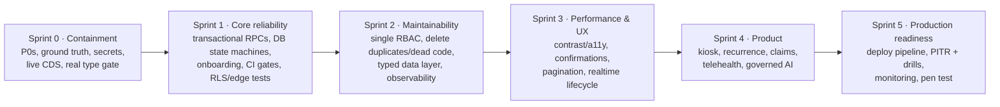

# Executive Summary: CareSync HIMS Repository Audit

> **Audit date:** 2026-11-01 · **Repository:** `CJCreator-New/care-harmony-hub` · **Commit audited:** `43ab8f7` (branch `ccr-2602d823-jeymkf`) · **Version:** 1.2.0
> **Scope:** the whole repository: the React SPA (253k lines of TypeScript), 42 Supabase edge-function entrypoints, 280 SQL files (69 top-level migrations), CI/CD, infrastructure, tests and docs.
> **Method:** line-level review by eight specialist reviewers, with lead verification of every critical claim. Executed checks: compiler, linter, unit tests, production build, dependency audit, boundary and migration validators, and a rendered UI and accessibility pass across all 7 roles at three viewports. **No source code was modified.** No production system, data or credentials were used.

## 1. Bottom line

**CareSync is not safe to operate with real patient data in its current state.**

The product has a broad, well-organized feature surface: 101 routes, 7 role dashboards, and clinical, pharmacy, lab, billing and portal workflows. It also has thoughtful *intent* in its ADRs and domain glossary. The foundational controls those ADRs describe, however, are mostly **not in effect**:

1. **Patient data is not reliably isolated between hospitals.** Any signed-up user can set their own `hospital_id` and then reads that hospital's records under the current RLS, which checks only membership, not role or account status (DB-01, DB-02). Several service-role edge functions leak or write across tenants (EDGE-01, EDGE-06, EDGE-07, EDGE-08).
2. **Clinical safety checks that were reported as fixed are not what clinicians run.** Live prescribing uses the legacy allergy and drug-interaction check, which misses "Penicillin allergy" against amoxicillin (CLIN-01). The doctor-facing NEWS2 score reads ≈0 for deteriorating patients (CLIN-08). Critical lab values never escalate (EDGE-03).
3. **The previous audit's "remediated" status does not hold.** Of the 21 remediation tickets marked resolved, **16 must be reopened**. The hardening migrations fail to apply in PostgreSQL (DB-03), and the fixes were "verified" by tests that grep for source text.
4. **The safety net is missing.**
   - The type check covers zero files, and running the real one reveals 35 errors, including runtime crashes (ARCH-01, CLIN-26).
   - Nothing protects `main`, and CI has had no successful run in its last 100 (OPS-01).
   - The E2E suite collects zero tests (TEST-01).
   - RLS has never been tested against a database (TEST-04).
5. **Irreversible data-loss paths exist in production.** A one-click "test data cleanup" in the admin dashboard deletes all of a hospital's patients, invoices and appointments (FUNC-10). A backup "restore" wipes tables across all tenants (EDGE-02). A callable function can purge the audit trail (DB-04).

The good news: none of this requires a rewrite. The Supabase-native architecture (ADR-0001) and the deep-module pattern are sound. Most fixes consist of moving authority into the database (RLS and checked RPCs), wiring the existing remediated modules into the UI, deleting the duplicates, and turning on real gates.

## 2. Findings at a glance

**229 findings were recorded. After consolidating 22 duplicates, 207 unique issues remain.**

| Severity | Count | Meaning |
|---|---|---|
| **P0 Critical** | **9** | Immediate action: PHI breach, patient-harm or irreversible data-loss risk |
| **P1 High** | **63** | Significant functional, security or reliability risk |
| P2 Medium | 89 | Meaningful quality or usability issue |
| P3 Low | 43 | Minor issue |
| P4 Informational | 3 | Observation |

| Category | P0 | P1 | P2 | P3 | P4 | Total |
|---|---|---|---|---|---|---|
| Functional | 3 | 21 | 28 | 12 | 0 | 64 |
| Security | 5 | 18 | 23 | 7 | 0 | 53 |
| Accessibility | 0 | 5 | 6 | 4 | 0 | 15 |
| Infrastructure | 0 | 4 | 5 | 4 | 0 | 13 |
| Testing | 0 | 5 | 3 | 4 | 0 | 12 |
| UI/UX | 0 | 2 | 7 | 3 | 0 | 12 |
| Technical debt | 0 | 1 | 4 | 4 | 2 | 11 |
| Architecture | 0 | 2 | 6 | 2 | 0 | 10 |
| Performance | 0 | 1 | 5 | 3 | 0 | 9 |
| Database | 1 | 4 | 2 | 0 | 0 | 7 |
| Product enhancement | 0 | 0 | 0 | 0 | 1 | 1 |

Category reflects each finding's primary nature. The database is the largest single source of security risk: 10 of the 20 database-area (DB-) issues are categorized as Security, because they concern RLS and tenant isolation. See [ISSUE_REGISTER.md](./ISSUE_REGISTER.md) for the breakdown by area.

**Confidence:** 168 Confirmed (seen in code or executed), 35 Likely (strong code evidence, deployed state unverified), 4 Suspected.

## 3. Modules audited and modules requiring attention

**Audited:**
- the 6 deep modules (`src/modules/*`);
- 19 application domains;
- all 39 deployable edge functions plus 3 nested ones;
- 232 tables and 75 SECURITY DEFINER functions across the migrations;
- 101 routes;
- 10 CI workflows;
- Docker, Kubernetes, Kong and monitoring artifacts;
- 331 test files.

**Requiring attention:**
- **All 18 runtime domains.** 11 are rated 🔴 critical: auth/2FA, RBAC, consultations, prescribing/pharmacy, billing, admin tools, AI features, observability, in-app QA tooling, edge functions, database/migrations. 7 are rated 🟠: laboratory, nursing, discharge, reception/scheduling, patient portal, telemedicine, data access.
- **4 of the 6 deep modules.** See [MODULE_AUDIT.md](./MODULE_AUDIT.md) §1.

## 4. Critical risks (the 9 P0 issues)

| ID | Risk | Confidence |
|---|---|---|
| DB-01 | Users can rewrite their own `profiles.hospital_id`, which gives any self-registered account access to another hospital's PHI | Confirmed |
| DB-02 | RLS "staff" policies check only hospital membership, so patients and deactivated staff keep hospital-wide PHI access | Confirmed |
| DB-03 | The migration chain cannot replay, and the 2026-03 to 2026-09 hardening migrations fail, so the claimed fixes are not deployed | Confirmed |
| DB-04 | Any caller can execute a SECURITY DEFINER function that deletes audit logs (its NULL-comparison guard does not stop it) | Likely (deployment unverified) |
| EDGE-01 | `fhir-integration` exports other tenants' PHI, and SMART "system" scope can be self-granted through `user_metadata` | Confirmed |
| EDGE-02 | `backup-manager` lets any hospital admin dump, and on restore wipe, tables across all tenants | Confirmed |
| EDGE-03 | The critical lab escalation ladder (5/10 minutes) is non-functional end to end | Confirmed |
| CLIN-01 | Live prescribing uses the unfixed allergy and DDI matcher. It ignores home medications and never fails closed. | Confirmed |
| FUNC-10 | The production admin "Test Data → Cleanup" deletes all of the hospital's real data, with no confirmation | Likely (RLS-dependent) |

## 5. Overall application health

| Dimension | Score (1–5) | Basis |
|---|---|---|
| Security & privacy | **1** | Tenant isolation defeatable. 2FA not enforced server-side. Secrets designed into client env vars. PHI cached on devices. |
| Clinical safety | **1** | CDS, NEWS2 display and lab escalation broken on live paths. The remediated logic is unused. |
| Data integrity & database | **1** | Schema not reproducible. State machines unenforced. Destructive paths exist. No working backup or restore. |
| Functional completeness | **2** | Broad surface. Many flows work in part, but onboarding, billing accuracy, scheduling conflicts and discharge rollback are broken, and several features are simulated. |
| Code quality & maintainability | **2** | Sound module pattern, but 41% dead code, duplicate hook trees, a vacuous type gate and 34 `@ts-nocheck` live files. |
| Testing & QA | **1** | Large test count with low assurance: tautologies, tests of dead code, source-grep "security" tests, no RLS or edge tests, 0 E2E collected. |
| DevOps & operability | **1** | No branch protection. CI permanently red. The deploy pipeline does not deploy the app. DR runbook not executable. |
| Performance | **3** | Initial payload ≈308 KB gzip with route splitting. Runtime risks (unbounded queries, polling, N+1) are unmeasured. |
| UX & accessibility | **2** | Modern UI, but it fails WCAG contrast broadly, shows backend failures as "all clear", and lacks confirmations for irreversible actions. |

**Overall: 1.6 / 5. Prototype-grade, not production-ready.** The breadth of features is ahead of the foundations they rely on.

## 6. Top 10 recommended actions

1. **Contain now.**
   - If the system holds real PHI, disable patient self-registration and these edge functions until fixed: `backup-manager`, `fhir-integration`, `telemedicine`, `workflow-automation`, `clinical-pharmacy`, `lab-automation`.
   - Remove the test-data seeder from production.
   - Revoke the audit purge function.
   (S0-05, S0-06)
2. **Establish ground truth.** Dump the live schema, regenerate the types, and rebuild a replayable migration baseline that CI resets on every PR (S0-01).
3. **Lock the tenant key and make RLS role-aware.** Make `hospital_id`, `is_active` and the role columns immutable for their owners. Separate staff, patient and inactive principals. Close the 35 tables that have no RLS (S0-03, S0-04).
4. **Put fail-closed CDS on the live prescribing path.** Route all prescribing and verification screens through `@/modules/order-safety`, load allergies and home medications, and fix the NEWS2 key mapping (S0-07).
5. **Restore critical-lab escalation.** Add an interim persistent-alert banner and phone SOP, then a `pg_cron`-driven, schema-aligned escalation worker (S0-08).
6. **Remove secrets and PHI from the browser.** No `VITE_*` secrets, no Supabase API caching in the service worker, a full purge on logout, and no hardcoded PIN (S0-09).
7. **Make 2FA real.** Adopt Supabase MFA with AAL2 enforced in RLS for privileged roles, and delete the `Math.random` hook (S0-10).
8. **Make the gates real.** A type check that covers the app (and fixing the 35 errors), the full test suite and Playwright in CI, and branch protection with required checks (S0-12, S1-07).
9. **Move multi-step workflows into transactional RPCs.** Cover consultation completion, dispensing with atomic stock, payments, adjustments, invoicing and check-in, and enforce the state machines in the database (S1-01, S1-02).
10. **Build the missing security test harness.** An RLS allow/deny matrix (7 roles × 2 tenants × every PHI table) and edge-function authorization contract tests on an ephemeral Supabase stack in CI (S1-08).

Also rotate the secrets and purge them from git history (S0-11). This is operator work, already ticketed as `.scratch` #18.

## 7. Recommended implementation sequence

Gates:
- **G0 Containment:** all P0s closed or mitigated.
- **G1 Pilot:** isolation and clinical safety proven by tests and clinician sign-off.
- **G2 Production:** checklist complete, restore drill and pen test passed.

Sprint 0 is larger than one sprint for a 3–4 person team; plan 3–5 weeks. The assumptions behind all estimates are in [IMPLEMENTATION_ROADMAP.md](./IMPLEMENTATION_ROADMAP.md) §1.

## 8. What was verified, and what could not be

**Executed** (results in [TEST_COVERAGE_AUDIT.md](./TEST_COVERAGE_AUDIT.md) §1):

| Check | Result |
|---|---|
| `npm ci` | Succeeded |
| `npm run type-check` | Passes, but checks 0 files |
| `tsc -p tsconfig.app.json` | 35 errors |
| ESLint | 0 errors, 243 warnings |
| `npm audit` | 42 advisories (1 critical, 9 high) |
| Vitest | 3,074 passed, 39 failed, 29 skipped |
| `vite build` | Succeeded, ≈308 KB gzip initial load |
| Boundary validator | Passes, but covers about 10% of `src` |
| Migration validator | Passes, but checks text patterns only |
| `playwright --list` | Collects 0 tests |
| Rendered UI | 70 axe scans across 8 public pages and 7 roles, 112 screenshots |

**Not verified:**
- **The live database and deployed edge functions.** No credentials were available. Findings that depend on them are marked Likely or Suspected. Task S0-01 resolves this.
- **End-to-end flows against a real backend.**
- **Load and performance under real data.**
- **Deno edge-function tests.** Deno is not installed.
- **The production hosting configuration (Lovable).** It is not in the repository.

## 9. Deliverables

| # | Document | Contents |
|---|---|---|
| 1 | [EXECUTIVE_SUMMARY.md](./EXECUTIVE_SUMMARY.md) | This document |
| 2 | [REPOSITORY_ARCHITECTURE.md](./REPOSITORY_ARCHITECTURE.md) | Stack and module inventory, architecture and flow diagrams, integrations, config, doc discrepancies |
| 3 | [MODULE_AUDIT.md](./MODULE_AUDIT.md) | Module health matrix, code-quality metrics, ARCH findings, target architecture |
| 4 | [FUNCTIONAL_AUDIT.md](./FUNCTIONAL_AUDIT.md) | Feature status for every module, cross-module issues, route inventory, CLIN/FUNC findings |
| 5 | [SECURITY_AUDIT.md](./SECURITY_AUDIT.md) | Threat themes, trust boundaries, lead verification, SECF/EDGE findings, edge-function inventory |
| 6 | [PERFORMANCE_AUDIT.md](./PERFORMANCE_AUDIT.md) | Measured build metrics, reliability themes, measurement plan, PERF findings |
| 7 | [UI_UX_AUDIT.md](./UI_UX_AUDIT.md) | Rendered axe results, UX and accessibility findings |
| 8 | [DATABASE_AUDIT.md](./DATABASE_AUDIT.md) | Data-flow traces, integrity and backup summary, DB findings, function timeline, ERD |
| 9 | [TEST_COVERAGE_AUDIT.md](./TEST_COVERAGE_AUDIT.md) | Commands executed, test inventory, missing coverage matrix, TEST findings |
| 10 | [ISSUE_REGISTER.md](./ISSUE_REGISTER.md) | All 207 unique issues with severity, confidence, location, effort and roadmap task |
| 11 | [ENHANCEMENT_BACKLOG.md](./ENHANCEMENT_BACKLOG.md) | 15 essential and 9 optional enhancements |
| 12 | [IMPLEMENTATION_ROADMAP.md](./IMPLEMENTATION_ROADMAP.md) | Sprints 0–5, 41 tasks, dependencies, gates, reconciliation of prior tickets |
| 13 | [TECHNICAL_DEBT_REGISTER.md](./TECHNICAL_DEBT_REGISTER.md) | 20 debt themes with interest and principal |
| 14 | [PRODUCTION_READINESS_CHECKLIST.md](./PRODUCTION_READINESS_CHECKLIST.md) | 75-item checklist (7 met), OPS findings |
| 15 | [ARCHITECTURAL_DECISIONS.md](./ARCHITECTURAL_DECISIONS.md) | Conformance review of ADR-0001 to ADR-0005, 9 proposed ADRs |

*Next step per the audit brief: review this audit and roadmap before starting implementation.*
