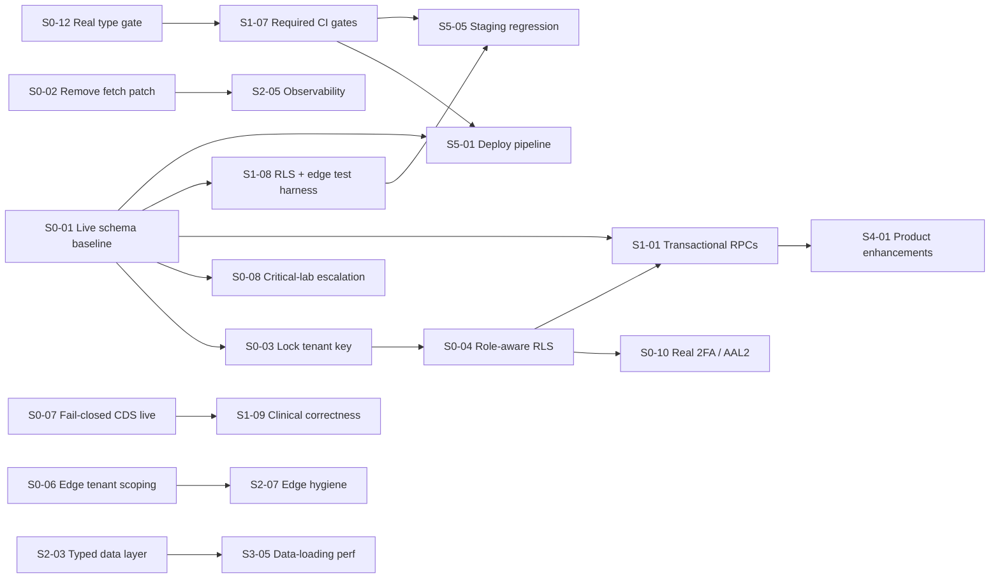

# Implementation Roadmap

> CareSync HIMS repository audit, 2026-11-01. Commit `43ab8f7`. Every task references issue IDs from [ISSUE_REGISTER.md](./ISSUE_REGISTER.md). All 207 unique issues are assigned to exactly one primary task. Duplicate IDs appear where the task that resolves them is the same.

## 1. Planning assumptions (read before using any estimate)

- **Team:** 3–4 engineers. At least one is strong in PostgreSQL/Supabase RLS, one is a senior React/TypeScript engineer, and a clinical informaticist is available for clinical acceptance. Part-time QA.
- **Sprint length:** 2 weeks. Sprints are **sequencing buckets, not calendar promises.** Sprint 0 contains more work than one sprint for this team. It is a *containment phase* that should run until its exit criteria are met. A realistic expectation is 3–5 weeks.
- **Complexity → effort:** S ≈ 1–3 engineer-days, M ≈ 4–8 engineer-days, L ≈ 2–4 engineer-weeks. These are judgment-based estimates from reading the code, not from historical velocity, which is unavailable. Re-estimate after S0-01, because the live schema state may add or remove work.
- **Environment:** A separate Supabase project for staging/test is created in Sprint 0 (S0-11). Until it exists, no task that changes RLS or migrations should be applied to production.
- **Production use:** If the system currently processes real PHI, treat Sprint 0 as incident response. Consider restricting access (for example, disabling patient self-registration and the affected edge functions) until S0-03, S0-04 and S0-05 are deployed.

## 2. Sequencing and critical path

**Critical path to a defensible go-live:**
1. S0-01 → S0-03 → S0-04 → S1-08. These prove tenant isolation.
2. In parallel: S0-07 and S0-08 (clinical safety), and S0-12 → S1-07 (quality gates).
3. Then S5-01 and S5-02 (deploy and recover).

Work that needs no schema knowledge can start on day 1 in parallel: S0-02, S0-05, S0-06, S0-07, S0-09, S0-11 and S0-12.

## 3. Release gates

| Gate | Must be true |
|---|---|
| **G0: Containment** (end of Sprint 0) | All 9 P0 issues closed or mitigated with a compensating control and a tracking ticket. Secrets rotated. Live schema captured. Type gate real. |
| **G1: Pilot readiness** (end of Sprint 1) | RLS and edge authz test matrices green in CI. Clinical safety acceptance tests (CLIN-01/02/08, EDGE-03) pass on staging and are signed off by a clinician. Transactional RPCs live for consultation, dispensing and billing. Required CI checks on `main`. |
| **G2: Production readiness** (end of Sprint 5) | Every item in [PRODUCTION_READINESS_CHECKLIST.md](./PRODUCTION_READINESS_CHECKLIST.md) checked. Restore drill passed. External penetration test with no open High findings. Zero open P0/P1. |

## 4. Reconciliation with the existing remediation tracker (`.scratch/audit-remediation`)

This audit re-tested the 21 tickets marked resolved in `.scratch/audit-remediation/map.md`. The table records what should happen to each. Following `docs/agents/issue-tracker.md`, new tickets for this roadmap belong in `.scratch/repository-audit/issues/NN-<slug>.md`. They were not created here because this audit is read-only by instruction.

| Ticket | Claimed | Audit result | Action |
|---|---|---|---|
| 01 phi-crypto oracle | resolved | **Not fixed** (EDGE-04) | Reopen → S1-09 |
| 02 allergy normalization | resolved | Fixed only in code the UI does not use (CLIN-01) | Reopen → S0-07 |
| 03 critical-lab escalation | resolved | **Not functional** (EDGE-03) | Reopen → S0-08 |
| 04 edge BOLA | resolved | Partial: 5 functions fixed; workflow-automation open, predict-deterioration regressed (EDGE-07, EDGE-13) | Reopen → S0-06 |
| 05 invoices RLS boundary | resolved | **Migration fails to apply.** Old permissive policies remain (DB-07, DB-03) | Reopen → S0-04 |
| 06 RLS active-user check | resolved | **Migration fails to apply** (DB-03) | Reopen → S0-04 |
| 07 audit-log immutability | resolved | Partial: `activity_logs` only (DB-08) | Reopen → S1-05 |
| 08 secure 2FA generation | resolved | Fix landed in the unused hook copy (ARCH-06) | Reopen → S0-10 |
| 09 purge super_admin | resolved | Holds in `src/` (0 references). However, `20260909000001:172` compares the role enum to the invalid label `'super_admin'`, which makes that migration error (part of DB-03) | Close for `src/`; fix the migration under S0-01 |
| 10 check-low-stock tenant pin | resolved | Holds | Close |
| 11 frontend DDI edge hook | resolved | Hook fixed but no screen uses it (CLIN-01) | Reopen → S0-07 |
| 12 dynamic lab age ranges | resolved | Not effective (CLIN-16) | Reopen → S1-09 |
| 13 pediatric dosing engine | resolved | Not wired. Four divergent copies (CLIN-15) | Reopen → S1-09 |
| 14 pharmacist RBAC hardening | resolved | Partial. Magic user ID; nothing in the UI calls it (SECF-08) | Reopen → S2-01 |
| 15 RBAC unification | resolved | **Not achieved.** Seven layers remain (SECF-07) | Reopen → S2-01 |
| 16 CI lint gate unmasking | resolved | Lint gate only. Other gates still neutralized; type gate vacuous (OPS-03, ARCH-01) | Reopen → S0-12, S1-07 |
| 17 discharge concurrency | resolved | Partial. The RPC trusts caller IDs; table UPDATE is open (DB-10, CLIN-11) | Reopen → S1-02 |
| 18 git secrets purge | ready-for-human | Still open (SECF-20) | → S0-11 |
| 19 "httponly cookie sessions" | resolved | Moved to sessionStorage, not HttpOnly; still XSS-readable (SECF-23) | Retitle. Track residual risk in S5-04 |
| 20 purge empty stubs | resolved | Holds | Close |
| 21 automated regression suites | resolved | Suites test unreachable code or grep source (TEST-03, TEST-08, ARCH-07) | Reopen → S1-08 |

The 7 open `.scratch/e2e-testing` tickets are subsumed by TEST-01 and S1-07.

## 5. Sprint plan and task details

### Sprint 0 — Critical stabilization (containment)

| Task | Priority | Title | Issues | Depends on | Complexity |
|---|---|---|---|---|---|
| S0-01 | P0 | Establish ground truth: dump the live schema, regenerate types, rebuild a replayable migration baseline | DB-03, DB-14, DB-21, ARCH-02 | — | L |
| S0-02 | P0 | Confirm and remove the CORS-breaking global fetch patch | PERF-01 | — | S |
| S0-03 | P0 | Lock the tenant key and onboarding paths (profiles.hospital_id, is_active, role-bearing columns) | DB-01, SECF-10, SECF-09, DB-22, SECF-11 | S0-01 | M |
| S0-04 | P0 | Make RLS role-aware: separate staff, patient and inactive principals; close tables without RLS | DB-02, DB-09, DB-13, DB-07, DB-16 | S0-01, S0-03 | L |
| S0-05 | P0 | Remove or neutralize destructive and data-exfiltrating endpoints | EDGE-02, DB-04, FUNC-10, EDGE-01, DB-11 | — | M |
| S0-06 | P0 | Tenant-scope every edge function that uses the service-role key | EDGE-06, EDGE-07, EDGE-08, EDGE-09, EDGE-13, EDGE-14, EDGE-16, EDGE-22, DB-05 | — | L |
| S0-07 | P0 | Put fail-closed clinical decision support on the live prescribing path | CLIN-01, CLIN-02, CLIN-14, ARCH-04, CLIN-08 | — | M |
| S0-08 | P0 | Restore critical-lab escalation (with an interim manual safeguard) | EDGE-03, CLIN-10, A11Y-06 | S0-01 | L |
| S0-09 | P0 | Remove secrets and PHI persistence from the browser | SECF-03, SECF-04, SECF-05, SECF-06, FUNC-33 | — | M |
| S0-10 | P0 | Make 2FA real: CSPRNG secrets, server-side AAL2 enforcement, correct TOTP encoding | ARCH-06, EDGE-05, SECF-01, SECF-02, EDGE-12, EDGE-25 | S0-04 | M |
| S0-11 | P0 | Rotate secrets, purge git history, remove shared test accounts from production | SECF-20, SECF-19, OPS-16, SECF-21, OPS-17, OPS-06 | — | M |
| S0-12 | P1 | Make the type gate real and fix the runtime defects it exposes | ARCH-01, CLIN-26, CLIN-27, CLIN-28, CLIN-29, FUNC-17 | — | M |

#### S0-01: Establish ground truth: dump the live schema, regenerate types, rebuild a replayable migration baseline

- **Status (2026-11-05): in progress, blocked on operator capture.** The replay, capture, comparison and baseline-builder tooling, the CI replay job and the runbook are merged (`supabase/baseline/README.md`). The replay confirmed DB-03 by execution (`supabase/baseline/REPLAY_FINDINGS_2026-11-05.md`). Remaining steps 1–5 need production database access. Tracked in `.scratch/repository-audit/issues/01-live-schema-baseline.md`.

- **Priority:** P0. Covers 4 issue(s), of which 1 are P0 and 2 are P1.
- **Related issues:** DB-03, DB-14, DB-21, ARCH-02
- **Dependencies:** none
- **Estimated complexity:** L (≈2–4 engineer-weeks)
- **Implementation approach:** Run `supabase db dump --schema public` (plus `auth`/`storage` policies) against production read-only. Diff the dump against the migrations (`migra` or `supabase db diff`). Write one squashed baseline migration that reproduces production exactly, and move the old files to `supabase/migrations/_archive`. Regenerate `types.ts` from the live schema. Add CI job `supabase db reset` on an ephemeral stack. List every table, RPC and policy the frontend references but production lacks (feeds S1/S2).
- **Definition of Done:** `supabase db reset` succeeds locally and in CI from an empty database. The regenerated `types.ts` matches production. A drift report is committed.
- **Validation method:** CI job green; `supabase db diff` against production is empty.

#### S0-02: Confirm and remove the CORS-breaking global fetch patch

- **Priority:** P0. Covers 1 issue(s), of which 0 are P0 and 1 are P1.
- **Related issues:** PERF-01
- **Dependencies:** none
- **Estimated complexity:** S (≈1–3 engineer-days)
- **Implementation approach:** In a browser against staging, invoke any edge function and inspect the preflight. Remove `registerFetchInterceptor()` from bootstrap. If correlation IDs are still required, use the OpenTelemetry fetch instrumentation with `propagateTraceHeaderCorsUrls` restricted to first-party origins and add the header to `_shared/cors.ts`.
- **Definition of Done:** No global `window.fetch` reassignment in `src/`. Edge functions return 200 from the browser.
- **Validation method:** Playwright smoke test invokes one edge function from a real browser.

#### S0-03: Lock the tenant key and onboarding paths (profiles.hospital_id, is_active, role-bearing columns)

- **Priority:** P0. Covers 5 issue(s), of which 1 are P0 and 1 are P1.
- **Related issues:** DB-01, SECF-10, SECF-09, DB-22, SECF-11
- **Dependencies:** S0-01
- **Estimated complexity:** M (≈4–8 engineer-days)
- **Implementation approach:** Replace the profile UPDATE policy with `USING (user_id = auth.uid()) WITH CHECK (user_id = auth.uid())`. Add a BEFORE UPDATE trigger that rejects changes to `hospital_id`, `is_active`, `is_staff`, 2FA and lockout columns unless the caller is service_role or an admin of the same hospital via RPC. Restrict INSERT to server-side registration and invitation RPCs. Gate `/hospital/role-setup` to admin. Drop the plaintext security answer columns.
- **Definition of Done:** An authenticated user cannot change their own `hospital_id` by REST, and patient self-registration cannot pick a hospital.
- **Validation method:** RLS test (S1-08) runs as patient and as staff of tenant A and tries to switch to tenant B: both are denied.

#### S0-04: Make RLS role-aware: separate staff, patient and inactive principals; close tables without RLS

- **Priority:** P0. Covers 5 issue(s), of which 1 are P0 and 3 are P1.
- **Related issues:** DB-02, DB-09, DB-13, DB-07, DB-16
- **Dependencies:** S0-01, S0-03
- **Estimated complexity:** L (≈2–4 engineer-weeks)
- **Implementation approach:** Introduce `is_active_staff_of(hospital_id)` and `is_patient_self(patient_id)` helpers (STABLE, SECURITY DEFINER, `SET search_path`, created with DROP+CREATE, not CREATE OR REPLACE). Rewrite the PHI table policies per role (receptionist/admin-only invoices per ADR-0002). Enable RLS on the 35 open tables, and add explicit policies to the 4 tables that have RLS but no policy. Replace broad `FOR ALL` policies with per-command policies.
- **Definition of Done:** Every table in `public` has RLS enabled with explicit policies. Patients and deactivated staff have no hospital-wide PHI access.
- **Validation method:** pgTAP/Vitest RLS matrix (7 roles × 2 tenants × PHI tables) passes in CI.

#### S0-05: Remove or neutralize destructive and data-exfiltrating endpoints

- **Priority:** P0. Covers 5 issue(s), of which 4 are P0 and 1 are P1.
- **Related issues:** EDGE-02, DB-04, FUNC-10, EDGE-01, DB-11
- **Dependencies:** none
- **Estimated complexity:** M (≈4–8 engineer-days)
- **Implementation approach:** Undeploy `backup-manager` (rely on Supabase PITR, see S5-02). `REVOKE EXECUTE` on `purge_old_audit_logs_staging_only` FROM PUBLIC and drop it in production. Remove `TestDataSeederCard` and `testDataSeeder` from production builds (DEV-only route). In `fhir-integration`, ignore `user_metadata` scopes, call `enforceHospitalAccess` in every export, and limit `system/*` to service tokens. Add a migration review rule: no data-mutating DML on PHI in migrations without sign-off.
- **Definition of Done:** None of these operations is reachable by a tenant user in production.
- **Validation method:** Negative tests per endpoint (403). `grep` shows no seeder in the prod bundle.

#### S0-06: Tenant-scope every edge function that uses the service-role key

- **Priority:** P0. Covers 9 issue(s), of which 0 are P0 and 5 are P1.
- **Related issues:** EDGE-06, EDGE-07, EDGE-08, EDGE-09, EDGE-13, EDGE-14, EDGE-16, EDGE-22, DB-05
- **Dependencies:** none
- **Estimated complexity:** L (≈2–4 engineer-weeks)
- **Implementation approach:** Create one `_shared/actor.ts` that derives the user, active roles and hospital from the JWT and the database (never from the body) and fails closed when the hospital is null. Every query on the service-role client must add `.eq('hospital_id', actor.hospitalId)` or call an RLS-respecting client created with the user's JWT, which is preferable. Audit the SECURITY DEFINER RPCs that accept tenant, patient or actor IDs and verify the caller inside each.
- **Definition of Done:** No edge function reads identity or tenant from the request body. Each has a cross-tenant negative test.
- **Validation method:** Deno contract tests (S1-08) with two tenants.

#### S0-07: Put fail-closed clinical decision support on the live prescribing path

- **Status (2026-11-05): code complete on branch `ccr-2602d823-jeymkf`, not merged to `main`.** Prescriber (consultation, quick consultation) and pharmacist screens use `@/modules/order-safety`; load/decrypt failures force a documented override; overrides persisted in `prescriptions.allergy_alerts`/`drug_interactions`; NEWS2 adapter and intake write-through landed; `usePrescriptionSafety` deleted. No migration. Remaining: the Playwright staging smoke test, and the follow-ups in `.scratch/repository-audit/issues/02-fail-closed-cds.md`.
- **Priority:** P0. Covers 5 issue(s), of which 1 are P0 and 3 are P1.
- **Related issues:** CLIN-01, CLIN-02, CLIN-14, ARCH-04, CLIN-08
- **Dependencies:** none
- **Estimated complexity:** M (≈4–8 engineer-days)
- **Implementation approach:** Route TreatmentPlanStep, QuickConsultationModal and PrescriptionApprovalModal through `@/modules/order-safety` (`useOrderSafety`). Add `allergies` and `current_medications` to the patient column presets and the pharmacist query. Make intake allergies write to `patients.allergies`. Persist override reason and actor. Map consultation vitals snake_case → camelCase before `evaluateVitalSigns`. Delete `usePrescriptionSafety`.
- **Definition of Done:** "Penicillin allergy", "PCN" and "penicillins" block amoxicillin at the prescriber and pharmacist steps. An edge outage forces a documented override. The doctor's NEWS2 equals the nurse's for the same vitals.
- **Validation method:** Component tests through the live import path plus a Playwright clinical smoke test on staging.

#### S0-08: Restore critical-lab escalation (with an interim manual safeguard)

- **Status (2026-11-05): interim safeguard live on branch; server fix written, not applied.** The persistent acknowledgment-required banner, telephone SOP (`docs/operations/CRITICAL_RESULT_ESCALATION_SOP.md`) and A11Y-06 fixes are on `ccr-2602d823-jeymkf`. The `critical-lab-check` rewrite, the lab call site and an idempotent migration are written; the migration is staged in `supabase/pending-migrations/` until S0-01. Remaining: apply the migration, set secrets, schedule pg_cron, fill the on-call rota, connect a BAA pager provider, and run the staging drill. Tracked in `.scratch/repository-audit/issues/03-critical-lab-escalation.md`.
- **Priority:** P0. Covers 3 issue(s), of which 1 are P0 and 2 are P1.
- **Related issues:** EDGE-03, CLIN-10, A11Y-06
- **Dependencies:** S0-01
- **Estimated complexity:** L (≈2–4 engineer-weeks)
- **Implementation approach:** Interim (day 1): a persistent, acknowledgment-required critical alert banner with `role=alert` on doctor and lab dashboards, plus a written phone-escalation SOP. Fix: align `critical-lab-check` with the reconciled schema, create `on_call_schedule`, and add a `pg_cron` job every minute that calls a service-authenticated escalation worker (not a user JWT). Implement SMS/pager via a provider with a BAA. Add an ack endpoint.
- **Definition of Done:** An unacknowledged critical result escalates to on-call at 5 minutes and to ED at 10 minutes in staging, with audit rows.
- **Validation method:** Integration test that advances time (or uses a short interval) and asserts notification rows; manual drill.

#### S0-09: Remove secrets and PHI persistence from the browser

- **Status (2026-11-05): code complete on branch `ccr-2602d823-jeymkf`, not merged to `main`.** Provider keys removed from the browser and a CI source + canary-bundle scan added (SECF-03); Supabase responses no longer cached by the service worker, old caches deleted on start (SECF-04); one `purgeClientState()` on logout, idle logoff and SIGNED_OUT with a local sign-out fallback (SECF-05); nurse offline data moved to an AES-GCM-encrypted IndexedDB store wiped on logout, plaintext export/import removed (SECF-06); invoice adjustment UI and PIN removed until S1-01 (FUNC-33). Remaining: rotate any provider keys ever set in the Lovable build env; live checks listed in `.scratch/repository-audit/issues/04-browser-secrets-and-phi.md`.
- **Priority:** P0. Covers 5 issue(s), of which 0 are P0 and 3 are P1.
- **Related issues:** SECF-03, SECF-04, SECF-05, SECF-06, FUNC-33
- **Dependencies:** none
- **Estimated complexity:** M (≈4–8 engineer-days)
- **Implementation approach:** Delete client-side OpenAI/Anthropic/Twilio usage, and proxy through edge functions with server-held keys. Remove Supabase `runtimeCaching` from the Workbox config. On logout, call `queryClient.clear()`, `caches.delete` and the IndexedDB/localStorage purge. Encrypt or remove offline nurse data in localStorage. Hide the invoice adjustment UI until S1-01 delivers the RPC, and delete the hardcoded PIN.
- **Definition of Done:** The prod bundle contains no `VITE_*_KEY`/`AUTH_TOKEN` reads. After logout, no PHI remains in Cache Storage, localStorage or IndexedDB.
- **Validation method:** Bundle grep in CI. Playwright test inspects storage after logout.

#### S0-10: Make 2FA real: CSPRNG secrets, server-side AAL2 enforcement, correct TOTP encoding

- **Priority:** P0. Covers 6 issue(s), of which 0 are P0 and 4 are P1.
- **Related issues:** ARCH-06, EDGE-05, SECF-01, SECF-02, EDGE-12, EDGE-25
- **Dependencies:** S0-04
- **Estimated complexity:** M (≈4–8 engineer-days)
- **Implementation approach:** Adopt Supabase Auth MFA (TOTP factors) instead of the custom tables. Require `aal2` in RLS for privileged roles (`(auth.jwt()->>'aal') = 'aal2'`). Add a 2FA check to `RoleProtectedRoute`. Make backup codes single-use atomically. Delete the duplicate `Math.random` hook.
- **Definition of Done:** An admin or doctor session at AAL1 cannot read PHI through REST, and 2FA enrollment requires a verified code.
- **Validation method:** RLS tests with AAL1 vs AAL2 JWTs, plus a TOTP RFC 6238 vector test.

#### S0-11: Rotate secrets, purge git history, remove shared test accounts from production

- **Priority:** P0. Covers 6 issue(s), of which 0 are P0 and 1 are P1.
- **Related issues:** SECF-20, SECF-19, OPS-16, SECF-21, OPS-17, OPS-06
- **Dependencies:** none
- **Estimated complexity:** M (≈4–8 engineer-days)
- **Implementation approach:** Execute `.scratch/audit-remediation/issues/18` (git filter-repo) after rotating the anon key, API keys, Kong/Loggly tokens and the former encryption key, and re-encrypt where needed. Delete shared E2E accounts from production and create a separate Supabase project for test/staging. Replace literals in compose/kong with env substitution. Enable GitHub secret scanning and push protection.
- **Definition of Done:** Rotated keys deployed. History purged. No literal credentials in `git grep`. Production has no shared test users.
- **Validation method:** gitleaks run in CI is clean. Auth user audit.

#### S0-12: Make the type gate real and fix the runtime defects it exposes

- **Priority:** P1. Covers 6 issue(s), of which 0 are P0 and 4 are P1.
- **Related issues:** ARCH-01, CLIN-26, CLIN-27, CLIN-28, CLIN-29, FUNC-17
- **Dependencies:** none
- **Estimated complexity:** M (≈4–8 engineer-days)
- **Implementation approach:** Change the `type-check` script to `tsc -p tsconfig.app.json --noEmit && tsc -p tsconfig.node.json --noEmit`. Fix the 35 errors, starting with the `queryClient` ReferenceError, the actor derivation via a typed `useClinicalActor()`, the discharge modal accessor, the eMAR shortcut props and the `usePermissions().hasPermission` crash. Shrink the `tsconfig.app.json` exclude list.
- **Definition of Done:** `npm run type-check` checks more than 900 files and exits 0 in CI.
- **Validation method:** CI required check. A deliberate type error fails the PR.

### Sprint 1 — Core reliability

| Task | Priority | Title | Issues | Depends on | Complexity |
|---|---|---|---|---|---|
| S1-01 | P1 | Move multi-step clinical and financial workflows into transactional RPCs | CLIN-07, CLIN-19, FUNC-25, CLIN-04, CLIN-03, ARCH-05, FUNC-05, FUNC-06, FUNC-07, FUNC-08, FUNC-16, FUNC-33 | S0-01, S0-04 | L |
| S1-02 | P1 | Enforce the prescription and discharge state machines in the database | DB-10, CLIN-11, CLIN-17, CLIN-20 | S0-01 | M |
| S1-03 | P1 | Repair onboarding: hospital signup, patient registration, invitations, staff directory | FUNC-03, DB-15, FUNC-01, FUNC-04, FUNC-21, EDGE-23, EDGE-24 | S0-03 | M |
| S1-04 | P1 | Scheduling correctness | FUNC-12, FUNC-13, FUNC-14, FUNC-15, CLIN-25 | S0-01 | M |
| S1-05 | P1 | Restore audit-trail integrity | DB-08, EDGE-09, DB-06 | S0-04 | M |
| S1-06 | P1 | Never show failed data as "all clear" on clinical dashboards | UX-01, UX-13 | — | S |
| S1-07 | P1 | Make CI gates real and required | OPS-01, OPS-03, SECF-27, OPS-02, TEST-01, TEST-02, TEST-10, OPS-19, OPS-11 | S0-12 | M |
| S1-08 | P1 | Build the missing security test harness: RLS matrix and edge-function authz contracts | TEST-04, TEST-05, EDGE-28, TEST-08 | S0-01 | L |
| S1-09 | P1 | Clinical data correctness fixes | CLIN-05, EDGE-04, CLIN-06, CLIN-09, CLIN-12, CLIN-13, CLIN-15, EDGE-19, CLIN-16, CLIN-21 | S0-07 | L |

#### S1-01: Move multi-step clinical and financial workflows into transactional RPCs

- **Priority:** P1. Covers 12 issue(s), of which 0 are P0 and 8 are P1.
- **Related issues:** CLIN-07, CLIN-19, FUNC-25, CLIN-04, CLIN-03, ARCH-05, FUNC-05, FUNC-06, FUNC-07, FUNC-08, FUNC-16, FUNC-33
- **Dependencies:** S0-01, S0-04
- **Estimated complexity:** L (≈2–4 engineer-weeks)
- **Implementation approach:** Implement `complete_consultation`, `dispense_prescription` (with `UPDATE ... SET current_stock = current_stock - qty WHERE current_stock >= qty`), `record_payment`, `adjust_invoice`, `create_invoice` (sequence-based numbering, unique constraint) and `check_in_patient` as SECURITY DEFINER plpgsql functions with explicit role checks, idempotency keys and audit inserts in the same transaction. Replace the client sagas.
- **Definition of Done:** Each workflow is one RPC call and either fully succeeds or leaves no partial rows.
- **Validation method:** Integration tests inject failure mid-way and assert rollback. Concurrency test on stock and payments.

#### S1-02: Enforce the prescription and discharge state machines in the database

- **Priority:** P1. Covers 4 issue(s), of which 0 are P0 and 2 are P1.
- **Related issues:** DB-10, CLIN-11, CLIN-17, CLIN-20
- **Dependencies:** S0-01
- **Estimated complexity:** M (≈4–8 engineer-days)
- **Implementation approach:** Add CHECK constraints for the status enums and a BEFORE UPDATE trigger that allows only the ADR-0003/0004 transitions for the caller's role (pharmacist-only approve, sequential discharge with rollback). Fix the rejection/resubmission and AMA paths, the specimen rejection status and the amendment RPC signature.
- **Definition of Done:** Illegal transitions fail at the database even with direct REST calls.
- **Validation method:** pgTAP transition matrix tests.

#### S1-03: Repair onboarding: hospital signup, patient registration, invitations, staff directory

- **Priority:** P1. Covers 7 issue(s), of which 0 are P0 and 4 are P1.
- **Related issues:** FUNC-03, DB-15, FUNC-01, FUNC-04, FUNC-21, EDGE-23, EDGE-24
- **Dependencies:** S0-03
- **Estimated complexity:** M (≈4–8 engineer-days)
- **Implementation approach:** Fix the stale closure in `createHospitalAndProfile`, and implement `register_patient` against the reconciled schema. Send invitation emails through `send-email` with signed, expiring tokens, and return `valid:false` for bad tokens. Set `is_staff` in the invitation acceptance RPC. Provide a supervised tenant-provisioning path (platform admin).
- **Definition of Done:** New-hospital, invite-staff and patient-signup journeys complete end to end on staging.
- **Validation method:** Playwright journeys against the staging stack.

#### S1-04: Scheduling correctness

- **Priority:** P1. Covers 5 issue(s), of which 0 are P0 and 2 are P1.
- **Related issues:** FUNC-12, FUNC-13, FUNC-14, FUNC-15, CLIN-25
- **Dependencies:** S0-01
- **Estimated complexity:** M (≈4–8 engineer-days)
- **Implementation approach:** Add an exclusion constraint on `(doctor_id, tstzrange(start,end))` for active appointments. Make appointment-request approval create the appointment in an RPC. Use hospital-timezone-aware date handling (`date-fns-tz`) for slots and "today". Correct the no-show semantics, add reschedule, and confirm cancellation.
- **Definition of Done:** Double booking is rejected by the database, and slots render the correct weekday in UTC−8 and UTC+5:30.
- **Validation method:** Unit tests with TZ matrix plus a DB constraint test.

#### S1-05: Restore audit-trail integrity

- **Priority:** P1. Covers 3 issue(s), of which 0 are P0 and 2 are P1.
- **Related issues:** DB-08, EDGE-09, DB-06
- **Dependencies:** S0-04
- **Estimated complexity:** M (≈4–8 engineer-days)
- **Implementation approach:** Make audit writes server-only (triggers on PHI tables plus a SECURITY DEFINER `log_event` with an actor taken from `auth.uid()`). Remove `WITH CHECK (true)` inserts. Apply the immutability trigger to `audit_logs` and its partitions with RLS. Scope admin reads to their hospital. Add `SET search_path` to all SECURITY DEFINER functions.
- **Definition of Done:** No client can insert arbitrary audit rows, and no one can update or delete them.
- **Validation method:** pgTAP tests plus forged-event negative tests on the edge function.

#### S1-06: Never show failed data as "all clear" on clinical dashboards

- **Priority:** P1. Covers 2 issue(s), of which 0 are P0 and 1 are P1.
- **Related issues:** UX-01, UX-13
- **Dependencies:** none
- **Estimated complexity:** S (≈1–3 engineer-days)
- **Implementation approach:** Introduce `<QueryBoundary>` rendering explicit error/empty/loading states, and adopt it on every dashboard stat and queue. Error copy names the failed data and offers Retry.
- **Definition of Done:** With the backend blocked, no dashboard shows 0 or an all-clear message.
- **Validation method:** Playwright test with network blocked, plus screenshot review.

#### S1-07: Make CI gates real and required

- **Priority:** P1. Covers 9 issue(s), of which 0 are P0 and 5 are P1.
- **Related issues:** OPS-01, OPS-03, SECF-27, OPS-02, TEST-01, TEST-02, TEST-10, OPS-19, OPS-11
- **Dependencies:** S0-12
- **Estimated complexity:** M (≈4–8 engineer-days)
- **Implementation approach:** Add a branch ruleset on `main` with required checks: type-check, full `vitest run`, lint, `npm audit --omit=dev --audit-level=high`, build, Playwright smoke and the RLS suite. Delete retired and duplicate workflows. Remove `continue-on-error` and `|| true`. Fix the Playwright fixtures. Fix or quarantine the 39 failing tests with owners.
- **Definition of Done:** PRs cannot merge red, and `main` is green.
- **Validation method:** Branch protection settings plus a test PR that breaks each gate.

#### S1-08: Build the missing security test harness: RLS matrix and edge-function authz contracts

- **Priority:** P1. Covers 4 issue(s), of which 0 are P0 and 1 are P1.
- **Related issues:** TEST-04, TEST-05, EDGE-28, TEST-08
- **Dependencies:** S0-01
- **Estimated complexity:** L (≈2–4 engineer-weeks)
- **Implementation approach:** Run `supabase start` in CI and seed 2 hospitals × 7 roles. Generate a table-by-role allow/deny matrix from policy metadata and assert it with real JWTs. Add `deno test` suites per edge function covering missing JWT, wrong role, wrong tenant and body-spoofed IDs. Retire the source-grep tests.
- **Definition of Done:** The matrix covers every PHI table and every edge function, runs on each PR, and fails on regression.
- **Validation method:** Mutation check: loosen one policy and the CI suite fails.

#### S1-09: Clinical data correctness fixes

- **Priority:** P1. Covers 10 issue(s), of which 0 are P0 and 3 are P1.
- **Related issues:** CLIN-05, EDGE-04, CLIN-06, CLIN-09, CLIN-12, CLIN-13, CLIN-15, EDGE-19, CLIN-16, CLIN-21
- **Dependencies:** S0-07
- **Estimated complexity:** L (≈2–4 engineer-weeks)
- **Implementation approach:** Decide the field-encryption model (column-level `pgsodium`/Vault, or app-level with AAD bound to `resource_id` and per-tenant keys), then fix the round-trip and the oracle. Make autosave a debounced patch that never overwrites dirty fields. Use canonical SI units with labelled conversions. Add ACVPU/O2 inputs and SpO2 Scale 2 to NEWS2. Add an eMAR schedule and double-dose guard and remove the scan simulator. Consolidate pediatric dosing into one engine with max-dose caps and correct frequencies. Use age- and sex-aware reference ranges. Persist telehealth notes.
- **Definition of Done:** Each item has an acceptance test from its finding, passing through the live UI path.
- **Validation method:** Component and integration tests plus a clinician UAT script.

### Sprint 2 — Architecture & maintainability

| Task | Priority | Title | Issues | Depends on | Complexity |
|---|---|---|---|---|---|
| S2-01 | P2 | One RBAC source of truth | SECF-07, SECF-08, ARCH-08, FUNC-20 | S0-04 | M |
| S2-02 | P2 | Delete duplicates, dead code and in-app QA tooling | ARCH-06, ARCH-07, FUNC-31, ARCH-14, SECF-22, UX-15, SECF-16, ARCH-15, ARCH-13 | S0-12, S1-07 | M |
| S2-03 | P2 | Typed data-access layer | ARCH-02, ARCH-03, ARCH-12, CLIN-24, EDGE-20 | S0-01, S0-12 | L |
| S2-04 | P2 | Decompose god components and break dependency cycles | ARCH-09, ARCH-11 | S2-03 | L |
| S2-05 | P2 | Consolidate observability with PHI-safe telemetry | PERF-12, SECF-12, EDGE-21, EDGE-17 | S0-02 | M |
| S2-06 | P2 | Archive non-runtime infrastructure per ADR-0001 | ARCH-16, OPS-05, DB-19, SECF-19, OPS-06 | — | S |
| S2-07 | P2 | Edge-function platform hygiene | EDGE-11, EDGE-15, EDGE-18, EDGE-26, EDGE-27, EDGE-29, EDGE-10, EDGE-17 | S0-06 | M |
| S2-08 | P2 | Database integrity, retention and performance hygiene | DB-12, DB-20, DB-17, SECF-24 | S0-04 | M |

#### S2-01: One RBAC source of truth

- **Priority:** P2. Covers 4 issue(s), of which 0 are P0 and 0 are P1.
- **Related issues:** SECF-07, SECF-08, ARCH-08, FUNC-20
- **Dependencies:** S0-04
- **Estimated complexity:** M (≈4–8 engineer-days)
- **Implementation approach:** Store the permission matrix in a `role_permissions` table, consumed by RLS helpers. Generate `src/types/rbac.ts` from it. Delete the 7 `*RBACManager`, `abacManager` and the `lib/permissions.ts` divergences. Align the route manifest, guards and sidebar.
- **Definition of Done:** A single matrix, with zero divergences between UI guards and DB policies in a parity test.
- **Validation method:** Generated parity test in CI.

#### S2-02: Delete duplicates, dead code and in-app QA tooling

- **Priority:** P2. Covers 9 issue(s), of which 0 are P0 and 1 are P1.
- **Related issues:** ARCH-06, ARCH-07, FUNC-31, ARCH-14, SECF-22, UX-15, SECF-16, ARCH-15, ARCH-13
- **Dependencies:** S0-12, S1-07
- **Estimated complexity:** M (≈4–8 engineer-days)
- **Implementation approach:** Remove the `src/hooks` twins (keep one tree), the 377 unreachable files (start with zero-importer files), the tests that exercise only dead code, `TestingProvider`, `/testing` and the codeReviewer UI from production, and the mock-auth branches (keep them in a test-only entry). Move test libraries to devDependencies, drop the unused SDKs and keep one lockfile.
- **Definition of Done:** The dead-file count is under 5% of `src`. The production bundle contains no mock/test code.
- **Validation method:** Reachability script in CI (fails on growth). Bundle grep.

#### S2-03: Typed data-access layer

- **Priority:** P2. Covers 5 issue(s), of which 0 are P0 and 1 are P1.
- **Related issues:** ARCH-02, ARCH-03, ARCH-12, CLIN-24, EDGE-20
- **Dependencies:** S0-01, S0-12
- **Estimated complexity:** L (≈2–4 engineer-weeks)
- **Implementation approach:** Remove the `query-helper` path remap and type the client with the regenerated `Database`. Introduce per-domain repositories (`src/data/<domain>.ts`) used by hooks only. Remove `@ts-nocheck` from the 34 live files, clinical paths first. Generate an edge-function client from a shared contract (zod schemas) to stop name and payload drift.
- **Definition of Done:** No live file has `@ts-nocheck`. UI components do not import the Supabase client.
- **Validation method:** ESLint `no-restricted-imports` rule plus the type-check gate.

#### S2-04: Decompose god components and break dependency cycles

- **Priority:** P2. Covers 2 issue(s), of which 0 are P0 and 0 are P1.
- **Related issues:** ARCH-09, ARCH-11
- **Dependencies:** S2-03
- **Estimated complexity:** L (≈2–4 engineer-weeks)
- **Implementation approach:** Split ConsultationWorkflowPage, LaboratoryPage, BillingPage, AuthContext and the AI providers into container plus presentational parts and domain hooks. Remove the `lib/hooks/auth` barrel cycle. Extend dependency-cruiser to all of `src` with no-circular.
- **Definition of Done:** No live file over 600 lines without a waiver, and 0 cycles.
- **Validation method:** depcruise in CI over `src`.

#### S2-05: Consolidate observability with PHI-safe telemetry

- **Priority:** P2. Covers 4 issue(s), of which 0 are P0 and 0 are P1.
- **Related issues:** PERF-12, SECF-12, EDGE-21, EDGE-17
- **Dependencies:** S0-02
- **Estimated complexity:** M (≈4–8 engineer-days)
- **Implementation approach:** One Sentry init with `sendDefaultPii:false`, a `beforeSend` scrubber for email, `extra` and URL query, and Replay masking. Remove the duplicate logger stacks and the non-existent `/api/logs`. Emit structured logs from edge functions with PHI redaction (use the `_shared/sanitizeLog.ts` that already exists). Upload hidden sourcemaps.
- **Definition of Done:** A single telemetry entry point. A PHI canary string never appears in Sentry or logs.
- **Validation method:** Canary test in staging.

#### S2-06: Archive non-runtime infrastructure per ADR-0001

- **Priority:** P2. Covers 5 issue(s), of which 0 are P0 and 0 are P1.
- **Related issues:** ARCH-16, OPS-05, DB-19, SECF-19, OPS-06
- **Dependencies:** none
- **Estimated complexity:** S (≈1–3 engineer-days)
- **Implementation approach:** Move `services/`, `kong.yml`, compose files, k8s manifests and `mobile-app` to an `archive/` branch or a separate repository. Fix or delete the Dockerfile depending on the chosen hosting (S5-01). Fix the README links.
- **Definition of Done:** The repository contains only runtime code, or clearly labelled archived code with no credentials.
- **Validation method:** `git grep` for kong/compose credentials returns nothing. The README link checker passes.

#### S2-07: Edge-function platform hygiene

- **Priority:** P2. Covers 8 issue(s), of which 0 are P0 and 1 are P1.
- **Related issues:** EDGE-11, EDGE-15, EDGE-18, EDGE-26, EDGE-27, EDGE-29, EDGE-10, EDGE-17
- **Dependencies:** S0-06
- **Estimated complexity:** M (≈4–8 engineer-days)
- **Implementation approach:** Use a database-backed or Upstash rate limiter keyed by user ID, fixing the `{limit}` typo. Move platform jobs to service-role cron-only. Fix the boot failures in `ai-clinical-support` and `predict-deterioration`. Pin all imports via `deno.json`. Use an explicit production CORS allow-list. Replace the retired RxNav API. Stop persisting mock insurance adjudications.
- **Definition of Done:** All functions deploy and boot. Imports are pinned. A rate limit test passes.
- **Validation method:** Deno tests plus a deploy dry-run in CI.

#### S2-08: Database integrity, retention and performance hygiene

- **Priority:** P2. Covers 4 issue(s), of which 0 are P0 and 0 are P1.
- **Related issues:** DB-12, DB-20, DB-17, SECF-24
- **Dependencies:** S0-04
- **Estimated complexity:** M (≈4–8 engineer-days)
- **Implementation approach:** Replace destructive cascades with RESTRICT plus soft delete (`deleted_at`) on PHI tables. Fix the visit uniqueness constraint. Wrap `auth.uid()` as `(select auth.uid())` in policies, mark helpers STABLE and add the missing indexes on `hospital_id`/`patient_id`/`status`/`created_at`. Add storage bucket policies scoped by the `hospital_id/` path prefix and role.
- **Definition of Done:** There are no PHI hard-delete paths, and storage objects are tenant-scoped.
- **Validation method:** EXPLAIN plans for the top queries and storage RLS tests.

### Sprint 3 — Performance, UX & accessibility

| Task | Priority | Title | Issues | Depends on | Complexity |
|---|---|---|---|---|---|
| S3-01 | P2 | Accessible design tokens and a consistent design system | A11Y-01, A11Y-02, A11Y-13, UX-08, UX-04, A11Y-11 | — | M |
| S3-02 | P2 | Accessibility semantics and keyboard support | A11Y-03, A11Y-04, A11Y-05, A11Y-07, A11Y-08, A11Y-09, A11Y-10, A11Y-12, A11Y-14, A11Y-15, A11Y-16, TEST-07 | S3-01 | M |
| S3-03 | P2 | Safe interaction patterns for irreversible actions | UX-02, UX-03, UX-11, UX-05, UX-06, UX-09 | — | S |
| S3-04 | P2 | Responsive and form consistency | UX-07, UX-10, UX-12, FUNC-29, FUNC-19 | S3-01 | M |
| S3-05 | P2 | Data-loading performance and realtime lifecycle | PERF-07, FUNC-28, PERF-08, PERF-09, PERF-10, PERF-13, PERF-04, PERF-11 | S2-03 | L |

#### S3-01: Accessible design tokens and a consistent design system

- **Priority:** P2. Covers 6 issue(s), of which 0 are P0 and 2 are P1.
- **Related issues:** A11Y-01, A11Y-02, A11Y-13, UX-08, UX-04, A11Y-11
- **Dependencies:** none
- **Estimated complexity:** M (≈4–8 engineer-days)
- **Implementation approach:** Recalculate `--primary` and the status tokens to at least 4.5:1 (3:1 for large text and UI). Keep a single `--primary` definition. Codemod hard-coded palette classes to semantic tokens. Give the active nav state a distinct style. Give the hero text a solid background.
- **Definition of Done:** axe color-contrast passes on all audited routes in light and dark mode.
- **Validation method:** Playwright axe suite (S3-02).

#### S3-02: Accessibility semantics and keyboard support

- **Priority:** P2. Covers 12 issue(s), of which 0 are P0 and 2 are P1.
- **Related issues:** A11Y-03, A11Y-04, A11Y-05, A11Y-07, A11Y-08, A11Y-09, A11Y-10, A11Y-12, A11Y-14, A11Y-15, A11Y-16, TEST-07
- **Dependencies:** S3-01
- **Estimated complexity:** M (≈4–8 engineer-days)
- **Implementation approach:** Fix `FormControl` usage (no wrapper div, no id override). Make the off-canvas nav `inert` when closed and manage focus. Flatten link and button nesting. Add names to icon buttons. Convert clickable divs to buttons. Use Radix Dialog for custom modals. Add landmarks and a skip link, focusable scroll regions and `prefers-reduced-motion`. Replace the fixture a11y tests with a Playwright axe suite over real routes.
- **Definition of Done:** Zero critical or serious axe violations on the 30 audited route and viewport pairs, and the keyboard-only journey passes.
- **Validation method:** CI axe suite plus a manual NVDA/VoiceOver pass on login, prescribing and critical alert.

#### S3-03: Safe interaction patterns for irreversible actions

- **Priority:** P2. Covers 6 issue(s), of which 0 are P0 and 1 are P1.
- **Related issues:** UX-02, UX-03, UX-11, UX-05, UX-06, UX-09
- **Dependencies:** none
- **Estimated complexity:** S (≈1–3 engineer-days)
- **Implementation approach:** A shared `ConfirmDestructiveAction` with a required reason for cancel, discharge, dispense, delete and refund. Wire up or remove the dead calendar buttons. A session-timeout modal with countdown and draft preservation. Human-readable auth errors. One toast system. Fix the placeholder encoding.
- **Definition of Done:** Every irreversible action has a confirmation and an audit reason.
- **Validation method:** Playwright journey checks.

#### S3-04: Responsive and form consistency

- **Priority:** P2. Covers 5 issue(s), of which 0 are P0 and 0 are P1.
- **Related issues:** UX-07, UX-10, UX-12, FUNC-29, FUNC-19
- **Dependencies:** S3-01
- **Estimated complexity:** M (≈4–8 engineer-days)
- **Implementation approach:** Fix the 390 px overflow with responsive tables (card view) and wrapping. Migrate forms to react-hook-form + zod with a shared `FormField` (required marker, inline errors). Use `Intl` formatting with hospital locale and currency settings. Resolve orphan routes and broken links.
- **Definition of Done:** No horizontal overflow at 390 px on audited routes. One currency per hospital.
- **Validation method:** Viewport screenshots in CI and a link checker.

#### S3-05: Data-loading performance and realtime lifecycle

- **Priority:** P2. Covers 8 issue(s), of which 0 are P0 and 0 are P1.
- **Related issues:** PERF-07, FUNC-28, PERF-08, PERF-09, PERF-10, PERF-13, PERF-04, PERF-11
- **Dependencies:** S2-03
- **Estimated complexity:** L (≈2–4 engineer-weeks)
- **Implementation approach:** Paginate every list (`range`) and move dashboard aggregates to SQL views or RPCs (counts with `head:true`). Batch decrypts server-side. Hoist the layout and realtime channels above the router outlet with per-user topics. Replace polling with realtime where it exists and scope polling by role. Add AbortSignal and react-virtual for long lists. Memoize the AuthContext value. Lazy-load charts.
- **Definition of Done:** The measurement-plan targets in PERFORMANCE_AUDIT §4 are met.
- **Validation method:** Lighthouse CI, web-vitals RUM and query p95 dashboards.

### Sprint 4 — Product enhancements

| Task | Priority | Title | Issues | Depends on | Complexity |
|---|---|---|---|---|---|
| S4-01 | P3 | Deliver simulated or partial product capabilities | FUNC-11, FUNC-23, FUNC-09, FUNC-22, FUNC-24, FUNC-18, FUNC-26, FUNC-27, FUNC-30, CLIN-18, CLIN-22, CLIN-23, UX-14, FUNC-32 | S1-01, S1-04 | L |

#### S4-01: Deliver simulated or partial product capabilities

- **Priority:** P3. Covers 14 issue(s), of which 0 are P0 and 1 are P1.
- **Related issues:** FUNC-11, FUNC-23, FUNC-09, FUNC-22, FUNC-24, FUNC-18, FUNC-26, FUNC-27, FUNC-30, CLIN-18, CLIN-22, CLIN-23, UX-14, FUNC-32
- **Dependencies:** S1-01, S1-04
- **Estimated complexity:** L (≈2–4 engineer-weeks)
- **Implementation approach:** See ENHANCEMENT_BACKLOG.md items E-01 to E-15 (the essential set). Each item has its own acceptance criteria. Optional items E-16 to E-24 are scheduled after Sprint 5 or where noted.
- **Definition of Done:** Each backlog item meets its acceptance criteria and has no mock data in production paths.
- **Validation method:** Per-item UAT.

### Sprint 5 — Production readiness

| Task | Priority | Title | Issues | Depends on | Complexity |
|---|---|---|---|---|---|
| S5-01 | P1 | A real deployment pipeline with environments | OPS-04, OPS-07, OPS-10, OPS-12, OPS-13, OPS-18 | S1-07, S0-01 | M |
| S5-02 | P1 | Backup, restore and disaster recovery that actually work | DB-18, OPS-08 | S0-05 | M |
| S5-03 | P2 | Monitoring, alerting and edge security headers in the real hosting | OPS-09, SECF-17, OPS-15 | S2-05, S5-01 | M |
| S5-04 | P2 | Account security hardening | SECF-13, SECF-14, SECF-15, SECF-26, SECF-23, SECF-18, SECF-25 | S0-10 | M |
| S5-05 | P2 | High-fidelity regression and load testing on staging | TEST-03, TEST-06, TEST-09 | S1-07, S1-08 | L |
| S5-06 | P2 | Compliance and documentation reconciliation | — | S0-11 | M |

#### S5-01: A real deployment pipeline with environments

- **Priority:** P1. Covers 6 issue(s), of which 0 are P0 and 1 are P1.
- **Related issues:** OPS-04, OPS-07, OPS-10, OPS-12, OPS-13, OPS-18
- **Dependencies:** S1-07, S0-01
- **Estimated complexity:** M (≈4–8 engineer-days)
- **Implementation approach:** Use GitHub Environments (staging and production with approvals). Deploy `supabase db push`, then `supabase functions deploy` (all functions), then the frontend (Lovable or a static host), each from CI with migration dry-runs. Pin Node 22 LTS via `.nvmrc` and `engines`. Pin actions to SHAs, set least-privilege `permissions:`, and keep the service-role key out of PR jobs.
- **Definition of Done:** Production changes only via the pipeline. Rollback is documented and rehearsed.
- **Validation method:** Release dry-run on staging plus a rollback drill.

#### S5-02: Backup, restore and disaster recovery that actually work

- **Priority:** P1. Covers 2 issue(s), of which 0 are P0 and 2 are P1.
- **Related issues:** DB-18, OPS-08
- **Dependencies:** S0-05
- **Estimated complexity:** M (≈4–8 engineer-days)
- **Implementation approach:** Enable Supabase PITR (plan permitting) and nightly logical dumps to separate, encrypted storage. Write a new runbook with real CLI commands, RPO/RTO targets, and quarterly restore drills into a scratch project with an integrity check.
- **Definition of Done:** A restore drill completed within the target RTO with a verified row-count and hash comparison.
- **Validation method:** Drill report committed to `docs/operations/`.

#### S5-03: Monitoring, alerting and edge security headers in the real hosting

- **Priority:** P2. Covers 3 issue(s), of which 0 are P0 and 0 are P1.
- **Related issues:** OPS-09, SECF-17, OPS-15
- **Dependencies:** S2-05, S5-01
- **Estimated complexity:** M (≈4–8 engineer-days)
- **Implementation approach:** Define SLOs (availability, edge-function error rate, critical-lab escalation latency) with alerts to on-call. Configure security headers and a nonce-based CSP at the actual host (Lovable or CDN), and remove `unsafe-eval`.
- **Definition of Done:** Alerts fire in staging chaos tests, and securityheaders.com grade is A for production.
- **Validation method:** Synthetic monitoring plus a header scan.

#### S5-04: Account security hardening

- **Priority:** P2. Covers 7 issue(s), of which 0 are P0 and 0 are P1.
- **Related issues:** SECF-13, SECF-14, SECF-15, SECF-26, SECF-23, SECF-18, SECF-25
- **Dependencies:** S0-10
- **Estimated complexity:** M (≈4–8 engineer-days)
- **Implementation approach:** Apply a uniform password policy (12+ characters plus breach check) via Supabase Auth settings. Require re-authentication for password change and MFA changes. Add lockout and backoff (Auth rate limits plus a captcha after N failures). Set a server-side session lifetime and refresh-token rotation. Sanitize PostgREST filters with a helper. Escape report export HTML.
- **Definition of Done:** An auth hardening checklist with tests for each item.
- **Validation method:** Automated auth tests plus a pen-test retest.

#### S5-05: High-fidelity regression and load testing on staging

- **Priority:** P2. Covers 3 issue(s), of which 0 are P0 and 1 are P1.
- **Related issues:** TEST-03, TEST-06, TEST-09
- **Dependencies:** S1-07, S1-08
- **Estimated complexity:** L (≈2–4 engineer-weeks)
- **Implementation approach:** Convert role E2E suites to run against the staging stack with real auth (no mock). Delete tautological tests. Set coverage thresholds on live code. Run k6 against staging at the documented peak (72 concurrent users).
- **Definition of Done:** A nightly staging E2E run is green, and coverage thresholds are enforced.
- **Validation method:** CI dashboards.

#### S5-06: Compliance and documentation reconciliation

- **Priority:** P2. Covers 0 issue(s), of which 0 are P0 and 0 are P1.
- **Related issues:** — (documentation and compliance task)
- **Dependencies:** S0-11
- **Estimated complexity:** M (≈4–8 engineer-days)
- **Implementation approach:** Rewrite `docs/COMPREHENSIVE_AUDIT_REPORT.md` claims against this audit. Update SYSTEM_ARCHITECTURE, README, HIPAA docs and CONTEXT.md glossary drift. Produce a HIPAA security risk analysis. Sign BAAs for AI, SMS and email vendors before sending PHI. Write a data retention and deletion policy.
- **Definition of Done:** No doc claims a control that the tests do not prove.
- **Validation method:** Docs review checklist plus the documentation-review test updated to check links and claims.
