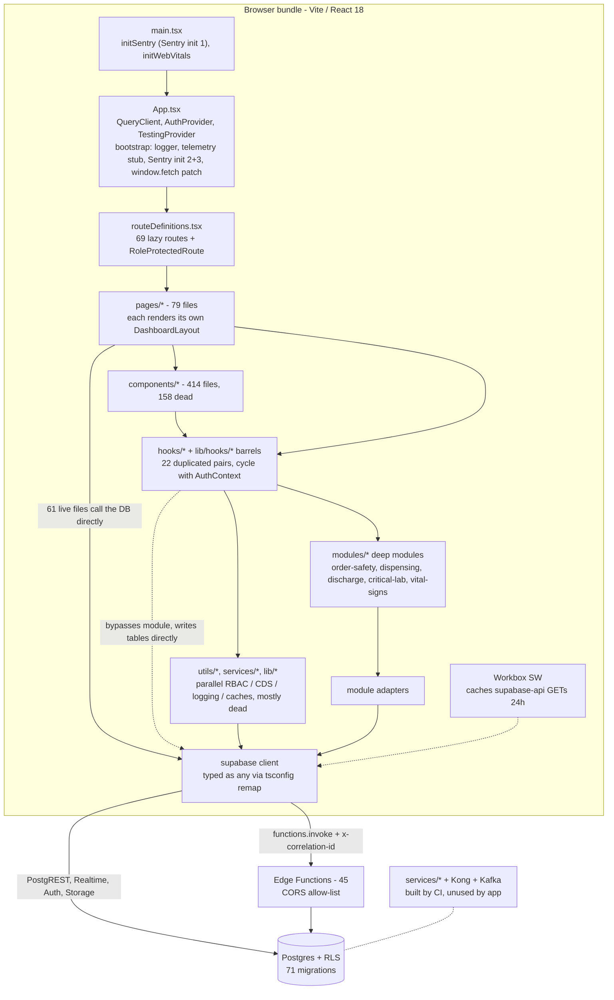

# Module Audit (Architecture & Code Quality)

> CareSync HIMS repository audit, 2026-11-01. Commit `43ab8f7`. This document has three parts. It assesses every application module (§1), records repository-wide code-quality measurements (§2), and holds the architecture and technical-debt findings (ARCH-xx, §4) together with a pragmatic target architecture (§5). Feature-level behavior is in [FUNCTIONAL_AUDIT.md](./FUNCTIONAL_AUDIT.md).

## 1. Module health matrix

Legend:
- **Live?** Reachable from `src/main.tsx` through the router (dependency-graph scan).
- **Health:** 🟢 sound · 🟡 works with notable issues · 🟠 partially working / high debt · 🔴 broken or unsafe.

### 1.1 Deep modules (`src/modules/*`, ADR-backed)

| Module | Purpose | Live? | Tests | Health | Key issues |
|---|---|---|---|---|---|
| `order-safety` | DDI, allergy class matching, pediatric bounds, fail-closed CDS | **No.** `useOrderSafety` has no UI importer. | 4 clinical test files, all passing | 🔴 | The UI uses the legacy `usePrescriptionSafety` (CLIN-01, ARCH-04). The actor uses non-existent `user.role`/`user.hospital_id` (CLIN-27). Pediatric engine disagrees with the other 3 copies (CLIN-15). |
| `prescription-dispensing` | ADR-0004 state machine | Partially, via `usePrescriptionApprovalWorkflow` | passing | 🔴 | The actor role resolves to `'authenticated'` (CLIN-27). The audit table does not exist (ARCH-05). There is no database enforcement (DB-10, CLIN-03). |
| `critical-lab-escalation` | ADR-0005 5/10-minute ladder | Yes (`LaboratoryPage`, `useCriticalLabAlerts`) | passing (but see TEST-08) | 🔴 | Nothing schedules escalations, and the edge function does not match the schema (EDGE-03). Actor drift (CLIN-27). |
| `discharge-pipeline` | ADR-0003 sequential discharge | Yes | module tests pass; `tests/unit/discharge-workflow.test.tsx` collects 0 tests | 🟠 | Rejection dead-ends and AMA is broken (CLIN-11). The initiation modal crashes (CLIN-28). The DB transition function trusts caller IDs (DB-10). |
| `vital-signs` | NEWS2 scoring | Yes | passing | 🟡 | The scoring tables are correct for RCP Scale 1. Callers pass mismatched keys (CLIN-08). No SpO2 Scale 2 and no "new confusion" level (CLIN-12). |
| `example` | Reference module | n/a | yes | 🟢 | — |

**Boundary enforcement:** `npm run lint:boundaries` passes, but it only scans `src/modules`, `src/components/doctor` and `src/components/nurse`, about 10% of `src` (ARCH-11). There are 4 dependency cycles through `AuthContext` ↔ the `lib/hooks/auth` barrel.

### 1.2 Application domains

| Domain | Primary code | Health | Requires attention because… |
|---|---|---|---|
| Auth, session, 2FA | `contexts/AuthContext.tsx` (968 lines), `pages/hospital/*`, `lib/hooks/auth/*` | 🔴 | 2FA bypassable and weak (SECF-01/02, EDGE-05, ARCH-06). Signup broken (FUNC-03). Cycles (ARCH-11). |
| RBAC / permissions | `types/rbac.ts`, `lib/permissions.ts`, 7 `utils/*RBACManager.ts`, `abacManager.ts`, `routeManifest.ts`, `UnifiedAuthService` | 🔴 | Divergent matrices in 50 cases, an `admin:'*'` wildcard, a magic pharmacist ID (SECF-07, SECF-08). ADR-0005 "unified RBAC" did not happen. |
| Consultations | `pages/consultations/ConsultationWorkflowPage.tsx` (1,412 lines), `hooks/useConsultations.ts` | 🔴 | Completion crash (CLIN-26), autosave data loss (CLIN-06), non-atomic saga (CLIN-07, CLIN-19). |
| Prescribing / pharmacy | `TreatmentPlanStep`, `hooks/usePrescriptionSafety.ts`, `lib/hooks/pharmacy/*` (duplicated in `hooks/`) | 🔴 | Legacy CDS (CLIN-01). Non-atomic stock (CLIN-04). Duplicate hook trees (ARCH-06). |
| Laboratory | `pages/laboratory/LaboratoryPage.tsx` (1,073 lines), `components/lab/*` | 🟠 | Escalation non-functional (EDGE-03). Age/sex ranges ignored (CLIN-16). Rejection violates CHECK (CLIN-17). |
| Nursing | `pages/nurse/NurseMedicationsPage.tsx`, `hooks/useNurseWorkflow.ts` (743 lines), `components/nurse/*` | 🟠 | eMAR without schedule or double-dose guard (CLIN-13). Shortcut dead-end (CLIN-29). Unit drift (CLIN-09). |
| Discharge | `components/discharge/*`, `supabase/functions/discharge-workflow` | 🟠 | CLIN-11, CLIN-28, DB-10 |
| Reception / scheduling | `components/receptionist/*`, `pages/appointments`, `lib/recurrence.utils.ts` | 🟠 | Double booking (FUNC-12), kiosk mock (FUNC-11), TZ bugs (FUNC-14), recurrence not implemented (FUNC-23). |
| Billing / insurance | `pages/billing/BillingPage.tsx` (712 lines), `utils/billingValidator.ts` (1,010 lines), `lib/billing.calculator.ts`, `lib/edi837.builder.ts` | 🔴 | PIN-authorized adjustments (FUNC-33). Tax/discount not saved (FUNC-05). Payment errors (FUNC-06). Simulated claims (FUNC-09, EDGE-10). Billing boundary not enforced (DB-07). |
| Patient portal | `pages/patient/*`, `usePatientPortal` (two identical 909-line copies) | 🟠 | Duplicate hooks (ARCH-06). Shows all statuses (FUNC-30). Isolation depends on DB-01/DB-02. |
| Admin / audit / monitoring | settings pages, `AuditLogViewer`, `SystemHealthDashboard` | 🔴 | Destructive test-data cleanup in production (FUNC-10). Two pages crash (FUNC-17). Hardcoded metrics (FUNC-18). |
| Telemedicine / messaging | `components/telemedicine/VideoCallModal.tsx` (888 lines), `pages/messaging/*` | 🟠 | STUN-only (FUNC-24). Notes not persisted (CLIN-21). Edge function trusts the body (EDGE-06). |
| "AI" features | `lib/ai/*` (two 1,200-line providers), `services/ai/*`, 7 AI pages | 🔴 | Simulated output feeds the record (CLIN-18). Browser-side API keys (SECF-03). |
| Observability | `bootstrap/*`, `lib/monitoring/*`, `utils/logger.ts`, `logging.ts`, `errorTracking.ts`, `sentry-integration.ts`, `correlationId.ts` | 🔴 | The fetch patch breaks CORS (PERF-01). Triple Sentry init (PERF-12). Logs go to a non-existent endpoint. |
| In-app QA tooling | `contexts/TestingContext.tsx` (791 lines), `pages/testing/*`, `utils/codeReviewer*.ts`, `TestDataSeederCard` | 🔴 | Mounted in production (ARCH-14). Destructive (FUNC-10). |
| Data access | 196 tables accessed directly from 61 live UI files; `query-helper.ts` `any` client | 🟠 | No data-access layer (ARCH-12). Type erasure (ARCH-02). Schema drift (DB-14). |
| Edge functions | `supabase/functions/*` (39 deployable) | 🔴 | See SECURITY_AUDIT §5 |
| Database / migrations | `supabase/migrations/*` | 🔴 | See DATABASE_AUDIT |
| `services/*` microservices, Kong, `mobile-app`, k8s | outside `src/` | ⚪ not on runtime path | Contradicts ADR-0001. Broken artifacts. Default credentials (ARCH-16, OPS-05, OPS-06, SECF-19). |

**Modules requiring attention:** every runtime domain is rated 🔴 (11) or 🟠 (7), which is 18 of 18; the 19th row is non-runtime infrastructure (⚪). Among the deep modules, 4 of 6 are 🔴/🟠, and `vital-signs` (🟡) needs its callers fixed.

## 2. Repository-wide code quality measurements

### Key counts

| Metric | Value |
|---|---|
| TS/TSX files under `src/` (incl. tests) / non-test | 1,030 / 921 |
| Reachable from `src/main.tsx` | 557 |
| **Unreachable (dead) non-test files** | **377 files, 90,823 LOC** (41 % of non-test files) — 268 have zero importers, 19 imported only by tests |
| Entry chunk static closure (before lazy routes) | 157 files |
| Lazy route components in `routeDefinitions.tsx` | 69 `lazy()` |
| Same-name hook pairs `src/hooks` ↔ `src/lib/hooks` | **22 pairs** (15 byte-identical, 7 diverged), 5,722 LOC in the `src/hooks` twins |
| Byte-identical duplicate files in `src/` (md5) | 16 groups |
| `as any` / `: any` / `<any>` / `as unknown as` (non-test `src`) | 347 / 670 / 97 / 43 |
| `@ts-nocheck` files (non-test) / **live** | 62 / **34 live files = 14,443 LOC** |
| `@ts-ignore` / `@ts-expect-error` | 0 / 0 |
| `eslint-disable` (non-test) | 29 |
| ESLint result | 0 errors, 226 warnings (175 `react-hooks/exhaustive-deps`, 71 in live non-test code) |
| Files > 600 lines (non-test) / live | 46 / 34 |
| Dependency cycles | 4 cycle paths (depcruise, all through `AuthContext` ↔ `lib/hooks/auth` barrel); my SCC scan: 2 SCCs (6-node auth SCC + a type-only `CPTService`↔`ClinicalCodingService` pair) |
| Repo boundary lint (`lint:boundaries`) | `✔ no dependency violations found (209 modules, 782 dependencies cruised)` — scope excludes 90 % of `src` |
| Tables referenced via `.from()` / present in generated `types.ts` | 196 / 44 (**154 referenced tables untyped**) |
| Referenced tables never created by any migration (live code) | 7 (incl. `prescription_approval_workflow_audit`, `staff`, `system_logs`, `appointment_slots`, `escalations`) |
| Live `.select()` statements / unbounded (no `limit/range/single`, not `head:true`) | 370 / 201 (73 are `select('*')`) |
| Live components/pages importing the Supabase client directly | 61 files, 145 DB call sites |
| Live `refetchInterval` sites | 28 (2×5 s, 4×10 s, 2×15 s, 11×30 s …) |
| `@tanstack/react-virtual` usages | 0 (installed, unused) |
| AbortSignal usages in data fetching | 3 |
| `console.*` calls (non-test `src`) vs files importing `utils/logger` | 698 vs 6 |
| Test files that import dead source | 52 of 330 (23 import *only* dead source) |

---

Lead-executed corroboration (2026-11-01):
- `npm run type-check` exits 0 after checking 0 files.
- `npx tsc --noEmit -p tsconfig.app.json` reports **35 errors in 11 files**. These include the runtime defects CLIN-26, CLIN-27, CLIN-28, CLIN-29, FUNC-33 (`profile.role`), the `DischargeWorkflowCard` step map missing `completed_ama`, and the `PatientSidebar` import of a non-existent type.
- `tsconfig.app.json` also **excludes about 30 production files** from type-checking, including `src/integrations/supabase/client.ts` and `src/lib/encryption.utils.ts`.
- `npx eslint .` reports 0 errors and 243 warnings, because `no-explicit-any`, `no-unused-vars` and `ban-ts-comment` are disabled and `supabase/**` and `scripts/**` are ignored.

## 3. Method

### Method & tooling (reproducible)

| Analysis | Command / script | Output location |
|---|---|---|
| Reachability / dead code / cycles | `node scratchpad/reach.mjs /home/user/care-harmony-hub reach.json src/main.tsx` (resolves `@/` → `src/` exactly like the Vite alias, relative imports, `import()`, `export … from`, `new URL(…, import.meta.url)`; BFS from `index.html` → `src/main.tsx`; Tarjan SCC for cycles) | `scratchpad/reach.json` |
| Entry-chunk (static, non-lazy) closure | same script with dynamic `import()` edges removed | `scratchpad/static.json` |
| Boundary lint (repo script) | `npx depcruise src/modules src/components/doctor src/components/nurse --config .dependency-cruiser.cjs` | console |
| Full-src cycle check | `npx depcruise src --config scratchpad/depcruise-full.cjs --output-type err` (repo rules + `no-circular` over all of `src` + `no-orphans`) | `scratchpad/depcruise-full.txt` |
| Lint | `npx eslint src --format json` | `scratchpad/eslint.json` |
| TS program membership (no type-check) | `npx tsc -p tsconfig.json --listFilesOnly`, `npx tsc -p tsconfig.app.json --listFilesOnly` | console |
| Unbounded queries / N+1 / leaks | `scratchpad/unbounded.mjs`, `scratchpad/nplus1.mjs`, `scratchpad/leaks.mjs`, `scratchpad/testsdead.mjs` | `scratchpad/*.json` |

(`scratchpad/` = `<audit-scratchpad>/`)

## 4. Architecture and code-quality findings (ARCH-xx)

### ARCH-01: `npm run type-check` compiles zero files — CI type gate is a no-op
- Severity: P1
- Category: Infrastructure
- Status: CONFIRMED
- Module: Build/CI tooling
- Location: package.json:72; tsconfig.json:16; .github/workflows/ci-cd.yml:17; .github/workflows/ci-pipeline.yml:50; .github/workflows/rls-validation.yml:120
- Evidence:
  ```
  package.json:72      "type-check": "tsc --noEmit",
  tsconfig.json:16     "files": [],   (+ "references": [app, node])
  $ npx tsc -p tsconfig.json --listFilesOnly | wc -l
  0
  ```
- Actual behavior / Expected behavior: Root `tsconfig.json` is a solution-style file (`files: []` + `references`). `tsc --noEmit` without `--build` type-checks only the root project, i.e. nothing, and always exits 0. Three CI workflows and `test:release:gates` rely on it. Only `deploy-production.yml:22` runs `tsc -p tsconfig.app.json`. Expected: every PR pipeline type-checks the 907 files in the app program.
- Reproduction: `npx tsc -p tsconfig.json --listFilesOnly` → empty list.
- Root cause: Lovable/Vite scaffold solution tsconfig + script never updated to `tsc -b` / `-p tsconfig.app.json`.
- Impact: Type regressions merge silently on every non-deploy branch; combined with ARCH-02/03 the type system gives near-zero protection to clinical code.
- Recommendation: `"type-check": "tsc -p tsconfig.app.json --noEmit && tsc -p tsconfig.node.json --noEmit"` (or `tsc -b --noEmit`). Land behind a baseline (e.g. `tsc … | tee` + allow-list) if the first run is red, then ratchet.
- Effort: S
- Acceptance criteria: `npm run type-check` lists > 900 files with `--listFiles`; introducing a deliberate type error in `src/App.tsx` fails CI on `ci-cd.yml`.


### ARCH-02: Supabase client is type-erased via a tsconfig path remap; generated `types.ts` covers 44 of 196 tables used
- Severity: P1
- Category: Architecture
- Status: CONFIRMED
- Module: Data access / `src/integrations/supabase`
- Location: tsconfig.app.json:18-24; src/integrations/supabase/query-helper.ts:24-25; src/integrations/supabase/client.ts:151; src/integrations/supabase/types.ts; tsconfig.app.json:56 (client.ts excluded)
- Evidence:
  ```
  tsconfig.app.json:22  "@/integrations/supabase/client": ["./src/integrations/supabase/query-helper.ts"]
  query-helper.ts:25    export const supabase: SupabaseClient<any, 'public', any> = createClient(
  client.ts:151         export const supabase = createClient<Database>(SUPABASE_URL, …   // what Vite actually bundles
  $ tsc -p tsconfig.app.json --listFilesOnly | grep -c integrations/supabase/client.ts  → 0
  ```
- Actual behavior / Expected behavior: The type checker resolves every `import { supabase } from '@/integrations/supabase/client'` (131 hooks, 61 live UI files, 46 utils/services) to a hand-written `any`-typed client, while Vite (alias `@` → `src`) bundles the real `client.ts`. The two files even disagree at runtime-level config (query-helper uses `localStorage`; client.ts uses sessionStorage + 10 s `safeFetch`). Generated `types.ts` has 44 tables; code references 196 distinct tables; 154 are untyped, including all deep-module tables (`discharge_workflows`, `prescription_approval_workflows`, `lab_alert_escalations`, `audit_logs`). Seven tables used by live code do not exist in any migration (see ARCH-05). Note: `(supabase as any)` count is 0 precisely because the client is already `any`. Expected: one client, typed with a regenerated `Database`.
- Reproduction: static analysis (script output above; table diff in scratchpad).
- Root cause: Stale generated types (last regenerated 2026-09-08, 71 migrations) "fixed" by erasing types instead of regenerating.
- Impact: Column/table typos, removed columns and missing tables compile cleanly and fail only at runtime (often silently because Supabase returns `{error}` that many call-sites ignore). Clinical writes (dispensing, audit) are unverifiable at compile time.
- Recommendation: (1) `supabase gen types typescript --linked > src/integrations/supabase/types.ts` in CI with a drift check; (2) delete the path remap and `query-helper.ts` (3 tests import it — repoint to a test client); (3) fix resulting errors module-by-module behind a `// @ts-expect-error TODO(ARCH-02)` budget that is ratcheted down; (4) remove `client.ts` from `exclude`.
- Effort: L
- Acceptance criteria: `tsc -p tsconfig.app.json --listFilesOnly` includes `client.ts` and not `query-helper.ts`; `types.ts` table count equals tables created by migrations; CI fails when `supabase gen types` output differs from committed file.


### ARCH-03: 34 live files (14,443 LOC) run under `@ts-nocheck`, incl. the consultation, dispensing, RBAC and audit paths; lint rules that would catch it are disabled
- Severity: P2
- Category: Technical debt
- Status: CONFIRMED
- Module: Cross-cutting (type safety)
- Location: src/pages/consultations/ConsultationWorkflowPage.tsx:1; src/lib/hooks/pharmacy/usePrescriptions.ts:1; src/lib/hooks/auth/usePermissions.ts:1; src/lib/hooks/observability/useAuditLog.ts:1; src/utils/pharmacistOperationsService.ts:1; src/lib/hooks/patients/usePatients.ts:1; src/pages/Dashboard.tsx:1; eslint.config.js:38-40; tsconfig.app.json:36-68
- Evidence:
  ```
  ConsultationWorkflowPage.tsx:1   // @ts-nocheck            (1,412 lines)
  usePermissions.ts:1              // @ts-nocheck            (RBAC facade per ADR-0005)
  eslint.config.js                 "@typescript-eslint/no-explicit-any": "off",
                                   "@typescript-eslint/ban-ts-comment": "off",
  ```
- Actual behavior / Expected behavior: Largest live `@ts-nocheck` files: ConsultationWorkflowPage 1,413, OpenAIProvider 1,252, ClaudeProvider 1,225, pharmacistOperationsService 822, lib usePrescriptions 725, orchestrator 640, ReportsPage 606, AuditLogViewer 599 … (full list in scratchpad `nocheck.txt`). Non-test totals: 347 `as any`, 670 `: any` (components 140/226, hooks 66/162, utils 42/85, pages 36/58, modules 23/9). `tsconfig.app.json` additionally "excludes" 22 files — but 5 of them are imported by live code (`RoleProtectedRoute.tsx`, `pharmacistOperationsService.ts`, `lib/ai/orchestrator.ts`, `useAuditLog.ts`, `client.ts`), so the exclude is cosmetic for those and only hides dead files. ESLint therefore reports 0 errors. Expected: `@ts-nocheck` banned in live code; `any` budgeted.
- Reproduction: `grep -rl "@ts-nocheck" src` + reachability join (scratchpad).
- Root cause: Type errors silenced wholesale rather than fixed (driven by ARCH-02's stale types).
- Impact: The highest-risk clinical files (prescribing, dispensing, RBAC checks, audit logging) have no compiler protection.
- Recommendation: Turn on `@typescript-eslint/ban-ts-comment` with `ts-nocheck: true` and `no-explicit-any: warn`; add an ESLint `max-warnings` ratchet; remove `@ts-nocheck` starting with `usePermissions.ts`, `usePrescriptions.ts`, `useAuditLog.ts`, `ConsultationWorkflowPage.tsx` (after ARCH-02 regeneration most errors disappear); delete the `exclude` entries for live files.
- Effort: L
- Acceptance criteria: 0 `@ts-nocheck` in files reachable from `main.tsx`; `any` count tracked in CI and monotonically non-increasing.


### ARCH-04: Live clinical paths bypass the deep modules that the ADRs and clinical tests describe
- Severity: P1
- Category: Architecture
- Status: CONFIRMED
- Module: order-safety / prescription-dispensing / consultation prescribing
- Location: src/pages/consultations/ConsultationWorkflowPage.tsx:40,463,530; src/components/consultations/steps/TreatmentPlanStep.tsx:25,109,132; src/hooks/usePrescriptionSafety.ts:44,140; src/lib/hooks/pharmacy/usePrescriptions.ts:484-610
- Evidence:
  ```
  ConsultationWorkflowPage.tsx:40  import { checkPrescriptionSafety } from '@/hooks/usePrescriptionSafety';
  usePrescriptionSafety.ts:44      const DRUG_INTERACTIONS: Array<{ …   // hard-coded local table, synchronous
  usePrescriptions.ts:606-608      } catch (err) {
                                     console.warn('[useDispensePrescription] Workflow advance bypassed:', err);
  ```
- Actual behavior / Expected behavior: (a) Prescribing: the only live consumers of `@/modules/order-safety` import *constants* (`ALLERGEN_CLASS_MAP`, `AAP_DOSING_RULES`); `OrderSafetyEngine`/`useOrderSafety` (fail-closed, edge-function DDI per ADR-0005) are referenced only by dead `services/clinicalDecisionSupport.ts` and tests. The doctor UI uses a third, synchronous, hard-coded checker. (b) Dispensing: `useDispensePrescription` deducts stock, sets `prescriptions.status='dispensed'`, updates items and queue *first*, then calls the ADR-0004 `PrescriptionDispensingEngine` and swallows any refusal. There are ≥5 DDI implementations (order-safety engine, `usePrescriptionSafety`, `useDrugInteractionChecker`, `usePharmacy.useDrugInteractions` (DB table), dead `useDrugInteractions`) and 2 pediatric engines (module `core/pediatricEngine.ts` live-but-unused vs dead `utils/pediatricDosingEngine.ts`). Expected: UI → module entry point → adapter; the module is the only path that can transition clinical state.
- Reproduction: static analysis (`grep` importers of each module entry point; reachability chains in scratchpad `reach.json`).
- Root cause: Modules were extracted (Sept 2026) but call-sites were wrapped in "facades" that keep the legacy logic and call the module as a best-effort side effect.
- Impact: ADR-0004/0005 guarantees (pharmacist gate, fail-closed DDI, allergen-class normalisation) are enforced only by DB constraints/edge functions, not by the client path the clinical tests exercise; tests give false assurance (see ARCH-07). Clinical-safety severity should be rated by the clinical auditor; architecturally this is a broken invariant.
- Recommendation: Make `order-safety` the single CDS entry: replace `checkPrescriptionSafety` in TreatmentPlanStep/ConsultationWorkflowPage with `useOrderSafety`; delete the other DDI hooks. In dispensing, call `engine.dispense()` *first* and perform stock/status writes inside the module adapter (ideally one RPC, see PERF-06); propagate engine errors.
- Effort: M
- Acceptance criteria: `grep -r "usePrescriptionSafety\|useDrugInteractionChecker\|useDrugInteractions" src` returns only the module; a dispense on a workflow not in `approved` state throws and writes nothing (integration test against the Supabase adapter).


### ARCH-05: ADR-0004 dispensing audit trail is written to a table that no migration creates; failure is silent
- Severity: P1
- Category: Database
- Status: CONFIRMED
- Module: prescription-dispensing (deep module adapter)
- Location: src/modules/prescription-dispensing/adapters/SupabasePrescriptionAdapter.ts:79-90,93-110; supabase/migrations/20260325_create_prescription_approval_workflows.sql:14
- Evidence:
  ```
  SupabasePrescriptionAdapter.ts:97   await supabase.from('prescription_approval_workflow_audit' as any).insert([entry]);
  SupabasePrescriptionAdapter.ts:98   } catch {   // fallback to audit_logs never runs: supabase-js returns {error}, it does not throw
  $ grep -rl prescription_approval_workflow_audit supabase/   → (no matches)
  ```
- Actual behavior / Expected behavior: `logTransition` inserts into a non-existent table; supabase-js resolves `{ error }` (PGRST205/42P01) instead of throwing, so the `catch` fallback to `audit_logs` is dead and the audit entry is lost. `getAuditHistory` returns `[]` "gracefully". Other live missing tables: `staff` (useActivityLogsPaginated.ts:222), `system_logs` (useRealtimeConnectionStatus.ts:86), `appointment_slots` (useSmartScheduling.ts:41), `escalations` (useWorkflowOrchestrator.ts:320), `admissions` (useUnbilledCharges.ts:136), `user_permissions` (orchestrator.ts:133). Expected: audit writes are durable and failures surface.
- Reproduction: static analysis — grep migrations for each `.from()` table (scratchpad `created_tables.txt`).
- Root cause: No schema contract test for module adapters; ARCH-02 hides missing tables from the compiler; `{error}` not checked.
- Impact: Medication-dispensing state transitions have no audit history — a regulatory (HIPAA §164.312(b)) and incident-investigation gap that ADR-0004 claims is covered.
- Recommendation: Add the migration (or write to `audit_logs` directly); check `error` and throw; add an adapter contract test that runs against a local Supabase (`supabase start`) in CI for every module adapter.
- Effort: S
- Acceptance criteria: After a dispense in the integration environment, `getAuditHistory(workflowId)` returns ≥1 row; inserting into a missing table makes the adapter throw.


### ARCH-06: Two parallel hook trees (`src/hooks` vs `src/lib/hooks`): 22 same-name pairs; fixes landed in the dead copy (live 2FA still uses `Math.random`)
- Severity: P1
- Category: Technical debt
- Status: CONFIRMED
- Module: hooks (patients, appointments, pharmacy, auth)
- Location: src/lib/hooks/auth/useTwoFactorAuth.ts:19-35 (live); src/hooks/useTwoFactorAuth.ts:18-40 (dead, fixed); src/lib/hooks/pharmacy/index.ts; src/lib/hooks/index.ts
- Evidence:
  ```
  usePatientPortal.ts lib=909/1a36cfe6 hooks=909/1a36cfe6 difflines=0
  usePharmacy.ts      lib=643/c7a85f90 hooks=643/c7a85f90 difflines=0
  usePrescriptions.ts lib=724/2c47e0e2 hooks=518/05c29c28 difflines=248
  lib/hooks/auth/useTwoFactorAuth.ts:23   secret += chars[Math.floor(Math.random() * chars.length)];
  src/hooks/useTwoFactorAuth.ts:22         window.crypto.getRandomValues(randomBytes);   // DEAD copy
  ```
- Actual behavior / Expected behavior: Pairs and which copy is live (imported via `@/lib/hooks…` barrels):

  | Hook | Identical? | Live copy | `src/hooks` copy |
  |---|---|---|---|
  | usePatientIdentity, usePatientPortalQueries, usePatientPortal, usePatientsReadyForDoctor, usePatientQuery, useSessionTimeout, useDoctorAvailability, useScheduling, useAppointmentRequests, useSmartScheduling, useMedicationAlerts, usePharmacy, useMedications | identical | lib | dead |
  | usePermissions, useAppointmentOptimization | identical | **both** (lib via barrel; `src/hooks` copy imported by SmartScheduler / SystemHealthDashboard / AuditLogViewer) | live |
  | usePatients (import path only), usePermissionAudit (+`detail?`), usePharmacistOperations (import paths) | ~identical | lib | dead |
  | useTwoFactorAuth | **diverged — security fix only in dead copy** | lib (Math.random) | dead (crypto RNG) |
  | useAppointments (+`useLatestScheduledAppointments` in lib), usePrescriptions (+partial dispense/witness/stock in lib, 248 diff lines) | diverged | lib | dead |
  | useDrugInteractionChecker | lib is a 2-line re-export of `src/hooks` | src/hooks | live |

  Tests target the dead copies (e.g. `tests/unit/usePharmacy.test.tsx`, `tests/integration/CreateLabOrderModal.integration.test.tsx` → `src/hooks/usePatients.ts`). Expected: one canonical location per hook.
- Reproduction: `md5sum`/`diff` loop over `src/lib/hooks/**/use*.ts` vs `src/hooks/` (scratchpad transcript).
- Root cause: An incomplete "move hooks into domain folders" refactor that copied instead of moved; `export *` barrels hide which copy is used.
- Impact: Engineers fix the wrong file (demonstrated by the 2FA RNG fix: TOTP secrets and backup codes for live users are generated with non-cryptographic `Math.random`); 5.7 k duplicated LOC; test coverage numbers overstate live coverage.
- Recommendation: (1) Immediately port the `crypto.getRandomValues` change to `src/lib/hooks/auth/useTwoFactorAuth.ts` (better: generate secret server-side in `generate-2fa-secret`, which already exists). (2) Delete the 19 dead `src/hooks` twins (keep/merge the 3 live ones: usePermissions, useAppointmentOptimization, useDrugInteractionChecker); repoint tests. (3) Replace `export *` barrels with explicit named exports (or direct imports) and add a depcruise rule forbidding `src/hooks/X` when `src/lib/hooks/**/X` exists.
- Effort: S (2FA port) / M (dedupe)
- Acceptance criteria: No basename appears in both trees; `grep -r "Math.random" src/lib/hooks/auth` is empty; a test asserts `crypto.getRandomValues` is called during 2FA setup.


### ARCH-07: 377 unreachable source files (90.8 k LOC) and 52 test files that test unreachable code — incl. the ADR-0005 fail-closed tests
- Severity: P2
- Category: Technical debt
- Status: CONFIRMED
- Module: Repository-wide
- Location: src/services/{blockchainAuditService,iotIntegration,enterpriseScaling,machineLearningService,automationScaling,continuousImprovement,performanceOptimization,advancedAnalytics,populationHealthService,unifiedAuthService,unifiedRecordService,workflowOrchestration,messagingService,clinicalApiClient,clinicalDecisionSupport,aiTriageService}.ts; src/services/ai/*; src/utils/{billingValidator,codeReviewer*,reportingEngine,analyticsEngine,validationEngine,rateLimiter,rateLimiting,rateLimitManager,logging,cache*,security{Hardening,Monitor,Monitoring,WorkerManager},indexedDBCache,serviceWorkerCache,pediatricDosingEngine}.ts; src/workers/securityAnalysis.worker.ts; src/components/features/**; src/pages/{audit/AuditDashboard,settings/CodeReviewDashboard,dashboard/*Dashboard,messaging/*MessagesPage,Index}.tsx; tests/clinical/fail-closed-ddi.test.ts; tests/clinical/pediatric-dosing.test.ts; tests/clinical/clinical-decision-support.test.ts
- Evidence:
  ```
  {"totalSrcFiles":1030,"nonTest":921,"reachable":557,"dead":377,"deadLoc":90823}
  by dir: components 158 files/41,579 LOC · hooks 83/18,340 · utils 64/15,518 · lib 26/5,991 · services 19/3,013 · pages 10/2,774 · types 11/2,755
  tests/clinical/fail-closed-ddi.test.ts:4  import { useDrugInteractions … } from '@/hooks/useDrugInteractions';   // dead hook
  ```
- Actual behavior / Expected behavior: Dead-but-maintained code includes the "blockchain/IoT/ML/enterprise scaling" services (only imported by dead admin panels `BlockchainAuditViewer`, `IoTMonitoringPanel`, `ComprehensiveSystemDashboard`, `MLPredictionDashboard`), the whole `components/features/*` tree (billing, telehealth, clinical-notes, appointment recurrence), 4 per-role `*MessagesPage`s, the only web worker (and its manager uses `new URL('@/workers/…', import.meta.url)`, which Vite does not alias-resolve), and `src/modules/example`. 52 test files import dead source; 23 import *only* dead source — including the three ADR-0005 safety suites above, so the fail-closed behaviour is verified on code the UI never runs. Of `src/modules/*`, all are reachable except `example`; but see ARCH-04 for how little of them the app actually uses.
- Reproduction: `node scratchpad/reach.mjs …` (list sorted by LOC in `reach.json`); `node scratchpad/testsdead.mjs`.
- Root cause: AI-assisted feature generation without wiring/removal; no orphan check in CI.
- Impact: ~36 % of `src` LOC is noise for reviewers/auditors/agents; tsc/lint/test time; misleading coverage; risk of reviving stale insecure code (e.g. `abacManager.ts`, per-role RBAC managers flagged in ADR-0005).
- Recommendation: Delete in batches by directory (services → utils → components/features → pages), moving anything product wants to keep to a `docs/backlog` issue. Add `knip` or the depcruise `no-orphans`/reachability rule to CI. Repoint/delete the 23 dead-only tests; re-target the ADR-0005 suites at `@/modules/order-safety` + the live hooks.
- Effort: M
- Acceptance criteria: Reachability script reports < 20 unreachable non-test files; CI fails on new orphans; every `tests/clinical/*` suite imports a module entry point or a live hook.


### ARCH-08: Parallel implementation families (logger ×2, rate limiter ×5, cache ×6, security ×4, RBAC ×10, Sentry ×3, registration ×4, vitals forms ×4, audit viewers ×4)
- Severity: P3
- Category: Technical debt
- Status: CONFIRMED
- Module: src/utils, src/lib, src/components
- Location: see table
- Evidence:
  ```
  rate:     DEAD rateLimitManager.ts · DEAD rateLimiter.ts(396) · DEAD rateLimiting.ts · LIVE rateLimitBackoff.ts · DEAD lib/security/rate-limiter.ts
  cache:    DEAD serviceWorkerCache · DEAD indexedDBCache(525) · DEAD cacheStrategy · DEAD cacheInvalidation · DEAD cache · DEAD lib/performance/cache-manager
  rbac:     LIVE adminRBACManager · LIVE doctorRBACManager · LIVE pharmacistRBACManager · DEAD nurse/receptionist/labTech/patientRBACManager · DEAD abacManager(390) · LIVE lib/permissions.ts · LIVE types/rbac.ts
  ```
- Actual behavior / Expected behavior: Families (LIVE/DEAD from reachability): logger — `utils/logger.ts` LIVE, `utils/logging.ts` DEAD; security — `securityHardening/securityMonitor/securityMonitoring/securityWorkerManager` all DEAD; error tracking — `lib/monitoring/sentry.ts`, `utils/errorTracking.ts`, `utils/sentry-integration.ts` all LIVE (PERF-12); patient registration — `patients/PatientRegistrationModal.tsx` (712) LIVE, `receptionist/WalkInRegistrationModal.tsx` LIVE, `PatientRegistrationModal.STANDARDIZED.tsx` DEAD, `receptionist/EnhancedPatientRegistrationForm.tsx` (693) DEAD, `pages/patient/PatientRegisterPage.tsx` (672) LIVE self-registration; billing — `pages/billing/BillingPage.tsx` LIVE vs `components/features/billing/BillingDashboard.tsx` DEAD; vitals — `RecordVitalsModal` (797), `MobileLandscapeVitalsForm` (549), `OfflineVitalsCaptureModal` (415) LIVE, `VitalSignsForm` (512) DEAD; audit viewers — `pages/admin/AuditLogViewer` + `components/audit/AuditLogViewer` LIVE, `components/admin/AuditLogViewer`, `AuditTrailDashboard`, `pages/audit/AuditDashboard` DEAD; directories `lab/labs/laboratory`, `patient/patients`, `prescription/prescriptions`, `pharmacy/pharmacist` split one domain across siblings. Expected: one implementation per concern.
- Reproduction: static analysis (family grouping script in transcript).
- Root cause: No ownership / canonical-module map outside `src/modules`.
- Impact: Behaviour differs depending on entry point (three live vitals forms likely validate differently — vital-signs module is used by only some); onboarding and audit cost.
- Recommendation: Publish a "canonical implementation" table in `CONTEXT.md`; delete DEAD members with ARCH-07; for LIVE duplicates (vitals, registration, RBAC managers, Sentry) converge on the deep module / `types/rbac.ts` and make the others thin wrappers, then remove.
- Effort: M
- Acceptance criteria: Each family has exactly one non-wrapper implementation; vitals forms all call `evaluateVitalSigns` from `@/modules/vital-signs`.


### ARCH-09: God components/hooks — 34 live files > 600 lines mixing UI, orchestration, persistence and side-effects
- Severity: P2
- Category: Architecture
- Status: CONFIRMED
- Module: consultations, laboratory, auth, AI, patient portal, telemedicine
- Location: src/pages/consultations/ConsultationWorkflowPage.tsx (1,412); src/lib/ai/providers/OpenAIProvider.ts (1,251) + ClaudeProvider.ts (1,224); src/lib/medical/ICD10Service.ts (1,154); src/pages/laboratory/LaboratoryPage.tsx (1,073); src/contexts/AuthContext.tsx (968); src/pages/patient/EnhancedPortalPage.tsx (951); src/pages/integration/WorkflowDashboard.tsx (898); src/components/telemedicine/VideoCallModal.tsx (888); src/contexts/TestingContext.tsx (791)
- Evidence:
  ```
  ConsultationWorkflowPage: imports=34 useState=15 useEffect=4 toast=24 direct .from(=4 mutateAsync chains=9   (@ts-nocheck)
  LaboratoryPage:           imports=39 useState=14 handlers=18 supabase.functions.invoke + per-row usePatient
  VideoCallModal:           useState=22 supabase.=9 .from(=7 toast=16 (WebRTC + DB + UI)
  diff OpenAIProvider vs ClaudeProvider (provider names normalised): 277 differing lines of ~2,475  (~89 % identical)
  ```
- Actual behavior / Expected behavior: SoC problems in the top 8: **ConsultationWorkflowPage** — 5-step wizard UI, autosave engine, keyboard shortcuts, addendum signing, CDS checks, summary-document builder (string templating), and a 9-step cross-table "completion transaction" (ARCH-10) all in one component. **LaboratoryPage** — list + 6 modal workflows + critical-value escalation + edge-function calls + per-row patient fetch (PERF-08). **AuthContext** — Supabase session, profile/hospital/role loading, E2E mock auth, device manager, biometric, password policy, session timeout, Sentry user, 2FA gating, role switching; provider value not memoised (PERF-04). **OpenAI/Claude providers** — 8 clinical prompt builders + response parsers duplicated per vendor, shipped to the browser where the SDKs refuse to run (`dangerouslyAllowBrowser: false`). **ICD10Service** — 1,154-line in-code reference table. **EnhancedPortalPage** — 18 `useState`, 5 queries, 20 toasts, mixed portal sections. **WorkflowDashboard** — 11 direct table queries from a page. **VideoCallModal** — signalling, media, DB writes and UI. **TestingContext** — QA test-case manager in the production provider tree (ARCH-14). Expected: pages compose feature components; orchestration lives in a module/RPC; data access in hooks.
- Reproduction: `wc -l` + metric grep (scratchpad `big.txt`).
- Root cause: Feature growth by accretion; no size/complexity budget.
- Impact: Untestable units (ConsultationWorkflowPage has no unit test of its completion path), merge conflicts, `@ts-nocheck` hiding errors, high regression risk in the most clinically important screen.
- Recommendation: Extract `useConsultationDraft` (autosave/dirty state), `completeConsultation` (move to a `consultation-completion` deep module backed by one Postgres RPC), `ConsultationSummaryBuilder` (pure function + tests); one `AIProvider` base with a vendor adapter, moved server-side into `ai-clinical-support`; split AuthContext into `SessionProvider` + React-Query `useProfile/useHospital/useRoles`; move ICD-10 data to the `icd10_codes` table (already queried by `useICD10Codes`). Add an ESLint `max-lines` (e.g. 400) warning ratchet.
- Effort: L
- Acceptance criteria: No live file > 800 lines; ConsultationWorkflowPage < 400 lines with completion logic covered by module tests.


### ARCH-10: Consultation completion is a non-atomic client-side saga that marks *all* of a patient's confirmed appointments (including future ones) as completed
> **Consolidation note:** this finding duplicates **CLIN-19** and is kept for its evidence. The register counts it once, under CLIN-19.

- Severity: P1
- Category: Functional
- Status: LIKELY
- Module: Consultations / Appointments
- Location: src/pages/consultations/ConsultationWorkflowPage.tsx:621-650,743-760,887-892
- Evidence:
  ```
  643  // INT-001: Mark linked appointment as completed
  644  await supabase
  645    .from('appointments')
  646    .update({ status: 'completed' })
  647    .eq('patient_id', consultation.patient_id)
  648    .in('status', ['confirmed', 'checked_in', 'in_progress']);
  ```
- Actual behavior / Expected behavior: On "Complete", the page sequentially: sets consultation `completed`; updates every `patient_queue` row of the patient in `in_service/called/waiting`; updates every appointment of the patient in `confirmed/checked_in/in_progress` (no date and no `appointment_id` filter, although `consultations.appointment_id` exists); inserts a document; creates prescriptions; loops lab orders one `mutateAsync` at a time; creates an invoice; inserts tasks; fires workflow events. The queue/appointment updates ignore `{error}`; prescription/invoice failures only toast after the consultation is already `completed`. Expected: only the linked appointment/queue entry transitions, and the whole completion is atomic (or compensatable).
- Reproduction: Static: book patient P a confirmed follow-up next week, run a consultation today for P and complete it → next week's appointment status becomes `completed` (verify in staging).
- Root cause: Business transaction implemented in a React event handler instead of a server-side RPC/edge function; coarse filters.
- Impact: Future appointments silently disappear from schedules/reminders (missed follow-ups); partial completion leaves consultations "completed" without prescriptions/lab orders reaching pharmacy/lab.
- Recommendation: Filter by `consultation.appointment_id` (and queue entry id); move completion into a `complete_consultation(consultation_id, payload jsonb)` Postgres function (single transaction) called via one RPC; keep workflow notifications as post-commit side effects.
- Effort: M
- Acceptance criteria: Integration test: completing consultation C for patient P leaves P's other appointments unchanged; injected failure in lab-order insert rolls back consultation status.


### ARCH-11: Dependency cycles through the `AuthContext` ↔ `lib/hooks/auth` barrel; boundary lint covers ~10 % of `src`
- Severity: P2
- Category: Architecture
- Status: CONFIRMED
- Module: auth / lint tooling
- Location: src/contexts/AuthContext.tsx:17; src/lib/hooks/auth/index.ts:3-6; src/lib/hooks/index.ts; .dependency-cruiser.cjs (rule `no-circular` `from: ^src/modules/`); package.json:11
- Evidence:
  ```
  $ npx depcruise src/modules src/components/doctor src/components/nurse --config .dependency-cruiser.cjs
  ✔ no dependency violations found (209 modules, 782 dependencies cruised)
  $ npx depcruise src --config scratchpad/depcruise-full.cjs --output-type err
  error no-circular-anywhere: src/contexts/AuthContext.tsx → src/lib/hooks/auth/index.ts → src/lib/hooks/auth/usePermissionAudit.ts → src/contexts/AuthContext.tsx
  x 49 dependency violations (4 errors, 45 warnings). 1111 modules, 5889 dependencies cruised.
  ```
- Actual behavior / Expected behavior: 4 cycles (AuthContext → barrel → {useTwoFactorAuth, usePermissions, usePermissionAudit → useActivityLog} → AuthContext). Caused by `AuthContext` importing `useSessionTimeout` from the `export *` barrel, which re-exports hooks that call `useAuth`. The barrel also drags `qrcode` (via useTwoFactorAuth) into the entry chunk. The repo `lint:boundaries` only cruises `src/modules` + two component folders and `no-circular` is scoped to modules, so it passes. `src/lib/hooks/index.ts` and every domain `index.ts` are `export *` barrels — the pattern `src/modules/README.md` forbids. 45 orphan warnings (subset of ARCH-07). Expected: zero cycles across `src`.
- Reproduction: commands above.
- Root cause: Barrel files + context living in the same dependency layer as the hooks that consume it.
- Impact: Init-order bugs (undefined imports at module evaluation) under HMR/tests; entry-chunk bloat; cycles hide layering violations.
- Recommendation: Import `useSessionTimeout` directly from its file; replace `export *` barrels with explicit entry points; widen `lint:boundaries` to `depcruise src` and apply `no-circular` globally (start as `warn` with a baseline via `--ignore-known`).
- Effort: S
- Acceptance criteria: `npx depcruise src --config .dependency-cruiser.cjs` reports 0 `no-circular` errors with the rule unscoped.


### ARCH-12: No data-access layer — 61 live pages/components talk to Supabase directly (145 call sites)
- Severity: P2
- Category: Architecture
- Status: CONFIRMED
- Module: UI layer
- Location: e.g. src/pages/consultations/ConsultationWorkflowPage.tsx:637-652,888; src/pages/laboratory/LaboratoryPage.tsx:430,450; src/pages/integration/WorkflowDashboard.tsx (11 `.from(`); src/components/workflow/RoleHandoffStatusPanel.tsx:44-65
- Evidence:
  ```
  components/pages importing supabase client: 80  live: 61  db calls in those live files: 145
  hooks importing supabase: 131   utils/services/lib importing supabase: 46
  ```
- Actual behavior / Expected behavior: Data access is spread across pages, components, 131 hooks and 46 utils/services, with inconsistent error handling, tenant filters, column lists, caching and audit logging. Only 4 pages use `usePaginatedQuery`. Expected (ADR-0001 + deep-module pattern): pages → feature hooks (React Query) → domain module/repository → `supabase` client; UI never imports the client.
- Reproduction: `grep -rl integrations/supabase/client src/components src/pages` ∩ reachable set.
- Root cause: No enforced layering rule.
- Impact: Cross-cutting concerns (hospital scoping, `{error}` checks, PHI decryption, audit) cannot be guaranteed; makes ARCH-02 regeneration noisier.
- Recommendation: Add depcruise rule `no-supabase-in-ui` (`from: ^src/(pages|components)/` `to: integrations/supabase/client`, severity `warn` + baseline), migrate call-sites into domain hooks/modules opportunistically when touched.
- Effort: L (incremental)
- Acceptance criteria: Baseline count published; count strictly decreasing per release; new violations fail CI.


### ARCH-13: Dependency manifest hygiene — test/tooling libs in `dependencies`, unused SDKs, two React plugins, two lockfiles that disagree
- Severity: P3
- Category: Technical debt
- Status: CONFIRMED
- Module: package.json / lockfiles
- Location: package.json:2,122,124-127,156,160-166,173,176-177,180,195,209,222,233-234; bun.lock; package-lock.json
- Evidence:
  ```
  "name": "vite_react_shadcn_ts",
  NOT-IN-SRC: @opentelemetry/{api,auto-instrumentations-web,exporter-trace-otlp-http,sdk-trace-web} @sentry/tracing @tanstack/react-query-devtools @tanstack/react-virtual jsdom @vitest/coverage-v8 @types/*
  ONLY-IN-DEAD-CODE: jspdf html2canvas idb cmdk embla-carousel-react input-otp vaul react-resizable-panels @radix-ui/{aspect-ratio,context-menu,hover-card,menubar,toggle,toggle-group}
  bun.lock: "vite@7.3.6"   package-lock.json/node_modules: vite@7.3.5
  ```
- Actual behavior / Expected behavior: `dependencies` contains test tooling (`@testing-library/*`, `jsdom`, `@vitest/coverage-v8`, `@types/*`), an unused v7 `@sentry/tracing` beside `@sentry/react` v10 (installs a parallel v7 set: `@sentry-internal/tracing`, `@sentry/utils`, `@sentry/types` 7.120.4), four unused OpenTelemetry packages (the "telemetry" is a hand-rolled stub, PERF-12), `openai` + `@anthropic-ai/sdk` for browser code that cannot run them, `vite-plugin-pwa` (build-time) while `web-vitals` (runtime, imported by `main.tsx`) is a devDependency. devDependencies hold both `@vitejs/plugin-react` (vitest) and `@vitejs/plugin-react-swc` (vite) → different JSX transforms in test vs prod; `workbox-build`/`workbox-window` unused; `lovable-tagger` is statically imported by `vite.config.ts`. `bun.lock` and `package-lock.json` resolve different versions. Package name is the scaffold default.
- Reproduction: scratchpad dependency classification (reach.json `reachBare`/`allBare` + grep of tests/scripts/configs).
- Root cause: Scaffold + agent-added packages never pruned.
- Impact: Larger installs/CI time, supply-chain surface, non-reproducible builds across bun/npm, confusion over what is shipped.
- Recommendation: Move test/tooling packages to devDependencies; remove unused ones (`depcheck`/`knip` to confirm); delete `bun.lock` (Dockerfile/CI use npm); pick one React plugin for both vite and vitest; rename package to `caresync-hims`; move AI SDKs to edge functions (`ai-clinical-support` exists).
- Effort: S
- Acceptance criteria: `knip --dependencies` clean; only one lockfile; vitest and vite use the same React plugin.


### ARCH-14: Production root renders QA/test tooling (TestingProvider, E2E mock-auth branches) for every user
- Severity: P3
- Category: Architecture
- Status: CONFIRMED
- Module: App shell
- Location: src/App.tsx:9,89; src/contexts/TestingContext.tsx:200-205,751-760; src/contexts/AuthContext.tsx:96-220
- Evidence:
  ```
  App.tsx:89                 <TestingProvider>
  TestingContext.tsx:204     const savedData = localStorage.getItem('testing-data');
  TestingContext.tsx:759     localStorage.setItem('testing-data', JSON.stringify(dataToSave));
  ```
- Actual behavior / Expected behavior: A 791-line QA test-case manager (seed data, reducer, localStorage persistence on every state change) is in the entry chunk and wraps all routes; only `/testing` pages need it. AuthContext carries E2E mock-user logic (guarded by `import.meta.env.DEV`, so stripped in prod, but it inflates the auth module). Expected: test tooling isolated to its lazy route or dev builds.
- Reproduction: static analysis (`static.json` includes TestingContext).
- Root cause: Convenience wiring.
- Impact: Entry-chunk weight and an extra context re-render boundary for all users; risk of test data/flags leaking into prod behaviour.
- Recommendation: Mount `TestingProvider` inside the `/testing` route element; move E2E mock auth to a separate `AuthProvider` implementation selected at build time.
- Effort: S
- Acceptance criteria: `TestingContext` absent from the entry chunk (visualizer); `/testing` still works.


### ARCH-15: Five test roots with overlapping scope; unit/coverage scripts cover only one of them
- Severity: P3
- Category: Testing
- Status: CONFIRMED
- Module: Test architecture
- Location: package.json (`test:unit`, `test:coverage`); vitest.config.ts; tsconfig.app.json:36-41
- Evidence:
  ```
  src/test: 65 · src/__tests__: 4 · src/modules/*/tests: 3 · colocated src/**: 19 (+3 at src/ root: e2e.test.ts, integration.test.ts, utilities.test.ts)
  tests/: 140 vitest (*.test.*) + 100 playwright (*.spec.*)
  "test:unit": "vitest run src/test",  "test:coverage": "vitest run --coverage src/test"
  ```
- Actual behavior / Expected behavior: Unit tests live in five places; `test:unit`/`test:coverage` only run `src/test` (65 files), so coverage omits module, colocated and `tests/unit` suites; `src/e2e.test.ts`/`src/integration.test.ts` are unit tests of dead utils. 3 modules (critical-lab-escalation, order-safety, prescription-dispensing) have no `tests/` folder despite the README layout — their tests live in `tests/clinical`. Expected: module tests under `src/modules/*/tests`, app unit tests colocated or under one root, e2e under `tests/e2e`.
- Reproduction: `find` counts above.
- Root cause: Organic growth; no test layout convention enforced.
- Impact: Misleading coverage; duplicated RBAC tests (`src/test/*-rbac.test.ts` vs `tests/rbac`); tests of dead code (ARCH-07).
- Recommendation: Adopt: `src/modules/<m>/tests` (module), colocated `*.test.tsx` (UI/hooks), `tests/integration` (Supabase), `tests/e2e` (Playwright). Point `test:unit`/coverage at `src` + `tests/unit`. Move `tests/clinical/*-engine.test.ts` into module `tests/`.
- Effort: M
- Acceptance criteria: `vitest run --coverage` includes all unit roots; each `src/modules/*` has a `tests/` folder.


### ARCH-16: Repo hygiene — microservices/Kong still built and deployed despite ADR-0001; stray prompt files; README links broken
- Severity: P3
- Category: Infrastructure
- Status: CONFIRMED
- Module: Repository root
- Location: services/ (105 files, 18,264 TS LOC); kong.yml; docker-compose.prod.yml:5-36; .github/workflows/docker-build.yml:7,33-42; deploy-prod.sh:253-269; mobile-app/ (10 files); "Prompt for review.md"; "prompt for testing"; skills-lock.json; .kilo/kilo.jsonc; .lovable/plan.md; README.md:49,101,139,214; Dockerfile:3,12,18
- Evidence:
  ```
  docker-build.yml:33  context: ./services/clinical-service
  deploy-prod.sh:269   services=("kong" "clinical-service" "patient-service" "appointment-service" "postgres" "redis" "kafka" …)
  README.md:101        see [API_GATEWAY.md](docs/API_GATEWAY.md)     → MISSING
  Dockerfile:12        RUN npm ci --only=production    then  RUN npm run build   (vite is a devDependency; FROM node:18 vs vite engines ^20.19.0)
  ```
- Actual behavior / Expected behavior: ADR-0001 says Kong/microservices are archived, yet CI builds three service images on push and `deploy-prod.sh` brings up Kong, three services, Kafka, Redis; the only frontend reference (`src/services/clinicalApiClient.ts`, `VITE_CLINICAL_SERVICE_URL`) is dead code. `mobile-app/` is a 10-file Expo 50 skeleton with no lockfile/CI (last change 2026-04-18). Root holds agent prompts (10 KB, 59 KB), `skills-lock.json`, `.kilo`, `.lovable/plan.md`. README: 11 of 16 relative file links are broken (`docs/ARCHITECTURE.md`, `docs/API.md`, `docs/API_GATEWAY.md`, `docs/CHANGELOG.md`, `docs/CONTRIBUTING.md`, `docs/IMPLEMENTATION_GUIDE.md`, `PHASES_1-4_COMPLETE_SUMMARY.md`, `PHASES_1-8_COMPLETE_SUMMARY.md`, `./agents/skills/product-strategy-session/{,INDEX.md}`, `./github/copilot-instructions.md`); `docs/INDEX.md`: 0 of 22 broken. Root `Dockerfile` installs prod deps only then runs `vite build` (vite, `lovable-tagger` imported by vite.config.ts, and `web-vitals` are devDependencies) on Node 18 while Vite 7.3 requires ≥ 20.19 → the image build is expected to fail (not executed). Expected: repository reflects the single Supabase-native runtime.
- Reproduction: link check loop (transcript); `git log -1 -- services mobile-app kong.yml`.
- Root cause: Architecture pivot not followed by cleanup.
- Impact: Operators may deploy an unsupported stack; CI minutes; misleading docs for auditors/new engineers; container image path broken.
- Recommendation: Move `services/`, `kong.yml`, Kong compose files, `deploy-prod.sh` microservice section and `mobile-app/` to an `archive/` branch or separate repo; delete `docker-build.yml` service matrix; move prompts to `.scratch/` or delete; fix README links (point to `docs/SYSTEM_ARCHITECTURE.md`, `docs/INDEX.md`); Dockerfile: `FROM node:22-alpine`, `npm ci` (full) in builder stage.
- Effort: S
- Acceptance criteria: `grep -r "services/" .github/workflows` empty; README link checker (`npm run test:link-check`) passes; `docker build .` succeeds.

---

## 5. Recommended target architecture (incremental, preserves ADR-0001 and the deep-module pattern)

### Recommended target architecture

Principles: keep **Supabase-native** (ADR-0001) — Postgres + RLS as the authority, Edge Functions for privileged/3rd-party work, React Query for server state — and extend the **deep-module** pattern (`src/modules/*`) from 5 modules to the remaining clinical/billing workflows. No big-bang rewrite: each step is shippable and reversible.

#### Current layering (as built)



#### Target (incremental) layering

`pages (route shells, ≤300 lines)` → `feature components` → `feature hooks (React Query only)` → `deep modules (src/modules/<domain>/index.ts)` → `module adapters` → `typed supabase client (generated Database)` → `Postgres RLS + RPCs for multi-table transactions` / `Edge Functions for privileged & external work`. Cross-cutting: one `observability` bootstrap, one `RealtimeProvider`, one RBAC source (`types/rbac.ts`).

#### Phased plan

| Phase | Goal | Steps (finding refs) | Exit criteria |
|---|---|---|---|
| 0 — Stop the bleeding (1 sprint) | Restore safety nets & fix live defects | Fix `type-check` script (ARCH-01); port 2FA RNG fix (ARCH-06); create/redirect dispensing audit table + check `{error}` (ARCH-05); remove global fetch patch / add CORS headers (PERF-01); drop `supabase-api` runtime caching + clear caches on logout (PERF-02); `queryClient.clear()` on logout (PERF-03); filter appointment completion by `appointment_id` (ARCH-10); autosave seed-once fix (PERF-05); remove root `usePerformanceMonitoring` (PERF-10) | CI type-checks app; browser smoke calls an edge function; no PHI in Cache Storage |
| 1 — Delete before you refactor (1–2 sprints) | Shrink surface 35–40 % | Delete dead files in batches + dead-only tests (ARCH-07/08); delete `src/hooks` twins (ARCH-06); archive `services/`, Kong, `mobile-app`, prompts; fix README links (ARCH-16); prune deps & single lockfile (ARCH-13); add `knip`/orphan check to CI | Reachability report < 20 dead files; one lockfile |
| 2 — Make types real (2–3 sprints, parallelisable) | Compiler protects clinical code | Regenerate `types.ts` + drift check; remove tsconfig remap/query-helper (ARCH-02); remove `@ts-nocheck` from live files starting with RBAC/dispensing/consultation (ARCH-03); turn on `ban-ts-comment`, `no-explicit-any` warn with ratchet | 0 live `@ts-nocheck`; `any` budget trending down |
| 3 — Enforce layering (ongoing) | UI → hooks → modules → client | Widen depcruise to `src` with global `no-circular`, `no-supabase-in-ui` (baseline), forbid barrels (ARCH-11/12); persistent layout route + `RealtimeProvider` (PERF-09); single observability bootstrap (PERF-12) | New violations fail CI; violation baseline decreasing |
| 4 — Grow deep modules where risk is highest | Clinical invariants enforced in one place, server-side | Route prescribing through `order-safety` (ARCH-04); move dispensing stock/status into one RPC behind `prescription-dispensing` (PERF-06); new `consultation-completion` module + `complete_consultation` RPC (ARCH-10, ARCH-09); stats RPCs (PERF-07); batch `phi-crypto` (PERF-08); split AuthContext into session + React-Query profile (PERF-04); move AI providers server-side (PERF-11) | Each module has adapter contract tests against local Supabase; `tests/clinical/*` import only module entry points |
| 5 — Performance budget | Measured, not guessed | Visualizer in main config, entry ≤ 250 kB gzip budget, functional `manualChunks`, precache shell only, hidden sourcemaps → Sentry (PERF-11); virtualise long lists, `signal` in queryFns (PERF-13) | CI publishes bundle + Lighthouse metrics with budgets |
