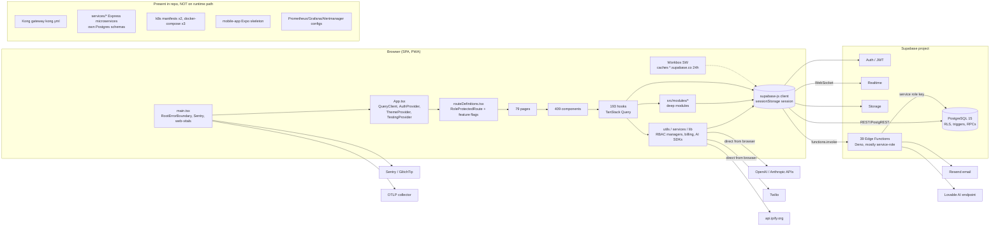
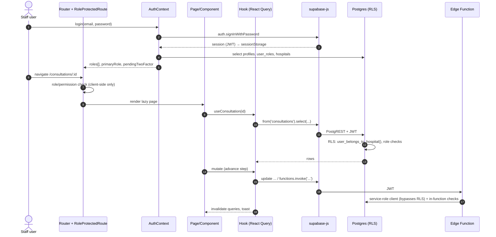

# Repository Architecture

> Part of the CareSync HIMS repository audit (2026-11-01). Audited commit: `43ab8f7` on branch `ccr-2602d823-jeymkf`.
> Everything here was checked against the source code, not taken from existing documentation. Where the existing docs disagree with the code, the disagreement is listed in [§9](#9-documentation-vs-implementation-discrepancies).

## 1. Repository overview

CareSync HIMS (also branded "AROCORD-HIMS" in `index.html` and the PWA manifest) is a multi-tenant hospital information system. It is a **single-page React application that talks directly to Supabase**: PostgreSQL protected by row-level security, Supabase Auth, Realtime, Storage, and Deno edge functions. ADR-0001 records this decision, and the code agrees with it. The repository also contains a parallel microservices stack (Kong, Express services, Kafka/Redis compose files, Kubernetes manifests, and an Expo mobile app). **None of that stack is on the runtime path of the web app.**

| Metric (measured) | Value |
|---|---|
| Git history | 120 commits (2026-04-01 → 2026-09-12); 55 by `gpt-engineer-app[bot]` (Lovable), 65 by the human maintainer |
| Tracked files (excluding `node_modules`, `.git`) | ~1,907 |
| TypeScript/TSX under `src/` | 253,427 lines |
| Pages / components / hooks / utils / services | 79 / 409 / 193 / 87 / 25 files |
| Routes declared in `src/routes/routeDefinitions.tsx` | 101 `path:` entries (69 lazily imported page components) |
| Distinct Supabase tables referenced from `src/` | 196 by a literal `.from('…')` scan. The database audit's broader scan (multi-line and dynamic calls) finds 212, of which 66 are undefined. |
| Distinct RPCs / edge functions invoked from `src/` | RPCs: 32 by a literal scan, 45 by the database audit's scan (16 undefined). Edge functions: 44 names invoked from non-test code, of which 26 exist, 1 is dynamic and 18 do not exist (SECURITY_AUDIT §5, "Frontend ↔ edge-function invocation map"). |
| Edge functions (`supabase/functions/*`, top-level) | 39, plus 3 nested under `phase5/` and 8 `_shared` helpers (~12.8k lines) |
| SQL migrations | 69 top-level `.sql` files (62 timestamp-named) + 98 in `legacy/` + 5 in `phase5/` (~39k SQL lines in `supabase/`) |
| Test files (`*.test.*`, `*.spec.*`) | 331, of which 96 are Playwright specs |
| Markdown docs under `docs/` | 57 |

## 2. Technology stack inventory

| Layer | Technology (version from `package.json`) | Notes |
|---|---|---|
| Language | TypeScript ^5.8, `strict: true` | **The `type-check` script checks 0 files** (root `tsconfig.json` has `"files": []` and the script does not pass `-b`). See TEST-01 in the issue register. |
| UI runtime | React ^18.3, React DOM, react-router-dom ^6.30 | 101 routes. Lazy-loaded pages. |
| Build | Vite ^7.3 with `@vitejs/plugin-react-swc`; terser; `vite-plugin-pwa` ^1.3 (Workbox) | `@vitejs/plugin-react` (Babel) is also installed and used only by Vitest. |
| Styling | Tailwind ^3.4, shadcn/ui (Radix primitives), `tailwindcss-animate`, `framer-motion` | 63 primitives in `src/components/ui`. |
| Server state | `@tanstack/react-query` ^5.83 (251 `useQuery`, 217 `useMutation` call sites) | One `QueryClient` in `src/App.tsx` (`staleTime` 5 min, `retry` 1). |
| Forms / validation | react-hook-form ^7, zod ^3.25, `@hookform/resolvers` | Schemas live in `src/lib/schemas`. |
| Backend | `@supabase/supabase-js` ^2.89 | Postgres + RLS, Auth, Realtime (45 `.channel(` call sites), Storage, 39 Deno edge functions. |
| AI | `openai` ^6, `@anthropic-ai/sdk` ^0.71 (browser bundle), plus an edge-function path through `LOVABLE_AI_ENDPOINT` | The SDKs read `VITE_*` API keys. Vite inlines these into the browser bundle (see the security audit). |
| Observability | `@sentry/react` ^10 **and** `@sentry/tracing` ^7; OpenTelemetry web SDK + OTLP exporter; `web-vitals` | Several overlapping logger/metrics systems (see the architecture findings). |
| Documents / export | `jspdf` ^4, `html2canvas`, `qrcode` | |
| Offline | `idb` ^8, Workbox runtime caching | Workbox caches **all `*.supabase.co` responses for 24 h** (`vite.config.ts:43-53`). |
| Unit/integration tests | Vitest ^4 (jsdom), Testing Library, jest-axe | Test libraries and `jsdom` are listed under `dependencies`, not `devDependencies`. |
| E2E tests | Playwright ^1.58 (three configs), axe-core | Most specs need a live Supabase project or the DEV-only mock-auth mode. |
| Lint / format | ESLint ^10 + typescript-eslint, Prettier, Husky + lint-staged, dependency-cruiser | `no-explicit-any`, `no-unused-vars` and `ban-ts-comment` are turned **off**. |
| Package managers | npm (`package-lock.json`) **and** Bun (`bun.lock`) | Two lockfiles. `.gitignore` excludes only `bun.lockb`. |
| Containers / infra | Dockerfile (nginx 1.25-alpine, node 18), docker-compose ×3, Kong (`kong.yml`), k8s manifests in two places, Prometheus/Grafana/Alertmanager configs | Not used by the Lovable/Supabase hosting path. See the DevOps findings. |
| Hosting (as evidenced) | Lovable Cloud (`.lovable/`, `lovable-tagger`, Supabase project ref in `supabase/config.toml`) | `deploy-production.yml` and `scripts/deploy.sh` describe other targets. |

## 3. Directory map

```
/
├── src/                      React SPA (all runtime code)
│   ├── main.tsx, App.tsx     entry, root error boundary, providers, router
│   ├── routes/               routeDefinitions.tsx (101 routes, guards, feature flags)
│   ├── config/               routeManifest.ts (role → nav), clinicalSLOs.ts
│   ├── contexts/             AuthContext (968 lines), ThemeContext, TestingContext (791 lines, mounted in prod)
│   ├── middleware/           routeGuard.ts
│   ├── pages/                79 page components (role dashboards, clinical, admin, patient portal, "AI" demo pages, /testing)
│   ├── components/           409 components in ~60 feature folders + ui/ (shadcn)
│   ├── hooks/ + lib/hooks/   193 hooks; several files exist in both trees (e.g. usePatientPortal.ts, usePharmacy.ts)
│   ├── modules/              6 "deep modules" (order-safety, discharge-pipeline, prescription-dispensing,
│   │                         critical-lab-escalation, vital-signs, example). Boundaries enforced by dependency-cruiser
│   ├── utils/ (87) lib/ services/ (25)  domain services, 7 per-role RBAC managers, AI/"enterprise" services
│   ├── integrations/supabase client.ts (runtime client, sessionStorage), query-helper.ts (any-typed client used for type-checking and some tests), types.ts (generated, 3.5k lines)
│   ├── bootstrap/            logger, metrics, telemetry, correlation-id, error-tracking
│   ├── test/, __tests__/     in-src unit tests
│   └── workers/              securityAnalysis.worker.ts
├── supabase/
│   ├── config.toml           project ref + verify_jwt for 11 functions
│   ├── migrations/           62 timestamped + 7 non-conforming top-level SQL files, legacy/ (98), phase5/ (5)
│   └── functions/            39 edge functions + _shared + phase5/ (3 nested)
├── tests/                    vitest + playwright suites (security, rbac, hipaa, clinical, api, integration, e2e, uat, ...)
├── services/                 5 Express/Node "microservices" with their own migrations (not on the runtime path)
├── mobile-app/               Expo/React Native skeleton
├── docker/, .deployment/, monitoring/, kong.yml, nginx.conf, docker-compose*.yml, Dockerfile*
├── scripts/                  deploy/backup/rollback/seed/validate scripts (sh, mjs, ts, ps1)
├── .github/workflows/        10 workflows (one retired)
├── docs/                     57 markdown docs, 5 ADRs, a prior audit report
└── .scratch/                 local issue tracker (audit-remediation: 21 tickets; e2e-testing: 7 tickets)
```

## 4. Application module inventory

| Domain | Primary pages | Key hooks / services | Backing tables / functions (examples) |
|---|---|---|---|
| Auth & onboarding | `pages/hospital/*` (Login, Signup, Join, RoleSelection, 2FA setup, Profile/Account setup), `pages/patient/PatientLoginPage`, `PatientRegisterPage` | `AuthContext`, `useStaffInvitations`, `utils/passwordPolicy`, `biometricAuth` | `profiles`, `user_roles`, `hospitals`, `staff_invitations`; edge fns `accept-invitation-signup`, `validate-invitation-token`, `create-hospital-admin`, `generate-2fa-secret`, `store-2fa-secret`, `verify-totp`, `verify-2fa`, `verify-backup-code` |
| Patients & registration | `pages/patients/*`, receptionist forms | `usePatients`, registration modals (several implementations) | `patients`, `patient_queue` |
| Scheduling | `AppointmentsPage`, `SchedulingPage`, `SmartSchedulerPage`, `KioskPage` | `useAppointments`, `useScheduling`, `lib/recurrence.utils.ts` | `appointments`, recurrence tables; phase5 fns `generate-recurring-appointments`, `mark-no-show` |
| Consultations | `ConsultationWorkflowPage` (1,412 lines), `ConsultationsPage`, `MobileConsultationPage` | `useConsultations` (761 lines), `lib/medical/ICD10Service.ts` | `consultations`, `patient_queue` |
| Prescribing & order safety | `/doctor/prescriptions/new`, `PrescriptionBuilder` | `modules/order-safety`, `utils/pediatricDosingEngine.ts` | `prescriptions`, `prescription_items`; fns `drug-interaction-check`, `pediatric-dosing` |
| Pharmacy | `PharmacyPage`, `PharmacyQueuePage`, `ClinicalPharmacyPage` | `modules/prescription-dispensing`, `usePharmacy` (two copies), `pharmacistOperationsService` | `prescriptions`, `medications`, inventory; fns `prescription-approval`, `clinical-pharmacy`, `check-low-stock` |
| Laboratory & radiology | `LaboratoryPage` (1,073 lines), `LabAutomationPage`, `RadiologyPage` | `modules/critical-lab-escalation`, `useCriticalLabAlerts` | `lab_orders`, `lab_results`, `lab_alert_escalations`; fns `critical-lab-check`, `lab-critical-values`, `lab-result-notify`, `lab-automation` |
| Nursing | `NurseMedicationsPage`, `NurseCareProtocolsPage`, nurse dashboard | `modules/vital-signs` (NEWS2), `useNurseWorkflow` | `vital_signs`, medication administration tables; fn `predict-deterioration` |
| Discharge | `DischargeWorkflowPage`, `components/discharge/*` | `modules/discharge-pipeline` | `discharge_workflows`; fn `discharge-workflow` |
| Billing & insurance | `BillingPage`, `components/billing`, `components/features/billing` | `lib/billing.calculator.ts`, `utils/billingValidator.ts`, `lib/edi837.builder.ts`, `paymentService` | `invoices`, `payments`, claims; fns `billing-reconciliation`, `insurance-integration` |
| Patient portal | `pages/patient/*` (EnhancedPortalPage 951 lines) | `usePatientPortal` (two identical 909-line copies) | patient-scoped RLS |
| Telemedicine & messaging | `TelemedicinePage`, `pages/messaging/*` | `VideoCallModal` (888 lines), `messagingService` | fn `telemedicine`; Twilio Video referenced |
| Inventory & suppliers | `InventoryPage`, `SuppliersPage` | `useInventory` | inventory tables; fn `check-low-stock` |
| Admin / audit / monitoring | settings pages, `AuditLogViewer`, `SystemHealthDashboard`, `SystemMonitoringPage` | `auditLogger`, `auditLogQueue` | `audit_logs`, `activity_logs`; fns `audit-logger`, `monitoring`, `system-monitoring`, `health-check`, `backup-manager` |
| "AI" & analytics | `AIDemoPage`, `DifferentialDiagnosisPage`, `PredictiveAnalyticsPage`, `TreatmentPlanOptimizationPage`, `LengthOfStayForecastingPage`, `ResourceUtilizationOptimizationPage`, `VoiceClinicalNotesPage` | `lib/ai/*`, `services/ai/*` (mock mode when no key) | fns `ai-clinical-support`, `symptom-analysis`, `analytics-engine` |
| Testing / dev tooling in app | `/testing` (`TestingDashboardPage`), `TestingContext`, `utils/codeReviewer*` | `services/testing` | fn `test-execution` |

The status of each feature (working / partial / broken) is in [FUNCTIONAL_AUDIT.md](./FUNCTIONAL_AUDIT.md). The health of each module is in [MODULE_AUDIT.md](./MODULE_AUDIT.md).

## 5. Architecture diagram (as implemented)



## 6. Application execution flow

### 6.1 Boot

1. `src/main.tsx` initialises Sentry and web-vitals. It registers global `error` and `unhandledrejection` handlers, unregisters stale service workers, and renders `<RootErrorBoundary><HelmetProvider><App/>`.
2. `src/integrations/supabase/client.ts` throws at import time if `VITE_SUPABASE_URL` or `VITE_SUPABASE_PUBLISHABLE_KEY` is missing, except in test mode. It purges legacy `sb-*` keys from `localStorage` and stores the session in `sessionStorage` through `safeStorage`. Fetches time out after 10 s.
3. `src/App.tsx` builds the `QueryClient` and mounts `AuthProvider`, `ThemeProvider` and `TestingProvider` (TestingProvider is mounted in production too). It then calls `bootstrap()` (logger, telemetry, metrics) and renders the routes: redirect, public, protected, then fallback.

### 6.2 Request lifecycle (authenticated page)



**Trust boundaries.** Route guards, role switching and permission checks in the browser are only for UX. Postgres RLS and the in-function authorization checks in edge functions are the real enforcement points. Most edge functions use the **service-role key**, which bypasses RLS. Their safety therefore depends entirely on the authorization code inside each function (see [SECURITY_AUDIT.md](./SECURITY_AUDIT.md)).

### 6.3 Data persistence paths

- **Direct table access:** most CRUD goes from hooks straight to PostgREST, so RLS is the only server-side guard.
- **RPCs:** 45 distinct `supabase.rpc()` targets, 16 of which are not defined in any applied migration (see [DATABASE_AUDIT.md](./DATABASE_AUDIT.md), DB-14).
- **Edge functions:** used for 2FA, invitations, PHI crypto, clinical decision support, notifications and AI.
- **Realtime:** 45 channel subscriptions (queues, alerts, notifications).
- **Client-side persistence:** sessionStorage holds the auth session. IndexedDB (`idb`) and the Workbox runtime cache can hold API responses.

## 7. External integration inventory

| Integration | Where | Mode | Credential location | Observed status |
|---|---|---|---|---|
| Supabase (DB/Auth/Realtime/Storage/Functions) | everywhere | live | `VITE_SUPABASE_URL` / publishable key (browser); service-role key in edge function env | Core runtime |
| Resend (email) | `supabase/functions/send-email` | server | `RESEND_API_KEY` (edge env) | Implemented server-side |
| Lovable AI gateway | `supabase/functions/*` AI functions | server | `LOVABLE_AI_ENDPOINT` | Server-side path |
| OpenAI / Anthropic | `src/lib/ai/*`, `src/services/ai/*` | **browser** | `VITE_OPENAI_API_KEY`, `VITE_ANTHROPIC_API_KEY` (would be shipped to clients) | Falls back to mock mode when unset |
| Twilio (SMS / Video) | `src/utils/smsService.ts`, telemedicine | **browser** | `VITE_TWILIO_ACCOUNT_SID`, `VITE_TWILIO_AUTH_TOKEN` | See the security audit |
| Stripe | `VITE_STRIPE_PUBLISHABLE_KEY` | browser | publishable key | No server-side payment confirmation found (see the functional audit) |
| Sentry / GlitchTip | `src/lib/monitoring/sentry.ts`, `src/utils/sentry-integration.ts` | browser | `VITE_SENTRY_DSN`, `VITE_GLITCHTIP_DSN` | Configured only when a DSN is set |
| OpenTelemetry OTLP | `src/bootstrap/telemetry.ts` | browser | `VITE_OTLP_ENDPOINT` / `VITE_OTEL_ENDPOINT` | Optional |
| api.ipify.org | client IP lookup | browser | none | Sends user IPs to a third party |
| FHIR / insurance | `supabase/functions/fhir-integration`, `insurance-integration` | server | none found | See the edge function inventory |
| Kong, Redis, Kafka, microservices | compose/k8s/services | — | `.env.prod.example` | Not wired to the SPA (ADR-0001) |

## 8. Documentation and configuration inventory

**Configuration files:** `vite.config.ts` (dev CSP headers and PWA), `vite.config.production.ts`, `tsconfig*.json` (three files), `eslint.config.js`, `.dependency-cruiser.cjs`, `vitest*.config.ts` (four files), `playwright*.config.ts` (three files), `tailwind.config.ts`, `components.json`, `supabase/config.toml`, `nginx.conf`, `Dockerfile`, `Dockerfile.dev`, `docker-compose{,.dev,.prod}.yml`, `kong.yml`, `.env.example`, `.env.prod.example`, `.env.staging.example`, `.env.test` (tracked; dummy E2E credentials), `.husky/`, `.lintstagedrc`, `.prettierrc`, `.code-reviewer.json`, `skills-lock.json`.

**Environment variables consumed by the browser bundle** (`import.meta.env.*`): `VITE_SUPABASE_URL`, `VITE_SUPABASE_PUBLISHABLE_KEY`, `VITE_SUPABASE_ANON_KEY` (11 uses; the name differs from the canonical one), `VITE_SENTRY_DSN`, `VITE_GLITCHTIP_DSN`, `VITE_OTLP_ENDPOINT`, `VITE_OTEL_ENDPOINT`, `VITE_APP_VERSION`, `VITE_ENV`, `VITE_E2E_MOCK_AUTH`, `VITE_E2E_MOCK_PASSWORD`, `VITE_OPENAI_API_KEY`, `VITE_ANTHROPIC_API_KEY`, `VITE_TWILIO_ACCOUNT_SID`, `VITE_TWILIO_AUTH_TOKEN`, `VITE_TWILIO_PHONE_NUMBER`, `VITE_STRIPE_PUBLISHABLE_KEY`, `VITE_LOVABLE_API_KEY`, `VITE_API_KEY`, `VITE_API_URL`, `VITE_CLINICAL_SERVICE_URL`, `VITE_REDIS_URL`, `VITE_PATIENT_MESSAGE_ALLOWED_ROLES`, `VITE_AI_COST_ALERT_THRESHOLD`. **Only the first two appear in `.env.example`.**

**Edge function environment:** `SUPABASE_URL`, `SUPABASE_SERVICE_ROLE_KEY` (39 functions), `SUPABASE_ANON_KEY`, `PHI_ENCRYPTION_KEY`, `TWO_FACTOR_ENCRYPTION_KEY`, `RESEND_API_KEY`, `LOVABLE_AI_ENDPOINT`, `CORS_ALLOWED_ORIGINS`, `ENVIRONMENT`, `EMAIL_SERVICE_HEALTH_URL`, `DEBUG_TRACING`.

**Documentation:** `README.md`, `CONTEXT.md` (domain glossary), `AGENTS.md`, `docs/` (57 files, including five ADRs, `HIPAA_AUDIT/` with four files, `product/` with twelve, `workflows/` with eight, `operations/` with two, `integrations/` with three, and `COMPREHENSIVE_AUDIT_REPORT.md`), `src/modules/README.md`, and `.scratch/` tickets. Two stray prompt files sit at the root (`Prompt for review.md`, `prompt for testing`).

## 9. Documentation vs implementation discrepancies

| Claim (source) | Reality (evidence) |
|---|---|
| "Type checking: 0 compilation errors across 450+ files" (`docs/COMPREHENSIVE_AUDIT_REPORT.md` §2.1) | `npm run type-check` = `tsc --noEmit` on a solution-style `tsconfig.json` with `"files": []`. It checks **0 files** (`--listFilesOnly` count = 0). `tsc -p tsconfig.app.json --noEmit` checks 907 files and reports **35 errors**. |
| "Unified typed RBAC… sole source of truth" (ADR-0005) | Seven per-role `*RBACManager.ts` files, `lib/permissions.ts`, `abacManager.ts`, `types/rbac.ts` and `routeManifest.ts` all still exist. See SECURITY_AUDIT and MODULE_AUDIT. |
| "TanStack Query v4" (`docs/SYSTEM_ARCHITECTURE.md`) | v5 (`^5.83.0`). |
| "Rate limiting via Kong API gateway" (`docs/SYSTEM_ARCHITECTURE.md` §OWASP) | Kong is not on the runtime path (ADR-0001). The SPA calls Supabase directly. |
| "Deployment: Docker + Kubernetes + CI/CD" (`docs/SYSTEM_ARCHITECTURE.md`) | The Dockerfile build cannot succeed as written (`npm ci --only=production`, then `vite build`). The evidenced hosting is Lovable Cloud. |
| README links to `PHASES_1-8_COMPLETE_SUMMARY.md`, `PHASES_1-4_COMPLETE_SUMMARY.md`, `docs/CHANGELOG.md`, `docs/API_GATEWAY.md`, `./github/copilot-instructions.md`, `./agents/skills/...`, `docs/IMPLEMENTATION_GUIDE.md` | These files do not exist in the repository. |
| README: "app available at http://localhost:5173" | `vite.config.ts` sets `port: 8080`. |
| "41 Active Deno Edge Functions", "78 migration files" (prior audit) | 39 top-level and 3 nested function directories. 69 top-level SQL files, of which 62 follow the timestamp convention that the Supabase CLI applies. |
