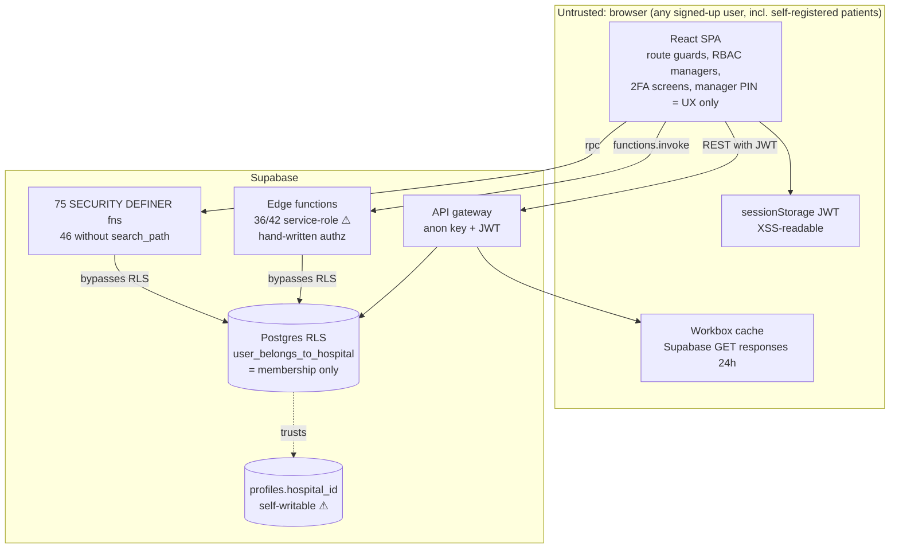

# Security & Data Protection Audit

> CareSync HIMS repository audit, 2026-11-01. Commit `43ab8f7`. Read-only static analysis plus local builds and test runs. **No live Supabase project, production URL or credentials were used.**
> Severity: P0 critical · P1 high · P2 medium · P3 low · P4 informational. Status: CONFIRMED (seen in code or executed) · LIKELY (strong code evidence, runtime unverified) · SUSPECTED (needs runtime verification).
> Secret values are never reproduced. Where a credential appears in source it is shown as `<REDACTED>`.

## 1. Scope and method

| Surface | What was examined | Detailed findings |
|---|---|---|
| Browser application | Auth/session (`AuthContext`, Supabase client), route guards, 7 RBAC layers, 2FA UI, PHI handling in storage/PWA/logging, XSS sinks, secrets in `VITE_*` env, CSP/headers, uploads, client "security" utilities | §4 (SECF-xx) |
| Edge functions | All 42 entrypoints and `_shared` helpers: authentication, tenant scoping, service-role use, CORS, input validation, rate limiting, SSRF, 2FA, invitation, crypto, backup | §5 (EDGE-xx) |
| Database / RLS | 232 tables across migrations, RLS policies, SECURITY DEFINER functions, audit logging, storage buckets | [DATABASE_AUDIT.md](./DATABASE_AUDIT.md) (DB-xx) |
| Business-logic security | Financial authorization, destructive admin tools | [FUNCTIONAL_AUDIT.md](./FUNCTIONAL_AUDIT.md) (FUNC-33, FUNC-10) |
| Supply chain / CI / secrets hygiene | `npm audit`, workflow permissions, secrets in history and config | [PRODUCTION_READINESS_CHECKLIST.md](./PRODUCTION_READINESS_CHECKLIST.md) (OPS-xx) |

Method: line-level source review by two independent security reviewers (frontend and edge functions) plus a database reviewer. The lead auditor then re-read the source behind every P0 and the highest-impact P1s; see §3. Two production builds were inspected to confirm bundle exposure. Mock-auth reachability was checked by building with `VITE_E2E_MOCK_AUTH=true`.

## 2. Security posture summary

**Overall: not production-ready for PHI.** The single most important conclusion is that **tenant isolation is not enforced in depth.** Every PHI read path in the database ultimately relies on `user_belongs_to_hospital(auth.uid(), hospital_id)`. That check is defeated by a user-writable `profiles.hospital_id` (DB-01). It does not check role, so patients and deactivated staff keep access (DB-02). The migrations that were meant to harden it fail to apply (DB-03). In parallel, most edge functions run with the service-role key and re-implement authorization by hand, and several do it wrongly (EDGE-01, -02, -06, -07, -08).

| Theme | Key findings | Worst realistic impact |
|---|---|---|
| Multi-tenant isolation | DB-01, DB-02, DB-05, DB-09, DB-13, EDGE-01, EDGE-06, EDGE-07, EDGE-08, EDGE-13, EDGE-14 | Any self-registered account reads another hospital's PHI. Reportable HIPAA breach across tenants. |
| Destructive / integrity operations | EDGE-02, DB-04, DB-11, FUNC-10, EDGE-09, DB-08 | Platform-wide table wipe, audit-trail erasure, forged audit events. |
| Authentication strength | SECF-01, SECF-02, EDGE-05, EDGE-12, EDGE-25, ARCH-06, SECF-13, SECF-14, SECF-15 | Mandatory 2FA is bypassable and the live TOTP secrets come from `Math.random`. No lockout. |
| Authorization model | SECF-07, SECF-08, SECF-09, DB-07, FUNC-33, DB-10 | Client-only financial authorization (hardcoded PIN). The billing boundary (ADR-0002) is not enforced. |
| PHI at rest on devices | SECF-04 (PWA cache), SECF-05, SECF-06, SECF-23 | PHI persists on shared clinical workstations after logout. |
| Secrets | SECF-03, SECF-19, SECF-20, SECF-21, OPS-13 | AI/Twilio keys would ship in public JS. A former PHI key remains in git history. |
| Crypto | EDGE-04 | The decryption oracle remains (the claimed fix is ineffective). |
| Hardening / hygiene | SECF-12, SECF-17, SECF-18, SECF-24, SECF-25, EDGE-11, EDGE-16, EDGE-21, EDGE-26, EDGE-27, OPS-19 | PHI in telemetry, weak CSP, open email relay, vulnerable dependencies. |

**Verified as holding:**
- E2E mock auth cannot activate in a production `vite build`.
- PHI encryption keys are server-only.
- The production frontend does not take roles from `localStorage`.
- `check-low-stock` tenant pinning and the stub-function purge are fixed.
- There is no wildcard or credentialed CORS in edge functions.

See the prior-claim tables in §4 and §5.

### 2.1 Trust boundaries (as implemented)



## 3. Lead verification of critical claims

Each item below was re-read in source by the lead auditor after the specialist reports were received.

| ID | Verified evidence (file:line) | Result |
|---|---|---|
| DB-01 | `supabase/migrations/20260204000011_misc.sql:274-276`: `CREATE POLICY "Users can update their own profile" ON public.profiles FOR UPDATE USING (user_id = auth.uid());` has no `WITH CHECK` and no column guard. No later migration or trigger restricts `hospital_id`. Read policies rely on membership (`20260303000001_profiles_rls_anon_deny.sql`). | CONFIRMED |
| DB-03 | `20260311000007_rls_hardening.sql:11` and `20260909000001_…:11` run `CREATE OR REPLACE user_belongs_to_hospital(p_user_id, p_hospital_id)` over the original `(_user_id, _hospital_id)` (`20260204000011_misc.sql:238`). PostgreSQL rejects parameter renames in `CREATE OR REPLACE`. The generated `src/integrations/supabase/types.ts:3328-3330` still shows `_user_id`, so the hardening is not live. | CONFIRMED |
| DB-04 | `20260313000004_…:335`: `IF current_setting('app.environment', true) != 'staging'` evaluates to NULL (no exception) when the setting is unset. The function is SECURITY DEFINER and EXECUTE was not revoked from PUBLIC (the grant is only commented out). | CONFIRMED in code. Live presence unknown. |
| EDGE-01 | `fhir-integration/index.ts:486-489` reads SMART scopes from user-writable `user_metadata`. `exportMedicationRequests` (:1226-1240) and `exportConditions` (:1280-1290) call only `enforcePatientScopeAccess`, which returns early for staff tokens (:743). | CONFIRMED |
| EDGE-02 | `backup-manager/index.ts:34` authorizes any `admin`. `restoreBackup` runs `.delete().neq('id','0000…')` on every table in the file with the service-role client (:159-187). | CONFIRMED |
| SECF-01 | The 2FA redirect exists only in `ProtectedRoute` (`routeDefinitions.tsx:173`, 5 routes). `withRoleAccess` → `RoleProtectedRoute` (:242-259) wraps the 52 role-protected routes and has no 2FA check. | CONFIRMED |
| ARCH-06 / EDGE-05 | `TwoFactorSetupModal.tsx:14` imports `useTwoFactorAuth` from `@/lib/hooks`, which resolves to `src/lib/hooks/auth/useTwoFactorAuth.ts:23,32` (`Math.random` for the TOTP secret and backup codes). The hardened copy in `src/hooks/` is unused. | CONFIRMED |
| SECF-03 | `src/lib/ai/orchestrator.ts:542,553` and `src/services/ai/clinicalAIService.ts:7,12` read `VITE_OPENAI_API_KEY` / `VITE_ANTHROPIC_API_KEY`. `src/utils/smsService.ts` reads `VITE_TWILIO_AUTH_TOKEN`. Vite inlines any `VITE_*` value. | CONFIRMED |
| SECF-04 | `vite.config.ts:43-63`: `runtimeCaching` uses `urlPattern: /^https:\/\/.*\.supabase\.co\/.*/i`, `NetworkFirst`, 24 h; storage uses `CacheFirst` for 7 days. There is no purge on logout. | CONFIRMED |
| FUNC-33 | `InvoiceAdjustmentModal.tsx:72-73`: `profile?.role === 'admin' \|\| profile?.role === 'billing_manager' \|\| managerPin === '<REDACTED>'`. `Profile` has no `role`, so the hardcoded PIN is the only path. A direct `invoices` UPDATE follows (:102-139). | CONFIRMED |
| PERF-01 | `bootstrap()` → `registerFetchInterceptor()` replaces `window.fetch` and adds `x-correlation-id` (`src/utils/correlationId.ts:177,199-204`). The edge CORS allow-list is `authorization, x-client-info, apikey, content-type` (`_shared/cors.ts:16-19`). Browser preflights to edge functions are therefore expected to fail. | LIKELY. Needs one browser check (Sprint 0 task S0-02). |

## 4. Frontend and repository-level security findings (SECF)

Scope: React 18 + Vite 7.3.5 SPA (`src/`), build/deploy config (vite, nginx, Docker, Kong), repo/git hygiene.
Edge functions and SQL/RLS are owned by other auditors; where frontend security *depends* on them it is called out as "Dependency".
Method: static review with Grep/Read, plus two read-only executions: (1) a parity script comparing `src/types/rbac.ts` and `src/lib/permissions.ts`, compiled with esbuild; (2) two production builds (`vite build`), both written to the scratchpad `--outDir`, not the repo. One used canary values for the `VITE_*` secrets. `git status` was clean afterwards. Secrets are redacted throughout.

### Prior-claim verification

| # | Prior claim (source) | File evidence | Verdict |
|---|---|---|---|
| 1 | E2E mock auth can never be active in a production build (AuthContext comment; `.scratch/e2e-testing/spec.md`) | `AuthContext.tsx:100,110,214-220` gate on `import.meta.env.DEV/PROD`. A production `vite build` (executed) contains no mock users, no mock password and no "cannot be enabled" guard. `isE2EMockAuthEnabled` is constant-folded to `false`. `.env.test` loads only with `--mode test`, and every `vite build` sets NODE_ENV=production, so PROD=true. The mock path is live only in the Vite **dev server** (`vite`/`npm run dev`, Playwright `vite --mode test`, `Dockerfile.dev`, CI `npm run dev`) or a build with `NODE_ENV=development` set explicitly. A prod build that sets `VITE_E2E_MOCK_AUTH=true` throws, so it fails closed (DoS, not bypass). | **HOLDS**, with residual mock code in the prod bundle (see SECF-22) |
| 2 | "No credential literal in source" (AuthContext.tsx:97) | `LoginPage.tsx:341,358` hardcode the shared test password. It is dead-code-eliminated from the prod bundle (verified). It is also hardcoded in `scripts/create-test-users.js:52-112`, `scripts/seed-e2e-data.mjs:18` and `.env.test:7` | **PARTIAL** |
| 3 | SEC-006 "Migrate auth session storage to HttpOnly cookies" (issue 19, audit report line 662) | `client.ts:69-146` uses a sessionStorage adapter and purges legacy `sb-*` keys: **holds**. Tokens are not HttpOnly and are still readable by any XSS. There is no "memory fallback". The tsconfig path alias maps `@/integrations/supabase/client` to `query-helper.ts`, which uses `storage: localStorage` (type-check only) | **PARTIAL** |
| 4 | RBAC-UNIFY / ADR-0005 §1: `src/types/rbac.ts` is the sole TS source of truth; managers are thin facades | Route guards (`RoleProtectedRoute`, `routeGuard.ts`) and `usePermissions` use `src/lib/permissions.ts` (20 importers). The executed parity script shows **50 divergences** between rbac.ts and permissions.ts. `UnifiedAuthService.hasPermission` ORs both (most permissive wins). `AdminRBACManager` and `abacManager` remain independent models | **DOES NOT HOLD** (SECF-07) |
| 5 | RBAC-004: phantom `super_admin` purged | No runtime reference in `src/` or `supabase/functions/`. `src/test/admin-rbac-verify.ts:101-298` still asserts super_admin behaviour. Migration `20260909000001:171-172` **remaps** legacy super_admin rows to `admin` (privilege retained, not revoked; SQL auditor). Older migrations still contain it (superseded?) | **PARTIAL** |
| 6 | RBAC-001: `PharmacistRBACManager.checkPermission` no longer `return true` | `return true` is gone. It was replaced by a magic-ID grant (`userId === 'default-pharmacist'` gives the pharmacist role), a default manager with `permissions: ['*']`, and substring permission matching | **PARTIAL** (SECF-08) |
| 7 | SEC-003: CSPRNG for 2FA + server verification before enabling | `useTwoFactorAuth.ts:22,36` use `getRandomValues` (holds). Enrolment calls the `verify-2fa`/`store-2fa-secret` edge functions. Login-time TOTP is a UI modal that is not bound to the session, and can be skipped by navigation or the PublicRoute redirect | **PARTIAL** (SECF-02) |
| 8 | 2FA mandatory for admin/doctor: "application route guard blocks PHI access" (migration `20260622000001` header, AuthContext:801-812) | `pendingTwoFactor` is checked only by `ProtectedRoute`, which wraps 5 non-PHI routes. All PHI routes use `withRoleAccess` (no 2FA check) | **DOES NOT HOLD** (SECF-01) |
| 9 | PHI field-encryption keys live only server-side (`dataProtection.ts:23-28`) | No `VITE_ENCRYPTION_KEY` or key material in `src/`. The former client key is still in git history (SECF-20) | **HOLDS** (for current code) |
| 10 | DEVOPS-001: lint `\|\| true` removed from CI | `ci-pipeline.yml:52` lint step is blocking (holds). `npm audit ... \|\| true` (`:99`) and SAST `continue-on-error` (`:103`) remain. The "0 lint errors" claim was not executed | **PARTIAL** (SECF-27) |
| 11 | Audit report exec summary: "SEC-001–SEC-009 resolved" (COMPREHENSIVE_AUDIT_REPORT.md:75) | SEC-007 is still open (`issues/18` status `ready-for-human`). `.env`/`.env.kong` remain in commits `df8831e`, `ff2ea46` | **DOES NOT HOLD** (SECF-20) |
| 12 | Frontend does not trust role from localStorage / user_metadata | In prod, roles come from `user_roles`, and the `preferredRole` stored in localStorage is validated against them (`AuthContext.tsx:515-521,825`). `testRole` overrides are DEV-only (`devRoleSwitch.ts:7`). No code reads role from `user_metadata`. DEV note: `getDevTestRole` ignores its `roles` argument, so any role can be chosen in dev | **HOLDS** (prod) |

---

### SECF-01: Mandatory 2FA enrolment for admin/doctor is enforced only on 5 non-PHI routes, so every PHI route skips it
- Severity: P1
- Category: Security
- Status: CONFIRMED (static analysis of route tree)
- Module: Routing / Authentication (2FA)
- Location: src/routes/routeDefinitions.tsx:92-176, 242-259, 426-698; src/contexts/AuthContext.tsx:805-812; supabase/migrations/20260622000001_enforce_2fa_for_clinical_roles.sql:8-12
- Evidence:
  ```
  routeDefinitions.tsx:173  if (pendingTwoFactor) return <Navigate to="/hospital/two-factor-setup" replace />;   // inside ProtectedRoute only
  routeDefinitions.tsx:248  const content = (<RoleProtectedRoute allowedRoles={allowedRoles} requiredPermission={requiredPermission}>
  migration:10-11  -- Enforcement is therefore: (1) this server-set requirement flag + (2) an application route guard that blocks PHI access
  ```
- Actual behavior / Expected behavior: `ProtectedRoute` (which checks `pendingTwoFactor` and `pendingRoleSelection`) wraps only `/dashboard`, `/profile`, `/notifications`, `/hospital/profile-setup` and `/hospital/role-setup`. Every PHI route (`/patients`, `/patients/:id`, `/consultations/*`, `/laboratory`, `/pharmacy`, `/billing`, `/documents`, `/messages`, `/telemedicine`, `/settings/*`) goes through `withRoleAccess` → `RoleProtectedRoute`, which never checks 2FA. An admin/doctor without 2FA who types `/patients` gets full access. The server migration says the route guard *is* the enforcement, because RLS cannot see MFA state. Expected: PHI is unreachable until 2FA is enrolled, and enforcement is server-side.
- Reproduction: Log in as a doctor with `two_factor_enabled=false`. You are redirected to `/hospital/two-factor-setup`. Edit the URL to `/patients`: the page renders and loads patient data.
- Root cause: The 2FA and role-selection gates live in a wrapper that the PHI route factory does not use. The custom TOTP sets no AAL claim, so there is no server-side backstop.
- Impact: The HIPAA §164.312(d) control for privileged clinical accounts is bypassed by URL entry. A phished doctor or admin password gives direct PHI access.
- Recommendation: Short term, nest `RoleProtectedRoute` inside `ProtectedRoute` in `withRoleAccess`, or move the `pendingTwoFactor`/`pendingRoleSelection` checks into `RoleProtectedRoute`. Proper fix: migrate to Supabase MFA (TOTP factors, `aal2`) and add `auth.jwt()->>'aal' = 'aal2'` to the PHI RLS policies for admin and doctor (SQL auditor).
- Effort: S (route fix) / L (AAL2 migration)
- Acceptance criteria: For every path in `protectedRoutes`, a user with `pendingTwoFactor=true` is redirected to `/hospital/two-factor-setup` (route-table unit test). After the AAL2 migration, a REST call with an aal1 JWT from a doctor or admin returns 0 PHI rows.

### SECF-02: Login-time TOTP check is a UI step after a full session is issued, so it is skippable and fails open
- Severity: P1
- Category: Security
- Status: LIKELY (strong code evidence; the race and bypass were not executed in a browser)
- Module: Authentication / LoginPage
- Location: src/pages/hospital/LoginPage.tsx:65-78, 97-115; src/routes/routeDefinitions.tsx:210-216, 317-324; src/components/auth/TwoFactorVerifyModal.tsx:36-46; supabase/migrations/20260204000011_misc.sql:274-276
- Evidence:
  ```
  LoginPage.tsx:72   if (error) return false;            // checkTwoFactorRequired fails open
  LoginPage.tsx:110  const requires2FA = await checkTwoFactorRequired(user.id);   // runs AFTER signInWithPassword stored the session
  routeDefinitions.tsx:212  if (isAuthenticated) { return <Navigate to={pendingRoleSelection ? '/hospital/select-role' : '/dashboard'} replace />;
  misc.sql:274-276  CREATE POLICY "Users can update their own profile" ON public.profiles FOR UPDATE USING (user_id = auth.uid());
  ```
- Actual behavior / Expected behavior: `signInWithPassword` stores a full AAL1 session before any second factor. The TOTP modal only decides whether `navigate('/dashboard')` runs. Four ways around it:
  1. `/hospital/login` sits inside `PublicRoute`, which redirects to `/dashboard` as soon as `onAuthStateChange` sets the session. That probably unmounts LoginPage before the modal opens.
  2. Closing the modal or refreshing keeps the session, and `pendingTwoFactor` is false because 2FA is "enabled".
  3. `checkTwoFactorRequired` returns false on any query error.
  4. Any other login path skips the check entirely: `/patient-login`, or `supabase.auth.signInWithPassword` from the console.

  Dependency: the profiles UPDATE policy has no column restriction, so a user can also PATCH `two_factor_enabled=true` and satisfy SECF-01's gate without enrolling. Expected: the second factor is verified server-side and bound to the session (AAL2) before any PHI query is authorised.
- Reproduction: Static. As a doctor with 2FA enabled, submit the password and observe the redirect to `/dashboard` (PublicRoute). Or press Esc on the modal and load `/patients`.
- Root cause: The custom TOTP is not integrated with GoTrue MFA, and the verify result (`data.valid`) is only a client boolean.
- Impact: 2FA gives no protection against credential theft for privileged users.
- Recommendation: Use `supabase.auth.mfa.challenge/verify` (AAL2) and enforce `aal2` in RLS and edge functions. Until then, sign the user out if the TOTP is not verified, fail closed on lookup errors, and keep the login route from redirecting while a 2FA challenge is pending. Restrict profile UPDATE to safe columns (column GRANTs or a trigger rejecting changes to `two_factor_*`, `hospital_id`, `is_active`, `is_staff`).
- Effort: L
- Acceptance criteria: With 2FA enabled, any PHI REST call made before the TOTP is verified returns 401/0 rows. `PATCH /profiles {two_factor_enabled:true}` from a user JWT is rejected.

### SECF-03: OpenAI/Anthropic API keys are read from `VITE_*` env and inlined into the public JS bundle
- Severity: P1
- Category: Security
- Status: CONFIRMED (canary build: `AUDITCANARY_OPENAI` and `AUDITCANARY_ANTHROPIC` found in `dist/assets/useAI-*.js`)
- Module: AI integration
- Location: src/lib/ai/orchestrator.ts:542-560; src/services/ai/clinicalAIService.ts:5-21, 186-220; src/services/ai/predictiveAnalyticsService.ts:6-14; src/utils/smsService.ts:55-57; src/hooks/useAIMetrics.ts:185-194; src/services/clinicalApiClient.ts:13
- Evidence:
  ```
  orchestrator.ts:542  const openaiKey = import.meta.env.VITE_OPENAI_API_KEY || import.meta.env.OPENAI_API_KEY;
  orchestrator.ts:553  const claudeKey = import.meta.env.VITE_ANTHROPIC_API_KEY || import.meta.env.ANTHROPIC_API_KEY;
  clinicalAIService.ts:21  console.warn('... Set VITE_OPENAI_API_KEY or VITE_ANTHROPIC_API_KEY in .env to enable real AI.');
  smsService.ts:56  this.authToken = import.meta.env.VITE_TWILIO_AUTH_TOKEN || null;
  build: dist-canary/assets/useAI-BB0zNYtT.js: AUDITCANARY_ANTHROPIC, AUDITCANARY_OPENAI
  ```
- Actual behavior / Expected behavior: Any value set for these variables at build time ships to every visitor, and the code tells operators to set them. `clinicalAIService` would also send prompts containing patient history directly from the browser to OpenAI or Anthropic, bypassing the `ai-clinical-support` edge function, its audit trail and BAA controls. The same pattern exists for `VITE_TWILIO_AUTH_TOKEN`, `VITE_LOVABLE_API_KEY` and `VITE_API_KEY`; these are not in the current bundle only because tree-shaking dropped them. Expected: provider secrets exist only in edge-function secrets, and the browser calls the edge function.
- Reproduction: `VITE_OPENAI_API_KEY=X vite build`, then `grep -r X dist/assets`.
- Root cause: AI and SMS provider code was written for the browser using Vite env vars.
- Impact: Theft of AI or Twilio credentials (billing fraud, SMS phishing from the hospital's number). Possible PHI disclosure to a non-BAA processor.
- Recommendation: Delete the browser provider paths (`clinicalAIService`, `predictiveAnalyticsService`, orchestrator provider init, `smsService`, `useLovableAIStats`). Route through edge functions. Add a CI check that fails if `VITE_[A-Z_]*(KEY|TOKEN|SECRET)` appears in `src/`, except `VITE_SUPABASE_PUBLISHABLE_KEY` and `VITE_STRIPE_PUBLISHABLE_KEY`.
- Effort: M
- Acceptance criteria: A canary build with all provider env vars set produces no canary string in `dist/`. `grep -rE "VITE_(OPENAI|ANTHROPIC|TWILIO_AUTH|LOVABLE|API_KEY)" src` returns nothing.

### SECF-04: The PWA service worker caches every Supabase GET response (PHI) on disk for 24h, keyed by URL rather than user
- Severity: P1
- Category: Security
- Status: CONFIRMED (generated `dist/sw.js` inspected)
- Module: PWA / offline
- Location: vite.config.ts:40-65; generated sw.js
- Evidence:
  ```
  sw.js: s.registerRoute(/^https:\/\/.*\.supabase\.co\/.*/i,new s.NetworkFirst({cacheName:"supabase-api",plugins:[new s.ExpirationPlugin({maxEntries:100,maxAgeSeconds:86400})]}),"GET"),
         s.registerRoute(/^https:\/\/.*\.supabase\.co\/storage\/.*/i,new s.CacheFirst({cacheName:"supabase-storage",...maxAgeSeconds:604800...}),"GET")
  ```
- Actual behavior / Expected behavior: All `/rest/v1/*` reads (patients, prescriptions, lab results, `/auth/v1/user`) and signed storage downloads are persisted in Cache Storage. Search terms in the URL (patient names) become cache keys. The Cache API ignores the `Authorization` header, so when the network fails, a later user on the same browser profile gets the previous user's PHI for an identical URL. Nothing clears `supabase-api` on logout. The second rule (storage, CacheFirst, 7 days) is dead because the first regex already matches `/storage/` URLs. Expected: never cache authenticated API responses, or encrypt them per user and purge on logout.
- Reproduction: Static, from the built `sw.js`. Runtime: log in, open `/patients`, log out, go offline and replay the same REST URL. It is served from the cache.
- Root cause: A generic PWA template applied to a PHI API.
- Impact: PHI persists unencrypted on shared hospital workstations and kiosks, with cross-user disclosure. This breaks HIPAA §164.312(a)(2)(iv) and §164.310(d) expectations.
- Recommendation: Remove the Supabase `runtimeCaching` entries (or add a `NetworkOnly` rule for `*.supabase.co`). If offline reads are required, use an explicit, per-user, encrypted store. Call `caches.delete('supabase-api')` and `caches.delete('supabase-storage')` on logout.
- Effort: S
- Acceptance criteria: The generated `sw.js` contains no cache route for `supabase.co`. After logout, `caches.keys()` contains no `supabase-*` cache.

### SECF-05: Logout leaves PHI in the client; idle auto-logoff can leave a live session
- Severity: P2
- Category: Security
- Status: CONFIRMED (missing purge); LIKELY (session survives a signOut network failure, per auth-js source)
- Module: AuthContext / session lifecycle
- Location: src/contexts/AuthContext.tsx:296-348; src/App.tsx:22-30; src/lib/hooks/auth/useSessionTimeout.ts:41-44; node_modules/@supabase/auth-js/dist/module/GoTrueClient.js:1577-1585
- Evidence:
  ```
  AuthContext.tsx:329  await supabase.auth.signOut();          // returned { error } ignored
  AuthContext.tsx:338-341  window.localStorage.removeItem(PREFERRED_ROLE_STORAGE_KEY); window.localStorage.removeItem('testRole');
  GoTrueClient.js:1582-1584  if (!(isAuthApiError(error) && (error.status === 404 || ...))) { return this._returnResult({ error }); }   // session NOT removed
  ```
- Actual behavior / Expected behavior: Logout clears only React state and two localStorage keys. These all survive and are visible to the next user of the tab or browser:
  - the React Query cache (`staleTime` 5 min; data shown without a refetch)
  - `care-harmony-offline-cache` and `offline_data`
  - `offline_patients_cache`, `offline_vitals_cache` and `offline_medications_cache`
  - `testing-data`
  - the service-worker caches (SECF-04)

  If `signOut` hits a network error, auth-js returns `{error}` and keeps the session in sessionStorage. AuthContext ignores that error and shows a logged-out UI, but a reload restores the session. This also applies to the 30-minute idle-timeout logout. Expected: logout always clears the local session (`scope:'local'` fallback) and wipes every client-side PHI store.
- Reproduction: Static. Runtime: set DevTools to offline, wait for the idle timeout, then reload. You are still logged in.
- Root cause: No central "purge client state" routine.
- Impact: Shared-workstation PHI leakage, and automatic logoff (§164.312(a)(2)(iii)) is not reliable.
- Recommendation: In `logout`, call `queryClient.clear()`, remove all app localStorage and sessionStorage keys, call `indexedDB.deleteDatabase('care-harmony-cache')` and delete the SW caches. If `signOut()` returns an error, call `signOut({scope:'local'})`.
- Effort: S
- Acceptance criteria: After logout, while online or offline, localStorage holds no app keys, `queryClient.getQueryCache().getAll()` is empty, and a reload shows the login page.

### SECF-06: PHI is written to localStorage in plaintext and exported or imported as unencrypted JSON
- Severity: P2
- Category: Security
- Status: CONFIRMED
- Module: Nurse offline mode
- Location: src/components/nurse/OfflineDataImportExport.tsx:33-49, 83-111 (rendered in src/components/dashboard/NurseDashboard.tsx:30); src/hooks/useOfflineSync.ts:170-179, 225-237
- Evidence:
  ```
  OfflineDataImportExport.tsx:111  localStorage.setItem('offline_patients_cache', JSON.stringify(mergedPatients));
  OfflineDataImportExport.tsx:45   const blob = new Blob([dataStr], { type: 'application/json' });   // patients + vitals + meds + pendingActions
  useOfflineSync.ts:170-171  const encryptedCache = { ...cache,   // pendingActions (full PHI payloads) copied unencrypted
  useOfflineSync.ts:230  pendingActions: cache.pendingActions.slice(-20), // quota fallback, unencrypted
  ```
- Actual behavior / Expected behavior: Any nurse can download a JSON file of cached patients, vitals, medications and queued writes, with no audit log entry. Imports accept any JSON with a `vitals` array (no size limit or schema check) and store it in plaintext localStorage. In `useOfflineSync`, only selected fields of three arrays are encrypted (through the `phi-crypto` server, so encryption fails while offline). `pendingActions[*].data` is always plaintext. Expected: no plaintext PHI at rest in web storage, and exports are audited and encrypted.
- Reproduction: Static.
- Root cause: An offline feature built without a data-at-rest design.
- Impact: PHI on lost or shared devices, and silent bulk exfiltration by insiders.
- Recommendation: Remove export/import, or require admin approval, an audit event and an encrypted package. Move offline queues to IndexedDB, encrypted with a non-extractable WebCrypto key derived per session and wiped on logout. Validate imports with zod and cap their size.
- Effort: M
- Acceptance criteria: No localStorage key contains PHI field names after an offline session. Export writes an `activity_logs` row and produces an encrypted artifact.

### SECF-07: Two divergent permission matrices; the guards use the one with an `admin: ['*']` wildcard and alias leaks
- Severity: P2
- Category: Security
- Status: CONFIRMED (executed parity script: 50 divergences)
- Module: RBAC
- Location: src/lib/permissions.ts:5-41, 145-164; src/types/rbac.ts:100-138; src/services/unifiedAuthService.ts:37-55; src/components/auth/RoleProtectedRoute.tsx:93-96; src/hooks/usePermissions.ts:28
- Evidence:
  ```
  permissions.ts:41   admin: ['*'],
  permissions.ts:18   'prescription:dispense': 'prescriptions:write',     // doctor has prescriptions:write
  script output:      admin prescription:write rbac=false permissions=true
                      doctor prescription:dispense rbac=false permissions=true
                      nurse appointment:write rbac=true permissions=false
  unifiedAuthService.ts:55  return enumResult || stringResult;
  ```
- Actual behavior / Expected behavior: ADR-0005 says `rbac.ts` is the single source of truth, but route guards, `usePermissions().can()` and GlobalSearch use `lib/permissions.ts`. That file grants admin everything, including clinical writes and dispensing (ADR-0002/0004 boundaries). Through the alias table it grants doctors `prescription:dispense`. Base-only grants such as `samples`, `clinical-pharmacy` and `laboratory` match any `:action`. `can()` evaluates the union of all roles, not the selected role. Expected: one matrix, deny-by-default, and no wildcard.
- Reproduction: `esbuild` bundle of a script that iterates `PermissionCategory` × roles over both `hasPermission` functions (output above).
- Root cause: Incomplete unification. The facades OR the two models instead of replacing one.
- Impact: Client-only today, so the UI shows clinical actions to admins and dispense affordances to doctors, and staff are trained that these work. Real enforcement rests entirely on RLS and edge functions (dependency), so any RLS gap is exposed through the UI.
- Recommendation: Delete `ROLE_PERMISSIONS` from `lib/permissions.ts` and re-export from `rbac.ts`. Remove `'*'`. Make `can()` evaluate the primary role. Add the parity script as a unit test.
- Effort: M
- Acceptance criteria: The parity test reports 0 divergences. `hasPermission('doctor','prescription:dispense') === false`. `hasPermission('admin','prescription:write') === false`.

### SECF-08: `PharmacistRBACManager` grants the pharmacist role to a magic user ID and uses substring permission matching
- Severity: P3
- Category: Security
- Status: CONFIRMED
- Module: RBAC / pharmacy
- Location: src/utils/pharmacistRBACManager.ts:27-61; src/utils/pharmacistOperationsService.ts:432-450
- Evidence:
  ```
  pharmacistRBACManager.ts:29  } else if (userId === 'default-pharmacist') {
  pharmacistRBACManager.ts:30    role = 'pharmacist';
  pharmacistRBACManager.ts:59-60  vp === normalizedPermission || normalizedPermission.includes(vp) || vp.includes(normalizedPermission)
  pharmacistOperationsService.ts:437  permissions: ['*'],
  ```
- Actual behavior / Expected behavior: The RBAC-001 fix swapped `return true` for an unconditional grant to `'default-pharmacist'`. The exported standalone functions (`receivePrescription`, etc.) always pass that ID. Matching is bidirectional substring, so `'a'` is valid. Expected: no identity shortcuts in production code, and exact-match permissions.
- Reproduction: `PharmacistRBACManager.checkPermission('default-pharmacist','x_prescription_receive_y')` returns true.
- Root cause: Test convenience left in the production path.
- Impact: Client-side only. Any component wired to the standalone helpers skips the role check. Defence-in-depth regression.
- Recommendation: Remove the magic ID and the default service, gate the test registry behind `MODE==='test'` only, and use exact enum membership.
- Effort: S
- Acceptance criteria: `checkPermission('default-pharmacist', ...)` returns false outside tests. `grep default-pharmacist src/utils` is empty.

### SECF-09: The admin onboarding page `/hospital/role-setup`, which creates staff invitations with any role, is open to every authenticated role
- Severity: P2
- Category: Security
- Status: LIKELY (UI confirmed; the server outcome depends on the live RLS set)
- Module: Onboarding / staff invitations
- Location: src/routes/routeDefinitions.tsx:391-398; src/pages/hospital/AdminRoleSetupPage.tsx:68-72, 146-160; src/hooks/useStaffInvitations.ts:103-113; supabase/migrations/20260204000008_security_compliance.sql:436-446
- Evidence:
  ```
  routeDefinitions.tsx:392-396  path: '/hospital/role-setup', element: (<ProtectedRoute><AdminRoleSetupPage /></ProtectedRoute>)
  AdminRoleSetupPage.tsx:71     const { user, hospital, isLoading: authLoading } = useAuth();   // no role check
  security_compliance.sql:436-438  CREATE POLICY IF NOT EXISTS "Staff invitations hospital scoped" ON public.staff_invitations FOR ALL TO authenticated USING (EXISTS (... p.hospital_id = staff_invitations.hospital_id))
  ```
- Actual behavior / Expected behavior: A nurse, receptionist or patient with a hospital can open this page and submit invitations with `role: 'admin'`. The insert is blocked only if the admin-only INSERT policy (`misc.sql:524-530`) is the sole applicable policy. If the permissive `FOR ALL` "hospital scoped" policy is live, any hospital member can mint admin invitations and read all invitation tokens. The `IF NOT EXISTS` syntax suggests that migration may have failed; the SQL auditor must verify `pg_policies`. Expected: the route is admin-only, and server-side insert requires admin.
- Reproduction: Log in as a nurse, open `/hospital/role-setup`, add `x@evil.tld` as Admin and send.
- Root cause: The route uses the generic `ProtectedRoute` instead of `withRoleAccess(..., ['admin'])`.
- Impact: Potential vertical privilege escalation to hospital admin (P0 if the FOR ALL policy is live).
- Recommendation: Wrap both setup routes with `withRoleAccess([...], ['admin'])`. Drop the `FOR ALL` policy and keep invitation creation behind the `create-invitation` edge function with an admin check.
- Effort: S
- Acceptance criteria: A non-admin visiting `/hospital/role-setup` sees Access Denied. A REST insert into `staff_invitations` with a nurse JWT returns 403.

### SECF-10: Patient self-registration can join any hospital tenant, giving hospital-wide reads (profiles, documents) to anonymous sign-ups
> **Consolidation note:** this finding duplicates **DB-01** and is kept for its evidence. The register counts it once, under DB-01.

- Severity: P1
- Category: Security
- Status: LIKELY (frontend flow confirmed; data-layer effect inferred from the migrations, live DB to be verified by the SQL auditor; escalate to P0 if confirmed)
- Module: Patient portal registration / multi-tenancy
- Location: src/pages/patient/PatientRegisterPage.tsx:148-191; src/hooks/useSecureMessaging.ts:250-269; supabase/migrations/20260204000011_misc.sql:274-276, 2146-2181; supabase/migrations/20260909000001_harden_invoices_and_active_user_rls.sql:18-23; supabase/migrations/20260613100405_*.sql:3-10
- Evidence:
  ```
  PatientRegisterPage.tsx:166-168  .from('hospitals').select('id').eq('license_number', formData.hospitalCode.trim())
  PatientRegisterPage.tsx:187-191  if (resolvedHospitalId) profileUpdate.hospital_id = resolvedHospitalId; ... .from('profiles').update(profileUpdate)
  user_belongs_to_hospital:  WHERE user_id = p_user_id AND hospital_id = p_hospital_id AND is_active = true
  useSecureMessaging.ts:262-269  .from('profiles').select(`id, user_id, first_name, last_name, email`).eq('hospital_id', hospital?.id || '')   // run by patients
  ```
- Actual behavior / Expected behavior: Anyone on the internet can register as a patient and attach themselves to a hospital by entering its license number, which is public and printed on letterhead. Because the profiles UPDATE policy has no column restriction, they could also PATCH `hospital_id` to any hospital UUID directly. From then on, `user_belongs_to_hospital()` is true. The profiles SELECT policy then returns every staff and patient profile in that hospital, including names, emails, phones and plaintext `security_answer` (SECF-11). The patient messaging hook fetches exactly this list. The `documents` storage policies check only the hospital folder, not role or `is_confidential`, so the patient can list and download every uploaded clinical document. Expected: patient accounts are linked by staff-verified invitation, and patient RLS is scoped to `patients.user_id = auth.uid()`, not hospital membership.
- Reproduction: Static. Runtime (SQL auditor): sign up, `PATCH /rest/v1/profiles?user_id=eq.<self> {hospital_id:<target>}`, then `GET /rest/v1/profiles` and `storage.list('documents','<target>/')`.
- Root cause: Tenant membership is derived from a user-writable column, and patients are treated as hospital members.
- Impact: Cross-patient PHI disclosure, and potentially cross-tenant access to any hospital-scoped table without role predicates.
- Recommendation: Make `profiles.hospital_id`, `is_active`, `is_staff` and `two_factor_*` non-updatable by the user (column GRANTs or a trigger). Link patients to a hospital through a server-verified flow such as staff invite or MRN plus DOB verification in an edge function. Add `has_role` predicates to storage and profile policies and exclude patients from hospital-wide reads. The frontend should fetch messaging contacts through an RPC that returns only the care team.
- Effort: M
- Acceptance criteria: A newly registered patient JWT gets 0 rows from `profiles` other than its own, cannot list `documents/<hospital>/`, and a PATCH of `hospital_id` fails.

### SECF-11: Plaintext "security question" answer is collected, stored hospital-readable, and never used
- Severity: P3
- Category: Security
- Status: CONFIRMED
- Module: Patient registration
- Location: src/pages/patient/PatientRegisterPage.tsx:182-185; supabase/migrations/20260204000011_misc.sql:1837
- Evidence:
  ```
  PatientRegisterPage.tsx:183-184  security_question: formData.securityQuestion,
                                   security_answer: formData.securityAnswer,
  ```
- Actual behavior / Expected behavior: A knowledge-based secret is stored in plaintext in `profiles`, which is readable hospital-wide (see SECF-10). No flow verifies it. The client also selects `profiles.*` (AuthContext:356-360). Expected: do not collect it, or hash it and exclude it from SELECT.
- Reproduction: Static.
- Root cause: A vestigial feature.
- Impact: Leaks secrets that users reuse elsewhere, and violates data minimisation.
- Recommendation: Remove the fields from the UI and drop the column, or store an Argon2 hash readable only by a SECURITY DEFINER verifier.
- Effort: S
- Acceptance criteria: No `security_answer` plaintext in the DB, and `select('*')` on profiles does not expose it.

### SECF-12: Sentry scrubbing does not cover user email, `extra` context or URL search terms, and three conflicting `Sentry.init` calls run
- Severity: P2
- Category: Security
- Status: LIKELY
- Module: Monitoring / Sentry
- Location: src/main.tsx:73; src/bootstrap/error-tracking.ts:15-22; src/lib/monitoring/sentry.ts:3-33, 107-147; src/utils/errorTracking.ts:81-105; src/utils/sentry-integration.ts:44-127, 259-331; src/contexts/AuthContext.tsx:873-884
- Evidence:
  ```
  sentry.ts:108-110  Sentry.setUser({ id: user.id, email: user.email, role: user.role, hospital_id: user.hospitalId });
  sentry-integration.ts:272-277  event.breadcrumbs = ... data: bc.data ? sanitizeObject(bc.data) : undefined   // key 'url' kept; only digits/emails regex-stripped
  sentry-integration.ts:259-285  sanitizeEvent touches message, exception, breadcrumbs, request.url — not event.user, event.extra, event.contexts, event.tags
  ```
- Actual behavior / Expected behavior: The last init wins (`sentry-integration.ts`), which has no `beforeBreadcrumb`. Fetch breadcrumbs carry full PostgREST URLs such as `patients?or=(first_name.ilike.%25<name>%25,...)`, and `sanitizeString` does not remove names. `setUser` sends staff email, which is not scrubbed. `captureError`/`captureClinicalError` put arbitrary `extra` objects through unchanged. Session replay is configured with sample rates but no replay integration is registered (no replay: mitigated). Mitigating factor: the nginx CSP `connect-src` does not allow Sentry ingest, so events are blocked in the Docker deployment. The `vite preview` deployment (SECF-17) has no CSP. Expected: one init, with allow-list scrubbing of URLs, user and extra fields, and a BAA with the vendor.
- Reproduction: Static.
- Root cause: Regex-based deny-list scrubbing and duplicated initialisation.
- Impact: PHI (patient names in search URLs) and staff PII sent to a third-party processor.
- Recommendation: Keep a single `Sentry.init`. Set `sendDefaultPii:false`. In `beforeBreadcrumb`, strip query strings from `http`/`fetch` breadcrumbs and drop console breadcrumbs. In `beforeSend`, delete `event.user.email`, `event.extra` and `event.request.query_string`. Set the user by ID only. Add the Sentry/GlitchTip host to the CSP deliberately, or self-host.
- Effort: S
- Acceptance criteria: A unit test feeding a breadcrumb URL containing `first_name.ilike.%25John%25` and a `setUser` email gets an event with neither string.

### SECF-13: Password policy is inconsistent; the 12-char HIPAA minimum applies only to the hospital-creator signup
- Severity: P2
- Category: Security
- Status: CONFIRMED
- Module: Authentication / password policy
- Location: src/utils/passwordPolicy.ts:20-29; src/contexts/AuthContext.tsx:657; supabase/functions/accept-invitation-signup/index.ts:10; src/pages/hospital/ResetPasswordPage.tsx:31,45; src/pages/hospital/JoinPage.tsx:37; src/pages/patient/PatientRegisterPage.tsx:110; supabase/config.toml (no `[auth]` section)
- Evidence:
  ```
  passwordPolicy.ts:20   export const HIPAA_MIN_PASSWORD_LENGTH = 12;
  accept-invitation-signup/index.ts:10   password: z.string().min(8),
  ResetPasswordPage.tsx:31   .min(8, 'Password must be at least 8 characters')
  PatientRegisterPage.tsx:110   if (formData.password.length < 8) {
  ```
- Actual behavior / Expected behavior: Invited staff (doctors, nurses), password resets and patients can use 8-character passwords. Only `AuthContext.signup` (hospital creator) runs `passwordPolicyManager`, and only client-side. Supabase Auth's server-side minimum, leaked-password check and rate limits are not codified in the repo. Expected: one server-enforced policy.
- Reproduction: Static. Reset a password to `Abcdef1!` and it succeeds.
- Root cause: Policy implemented per page in the client.
- Impact: Weaker credentials for PHI-accessing staff, which compounds SECF-01, SECF-02 and SECF-15.
- Recommendation: Set the GoTrue `password_min_length=12`, required character classes and HIBP check in the project config (and codify them in `config.toml`). Make `accept-invitation-signup` use `min(12)`. Use a shared zod schema in all four UIs.
- Effort: S
- Acceptance criteria: An 11-character password is rejected by the Auth API for signup, invite acceptance and `updateUser`.

### SECF-14: Password change and 2FA disable need no re-authentication; `/hospital/reset-password` accepts any session
- Severity: P2
- Category: Security
- Status: CONFIRMED (static)
- Module: Account management
- Location: src/routes/routeDefinitions.tsx:341; src/pages/hospital/ResetPasswordPage.tsx:69-86; src/components/auth/TwoFactorSetup.tsx:77-104
- Evidence:
  ```
  routeDefinitions.tsx:341  { path: '/hospital/reset-password', element: <ResetPasswordPage /> },
  ResetPasswordPage.tsx:73-74  const { data: { session } } = await supabase.auth.getSession(); setIsValidSession(!!session);
  TwoFactorSetup.tsx:86-98  .from('two_factor_secrets').delete() ... .from('profiles').update({ two_factor_enabled: false, two_factor_secret: null })
  ```
- Actual behavior / Expected behavior: Any authenticated session can set a new password without the current one; the page does not require a `PASSWORD_RECOVERY` event. 2FA can be disabled without a TOTP or password. Expected: re-authentication (current password plus TOTP, or a reauthentication nonce) for credential changes, and the reset page accepts only recovery sessions.
- Reproduction: While logged in, open `/hospital/reset-password` and set a new password. It succeeds.
- Root cause: Missing step-up authentication.
- Impact: A stolen session or an unattended workstation becomes permanent account takeover, with 2FA removed.
- Recommendation: Enable "Secure password change" (GoTrue `reauthenticate` nonce). Accept the reset page only after `onAuthStateChange('PASSWORD_RECOVERY')`. Move 2FA disable into an edge function that verifies the current TOTP. Revoke other sessions after a password change.
- Effort: M
- Acceptance criteria: `updateUser({password})` without a nonce fails for non-recovery sessions. Disabling 2FA without a valid code returns 4xx.

### SECF-15: No account lockout or brute-force protection in the app; "intrusion detection" cannot see the data it needs
- Severity: P2
- Category: Security
- Status: CONFIRMED
- Module: Authentication / security monitoring
- Location: src/contexts/AuthContext.tsx:541-557; src/pages/patient/PatientLoginPage.tsx:46-50; src/utils/intrusionDetection.ts:44-60; supabase/migrations/20260204000008_security_compliance.sql:612-640
- Evidence:
  ```
  AuthContext.tsx:552  p_ip_address: null,
  intrusionDetection.ts:47-50  const failedLogins = logs.filter(log => log.action === 'access_denied'); ... const ip = log.ip_address || 'unknown';
  PatientLoginPage.tsx:48  await supabase.rpc('reset_failed_login', { _user_id: data.user.id });
  ```
- Actual behavior / Expected behavior: `profiles.failed_login_attempts` and `locked_until` exist, but nothing increments them. The staff login logs `login_failure` with a null IP. The client-side IDS looks for `access_denied` grouped by IP, so it never fires meaningfully, and it runs in an admin's browser rather than server-side. The only protection is Supabase's default per-IP auth rate limit, which is not configured in the repo. Expected: server-side per-account throttling, lockout and alerting.
- Reproduction: Static.
- Root cause: Lockout logic designed in SQL but never wired to the auth flow.
- Impact: Online password guessing against staff accounts, combined with SECF-13.
- Recommendation: Use a GoTrue auth hook or edge-function login proxy that tracks failures per account and per IP and enforces backoff and lockout. Remove client-side "IDS" or feed it server-collected IPs. Configure the Auth rate limits explicitly.
- Effort: M
- Acceptance criteria: 10 failed logins for one account within 10 minutes block further attempts for at least 15 minutes and raise a server-side alert.

### SECF-16: Several "security" modules are dead code or client-only theater
- Severity: P3
- Category: Technical debt
- Status: CONFIRMED
- Module: src/lib/security, src/utils
- Location: src/lib/security/headers.ts:1-24; src/utils/securityHardening.ts:8-15; src/utils/rateLimiter.ts, rateLimiting.ts, rateLimitManager.ts, src/lib/security/rate-limiter.ts (0 importers); src/utils/biometricAuth.ts:150-180; src/lib/encryption.utils.ts (0 importers)
- Evidence:
  ```
  headers.ts:19  export const applySecurityHeaders = (headers: Headers): Headers => {   // never called
  securityHardening.ts:8  export const getCSRFToken = (): string => {                 // never sent/validated
  biometricAuth.ts:174  // Verify the credential (in a real implementation, you'd verify this on the server)
  ```
- Actual behavior / Expected behavior: These modules give a false sense of protection. Reviewers and compliance documents may count them as controls. The biometric "authentication" generates its own challenge and never verifies the assertion server-side, though it is currently not used for gating. Expected: controls that exist are enforced server-side, and the rest are deleted.
- Reproduction: `grep` importers (none).
- Root cause: Generated scaffolding.
- Impact: Misleading the audit record. A latent risk if someone wires biometric login as a factor.
- Recommendation: Delete the unused modules, or move real headers to nginx (SECF-17) and real rate limiting to edge functions.
- Effort: S
- Acceptance criteria: No exported security helper in `src/` lacks a production importer and a test.

### SECF-17: CSP permits inline/eval; nginx drops security headers on static assets; `deploy-prod.sh` serves via `vite preview` with no headers
- Severity: P2
- Category: Infrastructure
- Status: CONFIRMED (config) / LIKELY (runtime header absence)
- Module: Hosting / headers
- Location: nginx.conf:16-21, 30-33, 41-45; deploy-prod.sh:126; vite.config.ts:146-160; index.html:24-27
- Evidence:
  ```
  nginx.conf:21  add_header Content-Security-Policy "default-src 'self'; script-src 'self' 'unsafe-inline' 'unsafe-eval'; ... connect-src 'self' https://*.supabase.co wss://*.supabase.co;" always;
  nginx.conf:32  add_header Cache-Control "public, immutable";   // any add_header in a location discards all http-level add_header
  deploy-prod.sh:126  PORT=$PROD_GREEN_PORT npm run preview > /tmp/green-server.log 2>&1 &
  ```
- Actual behavior / Expected behavior:
  - (a) `script-src 'unsafe-inline' 'unsafe-eval'` makes the CSP ineffective against XSS.
  - (b) There is no `frame-ancestors` (only legacy X-Frame-Options), and no Permissions-Policy despite camera and microphone use.
  - (c) JS/CSS/SVG and `/health` responses carry none of the security headers, because nginx stops inheriting them.
  - (d) The blue-green script serves production through `vite preview`, which applies none of the `server.headers` (those apply only to the dev server). That means no CSP, HSTS or XFO.
  - (e) The CSP blocks Google Fonts (`index.html:27`) and any Sentry or OTLP endpoint. This drift shows the CSP is not tested.

  Expected: a strict, nonce/hash-based CSP with `frame-ancestors 'none'`, applied on every response and deployment path.
- Reproduction: `curl -I http://host/assets/index-*.js` on the nginx image shows no CSP or XFO.
- Root cause: Header configuration duplicated across nginx, vite and `headers.ts` with no single owner.
- Impact: XSS has no defence-in-depth, and the `vite preview` path is open to clickjacking.
- Recommendation: Move the headers into an `include` file referenced in every `location`, or use `add_header_inherit` (nginx ≥1.29) or `more_set_headers`. Remove `'unsafe-eval'` and `'unsafe-inline'` from script-src (Vite prod output needs neither). Add `frame-ancestors 'none'` and Permissions-Policy. Stop using `vite preview` in production.
- Effort: S
- Acceptance criteria: Every response type (HTML, JS, SVG, /health) carries CSP, HSTS, XCTO and frame-ancestors. The CSP has no `unsafe-*` in script-src. CI runs a header check against the built image.

### SECF-18: PostgREST filter strings are built from raw input at several sites; the local drug-contraindication check fails open on malformed names
- Severity: P2
- Category: Security
- Status: LIKELY
- Module: Data access / order safety
- Location: src/modules/order-safety/adapters/SupabaseAdapters.ts:50-57, 71-73; src/components/search/GlobalSearchDialog.tsx:53; src/components/receptionist/EnhancedCheckIn.tsx:36; src/hooks/usePatientPortal.ts:745; src/hooks/useLaboratory.ts:63; src/hooks/useCPTCodes.ts:46; src/hooks/useCPTCodeSuggestion.ts:20; src/utils/advancedSearch.ts:73 (sanitised correctly at src/hooks/usePatients.ts:294 and LoggingDashboard.tsx:139)
- Evidence:
  ```
  SupabaseAdapters.ts:55  .or(`drug_a.ilike.%${drugNameOrRxcui}%,drug_b.ilike.%${drugNameOrRxcui}%`);
  SupabaseAdapters.ts:57  if (error || !data) return [];
  GlobalSearchDialog.tsx:53  .or(`first_name.ilike.%${searchQuery}%,last_name.ilike.%${searchQuery}%,mrn.ilike.%${searchQuery}%,phone.ilike.%${searchQuery}%`)
  ```
- Actual behavior / Expected behavior: Commas, parentheses and dots in the input change the `or=` grammar. The direct authorization impact is limited, because RLS still applies, separate `.eq('hospital_id')` filters are ANDed, and a user could call REST directly anyway. The integrity impact is real. Drug names such as `Amoxicillin/Clavulanate (Augmentin)` or `Co-trimoxazole, 800mg` make PostgREST return a parse error, and `findLocalContraindications` then returns `[]` (no contraindications). That is a fail-open in a clinical-safety path, contrary to ADR-0005 §3. Search boxes break on names with commas or parentheses. Expected: all interpolated values pass through `sanitizePostgrestFilterValue`/`toIlikePattern`, and safety lookups fail closed on error.
- Reproduction: Static. Runtime: run the DDI check with a medication name containing `,` and observe no local rule hit.
- Root cause: The existing sanitiser is applied inconsistently.
- Impact: Missed local contraindication alerts, and broken searches.
- Recommendation: Add an ESLint rule banning template literals in `.or(`/`.filter(`. Apply the sanitiser at all listed sites. Have `findLocalContraindications` throw or return a "review required" sentinel on error.
- Effort: S
- Acceptance criteria: A unit test with `drugName = "A, B (C)"` either matches correctly or yields `requiresManualReview=true`. Lint shows 0 unsanitised `.or(` template usages.

### SECF-19: Kong gateway config commits static consumer API keys, a Loggly token and wildcard credentialed CORS; dev compose hardcodes JWT/encryption secrets
- Severity: P2
- Category: Security
- Status: CONFIRMED (config; production use via docker-compose.prod.yml:25,32)
- Module: API gateway / repo secrets
- Location: kong.yml:159-165, 170-181 (and 190-195, 204-209), 303-306; docker-compose.prod.yml:32; docker-compose.yml:95-96; scripts/test-rate-limiting.sh:7; scripts/test-response-caching.sh:7
- Evidence:
  ```
  kong.yml:159-161  keyauth_credentials:
                      - consumer: caresync-frontend
                        key: <REDACTED static human-readable value>
  kong.yml:177,181   - "https://*.vercel.app"   ...   credentials: true
  kong.yml:306       key: "<REDACTED loggly token>"
  docker-compose.yml:95-96  - JWT_SECRET=<REDACTED>  - ENCRYPTION_KEY=<REDACTED>
  ```
- Actual behavior / Expected behavior: Static, guessable key-auth credentials (the same value appears in test scripts) are mounted read-only into the production Kong. Any site on `*.vercel.app` (anyone can deploy one) is an allowed credentialed CORS origin for the clinical, patient and appointment services. A log-shipping token is committed. Expected: secrets injected at deploy time, and an exact-origin CORS allow-list.
- Reproduction: Static.
- Root cause: The declarative config holds secrets, and the CORS was permissive for previews.
- Impact: Gateway authentication is effectively public. Cross-origin credentialed requests from attacker-controlled Vercel apps. Log-stream tampering.
- Recommendation: Rotate all three consumer keys and the Loggly token. Template `kong.yml` with env substitution (`deck` or `KONG_*` vars). Restrict CORS to exact production origins. Use `${...}` in all compose files.
- Effort: S
- Acceptance criteria: `git grep` finds no literal key-auth or loggly values. The CORS origins list contains no wildcard while `credentials: true`.

### SECF-20: Git history still contains `.env`/`.env.kong` with project identifiers, a former PHI encryption key and an API key
- Severity: P2
- Category: Security
- Status: CONFIRMED (`git show df8831e:.env`, values not printed)
- Module: Repository hygiene
- Location: commits df8831e (2026-04-01) and ff2ea46 (2026-04-18) add `.env` and `.env.kong`; 791c933 (2026-06-19) deletes them. `.scratch/audit-remediation/issues/18-git-secrets-purge.md` (status ready-for-human)
- Evidence:
  ```
  $ git log --all --full-history --format='%h %ad %s' -- .env .env.kong
  791c933 2026-06-19 chore: remove unused configuration, services, and tests
  ff2ea46 2026-04-18 docs(session-final): ...
  df8831e 2026-04-01 fix: Comprehensive E2E testing fixes and analysis
  keys present: VITE_SUPABASE_URL, VITE_SUPABASE_PUBLISHABLE_KEY (anon JWT), VITE_ENCRYPTION_KEY (len 39), VITE_API_KEY (len 33), KONG_PG_PASSWORD; SUPABASE_SERVICE_ROLE_KEY= (empty, len 0)
  ```
- Actual behavior / Expected behavior: 120 commits were scanned with `-S` for the base64 `service_role` JWT payload, and none was found. The anon key is public by design. `VITE_ENCRYPTION_KEY` was the old client-side PHI encryption key: any PHI encrypted with it while it was live is recoverable by anyone with repo access. The exec summary of COMPREHENSIVE_AUDIT_REPORT.md:75 calls SEC-001 to SEC-009 resolved, which contradicts this. Expected: history purged, keys rotated, and data encrypted with the old key re-encrypted.
- Reproduction: The command above.
- Root cause: `.env` committed before the gitignore hardening.
- Impact: Possible decryption of historical PHI ciphertext, and a Kong DB credential.
- Recommendation: Run issue 18 (`git filter-repo`, then force-push and invalidate clones). Rotate the API, Kong and anon keys. Confirm `PHI_ENCRYPTION_KEY` on the server differs from the old client key, and re-encrypt any data written with it. Add a gitleaks pre-commit hook and CI step.
- Effort: M
- Acceptance criteria: `git log --all -- .env .env.kong` is empty on the canonical remote. Gitleaks reports 0 findings. A rotation record exists.

### SECF-21: Publicly known shared test credentials (including an admin) are provisioned into whichever Supabase project the scripts target
- Severity: P1
- Category: Security
- Status: SUSPECTED (depends on whether the scripts were run against the production project)
- Module: Test tooling / identity
- Location: .env.test:7-28; scripts/create-test-users.js:27-112; scripts/seed-e2e-data.mjs:18; src/pages/hospital/LoginPage.tsx:341,358; supabase/config.toml:1; .env.staging.example:6-14
- Evidence:
  ```
  .env.test:10-11   E2E_ADMIN_EMAIL=admin@testgeneral.com / E2E_ADMIN_PASSWORD=<REDACTED-shared-test-password>
  create-test-users.js:27,40  const supabaseUrl = envVars.VITE_SUPABASE_URL; ... createClient(supabaseUrl, serviceRoleKey, ...)
  create-test-users.js:52   password: '<REDACTED-shared-test-password>',
  .env.staging.example:10  # The "staging" GitHub environment should point at the dev/preview Supabase project until a dedicated staging project is provisioned.
  ```
- Actual behavior / Expected behavior: Seven accounts (admin, doctor, nurse, receptionist, pharmacist, lab, patient) share one password that is published in the repo. The seeding script uses the service-role key against `VITE_SUPABASE_URL`. `config.toml` has a single project ref (`wmxtz…`), and the docs admit there is no separate staging project. If these users exist in the production project, anyone holds an authenticated admin foothold (tenant "Test General Hospital") from which to exploit SECF-09 and SECF-10 and any RLS gaps. Expected: test identities exist only in an isolated project, with random per-run passwords.
- Reproduction: Runtime check by an operator: `auth.users` in prod `WHERE email LIKE '%@testgeneral.com'`.
- Root cause: A single Supabase project for dev, test and preview, plus fixed shared credentials.
- Impact: Authenticated access to production by anyone who reads the repo.
- Recommendation: Delete or disable `@testgeneral.com` users in production. Create a dedicated test project. Generate passwords per CI run from secrets. Make `create-test-users.js` refuse to run when the URL matches the production ref.
- Effort: S
- Acceptance criteria: Production has 0 `@testgeneral.com` users. The scripts abort on the production ref. No literal test password in `src/`.

### SECF-22: Mock and test-mode code paths remain in production code
- Severity: P3
- Category: Security
- Status: CONFIRMED (seen in the prod bundle `useStaffInvitations-*.js`)
- Module: Staff invitations / field encryption
- Location: src/hooks/useStaffInvitations.ts:82-101; src/utils/dataProtection.ts:45-78, 106-125
- Evidence:
  ```
  prod bundle: if("undefined"!=typeof window&&!!localStorage.getItem("e2e-mock-auth-user"))return{data:{id:"mock-invitation-id",...,token:"mock-token",...
  dataProtection.ts:45-47  if (import.meta.env.MODE === 'test') { return values.map((val) => ({ encrypted: val, iv: 'test-iv', ...
  ```
- Actual behavior / Expected behavior: In production, a leftover `e2e-mock-auth-user` localStorage key, for example on a QA machine pointed at prod or set by XSS, makes invitation creation return fake success with no DB row. If a bundle is ever built with `--mode test`, `FieldEncryptionService` silently "encrypts" to plaintext. Expected: test shims gated on `import.meta.env.DEV` (dead-code-eliminated) or injected through test-only modules.
- Reproduction: Set the key in a prod tab and invite staff. The toast reports success and no row is created.
- Root cause: Mock checks keyed on runtime storage rather than build flags.
- Impact: Silent integrity failure (admins believe invitations were sent). Latent plaintext-PHI risk.
- Recommendation: Gate on `import.meta.env.DEV && VITE_E2E_MOCK_AUTH==='true'` only. Throw, rather than return plaintext, unless `import.meta.env.VITEST`.
- Effort: S
- Acceptance criteria: The prod bundle contains no `e2e-mock-auth-user` or `test-iv` strings.

### SECF-23: Session tokens in sessionStorage are still XSS-readable, and the type-checker resolves a different Supabase client (localStorage) than runtime
- Severity: P3
- Category: Security
- Status: CONFIRMED
- Module: Supabase client
- Location: src/integrations/supabase/client.ts:69-160; src/integrations/supabase/query-helper.ts:25-35; tsconfig.app.json (paths: `@/integrations/supabase/client` → `query-helper.ts`; `exclude: src/integrations/supabase/client.ts`)
- Evidence:
  ```
  query-helper.ts:29-31  auth: { storage: localStorage, persistSession: true, autoRefreshToken: true },
  tsconfig.app.json  "@/integrations/supabase/client": ["./src/integrations/supabase/query-helper.ts"]
  ```
- Actual behavior / Expected behavior: Moving tokens to sessionStorage reduces persistence across tab close but not XSS theft, which the issue's AC-3 implies it does. At runtime Vite resolves `client.ts` (sessionStorage), but `tsc` type-checks against `query-helper.ts` (`any` generics, localStorage) and excludes `client.ts`. Adding `vite-tsconfig-paths` would silently put every token back in localStorage. Expected: one client file, type-checked, plus a strict CSP (SECF-17) as the real XSS control. Consider a BFF with HttpOnly cookies if the claim must hold.
- Reproduction: Static.
- Root cause: A workaround for generated-type issues.
- Impact: A latent regression, and the remediation claim is overstated.
- Recommendation: Delete `query-helper.ts` and the path override, fix the generated types, and add a test asserting `supabase.auth` storage is the sessionStorage adapter.
- Effort: S
- Acceptance criteria: `tsc` includes `client.ts`. There is no `localStorage` storage option anywhere in `src/integrations`.

### SECF-24: Telemedicine recordings go to a bucket with no migration-defined policies, under a path not scoped to the hospital, with overwrite enabled
- Severity: P2
- Category: Security
- Status: SUSPECTED (bucket and policies not in migrations; the live state is unknown)
- Module: Telemedicine
- Location: src/components/telemedicine/VideoCallModal.tsx:136-141, 219-235
- Evidence:
  ```
  VideoCallModal.tsx:219  const storagePath = `telemedicine/${sessionId}/recording-${timestamp}.webm`;
  VideoCallModal.tsx:223  .upload(storagePath, blob, { contentType: 'video/webm', upsert: true });
  $ grep -rn "telemedicine-recordings" supabase/migrations   → (no results)
  ```
- Actual behavior / Expected behavior: Recordings (high-sensitivity PHI) are written to `telemedicine-recordings` without the hospital as the first path segment, which the `documents` policies rely on. `upsert:true` lets any writer overwrite a recording. Bucket privacy and policies are not codified. Expected: a private bucket, a `<hospital_id>/<session_id>/` prefix, role- and participant-scoped policies, and no upsert.
- Reproduction: Static. Runtime: inspect `storage.buckets` and `storage.policies` in the live project.
- Root cause: Storage configured outside migrations.
- Impact: Possible cross-tenant read or tamper of consultation videos.
- Recommendation: Add a migration that creates a private bucket with `allowed_mime_types` and size limits, plus policies keyed on `telemedicine_sessions` participants. Prefix paths with `hospital_id`. Use `upsert:false`.
- Effort: S
- Acceptance criteria: The migration defines the bucket and policies. Another hospital's JWT cannot list or download a recording.

### SECF-25: Report "export to PDF" writes unescaped hospital name into a same-origin popup via `document.write`
- Severity: P3
- Category: Security
- Status: CONFIRMED (static)
- Module: Reports
- Location: src/utils/reportExport.ts:72, 94, 160-167; src/pages/reports/ReportsPage.tsx:40
- Evidence:
  ```
  reportExport.ts:72   <title>Hospital Report - ${hospitalName}</title>
  reportExport.ts:162  printWindow.document.write(html);
  ```
- Actual behavior / Expected behavior: `window.open('')` creates an `about:blank` window that inherits the app origin. A hospital name containing `</title><script>…` runs with access to `window.opener` and its sessionStorage tokens. `exportToCSV` similarly emits the name unescaped (CSV formula injection). Exploitation needs an admin of the same hospital to set the name, so this is low. Expected: HTML-escape all interpolations, and prefix CSV cells starting with `= + - @`.
- Reproduction: Set the hospital name to `x</title>`, then Reports, then Export PDF.
- Root cause: String-built HTML.
- Impact: Stored XSS limited to the same tenant.
- Recommendation: Escape with `DOMPurify`/`escapeHtml`, or render with React into a print stylesheet. Use `noopener` with a Blob URL.
- Effort: S
- Acceptance criteria: The payload above renders as text.

### SECF-26: Automatic logoff is client-only and per tab; server session lifetime is not codified
- Severity: P3
- Category: Security
- Status: CONFIRMED (static)
- Module: Session management
- Location: src/lib/hooks/auth/useSessionTimeout.ts:4-71; src/contexts/AuthContext.tsx:351; supabase/config.toml (no `[auth]` jwt_expiry or session timebox)
- Evidence:
  ```
  useSessionTimeout.ts:4   const SESSION_TIMEOUT = 30 * 60 * 1000; // 30 minutes
  useSessionTimeout.ts:59  const events = ['mousedown', 'mousemove', 'keypress', 'scroll', 'touchstart', 'click'];
  ```
- Actual behavior / Expected behavior: The idle timer lives in each tab and never touches the server. Refresh tokens keep rotating as long as any tab is open, and a duplicated tab copies sessionStorage. There is no server-enforced inactivity timeout or absolute session lifetime (GoTrue `sessions.timebox`/`inactivity_timeout`). Expected: server-enforced inactivity and absolute timeouts, with the client timer as UX only.
- Reproduction: Static.
- Root cause: Session lifetime implemented in the UI.
- Impact: Stolen refresh tokens stay valid indefinitely, and HIPAA automatic logoff relies on the client.
- Recommendation: Configure GoTrue session timebox and inactivity timeout (Pro plan) and codify them in `config.toml`. Sync idle state across tabs with `BroadcastChannel`. Combine with SECF-05.
- Effort: S
- Acceptance criteria: A refresh token unused for 30 minutes is rejected by `/auth/v1/token`.

### SECF-27: CI security gates are non-blocking
> **Consolidation note:** this finding duplicates **OPS-03** and is kept for its evidence. The register counts it once, under OPS-03.

- Severity: P3
- Category: Infrastructure
- Status: CONFIRMED
- Module: CI/CD
- Location: .github/workflows/ci-pipeline.yml:99, 101-104; .github/workflows/automated-testing.yml:26,60,96,125,151
- Evidence:
  ```
  ci-pipeline.yml:99   run: npm audit --json > npm-audit.json || true
  ci-pipeline.yml:103  continue-on-error: true      # SAST (SonarCloud)
  ```
- Actual behavior / Expected behavior: Dependency-vulnerability and SAST results never fail a build. There is no secret scanning (gitleaks), which would have caught SECF-19 and SECF-20, and no check that the built bundle is free of `VITE_*` secrets (SECF-03). Expected: blocking gates for high and critical findings, and secret scanning.
- Reproduction: Static.
- Root cause: Gates relaxed to keep CI green.
- Impact: Regressions such as SECF-03, SECF-19 and SECF-20 ship undetected.
- Recommendation: Use `npm audit --audit-level=high` (blocking), add a gitleaks action and a post-build `grep` for canary or secret patterns in `dist/`, and make SAST blocking on new issues.
- Effort: S
- Acceptance criteria: A PR adding a dummy `sk-…` key or a high-severity dependency fails CI.

---

#### Mitigated or not-an-issue notes (checked to avoid false positives)
- **XSS sinks:** The only `dangerouslySetInnerHTML` is in shadcn `chart.tsx` (config colours, not user data). `sanitizeHTML`'s use of innerHTML is on a detached div. There is no markdown renderer, no `eval`/`new Function` in the app path, and no `javascript:` hrefs (landing nav uses `sanitizeUrl`). React escaping covers the rest.
- **Console PHI logging:** Production builds use terser `drop_console: true` (vite.config.ts:139), which strips all `console.*` calls, so remaining console logging is dev-only.
- **OpenTelemetry:** `src/utils/telemetry.ts` is a console-only stub, and the `@opentelemetry/*` deps are not imported, so nothing is exported. The default `http://localhost:4318` endpoint is unused.
- **Signup role choice:** Users cannot pick their own role at signup. Roles come from `create-hospital-admin` (creator becomes admin of a *new* tenant) or from the server-side invitation record (`accept-invitation-signup`).
- **Document uploads:** The `documents` bucket enforces 50 MB and a MIME allow-list server-side (misc.sql:2135-2141). The client dropzone check is a UX layer. Role scoping of the storage policies is the gap (SECF-10).
- **Dev role switcher and `testRole`:** Gated by `import.meta.env.DEV` and removed from prod. The prod bundle still contains `applyE2EMockAuthState` (with `testRole` override), but it is unreachable because `isE2EMockAuthEnabled` is folded to `false`.
- **Testing dashboard (`/testing`):** Admin-only plus the `testing_dashboard` feature flag (default false), and it has no backend calls. `codeReviewer*.ts` has no importers from routed code.

## 5. Edge function security findings (EDGE)

Audit date: 2026-11-01. Read-only static review of `supabase/functions/**`, `supabase/config.toml`, the migrations the functions depend on, and every frontend call site. No repo file was modified. No secret values are reproduced in this report.

Method: I read every `index.ts` in full or in its security-relevant parts, plus all `_shared/*` helpers. I traced each body-supplied identifier into its service-role query, and checked column and constraint names against `supabase/migrations/*.sql`. Some behavior was confirmed by running small Node replicas in the scratchpad: the rate-limiter key and `{limit}` typo, the 2FA secret alphabet, and the absence of `PostgrestBuilder.catch` and `realtime.getSubscription` in supabase-js. Deno is not installed, so no function was executed.

Labels: **CONFIRMED** means the behavior is visible in code or was executed. **LIKELY** means strong code evidence but not run against a live stack. **SUSPECTED** means it needs runtime verification.

---

### 0. Prior-claim verification (docs/COMPREHENSIVE_AUDIT_REPORT.md §4 and .scratch/audit-remediation/issues)

| # | Prior claim (status "resolved") | Verdict | Evidence / notes |
|---|---|---|---|
| 01 | `phi-crypto` decryption oracle eliminated by RLS resource probe (SEC-001) | **NOT FIXED** | The probe checks that the caller can read *some* row `resourceId` in `resourceType`. The ciphertext `items` are never bound to that row: no AAD, and the ciphertext is not loaded from that row. Every user can read their own `profiles` row (`profiles_authenticated_select`: `user_id = auth.uid()`), so `{resourceType:"profile", resourceId:<own profile id>}` unlocks decryption of arbitrary ciphertext under the single global key. `phi-crypto/index.ts:171-213, 231-233`. See **EDGE-04**. |
| 03 | Durable critical-lab escalation queue and worker (CLIN-002) | **NOT FIXED (non-functional)** | Nothing schedules the worker (no pg_cron or trigger references `process_escalations`), and the worker needs a *user* JWT. Its status `"escalated"` and column `processed_at` violate the table definition. It notifies nobody. `acknowledge` writes non-existent columns and a non-existent table (`critical_lab_alerts`). The fail-closed severities violate a CHECK constraint, and the frontend payload makes the value non-numeric. See **EDGE-03**. |
| 04 | BOLA eliminated in census-reports, insurance-integration, billing-reconciliation, optimize-queue, check-low-stock, predict-deterioration, workflow-automation (SEC-002) | **PARTIAL** | Fixed and tenant-pinned: census-reports `:33-41`, billing-reconciliation `:36-43`, optimize-queue `:36-50`, check-low-stock `:48-49`, predict-deterioration `:38-44`. Still open: **workflow-automation** writes tasks and notifications using `record_data.hospital_id` from the body (`:128, :186, :204, :229, :240`; see **EDGE-07**). insurance-integration pins `hospital_id`, but `patient_id` is never verified and the whole module is mock (**EDGE-10**). The fix also introduced a regression: predict-deterioration `:116` references an undeclared `hospital_id`, a ReferenceError on the critical-risk path (**EDGE-18**). AC-2 ("every query includes `.eq('hospital_id', …)`") is false for workflow-automation, clinical-pharmacy, telemedicine, backup-manager and others. |
| 08 | 2FA uses Web Crypto; enablement requires server TOTP verification (SEC-003) | **INEFFECTIVE** | The "fixed" file `src/hooks/useTwoFactorAuth.ts` is imported nowhere. The live hook is `src/lib/hooks/auth/useTwoFactorAuth.ts` (exported through `@/lib/hooks`, used by `UserProfilePage` and `TwoFactorSetupModal`). It still uses `Math.random()` (`:23, :32`) and enables 2FA via `store-2fa-secret` with no TOTP check (`:79-90`, comment "For now, we'll just save the secret"). The dead fixed hook checks `verifyData?.success` (`:110`), but `verify-totp` returns `{valid}`, so it would always roll back. `store-2fa-secret` itself never verifies a code. See **EDGE-05**. |
| 10 | check-low-stock pinned to actor tenant (SEC-005) | **VERIFIED FIXED** | `check-low-stock/index.ts:25` uses `getAuthorizedActor`, and `:48-49` adds `.eq('hospital_id', actor!.hospitalId)`. |
| 20 | 5 empty function stubs purged (DEV-STUBS) | **VERIFIED** | `ab-test-api`, `integration-api`, `live-chat`, `partner-api` and `personalization-api` no longer exist, and nothing in `src/` or `supabase/` references them. The claimed count of "41 active edge functions" is wrong: there are **39 deployable** top-level functions plus **3 nested `phase5/*`** functions that cannot be deployed (**EDGE-22**). |
| §4 table | Per-function inventory (44 dirs) | **INACCURATE in several rows** | `audit-logger` allows 6 staff roles, not `['admin']` (`:31`). `issue-telehealth-prescription` "strictly enforces doctor identity" is false: `doctor_id` comes from the body (`phase5/issue-telehealth-prescription/index.ts:337-376`). `fhir-integration` is rated "Medium", but it has an unscoped export and a self-grantable `system/*.*` scope (**EDGE-01**). `backup-manager` is rated "Medium", but it allows cross-tenant dump and wipe (**EDGE-02**). `telemedicine` is rated "Medium", but it trusts body identity (**EDGE-06**). `verify-2fa` is not part of the login flow: it is a setup-time oracle that takes a client-supplied secret. |
| Verification evidence | "Verified via tests/security/p0/p1-audit-remediation.test.ts" | **WEAK** | The tests are source-string assertions such as `expect(fnSource).toContain('resourceType')` (`tests/security/p0-audit-remediation.test.ts:8-30, 63-78`). They pass even though the behavior is broken. See **EDGE-28**. |

---

### 1. `supabase/config.toml` and gateway JWT verification

- `config.toml` declares only **11 of 39** deployable functions, all `verify_jwt = true`: send-notification, appointment-reminders, lab-critical-values, check-low-stock, send-email, verify-totp, generate-2fa-secret, phi-crypto, drug-interaction-check, critical-lab-check, prescription-approval.
- **28 functions have no entry**: accept-invitation-signup, ai-clinical-support, analytics-engine, audit-logger, backup-manager, billing-reconciliation, census-reports, clinical-pharmacy, create-hospital-admin, discharge-workflow, fhir-integration, health-check, insurance-integration, lab-automation, lab-result-notify, monitoring, optimize-queue, pediatric-dosing, predict-deterioration, store-2fa-secret, symptom-analysis, system-monitoring, telemedicine, test-execution, validate-invitation-token, verify-2fa, verify-backup-code, workflow-automation.
- What a missing entry implies: the Supabase CLI defaults to `verify_jwt = true`, so the gateway still requires a signature-valid JWT. **The public anon key is itself a valid JWT.** It ships in the SPA bundle and supabase-js sends it whenever no session exists. `verify_jwt=true` therefore gives **no user authentication**. Functions without in-code `getUser()` are effectively public: generate-2fa-secret, verify-2fa, health-check, validate-invitation-token, accept-invitation-signup.
- Side effects of the default:
  - `health-check` cannot be used as an unauthenticated liveness probe. The frontend calls it without a token, at the wrong origin (EDGE-20).
  - If the project moves to the new non-JWT publishable keys, every unlisted pre-login function will start rejecting requests (SUSPECTED).
- No function is declared with `verify_jwt = false`. The pre-login flows depend on the anon key passing, which is implicit and undocumented.

### 2. Frontend ↔ edge-function invocation map

Every `functions.invoke(` and `/functions/v1/` call in `src/` (tests excluded).

**Invoked and existing (26, plus 1 dynamic):** accept-invitation-signup, backup-manager, census-reports, check-low-stock, create-hospital-admin, critical-lab-check, discharge-workflow, drug-interaction-check, fhir-integration, generate-2fa-secret, health-check (wrong URL), insurance-integration, lab-critical-values, monitoring, optimize-queue, phi-crypto, send-email, send-notification, store-2fa-secret, symptom-analysis, telemedicine, validate-invitation-token, verify-2fa, verify-backup-code, verify-totp, workflow-automation. Also `clinical-pharmacy`, reached dynamically through `useWorkflowOrchestrator.ts:313` from DB rule metadata (`migrations/20260204000011_misc.sql:6850`).

**Invoked but NO deployable function exists (18):**

| Name | Call site |
|---|---|
| resubmit-insurance-claim | `src/components/features/billing/InsuranceClaimUI.tsx:130` |
| appeal-insurance-claim | `InsuranceClaimUI.tsx:153` |
| get-billing-metrics | `src/components/features/billing/BillingDashboard.tsx:195` |
| get-claims-metrics | `BillingDashboard.tsx:234` |
| get-daily-cashflow | `BillingDashboard.tsx:254` |
| get-provider-performance | `BillingDashboard.tsx:274` |
| get-preauth-status | `BillingDashboard.tsx:294` |
| generate-invoice-pdf | `src/components/features/billing/BillingInvoiceGenerator.tsx:180` |
| check-drug-interactions (the real one is `drug-interaction-check`) | `src/components/features/telehealth/TelehealthPrescriptionIssuance.tsx:224` |
| issue-telehealth-prescription (exists only as nested `phase5/…`) | `TelehealthPrescriptionIssuance.tsx:276` |
| generate-recurring-appointments (nested `phase5/…` only) | `src/components/features/appointments/AppointmentRecurrenceSettings.tsx:197` |
| create-payment-intent, create-payment-plan, process-installment, refund-payment, get-payment-methods, attach-payment-method, create-customer | `src/utils/paymentService.ts:130, 200, 233, 262, 288, 313, 340` |

**Deployed but never invoked by the SPA (12, plus nested mark-no-show):** ai-clinical-support, analytics-engine, appointment-reminders, audit-logger, billing-reconciliation, lab-automation, lab-result-notify, pediatric-dosing, predict-deterioration, prescription-approval, system-monitoring, test-execution. These are still live service-role attack surface: any authenticated user holding the right role can call them directly.

---

### 3. Function inventory (42 entrypoints = 39 deployable + 3 nested non-deployable)

Legend:
- **gAA** = `getAuthorizedActor` (JWT `getUser` plus `user_roles` / `profiles.hospital_id`).
- **auth()** = `authorize()`, a role check that discards the actor.
- **cfg** = `verify_jwt` in config.toml ("dflt" = missing entry, defaults to true; the anon key satisfies it).
- **SR** = uses the service-role key.
- **CORS**: every function uses the `_shared/cors.ts` allowlist reflector. **No function uses wildcard `*`, and none sends `Access-Control-Allow-Credentials`.** "mod" marks functions that answer with the module-level `corsHeaders` (fixed to the first allowed origin) instead of per-request headers.
- **RL** = rate limit. Every RL listed is in-memory per isolate (EDGE-11). "typo" means `{limit:N}` was passed, so `withRateLimit` never limits.

| Function | Purpose | AuthN (code / cfg) | AuthZ & tenant scoping (trusts body?) | SR | Input validation | CORS | RL | External calls | Status |
|---|---|---|---|---|---|---|---|---|---|
| accept-invitation-signup | Accept staff invite, create auth user, assign role through RPC | none (token-based) / dflt | Role and hospital come from the invitation row; RPC takes `FOR UPDATE` lock. Body: token, password, names only | Y | zod | allowlist + Origin check | inner 8/10min; wrapper typo | none | real |
| ai-clinical-support | "AI" symptom/risk (rule-based) | auth(doctor, admin) + getUser / dflt | hospital from profile; `risk_assessment` patient_id **unscoped** | Y | imports non-existent `validateAIClinicalRequest` | `corsHeaders` undefined in helpers | broken (`rateLimit(req,…)`) + typo | none (no LLM) | **boot failure** (EDGE-18) |
| analytics-engine | KPI aggregates | auth(admin, doctor) + getUser / dflt | pinned to profile hospital (overrides params) | Y | action string; params `z.any` | mod | 60/min | none | real; uncalled |
| appointment-reminders | Create staff notifications for tomorrow's appointments | auth(admin, receptionist) / true | **none; processes all tenants** | Y | none | ok | 60/min | none | real; no patient delivery (EDGE-15) |
| audit-logger | Write and read audit_logs | gAA(6 staff roles) / dflt | read pinned **only if hospitalId**; `log_event` trusts body `user_id` | Y | action; events `z.any` | ok | 60/min | none | real (EDGE-09) |
| backup-manager | Backup and restore | auth(admin = any tenant admin) / dflt | **none; arbitrary tables, platform-wide delete** | Y | action; data `z.any` | mod | 60/min | Storage | **dangerous** (EDGE-02) |
| billing-reconciliation | Billing reconciliation report | gAA(admin) / dflt | pinned; body hospital mismatch returns 403 | Y | zod | ok | 20/min | none | real; uncalled |
| census-reports | Ward census | gAA(admin, doctor, nurse) / dflt | pinned | Y | zod | ok | 30/min | none | real |
| check-low-stock | Low-stock alerts | gAA(admin, pharmacist) / true | pinned | Y | n/a | ok | 60/min | none | real |
| clinical-pharmacy | Interventions, MTR, DUR CRUD | auth(4 roles) + getUser / dflt | profile hospital; **DUR RPC on any patient; update mass-assignment incl. hospital_id** | Y | none (body spread) | ok | 60/min | none | real (EDGE-08) |
| create-hospital-admin | Create tenant and assign admin | auth(admin) + getUser / dflt | caller id from JWT; **requires pre-existing admin** | Y (RPC) | zod | ok (auth errors without CORS) | 60/min | none | real; onboarding dead-end (EDGE-24) |
| critical-lab-check | Critical alert and escalation queue | gAA(4 roles) / true | body hospital_id must equal actor's; `ordering_doctor_id` / `patient_id` **unverified** | Y | zod passthrough; action branches unvalidated | ok | **none** | none | **non-functional** (EDGE-03) |
| discharge-workflow | Multi-step discharge | auth + gAA(5 roles) / dflt | workflow pinned; `patientId` unverified on initiate | Y | zod | ok | 60/min | none | real |
| drug-interaction-check | DDI check | gAA(4 roles) / true | cache and rules pinned; **prescriptions by `patientId` unpinned** | Y | zod | ok | **none** | rxnav.nlm.nih.gov (fixed host; param not URL-encoded; no SSRF) | real; RxNav API retired (EDGE-29) |
| fhir-integration | FHIR export/import | auth(4 roles) + custom SMART / dflt | **3 exports unscoped; `system/*.*` self-grant bypasses all checks** | Y | manual | ok | 60/min + inner | none (no outbound FHIR: no SSRF) | real (EDGE-01) |
| generate-2fa-secret | TOTP secret and backup codes | **none** / true (anon passes) | not bound to user; email from body | N | zod | allowlist + Origin check | 3/h inner + 5/5min | none | real; **base64url secret** (EDGE-12) |
| health-check | Health, ready, metrics | **none** / dflt | n/a | Y (listUsers, listBuckets) | n/a | ok | 60/min | `LOVABLE_AI_ENDPOINT` (env, not request: no SSRF) | real |
| insurance-integration | Eligibility, claims, payments | gAA(admin, receptionist) / dflt | hospital pinned; `patient_id` unverified; payment amount unvalidated | Y | action; data `z.any` | mod | 60/min | none | **MOCK** (EDGE-10) |
| lab-automation | Lab samples, QC | auth(4 roles) + getUser / dflt | profile hospital; **update mass-assignment** | Y | none | ok | 60/min | none | real; uncalled (EDGE-08) |
| lab-critical-values | Scan completed orders for critical values | auth + gAA(4 roles) / true | pinned **only if hospitalId** | Y | labOrderId uuid | ok | 60/min | none | real; `escalate` action ignored |
| lab-result-notify | Notify doctor of a lab result | auth(4 roles) / dflt | **trusts body doctor, patient and values** | Y | none | ok | **none** | none | **stub delivery** (EDGE-17) |
| monitoring | Metrics and alerts | auth(admin) / dflt | **global platform tables** | Y | data `z.any` | mod | 60/min | none | real (EDGE-15) |
| optimize-queue | Queue scoring | gAA(4 roles) / dflt | pinned | Y | zod | ok | 60/min | none | real (`Math.random()` tie-break, `:96`) |
| pediatric-dosing | Dose validation | gAA(4 roles) / dflt | n/a (no DB) | N | zod | ok | **none** | none | real; uncalled; no absolute cap (EDGE-19) |
| phi-crypto | AES-GCM encrypt/decrypt | getUser / true | **decrypt gated by an unrelated resource probe** | Y | minimal | ok | **none** | none | real (EDGE-04) |
| predict-deterioration | MEWS score | gAA(3 roles) / dflt | patient pinned | Y | zod | ok | 60/min | none | **crashes when critical** (EDGE-18) |
| prescription-approval | Rx approval workflow | gAA / true | workflow hospital vs actor (**fail-open if null**) | Y | zod | ok | **none** | none | real; uncalled |
| send-email | Arbitrary email via Resend | auth(6 roles) / true | **none: any to, from, html** | N | zod (`from` unvalidated) | ok | 60/min | api.resend.com | real (EDGE-16) |
| send-notification | Templated email | auth(4 roles) / true | **none: any recipient** | N | zod | ok | 60/min | Resend SDK | real (EDGE-16) |
| store-2fa-secret | Persist secret and enable 2FA | getUser / dflt | own user | Y | zod | allowlist + Origin check | **typo: none** | none | real (EDGE-05) |
| symptom-analysis | Rule-based triage | auth(3 roles) + getUser / dflt | profile hospital; `patient_id` unverified | Y | zod | ok | 60/min | none | rule-based ("AI" label) |
| system-monitoring | System status | auth(admin) / dflt | global | Y | data `z.any` | ok | 60/min | none | **hard-coded metrics** (EDGE-15) |
| telemedicine | Video sessions | auth(4 roles) / dflt | **none: body hospital_id, user_id, appointment_id** | Y | action only | mod | 60/min | none | **mock tokens and URL; schema drift** (EDGE-06) |
| test-execution | (disabled) | auth(admin) / dflt | n/a | N | n/a | ok | 60/min | none | **stub, returns 501**; cannot run code |
| validate-invitation-token | Check invite token | none (public) / dflt | n/a | Y | zod + UUID regex | allowlist + Origin check | inner 10/5min (+UA); typo | none | real; `.catch` bug (EDGE-23) |
| verify-2fa | TOTP check with client-supplied secret | none / dflt | **not bound to a user** | N | zod | allowlist + Origin check | inner 5/5min (global bucket); typo | npm:otpauth | real (oracle) |
| verify-backup-code | Consume a backup code | getUser / dflt | own user | Y | zod | allowlist + Origin check | **typo: none** | none | real; race (EDGE-25) |
| verify-totp | Verify TOTP | getUser / true | own user | Y | zod | allowlist + Origin check | 60/min shared bucket | none | real; no replay protection |
| workflow-automation | Rules, tasks, notifications | gAA(admin, doctor, nurse) / dflt | `scopedData` pinned, but **`record_data.hospital_id` drives writes** | Y | action; data `z.any` | mod | 60/min | invokes other functions with SR key | real (EDGE-07) |
| phase5/generate-recurring-appointments | Generate recurrences | auth(admin, receptionist) | **global, all tenants** | Y | none | partial | none | esm date-fns | **not deployable** |
| phase5/issue-telehealth-prescription | e-Rx | gAA(admin, doctor) | **`doctor_id` from body; fail-open tenant** | Y | manual | ok | none | none | **not deployable** |
| phase5/mark-no-show | Flag no-show | auth(4 roles) | **any tenant's appointment** | Y | none | none on most responses | none | none | **not deployable**; fake "notified" flags |

**Headline:**
- 5 functions have no in-code user authentication and are effectively public via the anon key. This is by design for invitation and 2FA-setup pre-login flows, but health-check and verify-2fa are also exposed.
- **15 of 39 deployable functions have at least one tenant-isolation gap.** Seven are severe: fhir-integration, backup-manager, telemedicine, workflow-automation, clinical-pharmacy, audit-logger, appointment-reminders.
- 36 of 42 entrypoints use the service-role key, so RLS never applies inside them.
- Status breakdown:
  - 5 stub or mock: test-execution, insurance-integration, system-monitoring, telemedicine tokens, lab-result-notify delivery.
  - 5 broken at runtime on a primary path: ai-clinical-support, critical-lab-check, predict-deterioration (critical branch), generate-2fa-secret (encoding), validate-invitation-token (invalid-token branch).
  - 3 not deployable: phase5/*.
- `Math.random()` remains server-side only in optimize-queue (tie-break) and telemedicine (room id).

---

### 4. Shared helpers

- `_shared/authorize.ts`:
  - JWT verification is correct (`auth.getUser(token)` with the service client).
  - **Roles are not tenant-scoped**: `user_roles` is queried by `user_id` only (`:54-57`). A role held in any hospital counts in the hospital of the caller's current profile.
  - The 403 body echoes `assignedRoles` (`:78-81`).
  - The 401/403 responses carry **no CORS headers** (`:17-21`), so browsers report a CORS error instead of the real status.
  - `hospitalId` may be `null`, and several callers then fail open (EDGE-14).
- `_shared/cors.ts`:
  - Reflects the request origin only if it is allowlisted (no wildcard, no credentials).
  - The default allowlist is localhost only (`:1-6`), so production needs `CORS_ALLOWED_ORIGINS`.
  - `isOriginAllowed` returns `true` when there is no Origin header (`:30`). The Origin check therefore stops only browsers, not attackers.
  - `export const corsHeaders = getCorsHeaders()` (`:49`) is fixed to the first allowed origin and is used for responses in 6 functions.
- `_shared/rateLimit.ts`: per-isolate in-memory store, shared-prefix identifier, `{limit}` typo. See EDGE-11.
- `_shared/validation.ts`: `validateRequest` is used in 48 places, but 8 functions validate only `action` and accept `data: z.any()`. The exported domain schemas (`aiClinicalSupportSchema`, `fhirPatientSchema`, `insuranceClaimSchema`, `symptomAnalysisSchema`, shared `notificationSchema`) are **unused**. `validationErrorResponse` omits CORS headers.
- `_shared/sanitizeLog.ts`, `errorHandler.ts`, `auditLogSanitization.ts` and `tracing.ts` are **imported by no function** (grep of all `index.ts`). The "HIPAA-compliant logging" they describe is not in effect (EDGE-21).

---

### 5. Findings

### EDGE-01: fhir-integration exposes any tenant's PHI: unscoped exports plus self-grantable `system/*.*` SMART scope
- Severity: P0
- Category: Security
- Status: CONFIRMED (static analysis; uses standard Supabase `user_metadata` behavior)
- Module: FHIR interoperability
- Location: supabase/functions/fhir-integration/index.ts:475-490, 532-561, 650-668, 692-697, 963-972, 1226-1240, 1274-1290, 1321-1336
- Evidence:
  ```ts
  user?.user_metadata?.scope,            // :486 – user-editable claim feeds SMART scopes
  if (smartScopeGrant.granted) { return { …, systemScoped: smartScopeGrant.systemScoped, grantSource: "smart-scope" } // :661
  if (authorization.systemScoped) return; // :697 enforceHospitalAccess bypass
  enforcePatientScopeAccess(authorization, patientId, `MedicationRequest?patient=${patientId}`); // :1235 – no hospital check at all
    .from("prescriptions").select("…").eq("patient_id", patientId); // :1237-1239
  ```
- Actual behavior / Expected behavior:
  - Actual, path (a): `export_medication_requests`, `export_conditions` and `export_diagnostic_reports` never call `enforceHospitalAccess`. `enforcePatientScopeAccess` returns early for role-based grants. An admin or doctor at Hospital A can pull prescriptions, diagnoses and lab results for **any** patient UUID in any tenant.
  - Actual, path (b): SMART scopes are parsed from `user.user_metadata`, which every user can set with `supabase.auth.updateUser({ data: { scope: 'system/*.*' } })`. That yields `systemScoped = true`, which disables `enforceHospitalAccess` for `export_patient`, `export_encounter` and `sync_observations`. It also lets `import_patient` write into any `hospital_id` (`:963`).
  - Expected: scopes come only from a server-issued SMART token or `app_metadata`, and every action enforces `resource.hospital_id === actor.hospitalId`.
- Reproduction:
  1. As a nurse or doctor in hospital A, call `supabase.auth.updateUser({data:{scope:'system/*.*'}})` and refresh the session.
  2. Invoke `fhir-integration` with `{action:'export_patient', data:{patient_id:<hospital-B patient>}}`. The patient is returned.
  3. Without step 1, as a doctor, `{action:'export_conditions', data:{patient_id:<B patient>}}` returns B's diagnoses.
- Root cause: authorization trusts client-writable claims, and three handlers omit the tenant check entirely. The service-role client bypasses RLS.
- Impact: cross-tenant PHI disclosure (demographics, encounters, medications, diagnoses, labs) and cross-tenant patient creation or overwrite. Reportable HIPAA breach scope covers every tenant.
- Recommendation:
  - Remove the `user_metadata` and `jwtPayload` candidates from `extractSmartScopes`. Accept scopes only from `app_metadata` or a dedicated SMART token table.
  - Call `enforceHospitalAccess` after loading data in every export, or better, query with `.eq('hospital_id', callerHospitalId)`.
  - Replace the outer `authorize()` with `getAuthorizedActor`.
  - Never let `systemScoped` come from an interactive user session.
- Effort: S
- Acceptance criteria:
  - A user with `user_metadata.scope='system/*.*'` is denied for a patient outside their hospital (403).
  - `export_conditions`, `export_medication_requests` and `export_diagnostic_reports` return 403 for a foreign-tenant `patient_id`.
  - An integration test with two hospitals proves zero cross-tenant rows for all 7 actions.

### EDGE-02: backup-manager lets any tenant admin dump every tenant's tables and wipe them platform-wide
- Severity: P0
- Category: Security
- Status: CONFIRMED (static); 1000-row truncation LIKELY
- Module: Backup / DR
- Location: supabase/functions/backup-manager/index.ts:34, 71-76, 97-100, 159-187, 199-204; src/hooks/useBackupManager.ts:31-46
- Evidence:
  ```ts
  const authError = await authorize(req, ['admin']);                       // :34 any hospital's admin
  tables.length > 0 ? tables : CRITICAL_TABLES;                             // :76 caller-chosen table names
  const { data, error } = await supabase.from(table).select('*');           // :99-100 all tenants, service role
  .download(`${backup_id}.json`);                                           // :163 caller-chosen object path
  await supabase.from(tableName).delete().neq('id', '00000000-0000-0000-0000-000000000000'); // :176
  ```
- Actual behavior / Expected behavior:
  - Actual: `admin` is a per-tenant role. `create_hospital_with_admin` grants it to every hospital creator (`migrations/20260205000002_hospital_admin_role.sql:59-61`).
  - Any tenant admin can export any table (for example `two_factor_secrets`, `staff_invitations`, `profiles`) across all tenants into the `backups` bucket.
  - `list_backups` returns every tenant's jobs.
  - `restore_backup` deletes **all rows of every table in the backup file, for every tenant**, then re-inserts. The `backup_id` path is caller-controlled, e.g. `"2026-11-01/<uuid>"`.
  - PostgREST's default `max_rows` (1000) truncates each table export, so a restore permanently destroys any rows past the first 1000.
  - The path mismatch (writes to `date/uuid.json`, reads `uuid.json`) means the UI restore always fails. An attacker supplying the dated path succeeds.
  - Expected: backups are a platform-operator function (DB-level PITR or `pg_dump`), not a tenant-callable edge function, and are never destructive across tenants.
- Reproduction:
  1. As any hospital admin, invoke `{action:'create_backup', data:{tables:['patients']}}`.
  2. Invoke `{action:'list_backups'}` to read the ids.
  3. Invoke `{action:'restore_backup', data:{backup_id:'<date>/<id>'}}`. All tenants' `patients` rows are deleted and at most 1000 are re-inserted.
- Root cause: platform-scope operations are exposed behind a tenant role, using the service role with no table allowlist and no tenant filter.
- Impact: platform-wide data destruction (availability and integrity of every hospital's records), an exfiltration staging area, and audit-table tampering.
- Recommendation:
  - Delete `restore_backup` and `create_backup` from the edge layer.
  - Use Supabase PITR or scheduled `pg_dump` run by operators.
  - If a tenant export is required, make it read-only, filtered by `hospital_id`, use a fixed table allowlist, and paginate.
- Effort: M
- Acceptance criteria:
  - No edge function can delete rows outside the caller's hospital.
  - A tenant admin calling backup-manager receives 403, or only their tenant's data.
  - The penetration test suite includes a cross-tenant restore attempt and it fails.

### EDGE-03: Critical lab escalation is non-functional end-to-end (claim CLIN-002 "resolved" is false)
- Severity: P0
- Category: Functional
- Status: CONFIRMED (static, schema vs code); table-presence issue LIKELY
- Module: Laboratory / clinical safety
- Location:
  - supabase/functions/critical-lab-check/index.ts:51, 75-90, 100-134, 136-158, 183-215, 343-344, 424, 437-443
  - supabase/migrations/20260909000001_harden_invoices_and_active_user_rls.sql:83-95
  - supabase/migrations/tier4_2_4_lab_workflows.sql:124-135
  - src/pages/laboratory/LaboratoryPage.tsx:428-444
- Evidence:
  ```ts
  .update({ status: "escalated", processed_at: now })            // :117 – status CHECK allows ('pending','dispatched','acknowledged','cancelled','failed'); no processed_at column
  .update({ status: "acknowledged", acknowledged_at: now, acknowledged_by: actor!.userId }) // :77 – columns do not exist on lab_alert_escalations
  .from("critical_lab_alerts")                                     // :87 – table does not exist anywhere (alerts live in lab_critical_alerts)
  return { severity: "unverified_review_required", isCritical: true, … }; // :344 – violates lab_critical_alerts.severity CHECK (critical_high|critical_low|warning)
  await supabase.realtime.getSubscription(`doctor:${doctor.id}:alerts`)?.send({ // :424 – no such API (typeof === 'undefined', executed) → throws, swallowed
  console.log(`SMS notification queued for doctor ${doctor.id} …`); // Twilio SMS dispatch placeholder  :438-439
  ```
- Actual behavior / Expected behavior:
  1. **No scheduler.** No pg_cron job, trigger or workflow calls `process_escalations`. The only cron job in the migrations is for workflow failures. The worker requires a *user* JWT (`getAuthorizedActor`), so a cron job using the service key would get 401.
  2. **The worker cannot advance state.** The `"escalated"` status and the `processed_at` column are rejected, and the error is unchecked. Rows stay `pending` forever. Every run inserts a new duplicate `er` row for each `on_call` row (`:120-129`). Nobody is ever notified.
  3. **Acknowledge fails** (500) because of non-existent columns, and the alert-table update targets a non-existent table.
  4. **Initial alert creation fails or is skipped from the real UI.** The frontend sends `labResultId: target.id` (a *lab_order* id, while the FK points to `lab_results`), `test_code: target.test_name`, and `result_value: data.criticalSummary || 'CRITICAL_ALERT'`.
     - If ranges exist, `parseFloat` returns NaN, so the result is classified "normal" and the function returns `{critical:false}`.
     - If ranges are missing, the fail-closed severity violates the CHECK constraint, the insert throws, and the function returns 500. Also `result_value` is `NUMERIC NOT NULL`.
     - The frontend swallows either outcome with `console.warn`.
  5. The primary notification throws, and SMS and e-mail are `console.log` only.
  6. `lab_critical_alerts` is defined only in `tier4_2_4_lab_workflows.sql`. That filename lacks the `<timestamp>_` prefix, so the Supabase CLI skips it (LIKELY). `20260909000001` then declares an FK to the possibly missing table.
  7. The `on_call_schedule` table does not exist in any migration, so no on-call doctor is ever resolved.
  - Expected: a DB-trigger or queue-driven alert on result insert, with a scheduled worker (pg_cron plus a service-auth path) that dispatches real notifications, escalates on timeout and acknowledges idempotently.
- Reproduction: static analysis. Compare the code columns and statuses with `20260909000001…sql:83-95` and `tier4_2_4…sql:124-135`, then `grep -rn process_escalations supabase/ .github/`, which returns only the function itself.
- Root cause: the remediation was verified with source-string tests (`toContain('rawBody.action === "process_escalations"')`), not behavior. Schema and code were written independently.
- Impact: panic values (for example K+ 6.9) produce no alert, no escalation to on-call or ER, and no audit trail. This is a direct patient-harm risk and a Joint Commission NPSG 02.03.01 gap, and it is presented to stakeholders as resolved.
- Recommendation:
  - Create the alert server-side from a `lab_results` AFTER INSERT trigger, or have the edge function read the result row by id rather than trusting the body.
  - Align statuses and columns with the migration, or migrate the schema.
  - Move `lab_critical_alerts` into a timestamped migration.
  - Add a pg_cron job calling a SECURITY DEFINER `process_lab_escalations()`, or a service-authenticated function.
  - Implement real notification dispatch (SMS or pager) with delivery receipts.
  - Add an integration test that inserts a critical result and asserts escalation rows advance at +5 and +10 minutes.
- Effort: L
- Acceptance criteria:
  - In an integration environment, inserting a critical potassium result creates one alert and a level-1 escalation row.
  - Without acknowledgement, the on-call target is notified within 6 minutes and ER within 11 minutes, with notification records persisted.
  - Acknowledge returns 200 and halts further escalation.
  - The fail-closed path creates an alert, not a 500.

### EDGE-04: phi-crypto decryption oracle remains: probe not bound to ciphertext; one global key; no AAD
- Severity: P1
- Category: Security
- Status: CONFIRMED (static; the own-profile RLS policy is confirmed in `migrations/20260303000001_profiles_rls_anon_deny.sql:44-58`)
- Module: PHI field encryption
- Location: supabase/functions/phi-crypto/index.ts:32-34, 89-93, 103-110, 167-213, 214-229, 231-233, 236-255
- Evidence:
  ```ts
  if (resourceType && resourceId) {                                     // :171
    const { data: record, error: probeError } = await userClient.from(targetTable).select("id").eq("id", resourceId).maybeSingle(); // :205-209
  …
  const results = await Promise.all((items as EncryptedData[]).map((it) => decryptValue(it, key))); // :231-232 – items unrelated to resourceId
  ```
- Actual behavior / Expected behavior:
  - Actual: the authorization "probe" proves only that the caller can see *some* row. Any user can pass it with `{resourceType:'profile', resourceId:<own profiles.id>}`, because own-profile SELECT is always allowed. They can then decrypt **any** ciphertext.
  - The key is a single PBKDF2-derived AES key for all tenants and fields, with a static salt (`"care-sync-salt"`). `keyVersion` is ignored on decrypt, so rotation is impossible.
  - Decryption uses no AAD. Ciphertexts can be swapped between records or fields undetectably.
  - The audit write is best-effort and skipped when the caller has no `hospital_id` (`:243`).
  - `encrypt` and `decrypt` have no size limit or rate limit.
  - Expected: decrypt loads the ciphertext server-side from the authorized row and column (never accepts ciphertext from the client), binds `table|column|row_id|hospital_id` as AES-GCM additional data, and uses per-tenant data keys (envelope encryption, KMS or Vault) with versioning.
- Reproduction: as any authenticated user (any role), POST `{action:'decrypt', items:[<ciphertext from any tenant or record>], resourceType:'profile', resourceId:'<own profile id>'}`. The plaintext is returned.
- Root cause: authorization is checked against a caller-chosen resource instead of the resource the ciphertext belongs to.
- Impact: any ciphertext obtained through another channel becomes plaintext PHI. Channels include backups (EDGE-02), exports, logs, other tenants' rows exposed by any RLS gap, or columns readable to roles that should not see the clear field. The prior Critical finding stands, and its "resolved" status is misleading.
- Recommendation:
  - Change the API to `{action:'decrypt', table, column, ids[]}`. Fetch the ciphertext with the *user's* client (RLS applies), decrypt server-side, and verify AAD.
  - Use per-hospital DEKs wrapped by a KMS or Vault master key, store `key_version` with each ciphertext, and support re-wrap.
  - Make the audit insert mandatory (fail the request if logging fails).
- Effort: M
- Acceptance criteria:
  - A ciphertext from record X cannot be decrypted by a user who cannot read record X, even if they reference a readable record Y.
  - A ciphertext moved to another row fails AAD verification.
  - Tenant B's DEK cannot decrypt tenant A's data.

### EDGE-05: 2FA is cosmetic: no server-side enforcement; secret can be (re)enrolled without proof; live hook still uses Math.random
- Severity: P1
- Category: Security
- Status: CONFIRMED (static)
- Module: Authentication / 2FA
- Location:
  - supabase/functions/store-2fa-secret/index.ts:8-11, 109-164
  - supabase/functions/verify-totp/index.ts:116-128, 198-206
  - src/lib/hooks/auth/useTwoFactorAuth.ts:20-25, 32, 79-90
  - src/components/auth/TwoFactorVerifyModal.tsx:36-46
- Evidence:
  ```ts
  .upsert({ user_id: authData.user.id, secret: secretPayload, backup_codes: hashedCodes, …, verified_at: new Date().toISOString() }, { onConflict: "user_id" }) // store-2fa-secret :134-143
  .update({ two_factor_enabled: true })                                                      // :155 – no TOTP code required
  JSON.stringify({ valid: isValid, message: … })                                             // verify-totp :201-204 – boolean only, nothing recorded server-side
  secret += chars[Math.floor(Math.random() * chars.length)];                                 // live hook :23
  // In a real implementation, you would verify the TOTP code server-side                    // live hook :79
  ```
- Actual behavior / Expected behavior:
  1. `verify-totp` only returns `{valid}`. It mints no step-up claim. The repo has no `aal`/`aal2` check anywhere (grep of `src/` and `migrations/`), and RLS never checks MFA. The login "2FA" is a client-side modal (`TwoFactorVerifyModal.tsx:44-46`). An attacker with a stolen password receives a fully privileged JWT and can call PostgREST and edge functions directly.
  2. `store-2fa-secret` accepts a client-chosen secret and backup codes. It sets `verified_at` and `two_factor_enabled=true` without verifying a code. It overwrites an existing secret without requiring the current TOTP, a backup code or re-authentication. A hijacked session can silently re-enroll 2FA to the attacker's device.
  3. The production hook generates secrets with `Math.random()` and never calls a verifier (the prior fix touched a dead file).
  4. `verify-totp` has no replay protection (no last-used timestep stored), so a code is reusable for about 90 seconds. Comparison uses `===` (`:122`), which is minor for 6 digits.
  - Expected: use Supabase Auth MFA (TOTP factors with `aal2` in the JWT) and enforce `auth.jwt()->>'aal' = 'aal2'` in RLS for PHI tables and in `getAuthorizedActor`. Enrollment must require a valid code for the new secret, and re-enrollment must require the current factor.
- Reproduction:
  1. Log in with a password only.
  2. Skip the modal and call `supabase.from('patients').select()`. Rows are returned.
  3. Call `store-2fa-secret` with any `secret` (≥16 chars) and the account's 2FA is replaced.
- Root cause: 2FA was implemented as a UI gate plus a stateless verifier.
- Impact: there is no effective second factor for PHI access, which fails HIPAA §164.312(d) and any MFA attestation. Account takeover persists through attacker-controlled 2FA.
- Recommendation:
  - Migrate to `supabase.auth.mfa.enroll/challenge/verify`.
  - Require `aal2` in `getAuthorizedActor` and in RLS helper functions for staff.
  - Delete `store-2fa-secret`, `verify-2fa` and `generate-2fa-secret`, or make enrollment server-generated and code-verified.
  - Delete the duplicate hook and fix the live one.
- Effort: M
- Acceptance criteria:
  - A password-only session (aal1) receives 403 or 0 rows on PHI tables and edge functions.
  - Enabling 2FA without a valid code fails.
  - Changing the 2FA secret requires the current factor.
  - A TOTP code cannot be accepted twice.

### EDGE-06: telemedicine trusts body identity and tenant; cross-tenant appointment state changes; forgeable tokens; silent clinical data loss
- Severity: P1
- Category: Security
- Status: CONFIRMED (code); runtime create and record failure LIKELY (schema drift)
- Module: Telemedicine
- Location:
  - supabase/functions/telemedicine/index.ts:32, 69-100, 114-129, 163-181, 200-246, 257-266
  - supabase/migrations/20260204000006_telemedicine.sql:10-24
  - supabase/migrations/20260204000011_misc.sql:1558-1575
- Evidence:
  ```ts
  async function createVideoSession(supabase: any, { appointment_id, doctor_id, patient_id, hospital_id }: any) {  // :69 all from body
  await supabase.from('appointments').update({ status: 'in_progress', telemedicine_session_id: sessionId }).eq('id', appointment_id); // :94-100
  const isAuthorized = (user_type === 'doctor' && session.doctor_id === user_id) || …   // :124 user_id/user_type from body
  return btoa(JSON.stringify(payload));                                                  // :266 unsigned "session token"
  ```
- Actual behavior / Expected behavior:
  - Actual: any admin, doctor, nurse or receptionist in any tenant can:
    - set any tenant's appointment to `in_progress` (create) or `completed` (end, `:178-181`) by id;
    - "join" any session by echoing its `doctor_id` in the body, receiving the `room_id` and a token;
    - mint tokens client-side, since they are unsigned base64 JSON.
  - `record_consultation` lets a receptionist or nurse submit consultation notes and *active* prescriptions attributed to the session's doctor. Today the inserts omit NOT NULL `hospital_id` / `prescribed_by`, so they fail, but the error is unchecked and the response claims `prescriptions_created: N` (`:211-253`). Clinicians therefore believe notes and Rx were saved when they were not.
  - The first `telemedicine_sessions` definition has no `hospital_id` and a different status CHECK. The later `IF NOT EXISTS` definition never applies, so `create_session` most likely throws.
  - The `join_url` points to a non-existent `meet.caresync.com`.
  - Expected: derive the actor from the JWT, verify the appointment, session and patient belong to `actor.hospitalId`, allow only the assigned doctor or patient to join, issue signed short-lived room tokens from a real video provider, and restrict prescribing to the doctor actor.
- Reproduction: static analysis. As a receptionist, call `{action:'end_session', data:{session_id:<any>}}`. The appointment is marked completed in its tenant.
- Root cause: the function uses `authorize()` plus service role and body-sourced identity, and there is schema drift between two table definitions.
- Impact: cross-tenant workflow tampering, unauthorized access to teleconsult rooms, and silent loss of clinical notes and prescriptions (patient-safety risk).
- Recommendation: rewrite on `getAuthorizedActor`, pin every query to `actor.hospitalId`, bind join to `actor.userId`, check every insert error, consolidate the `telemedicine_sessions` schema, and integrate a real provider (Daily, Twilio, Chime) under a BAA.
- Effort: L
- Acceptance criteria:
  - Cross-tenant session and appointment ids return 404/403.
  - Join with a mismatched JWT user is rejected.
  - A failed insert returns a 5xx error.
  - Only a doctor actor can create prescriptions.

### EDGE-07: workflow-automation writes tasks and notifications into the tenant named in `record_data`; any nurse can broadcast as the hospital admin
- Severity: P1
- Category: Security
- Status: CONFIRMED (static)
- Module: Workflow automation
- Location: supabase/functions/workflow-automation/index.ts:58-61, 92, 128, 182-205, 223-241, 514-573; supabase/functions/workflow-automation/index.test.ts:1; src/hooks/useWorkflowAutomation.ts:239-245
- Evidence:
  ```ts
  const scopedData = { ...(data ?? {}), hospital_id: actor.hospitalId, };   // :58-61 pins only the top-level field
  const tasks = await executeRuleActions(supabaseClient, rule, record_data) // :128 record_data is raw body
  hospital_id:  recordData.hospital_id,                                     // :204 task inserted into body-chosen tenant
  .eq('hospital_id', recordData.hospital_id)                                // :229/:235 notification fan-out to that tenant's staff
  sender_id: senderInfo.id, sender_name: senderInfo.full_name, sender_role: senderInfo.role, // :563-565 first admin used as sender
  ```
- Actual behavior / Expected behavior:
  - Actual: rules are loaded for the actor's hospital, but actions are executed against `record_data.hospital_id`. A doctor or nurse at A can create `workflow_tasks`, `notifications` and `communication_messages` inside hospital B, assigned to B's staff, with an arbitrary `patient_id`. Title and message come from A's rule, which A's admin controls.
  - `send_bulk_notifications` lets any doctor or nurse send arbitrary `subject`/`content` to all staff of their hospital **as the hospital's admin** (sender spoofing).
  - `limit` and `timeframe_days` are unbounded.
  - The SPA call sends `{event, data, hospital_id}` with no `action`, so it always returns 400.
  - `index.test.ts` is a single UTF-16 line containing only an import: no tests.
  - Expected: overwrite `record_data.hospital_id` with `actor.hospitalId` (or reject a mismatch), verify `patient_id` belongs to the tenant, restrict broadcast to admin, and record the real sender.
- Reproduction: as a nurse at A, `{action:'process_workflow_rules', data:{trigger_event:'<rule event>', record_data:{hospital_id:'<B>', patient_id:'<any>'}}}` creates tasks and notifications in B.
- Root cause: tenant pinning was applied to the wrapper object, not to the nested record that drives writes.
- Impact: cross-tenant data injection and internal phishing or social-engineering with spoofed admin identity in a clinical context.
- Recommendation: `const recordData = { ...record_data, hospital_id: actor.hospitalId }`. Validate payloads with zod per action. Gate `send_bulk_notifications` to admin and use `actor.userId` as the sender. Fix the frontend contract. Write real Deno tests.
- Effort: S
- Acceptance criteria:
  - A body `record_data.hospital_id` ≠ actor yields 403, or rows are written only to the actor's tenant.
  - A nurse calling `send_bulk_notifications` gets 403.
  - Deno tests cover both cases.

### EDGE-08: clinical-pharmacy and lab-automation: cross-tenant DUR disclosure and mass-assignment that can move rows to another tenant
- Severity: P1
- Category: Security
- Status: CONFIRMED (static)
- Module: Pharmacy / Laboratory
- Location:
  - supabase/functions/clinical-pharmacy/index.ts:91-99, 109-118, 144-151, 161-168, 193-200, 210-217
  - supabase/functions/lab-automation/index.ts:85-93, 103-113, 123-131
  - supabase/migrations/20260204000004_pharmacy.sql:424-445
- Evidence:
  ```ts
  const { patient_id } = body
  const { data, error } = await supabaseClient.rpc('perform_dur_analysis', { patient_uuid: patient_id }) // clinical-pharmacy :163-167 – any tenant's patient, service role
  const { id, ...updates } = body
  .from('clinical_interventions').update(updates).eq('id', id).eq('hospital_id', profile.hospital_id) // :111-116 – updates may contain hospital_id
  .from('lab_samples').update({ ...updates, updated_at: … }).eq('id', id).eq('hospital_id', profile.hospital_id) // lab-automation :106-113
  ```
- Actual behavior / Expected behavior:
  - Actual: `perform_dur_analysis` returns drug-interaction findings (the patient's active medications) for any patient UUID, regardless of tenant.
  - Every `update_*` action spreads the request body. A caller can set `hospital_id` (moving the row into another tenant), `pharmacist_id`, `patient_id`, `created_at` and other columns.
  - Inserts spread the body too, so any column except the two overwritten ones is caller-controlled.
  - Nurses and doctors can insert "pharmacist" interventions stamped `pharmacist_id = user.id`.
  - The dynamic orchestrator call (`useWorkflowOrchestrator.ts:313`) omits `?action=`, so it always returns 400.
  - Expected: verify `patient.hospital_id === profile.hospital_id` before the RPC, use explicit column allowlists in zod schemas, and enforce pharmacist-only actions.
- Reproduction: as a doctor at A, `POST /clinical-pharmacy?action=perform_dur_analysis {patient_id:<B patient>}` returns B's medication interactions. `?action=update_dur_finding {id:<own>, hospital_id:<B>}` moves the row to B.
- Root cause: body spread into service-role writes, and no tenant check on the RPC argument.
- Impact: cross-tenant PHI (medication list) disclosure and cross-tenant record injection that corrupts another hospital's pharmacy worklists.
- Recommendation: zod schema per action with `.strict()`, a patient-tenant check, explicit role gates per action, and `getAuthorizedActor`.
- Effort: S
- Acceptance criteria:
  - A cross-tenant `patient_id` returns 403.
  - Unknown or forbidden fields (`hospital_id`, `pharmacist_id`) are rejected with 400.

### EDGE-09: audit-logger accepts forged audit events and exposes the audit trail to every staff role (globally if hospital is null)
- Severity: P1
- Category: Security
- Status: CONFIRMED (code); null-hospital exploitability SUSPECTED
- Module: Audit / HIPAA §164.312(b)
- Location: supabase/functions/audit-logger/index.ts:31-32, 75-100, 115-124, 143-157
- Evidence:
  ```ts
  const allowedRoles = ['admin', 'doctor', 'nurse', 'receptionist', 'pharmacist', 'lab_technician']; // :31
  .eq('user_id', event.user_id)                                    // :86 hospital derived from the *claimed* user
  const auditRecord = { ...event, hospital_id: profile?.hospital_id ?? null, … };  // :89-96
  if (hospitalScope) { query = query.eq('hospital_id', hospitalScope); } // :122-124 – no filter when null
  ```
- Actual behavior / Expected behavior:
  - Actual: `log_event` inserts whatever `user_id`, `action` and `resource_*` the caller supplies, and derives `hospital_id` from that claimed user. Any receptionist can write fabricated audit entries attributed to any user in any tenant.
  - `get_audit_trail` and `search_logs` are open to all six staff roles, with unbounded `limit`.
  - When the actor's `profiles.hospital_id` is null, no tenant filter is applied and the entire platform audit log is returned.
  - `ip_address` is taken from the spoofable `x-forwarded-for`.
  - Expected: the actor is always `actor.userId`, the hospital is always `actor.hospitalId`, audit reads are limited to admin or compliance roles, the function fails closed when there is no hospital, and `limit` is capped.
- Reproduction: as a receptionist, `{action:'log_event', events:{user_id:'<doctor B uid>', action:'export', resource_type:'patients'}}` creates a high-severity entry and security alert blaming doctor B in B's tenant.
- Root cause: the body object is trusted as the audit subject, and scope is applied conditionally.
- Impact: audit-trail integrity is lost (non-repudiation, breach investigations), PHI in audit `details` is disclosed to low-privilege roles, and false security alerts can be generated.
- Recommendation: ignore `event.user_id`, `hospital_id`, `timestamp` and `severity` from the body; return 403 when `actor.hospitalId` is null; restrict reads to `['admin']`; cap `limit` at 500.
- Effort: S
- Acceptance criteria:
  - A logged event's `user_id` always equals the JWT subject.
  - A non-admin read returns 403.
  - A null-hospital actor returns 403.

### EDGE-10: insurance-integration returns hard-coded adjudication and persists fabricated "processed, 80% approved" results
- Severity: P1
- Category: Functional
- Status: CONFIRMED (static)
- Module: Billing / insurance
- Location: supabase/functions/insurance-integration/index.ts:67-90, 100-119, 170-191, 199-239; src/hooks/useInsuranceEligibility.ts:37-45; src/hooks/useInsuranceClaims.ts:57-90
- Evidence:
  ```ts
  // Mock insurance verification - in production, integrate with actual insurance APIs
  const eligibilityResponse = { eligible: true, coverage_type: "comprehensive", copay_amount: 25.00, … expiration_date: "2024-12-31", … }; // :68-78
  provider_npi: "1234567890",                                               // :109
  approved_amount: claim.total_amount * 0.8, // 80% coverage               // :175 – then written to insurance_claims :182-191
  ```
- Actual behavior / Expected behavior:
  - Actual: every patient is reported eligible, with fixed copay and deductible values and 2024 coverage dates. Results are stored in `insurance_verifications`.
  - `check_claim_status` overwrites real claims with `status:'processed'` and an 80% approved amount.
  - `process_payment` records any client-supplied `payment_amount` (negative values included) and sets `billing.status='partially_paid'`.
  - `patient_id` is never verified to be in the caller's tenant.
  - The production hooks call these actions.
  - Expected: either integrate a real clearinghouse (270/271, 837/835) behind a feature flag, or return 501 and display "not available". Never persist simulated payer responses.
- Reproduction: static analysis. Invoke `check_claim_status` on any claim; it becomes "processed" with 80% approved.
- Root cause: demo code shipped as a production path.
- Impact: front-desk staff are told patients are covered when they are not, financial records are falsified, and the revenue cycle and audit reports are wrong.
- Recommendation: gate it behind `INSURANCE_PROVIDER` configuration, return 501 when unconfigured, validate `data` with `insuranceClaimSchema`, verify the patient's tenant, and restrict `process_payment` to positive amounts ≤ the claim balance.
- Effort: M (gate) / L (real integration)
- Acceptance criteria:
  - With no provider configured, every action returns 501 and writes nothing.
  - No hard-coded eligibility object remains in the code.

### EDGE-11: Rate limiting is ineffective: per-isolate memory, one shared bucket for all users, `{limit}` typo, header-rotation bypass
- Severity: P2
- Category: Security
- Status: CONFIRMED (logic replica executed; see note)
- Module: _shared/rateLimit.ts
- Location:
  - supabase/functions/_shared/rateLimit.ts:7, 29-33, 35-41
  - `{limit}` typo in: store-2fa-secret/index.ts:179; verify-backup-code/index.ts:169; verify-2fa/index.ts:111; validate-invitation-token/index.ts:170; accept-invitation-signup/index.ts:180; ai-clinical-support/index.ts:313
  - validate-invitation-token/index.ts:58
- Evidence:
  ```ts
  if (auth) return `user:${auth.substring(0, 20)}`;   // :31 → "user:Bearer eyJhbGciOiJIU" for EVERY HS256 token
  serve((req) => withRateLimit(req, handler, { limit: 5, windowMs: 300000 })); // maxRequests undefined → never blocks
  ```
  Executed replica output: `same bucket for different users: true`; `{limit:5} config -> requests blocked out of 1000: 0`.
- Actual behavior / Expected behavior:
  1. The 20-character prefix is identical for all users' JWTs, so all authenticated users share one bucket per isolate. One busy user (or attacker) can throttle 2FA verification for everyone (`verify-2fa` inner limit: 5 per 5 minutes, platform-wide per isolate).
  2. Six functions pass `{limit}` instead of `{maxRequests}`, which disables the wrapper. `store-2fa-secret` and `verify-backup-code` have **no** effective limit, so backup-code guessing is unthrottled.
  3. Unauthenticated callers are keyed on the raw `x-forwarded-for` (plus `user-agent` for invitations), which the client can rotate freely.
  4. The store is in-memory per isolate and reset on every cold start or scale-out. Six deployable functions have no limiter at all: phi-crypto, critical-lab-check, drug-interaction-check, lab-result-notify, pediatric-dosing, prescription-approval.
  - Expected: a shared store (Postgres table or Upstash/Redis) keyed by `user.id` (after `getUser`) or by the gateway-provided client IP, with per-account lockout for 2FA and backup codes.
- Reproduction: the replica script at `<audit-scratchpad>/verify/rl.mjs` mirrors `rateLimit.ts:7-33` verbatim.
- Root cause: identifier truncation, a config key mismatch, and an in-memory design.
- Impact: brute-force protections for TOTP, backup codes and invitations are nonexistent, while a trivial cross-user DoS of login 2FA is possible.
- Recommendation: key on `sub` from the verified JWT, use durable storage (Postgres `rate_limits` with `INSERT … ON CONFLICT`), add a TypeScript type to the config so the typo is a compile error, and add per-user failure counters with lockout for TOTP and backup codes.
- Effort: M
- Acceptance criteria:
  - Two users' quotas are independent.
  - The 6th backup-code attempt within 5 minutes returns 429 across isolates.
  - A unit test asserts the configured limit is enforced.

Note: the TOTP brute-force risk is secondary to EDGE-05, because 2FA is not enforced server-side.

### EDGE-12: generate-2fa-secret emits base64url, not RFC 4648 base32: authenticator apps, `verify-2fa` and `verify-totp` disagree
- Severity: P2
- Category: Functional
- Status: CONFIRMED (alphabet executed); otpauth throwing on invalid characters LIKELY
- Module: 2FA setup
- Location: supabase/functions/generate-2fa-secret/index.ts:91-99, 102-108; supabase/functions/verify-totp/index.ts:67-75; src/components/auth/TwoFactorSetup.tsx:26, 49-57; src/pages/hospital/MandatoryTwoFactorSetupPage.tsx:4
- Evidence:
  ```ts
  const secretBase32 = btoa(String.fromCharCode(...secret)).replace(/\+/g, '-').replace(/\//g, '_').replace(/=/g, ''); // :92-95
  if (index === -1) continue;   // verify-totp base32Decode silently drops non-base32 chars :73
  ```
  Executed: `generated secret length 43 chars outside RFC4648 base32 alphabet: 20` (lowercase letters, 0/1/8/9, `-`, `_`).
- Actual behavior / Expected behavior:
  - Actual: the QR or URI carries a secret that standard authenticators reject or decode differently.
  - `verify-2fa` (otpauth `Secret.fromBase32`) throws on `-_0189`, which appear in about 98.5% of 43-character secrets. That gives 500 and a "Failed to verify" message, so mandatory 2FA setup (`MandatoryTwoFactorSetupPage` uses `TwoFactorSetup`) is effectively blocked.
  - `verify-totp` decodes a different key, because it drops characters and uppercases.
  - Backup codes are `byte.toString(36)` joined, giving variable length and a non-uniform distribution (`:102-108`).
  - Expected: a 20-byte (160-bit) secret encoded with RFC 4648 base32 (`A–Z2–7`), and uniformly random fixed-length backup codes. Better, Supabase MFA (EDGE-05).
- Reproduction: static analysis plus the executed alphabet check (`<audit-scratchpad>/verify/totp.mjs`).
- Root cause: base64url was used in a variable named `secretBase32`.
- Impact: hospitals that enforce mandatory 2FA cannot onboard staff, which creates pressure to disable 2FA.
- Recommendation: use a proper base32 encoder (for example `otpauth`'s `new Secret().base32`) and add a round-trip test (generate, then verify with otpauth).
- Effort: S
- Acceptance criteria: a generated secret contains only base32 characters, and a code generated by otpauth from the URI verifies in both `verify-2fa` and `verify-totp`.

### EDGE-13: Residual BOLA through body-supplied patient and doctor ids in "fixed" functions
- Severity: P2
- Category: Security
- Status: CONFIRMED (static)
- Module: Multiple
- Location:
  - supabase/functions/drug-interaction-check/index.ts:235-240 (prescriptions by `patientId`, no hospital filter)
  - supabase/functions/critical-lab-check/index.ts:161-186, 287-291
  - supabase/functions/lab-result-notify/index.ts:39-68, 102-112
  - supabase/functions/insurance-integration/index.ts:81-90, 218-239
  - supabase/functions/symptom-analysis/index.ts:321-333
  - supabase/functions/discharge-workflow/index.ts:194-205
- Evidence:
  ```ts
  .from('prescriptions').select('drug_rxcui, drug_name').eq('patient_id', patientId).eq('status', 'active') // DDI :237-240
  .from("profiles").select("id, full_name, email, phone_number, hospital_id").eq("id", labResult.ordering_doctor_id) // critical-lab-check :162-164
  hospital_id: primaryDoctor.hospital_id,                                    // :186 alert written to the doctor's tenant
  await supabase.from("activity_logs").insert({ hospital_id: doctor.hospital_id, user_id: doctor.id, … }) // lab-result-notify :102-104
  ```
- Actual behavior / Expected behavior:
  - drug-interaction-check returns the names of another tenant patient's active drugs when they interact with the probe drug (an inference oracle: "is patient X on warfarin?").
  - critical-lab-check checks only `labResult.hospital_id`, then writes the alert into **the body-chosen ordering doctor's hospital**.
  - lab-result-notify creates notifications and `activity_logs` attributed to an arbitrary doctor in any tenant (forged audit).
  - insurance, symptom and discharge accept foreign `patient_id`s into the actor's tenant (referential pollution).
  - Expected: every body id is resolved with `.eq('hospital_id', actor.hospitalId)` before use, and server-side facts (lab values, ordering doctor) are read from the DB, not the body.
- Reproduction: static analysis. As a doctor at A, call drug-interaction-check with `patientId:<B patient>` and a known interacting rxcui.
- Root cause: tenant pinning was applied to `hospital_id` fields only, not to foreign keys.
- Impact: low-volume PHI inference, cross-tenant alert and notification injection, and forged audit attribution.
- Recommendation: add a shared `assertPatientInTenant(supabase, patientId, hospitalId)` and `assertProfileInTenant` helper and call it in every function. For lab functions, load the lab result by id instead of trusting the body.
- Effort: M
- Acceptance criteria: a foreign-tenant `patientId` or `ordering_doctor_id` yields 403 in all six functions (Deno tests).

### EDGE-14: Fail-open tenant checks when `actor.hospitalId` is null; roles not tenant-scoped; role list disclosed
- Severity: P2
- Category: Security
- Status: CONFIRMED (code); exploitability SUSPECTED (needs a user holding a role but with `profiles.hospital_id IS NULL`)
- Module: _shared/authorize.ts and callers
- Location:
  - supabase/functions/_shared/authorize.ts:54-57, 78-81, 89
  - supabase/functions/prescription-approval/index.ts:267
  - supabase/functions/lab-critical-values/index.ts:145-147
  - supabase/functions/audit-logger/index.ts:122-124
  - supabase/functions/phase5/issue-telehealth-prescription/index.ts:340
- Evidence:
  ```ts
  if (actor!.hospitalId && actor!.hospitalId !== hospitalId) {   // prescription-approval :267 – null actor passes
  if (actor.hospitalId) { query = query.eq('hospital_id', actor.hospitalId); } // lab-critical-values :145-147
  adminClient.from("user_roles").select("role").eq("user_id", user.id),        // authorize.ts :54-57 – all hospitals' roles
  ```
- Actual behavior / Expected behavior:
  - Actual: a user whose profile has no hospital but who holds a role row can approve or reject any tenant's prescription workflow, trigger the critical-value scan across all tenants (marking and notifying), and read all audit logs (EDGE-09).
  - Roles held in hospital A apply when the profile points to hospital B. `create_hospital_with_admin` moves a profile without removing old role rows (`migrations/20260205000002_hospital_admin_role.sql:50-61`).
  - The 403 response returns `assignedRoles`.
  - Expected: `getAuthorizedActor` returns 403 when `hospitalId` is null (unless an explicit platform role exists), filters `user_roles` by `hospital_id = profile.hospital_id`, and does not echo roles.
- Reproduction: static analysis.
- Root cause: optional-chaining "if present then check" logic, and an unscoped role query.
- Impact: tenant isolation depends on an invariant (every role holder has a hospital) that is not enforced in the edge layer.
- Recommendation: centralize the rule in `getAuthorizedActor`, add `.eq('hospital_id', profile.hospital_id)` to the role query, and delete per-function conditional checks.
- Effort: S
- Acceptance criteria: a unit test with a null-hospital actor returns 403 from `getAuthorizedActor`, and roles from another hospital are not matched.

### EDGE-15: Platform-scope jobs are callable by any tenant user; reminders never reach patients; monitoring metrics are hard-coded
- Severity: P2
- Category: Architecture
- Status: CONFIRMED (static)
- Module: Scheduling / ops
- Location:
  - supabase/functions/appointment-reminders/index.ts:36, 55-71, 100-121, 157-164
  - supabase/functions/monitoring/index.ts:37, 72-75, 85-113
  - supabase/functions/system-monitoring/index.ts:20, 70-73, 77-100
  - supabase/functions/phase5/generate-recurring-appointments/index.ts:100-118
  - supabase/functions/health-check/index.ts:120-130
- Evidence:
  ```ts
  .eq('scheduled_date', tomorrowStr).eq('status', 'scheduled').eq('reminder_sent', false); // appointment-reminders :69-71 – all tenants
  recipient_id: apt.patient_id, // This will need to be mapped to user_id if patient has account  :104
  uptime_percentage: 99.9, … error_rate: 0.5,                     // system-monitoring :77, :99
  ```
- Actual behavior / Expected behavior:
  - A receptionist at any hospital can run the platform-wide reminder job. It creates staff notifications in every tenant and marks `reminder_sent=true` for all of them, but sends **no** patient reminder (no e-mail or SMS). Real reminders are therefore suppressed.
  - Tenant admins can insert arbitrary `system_metrics` and trigger platform `system_alerts` (monitoring and system-monitoring).
  - system-monitoring reports a fixed 99.9% uptime and 0.5% error rate, and counts activity across all tenants.
  - health-check calls `auth.admin.listUsers` and `storage.listBuckets` with the service role on every request (DoS amplification).
  - None of these jobs is scheduled. All require a user JWT, so they cannot run from cron.
  - Expected: platform jobs run via pg_cron or a scheduler with a service credential checked in code (shared secret header). They are not exposed to tenant roles, and patient reminders are actually dispatched.
- Reproduction: static analysis.
- Root cause: tenant-role `authorize()` was reused for operator jobs.
- Impact: cross-tenant side effects, missed patient reminders (no-shows), and misleading ops dashboards.
- Recommendation: move these jobs to `supabase/functions/_cron/*`, guarded by a `CRON_SECRET` header and `verify_jwt=false`, and schedule them with pg_cron `net.http_post`. Remove mock metrics and send real reminders through the notification service.
- Effort: M
- Acceptance criteria:
  - A tenant JWT calling any platform job returns 403.
  - A cron run sends reminders and marks only the processed rows.
  - The dashboard shows measured values.

### EDGE-16: send-email and send-notification are an authenticated open relay with HTML injection and unaudited PHI egress
- Severity: P2
- Category: Security
- Status: CONFIRMED (static)
- Module: Notifications
- Location: supabase/functions/send-email/index.ts:8-14, 23, 49-62, 66-75; supabase/functions/send-notification/index.ts:11-27, 38-46, 111-121, 149-154
- Evidence:
  ```ts
  to: z.union([z.string().email(), z.array(z.string().email())]), html: z.string().min(1), from: z.string().optional(), // send-email :9-13
  from: from || "CareSync <onboarding@resend.dev>",                          // :56
  <p>Dear ${recipientName},</p> … <p>${data?.customMessage || ''}</p>          // send-notification :117-118 – unescaped
  from: `${request.hospitalName} <onboarding@resend.dev>`,                   // :150 display-name from body
  ```
- Actual behavior / Expected behavior:
  - Actual: any staff role (including lab technicians) can send arbitrary HTML to unlimited recipients, with an arbitrary From header and Reply-To. The only throttle is the broken limiter (EDGE-11).
  - send-notification interpolates the body into HTML without escaping and lets the caller choose the display name, which enables phishing that looks like the hospital.
  - Nothing is audit-logged, so this is an unmonitored PHI exfiltration channel (`prescriptionDetails` and `labTestName` are sent to arbitrary addresses).
  - Both functions use the Resend sandbox sender `onboarding@resend.dev`, which in production mode delivers only to the account owner (LIKELY), so legitimate notifications silently fail.
  - BAA coverage for Resend is not documented in the repo.
  - SPA callers send unsupported types (`invoice_email`, `refill_rejected`), which return 400. `BillingInvoiceGenerator` still toasts success (`:162-171`).
  - Expected: server-side templates only; recipients resolved from DB ids (patient or staff in `actor.hospitalId`); a fixed verified From; HTML-escape all fields; per-user quotas; audit log of every send; and a BAA (or no PHI in email bodies).
- Reproduction: as a lab technician, POST send-email `{to:[…100 external addresses], subject:'Password reset', html:'<a href=evil>…', from:'IT Support <it@hospital.org>'}`.
- Root cause: a generic relay endpoint behind a broad role list.
- Impact: brand-damaging phishing from hospital infrastructure, PHI leakage, and domain reputation and blacklisting.
- Recommendation: remove `send-email` as a generic relay and keep only typed, templated notifications keyed by `patient_id` or `invoice_id`.
- Effort: M
- Acceptance criteria:
  - An arbitrary `to`, `from` or `html` is rejected.
  - The recipient must belong to the caller's tenant.
  - Each send writes an audit row.
  - HTML special characters are escaped (unit test).

### EDGE-17: lab-result-notify reports fake delivery, fails open on criticality, and logs PHI
- Severity: P2
- Category: Functional
- Status: CONFIRMED (static; `getSubscription` absence executed)
- Module: Laboratory notifications
- Location: supabase/functions/lab-result-notify/index.ts:136-157, 189-204, 219-224, 240-257, 88-99, 126
- Evidence:
  ```ts
  if (error || !ranges) return false;                               // :147 – missing range ⇒ "not critical"
  await supabase.realtime.getSubscription(`doctor:${doctor.id}:notifications`)?.send({ // :192 – throws (undefined fn)
  console.log(`SMS to ${phoneNumber}: ${message}`);                 // :222 – phone + test + value in logs
  return { success: true, message: "SMS queued" };                  // :224 – nothing queued
  ```
- Actual behavior / Expected behavior:
  - Actual: the notification row is set to `notified` with `delivery_results` claiming SMS and e-mail success, but no channel delivers anything.
  - A missing or erroring range classifies the result as non-critical (the opposite of critical-lab-check's fail-closed design).
  - Clinician phone, e-mail, test name and value are written to function logs.
  - It returns `error.message` to the client (`:126`). It has no rate limit and is uncalled by the SPA.
  - Expected: real dispatch with provider receipts, fail-closed criticality, and no PHI or contact data in logs.
- Reproduction: static analysis.
- Root cause: placeholders shipped as success paths.
- Impact: false assurance that results were communicated, and PHI in log aggregation.
- Recommendation: remove the function or implement dispatch through a queue; return `success:false` until delivered; redact logs.
- Effort: M
- Acceptance criteria: with no provider configured, status stays `pending`; logs contain no phone numbers, e-mail addresses or lab values.

### EDGE-18: ai-clinical-support cannot boot; predict-deterioration throws exactly when the patient is critical
- Severity: P2
- Category: Functional
- Status: CONFIRMED (static; missing export verified by grep)
- Module: Clinical decision support
- Location: supabase/functions/ai-clinical-support/index.ts:4, 32-33, 67-73, 139-141, 183-194; supabase/functions/predict-deterioration/index.ts:36, 115-125
- Evidence:
  ```ts
  import { validateAIClinicalRequest } from "../_shared/validation.ts"; // ai-clinical-support :4 – not exported anywhere ⇒ module link error
  const rateLimitResponse = await rateLimit(req, { limit: 10, window: 60 }); if (rateLimitResponse) return rateLimitResponse; // :32-33 returns a plain object
  if (risk_level === 'critical' && hospital_id) {                        // predict-deterioration :116 – hospital_id is undeclared ⇒ ReferenceError
  ```
- Actual behavior / Expected behavior:
  - Actual: ai-clinical-support fails at module load on every request. Even if fixed, `corsHeaders` is undefined in its helpers, and `risk_assessment` reads any tenant's full patient record by `patient_id`.
  - It has no external LLM, so there is no API-key or third-party PHI exposure (and no BAA concern today). The "AI" is a few `if` statements.
  - predict-deterioration returns 500 instead of `level:'critical'` whenever MEWS ≥ 5, and never logs the alert. It is uncalled by the SPA.
  - Expected: both functions are deployable and tested; critical MEWS returns 200 with `critical` and inserts an alert pinned to `actor.hospitalId`.
- Reproduction: static analysis (`grep -rn validateAIClinicalRequest` finds only the import).
- Root cause: refactor regressions with no Deno type-check or tests in CI.
- Impact: CDS features are dead. If deterioration prediction were wired up, it would fail on the most important cases.
- Recommendation: add `deno check supabase/functions/**/index.ts` to CI, fix the import (use `aiClinicalSupportSchema`), replace `hospital_id` with `actor!.hospitalId`, and pin `risk_assessment` to the tenant.
- Effort: S
- Acceptance criteria: `deno check` passes for all functions in CI, and a test with critical vitals returns `level:'critical'` and inserts an alert.

### EDGE-19: pediatric-dosing never caps the prescribed dose at the absolute maximum (adolescent overdose passes as valid)
- Severity: P2
- Category: Functional
- Status: CONFIRMED (static arithmetic)
- Module: Pharmacy CDS
- Location: supabase/functions/pediatric-dosing/index.ts:16, 51-60, 172-189, 221
- Evidence:
  ```ts
  weightKg: z.number().positive().max(200),                              // :16
  const maxSafeDaily = weightKg * rule.maxSafeDailyMgPerKg;               // :175 – no Math.min with maxDailyDoseMg/adultMaxDailyDoseMg
  if (prescribedDaily > maxSafeDaily * 2.0) { … } else if (prescribedDaily > maxSafeDaily * 1.1) { … } // :177-189
  ```
- Actual behavior / Expected behavior:
  - Actual: for acetaminophen (75 mg/kg/day, adult max 4000 mg/day), a 70 kg patient prescribed 1000 mg × 5/day = 5000 mg/day passes with `isValid:true` and no warning, because 5000 < 5250 × 1.1. Hard stop happens only above 10,500 mg/day.
  - `dosesPerDay` comes from the rule, not the prescribed frequency.
  - The function returns `details: err.message` on error (`:221`). It is uncalled by the SPA, which uses `src/utils/pediatricDosingEngine.ts`.
  - Expected: cap at `min(weight × mg/kg/day, maxDailyDoseMg)`, hard-stop above the absolute adult maximum, and derive doses per day from the prescribed frequency.
- Reproduction: `{drugName:'acetaminophen', weightKg:70, prescribedDoseMg:1000}` returns `isValid:true`.
- Root cause: limits are computed per kilogram only.
- Impact: hepatotoxic dosing could pass validation if this endpoint is adopted (dead code today).
- Recommendation: apply the absolute cap, and either delete the duplicate engine or make the edge function the single source of truth.
- Effort: S
- Acceptance criteria: the case above returns `requiresOverride` or `isHardStop`, and a unit test covers absolute caps for every drug rule.

### EDGE-20: Frontend ↔ edge contract drift: 18 missing functions, broken payloads, 12 uncalled deployed functions
- Severity: P2
- Category: Architecture
- Status: CONFIRMED (static)
- Module: Integration
- Location: see §2. Payload mismatches:
  - src/hooks/useWorkflowAutomation.ts:239-245 (no `action`, so 400)
  - src/hooks/useStaffInvitations.ts:212-214 (`{token,userId}` vs a schema requiring password and names, so 400)
  - src/hooks/useLabCriticalAlerts.ts:159-163 (`action:'escalate'` ignored by lab-critical-values)
  - src/components/features/billing/BillingInvoiceGenerator.tsx:162-168 and src/lib/prescription-refill.manager.ts:377-383 (send-notification types not in enum)
  - src/pages/admin/SystemHealthDashboard.tsx:76 (`fetch('/functions/v1/health-check')` on the SPA origin, no token)
  - src/hooks/useWorkflowOrchestrator.ts:313 (clinical-pharmacy without `?action=`)
  - src/pages/laboratory/LaboratoryPage.tsx:430-441 (critical-lab-check payload; see EDGE-03)
- Evidence:
  ```ts
  await supabase.functions.invoke('create-payment-intent', {          // src/utils/paymentService.ts:130 – no such function
  await supabase.functions.invoke('check-drug-interactions', {        // TelehealthPrescriptionIssuance.tsx:224 – real name is drug-interaction-check
  ```
- Actual behavior / Expected behavior:
  - Actual: payments, billing dashboards, insurance appeals, invoice PDF, telehealth prescribing and recurring appointments all call functions that are not deployed (404). Several flows send payloads the functions reject.
  - Many callers treat `{error}` as success or swallow it.
  - Twelve functions that nothing calls stay deployed with the service role.
  - Expected: a typed client (`invokeEdge<'name'>`) generated from a shared schema, a CI check that every invoked name exists as a top-level function, and removal of unused functions.
- Reproduction: `grep -rn "functions.invoke(" src`, then diff against `ls supabase/functions`.
- Root cause: no contract tests between the SPA and edge layers.
- Impact: whole product areas are non-functional in production while the UI shows success toasts, and there is dead attack surface.
- Recommendation: add `scripts/check-edge-contracts.ts` to CI, share zod schemas in a module imported by both sides, delete or implement the missing functions, and undeploy unused ones.
- Effort: M
- Acceptance criteria: the CI job fails on an unknown function name or a schema mismatch, and zero unresolved names remain.

### EDGE-21: Error responses leak internals; PHI and contact data reach logs; shared sanitizers are unused
- Severity: P2
- Category: Security
- Status: CONFIRMED (static); "Failing row contains" PHI in logs LIKELY
- Module: Multiple
- Location:
  - critical-lab-check/index.ts:83, 110, 213, 269
  - lab-result-notify/index.ts:126, 222, 255
  - prescription-approval/index.ts:347
  - pediatric-dosing/index.ts:221
  - phase5/mark-no-show/index.ts:171, 179
  - fhir-integration/index.ts:854, 1084, 1135, 1243, 1292, 1338
  - send-email/index.ts:69
  - _shared/authorize.ts:78-81
- Evidence:
  ```ts
  return json(500, { error: "Failed to acknowledge escalation queue", details: ackErr.message }); // critical-lab-check :83
  JSON.stringify({ error: error.message })                             // :269, lab-result-notify :126
  console.error("Alert creation failed:", alertError);                 // :213 – PG constraint errors carry "Failing row contains (…patient_id, test, value…)"
  ```
- Actual behavior / Expected behavior:
  - Actual: database error text (table, column and constraint names) and provider errors are returned to clients.
  - `console.error(err)` of insert failures logs Postgres `details`, which include full row values (PHI).
  - lab-result-notify logs phone, e-mail and lab values.
  - `_shared/sanitizeLog.ts` and `errorHandler.ts` exist but no function imports them.
  - Expected: a generic client error with a correlation id, and logs passed through `sanitizeLogMessage` / `sanitizeObjectForLog`.
- Reproduction: static analysis.
- Root cause: shared error handling was never adopted.
- Impact: PHI ends up in log vendors (likely without a BAA), and the schema is revealed to attackers.
- Recommendation: wrap every handler with `withErrorHandling` / `createErrorResponse`, add a lint rule banning `error.message` in Response bodies, and log only `error.code`.
- Effort: S
- Acceptance criteria: a grep for `error.message` inside `new Response(` and `json(` returns 0, and a log sample from an integration test contains no PHI patterns.

### EDGE-22: Nested `phase5/*` functions are not deployable, and their code has BOLA (prescriber identity from body)
- Severity: P3
- Category: Architecture
- Status: CONFIRMED (structure and code); CLI behavior LIKELY
- Module: Phase 5 scheduling and telehealth
- Location: supabase/functions/phase5/issue-telehealth-prescription/index.ts:337-376, 145-160, 287-295; supabase/functions/phase5/mark-no-show/index.ts:37-51, 87-93, 151-161; supabase/functions/phase5/generate-recurring-appointments/index.ts:100-118
- Evidence:
  ```ts
  const doctorValid = await validateDoctorPermission(request.doctor_id, request.hospital_id); // :373-376 body doctor, never compared to actor.userId
  if (actor?.hospitalId && request.hospital_id && actor.hospitalId !== request.hospital_id) { // :340 fail-open
  notifiedDoctor: !!doctor, notifiedPatient: !!patient,   // mark-no-show :158-159 – nothing was sent
  ```
- Actual behavior / Expected behavior:
  - Actual: Supabase deploys `supabase/functions/<slug>/index.ts`, and slugs cannot contain `/`. `phase5/` has no `index.ts`, so these three never deploy, and the SPA's `issue-telehealth-prescription` and `generate-recurring-appointments` calls return 404.
  - If they are promoted as-is:
    - an admin can issue prescriptions under any doctor's identity;
    - mark-no-show changes any tenant's appointment;
    - recurring generation processes all tenants;
    - responses claim notifications that were never sent, and `audit_logs` gets `user_id: "system_scheduler"` (not a UUID).
  - Expected: flat top-level slugs, `actor.userId` as the prescriber, tenant pinning, and honest response fields.
- Reproduction: `ls supabase/functions/phase5/` shows only subdirectories, with no `index.ts` at its root.
- Root cause: the directory layout does not match Supabase's function model.
- Impact: features are dead today, with latent prescription forgery if deployed.
- Recommendation: move to top-level slugs only after fixing identity and tenant binding, and add the contract check from EDGE-20.
- Effort: M
- Acceptance criteria: the functions deploy under the invoked names, `doctor_id` ≠ `actor.userId` returns 403, and a cross-tenant appointment returns 404.

### EDGE-23: validate-invitation-token returns 500 for every invalid token (`.catch` on a PostgREST builder); invitation flow otherwise sound
- Severity: P3
- Category: Functional
- Status: CONFIRMED (executed: `typeof rpcBuilder.catch === 'undefined'` in supabase-js 2.89 locally; postgrest-js builders are `PromiseLike` with no `catch` in 2.49.x as well)
- Module: Staff onboarding
- Location: supabase/functions/validate-invitation-token/index.ts:87-94, 126-133
- Evidence:
  ```ts
  await supabase.rpc("log_security_event", { … p_severity: "warning", }).catch(() => {});   // :87-94 → TypeError: …catch is not a function
  ```
- Actual behavior / Expected behavior:
  - Actual: malformed and not-found tokens throw, so the function returns 500 "Unable to validate invitation" instead of `{valid:false}`, and the security event is never logged.
  - The invitation flow review found **no privilege escalation**:
    - the role and hospital come from the invitation row (`accept_staff_invitation` uses `FOR UPDATE`, status and expiry checks, and `v_invitation.role`, per `migrations/20260205000001_accept_staff_invitation.sql:22-40`);
    - the RPCs are granted to `service_role` only (`20260205000002…:67-75`);
    - the account e-mail is the invitation's e-mail;
    - tokens are UUID v4.
  - Residual: tokens are stored and queried in plaintext (`.eq("token", token)`), and existing accounts cannot accept (`createUser` fails).
  - Expected: `{ error } = await supabase.rpc(...)` with `try/catch`, and SHA-256-hashed tokens at rest.
- Reproduction: POST `{token:"not-a-uuid"}` returns 500.
- Root cause: misuse of the thenable API.
- Impact: poor UX, lost security telemetry, and plaintext tokens readable to anyone with DB or backup access (see EDGE-02).
- Recommendation: fix the error handling, hash tokens, and support existing users by linking instead of creating.
- Effort: S
- Acceptance criteria: an invalid token returns 200 `{valid:false}` and a `security_events` row exists; tokens are stored hashed.

### EDGE-24: create-hospital-admin needs an existing admin, so self-service tenant onboarding is a dead end; admins can silently re-home themselves
- Severity: P3
- Category: Functional
- Status: LIKELY (static; there is no other server path that grants the first admin role besides the `user_roles` INSERT policy, which belongs to the DB audit)
- Module: Tenant onboarding
- Location: supabase/functions/create-hospital-admin/index.ts:27-28, 77-90; src/contexts/AuthContext.tsx:758-767; supabase/migrations/20260205000002_hospital_admin_role.sql:50-61
- Evidence:
  ```ts
  const authError = await authorize(req, ['admin']);  // :27 – a brand-new signup has no roles ⇒ 403
  UPDATE public.profiles SET hospital_id = v_hospital_id WHERE user_id = p_user_id   // RPC :50-52
  ```
- Actual behavior / Expected behavior:
  - Actual: a new user creating their first hospital gets 403 (with no CORS headers, so the SPA sees a network error).
  - An existing admin can create unlimited hospitals. Each call moves their profile to the new tenant while their old admin role rows remain (feeds EDGE-14).
  - **Nobody without an admin role can create a hospital admin through this function.**
  - Expected: allow callers with no hospital and no roles (first-run), deny callers who already belong to a hospital, and add an anti-abuse rate limit.
- Reproduction: sign up a new user and complete hospital setup. The call returns 403.
- Root cause: the role gate contradicts the function's purpose.
- Impact: onboarding is blocked, or works only through mock or e2e paths, and there is a tenant-hopping inconsistency.
- Recommendation: replace the gate with "authenticated AND profile.hospital_id IS NULL AND no user_roles rows".
- Effort: S
- Acceptance criteria: a first-time user succeeds once, a second call returns 409, and an existing staff member returns 403.

### EDGE-25: verify-backup-code allows double-spend under concurrency; backup-code material is weak and client-chosen
- Severity: P3
- Category: Security
- Status: CONFIRMED (static)
- Module: 2FA recovery
- Location: supabase/functions/verify-backup-code/index.ts:88-92, 101-111, 132-147; supabase/functions/store-2fa-secret/index.ts:9-10, 59-67, 125-130
- Evidence:
  ```ts
  const codeIndex = existingCodes.indexOf(hashed);                  // :134 read …
  const newCodes = existingCodes.filter((_, i) => i !== codeIndex); // :143
  .update({ backup_codes: newCodes }).eq("user_id", authData.user.id); // :144-147 … write (no compare-and-swap)
  ```
- Actual behavior / Expected behavior:
  - Actual: two parallel requests with the same code both succeed (read-modify-write race).
  - Codes are hashed with a single fast SHA-256 and a per-user salt, but they are client-generated: the live hook uses `Math.random().toString(36)`, giving 6 characters (about 31 bits).
  - The legacy branch compares plaintext codes.
  - The rate limit is disabled (EDGE-11).
  - Expected: an atomic consume via an RPC (`UPDATE … SET backup_codes = array_remove(...) WHERE … AND $hash = ANY(backup_codes) RETURNING`), server-generated codes of at least 10 characters, Argon2id or HMAC with a server pepper, and a lockout.
- Reproduction: send two concurrent requests with the same valid code; both return `success:true`.
- Root cause: non-atomic state change and client-side code generation.
- Impact: minor today, because 2FA is not enforced (EDGE-05). It becomes relevant once MFA is real.
- Recommendation: as above, or adopt Supabase MFA recovery.
- Effort: S
- Acceptance criteria: a concurrent double-submit yields exactly one success, and codes are generated server-side with at least 50 bits of entropy.

### EDGE-26: CORS and gateway configuration gaps: localhost default allowlist, CORS-less auth errors, fixed module-level headers, 28 functions missing from config.toml
- Severity: P3
- Category: Infrastructure
- Status: CONFIRMED (static)
- Module: _shared/cors.ts, config.toml
- Location: supabase/functions/_shared/cors.ts:1-6, 28-32, 49; supabase/functions/_shared/authorize.ts:17-21; supabase/config.toml:1-35; the 6 functions using `defaultCorsHeaders` (analytics-engine, backup-manager, insurance-integration, monitoring, telemedicine, workflow-automation)
- Evidence:
  ```ts
  if (!origin) return true; // Allow server-to-server requests with no Origin header.   // cors.ts :30
  export const corsHeaders = getCorsHeaders();                                         // :49 – evaluated once, no request
  ```
- Actual behavior / Expected behavior:
  - Positive: there is no wildcard origin and no `Allow-Credentials`, so the CORS/credentials risk is low.
  - Defects:
    1. Without `CORS_ALLOWED_ORIGINS`, production origins are rejected, because the default is localhost.
    2. Responses from authorize/getAuthorizedActor and `validationErrorResponse` lack CORS headers, so the SPA cannot read 401/403/400 bodies.
    3. Six functions return module-level headers fixed to the first allowed origin, which breaks multi-origin deployments.
    4. The `isOriginAllowed` 403 gate is not a security control (curl omits Origin).
    5. `config.toml` documents only 11 functions. JWT behavior for the other 28 relies on CLI defaults, and the anon key satisfies the gateway (§1).
  - Expected: fail deployment if `CORS_ALLOWED_ORIGINS` is unset in production, wrap all responses with per-request CORS, and declare every function explicitly in config.toml (with `verify_jwt=false` plus an in-code secret for cron and webhooks).
- Reproduction: static analysis.
- Root cause: incremental adoption of the CORS helper.
- Impact: broken error handling in the UI, deployment fragility, and implicit security posture.
- Recommendation: as above, plus a CI check that every function directory has a config.toml entry.
- Effort: S
- Acceptance criteria: every function response (including 401 and 403) carries `Access-Control-Allow-Origin` for allowed origins, and config.toml lists all deployable functions.

### EDGE-27: Unpinned and inconsistent remote imports; lockfile does not cover the dependency graph
- Severity: P3
- Category: Infrastructure
- Status: CONFIRMED (static)
- Module: Build / supply chain
- Location: 28 imports of `https://esm.sh/@supabase/supabase-js@2` (for example phi-crypto/index.ts:23, _shared/authorize.ts:1); std@0.168.0 (32 imports) mixed with std@0.190.0 (10); supabase-js@2.38.4 / 2.49.1 / 2.49.4 mixed; supabase/functions/deno.lock (21 lines, only std@0.190.0 entries); supabase/functions/deno.json import map unused
- Evidence:
  ```ts
  import { createClient } from "https://esm.sh/@supabase/supabase-js@2";   // floating major
  ```
- Actual behavior / Expected behavior:
  - Actual: each deploy may pull a different supabase-js 2.x, so behavior changes (such as builder APIs) can occur without review. esm.sh content is not integrity-pinned.
  - The deprecated `std/http/server.ts` `serve` is used instead of `Deno.serve`.
  - Expected: exact versions through the `deno.json` import map (or `npm:` specifiers), a complete committed lockfile, `Deno.serve`, and Renovate updates.
- Reproduction: `grep -rhoE "from ['\"](https?://[^'\"]+)" supabase/functions | sort | uniq -c`
- Root cause: no dependency policy for the edge layer.
- Impact: non-reproducible builds and supply-chain exposure for PHI-handling code.
- Recommendation: as above.
- Effort: S
- Acceptance criteria: no bare `@2` specifiers remain, `deno.lock` covers all remote modules, and CI runs `deno check --lock`.

### EDGE-28: Edge-function tests are effectively absent; remediation "verification" asserts source strings
> **Consolidation note:** this finding duplicates **TEST-05** and is kept for its evidence. The register counts it once, under TEST-05.

- Severity: P3
- Category: Testing
- Status: CONFIRMED (static)
- Module: Testing
- Location: supabase/functions/workflow-automation/index.test.ts:1; tests/security/p0-audit-remediation.test.ts:8-30, 63-78
- Evidence:
  ```
  index.test.ts (UTF-16 LE, 1 line): import { assertEquals } from 'https://deno.land/std@0.192.0/testing/asserts.ts';
  expect(labFnSource).toContain('rawBody.action === "process_escalations"');   // p0-audit-remediation.test.ts:78
  ```
- Actual behavior / Expected behavior:
  - Actual: the only Deno test file is UTF-16 encoded and contains a single import and no test.
  - The Vitest "security" tests read function source as text and assert substrings. That is how broken implementations (EDGE-03, EDGE-04, EDGE-05) were marked resolved.
  - Expected: Deno tests per function using a local Supabase stack (`supabase start`) with two tenants, covering authZ, tenant pinning and the happy path.
- Reproduction: `file supabase/functions/workflow-automation/index.test.ts`, then read the test file.
- Root cause: tests are optimized for checklist closure.
- Impact: regressions and false "resolved" status in governance documents.
- Recommendation: add a `deno test` CI job with a fixtures matrix of roles and tenants, and replace `toContain` assertions with HTTP-level tests.
- Effort: L
- Acceptance criteria: each P0/P1 finding here has a failing-then-passing behavioral test.

### EDGE-29: drug-interaction-check falls back to the retired RxNav interaction API, so every unmatched check returns "unknown / manual review"
- Severity: P3
- Category: Functional
- Status: LIKELY (NLM discontinued the RxNav Drug Interaction API in January 2024; not executed here)
- Module: Pharmacy CDS
- Location: supabase/functions/drug-interaction-check/index.ts:20, 97-114, 371-390
- Evidence:
  ```ts
  const RXNORM_API = 'https://rxnav.nlm.nih.gov/REST';
  const response = await fetch(`${RXNORM_API}/interaction/list.json?rxcuis=${rxcui}`, {   // :101
  ```
- Actual behavior / Expected behavior:
  - Actual: any drug pair not in the local `drug_interactions` table triggers a call to a retired endpoint. The function correctly fails closed (`severity:'unknown'`, `requiresManualReview:true`), but that causes systematic alert fatigue.
  - `rxcui` is not URL-encoded. The host is fixed, so there is no SSRF.
  - Expected: a licensed interaction knowledge base (FDB, Medi-Span, DrugBank) or a curated local table, with monitoring of the fallback rate.
- Reproduction: `curl https://rxnav.nlm.nih.gov/REST/interaction/list.json?rxcuis=207106` returns 404 or "discontinued" (to verify at runtime).
- Root cause: the external dependency was retired.
- Impact: pharmacists ignore warnings and real interactions are missed.
- Recommendation: replace the provider, `encodeURIComponent(rxcui)`, and alert on the share of `unknown` results.
- Effort: M
- Acceptance criteria: the fallback rate is below 5% on the test formulary, and no calls go to the `/interaction/` endpoint.

---

#### Notes on scope items with no finding
- **test-execution**: cannot run arbitrary code. It returns 501 after an admin check (`test-execution/index.ts:22-31`). It is safe and could be deleted.
- **SSRF**: no function fetches a URL derived from the request. The outbound hosts are fixed (Resend, RxNav) or environment-configured (`LOVABLE_AI_ENDPOINT` in health-check).
- **AI functions**: no LLM or third-party AI calls and no AI API keys. ai-clinical-support and symptom-analysis are rule-based. No PHI is sent to AI vendors today, but the "AI" labeling (`ai_model_version: 'symptom-analyzer-v1.0'`, `confidence_score: 0.85 // Simulated`) is misleading (symptom-analysis/index.ts:316-317).
- **Census, billing-reconciliation, check-low-stock, optimize-queue, analytics-engine, discharge-workflow**: tenant pinning is correct; only minor items apply (no tests, CORS-less auth errors).
