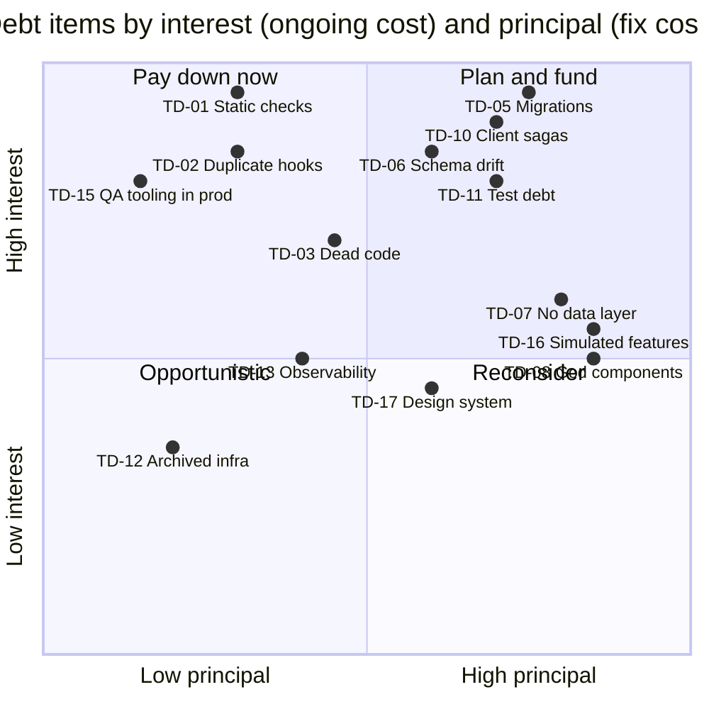

# Technical Debt Register

> CareSync HIMS repository audit, 2026-11-01. Commit `43ab8f7`. This register groups the debt *themes* behind individual issues. **Interest** is the ongoing cost of leaving an item in place. **Principal** is the one-off cost of paying it down, using the S/M/L scale from [IMPLEMENTATION_ROADMAP.md](./IMPLEMENTATION_ROADMAP.md) §1. Measurements come from the lead's runs and the architecture review ([MODULE_AUDIT.md](./MODULE_AUDIT.md) §2).

## 1. Summary

The defining pattern of this codebase is **remediation by addition**. Fixes and "deep modules" were added beside the legacy code instead of replacing it, and the static checks that would have exposed the divergence were switched off or made vacuous. As a result, 41% of non-test source files are unreachable, 22 hooks exist twice, and safety fixes are tested but not live. Paying down TD-01, TD-02 and TD-03 first makes every later fix cheaper and verifiable.

## 2. Register

| ID | Debt item | Type | Evidence & size | Interest (ongoing cost) | Principal | Related issues | Paid down by |
|---|---|---|---|---|---|---|---|
| TD-01 | Disabled or vacuous static checks | Code / tooling | `type-check` checks 0 files. About 30 production files excluded from `tsconfig.app.json`. 34 live files `@ts-nocheck` (14,443 LOC). 347 `as any`, 670 `: any`. ESLint `no-explicit-any`, `no-unused-vars` and `ban-ts-comment` off. | **Very high.** Runtime crashes ship unnoticed (CLIN-26 to CLIN-29, FUNC-17), and interface drift goes undetected. | M | ARCH-01, ARCH-02, ARCH-03, CLIN-24 | S0-12, S2-03 |
| TD-02 | Duplicate hook trees (`src/hooks` vs `src/lib/hooks`) | Design | 22 same-name pairs (15 identical, 7 diverged), 5,722 LOC | **Very high.** Fixes land in the dead copy (2FA `Math.random`, ARCH-06). Every change needs two edits. | S–M | ARCH-06, FUNC-31 | S2-02 |
| TD-03 | Dead code | Code | 377 unreachable non-test files (90,823 LOC, 41%). 52 test files exercise dead code. | High. It misleads reviewers and auditors, inflates test counts and the attack surface, and slows onboarding. | M | ARCH-07, SECF-16 | S2-02 |
| TD-04 | Parallel implementation families | Design | Logger ×2, rate limiter ×5, cache ×6, security utils ×4, RBAC ×10, Sentry init ×3, patient registration ×3, pediatric dosing ×4, billing dashboards ×2 | High. Behavior differs by entry point, which is a source of clinical and security inconsistency. | L | ARCH-08, SECF-07, CLIN-15, PERF-12 | S2-01, S2-05, S1-09 |
| TD-05 | Migration debt | Data | 108 SQL files never applied. At least 15 applied files error. No replayable baseline. The validator pattern-matches text only. | **Very high.** The real schema is unknown, claimed fixes are not deployed, and no environment can be rebuilt. | L | DB-03, DB-21, DB-11 | S0-01 |
| TD-06 | Schema drift and untyped data access | Data / code | 66 referenced tables and 16 RPCs undefined. Types cover 44 of 232 tables. The `query-helper` client is `any`. | High. 404/400 errors at runtime, and features silently non-functional. | M (after S0-01) | DB-14, ARCH-02, EDGE-20, ARCH-05 | S0-01, S2-03 |
| TD-07 | No data-access layer | Design | 61 live UI files call Supabase directly (145 call sites). 201 unbounded selects. | Medium–high. Pagination, tenancy and error handling are reimplemented ad hoc. | L | ARCH-12, PERF-07 | S2-03, S3-05 |
| TD-08 | God components and hooks | Code | 34 live files over 600 lines. `ConsultationWorkflowPage` is 1,412 lines and `AuthContext` 968. | Medium. Changes are hard to test and regressions likely. | L | ARCH-09, PERF-04 | S2-04 |
| TD-09 | Dependency cycles and narrow boundary lint | Design | 4 cycles through `AuthContext` ↔ `lib/hooks/auth`. Boundary lint covers about 10% of `src`. | Medium. The architecture rules are not enforced. | S | ARCH-11 | S2-04 |
| TD-10 | Business transactions run as client-side sagas | Design | Consultation completion, dispensing, payments, check-in and invoice creation are chained client writes. | **Very high.** Partial writes, races and double billing. | L | CLIN-07, CLIN-04, FUNC-06, FUNC-07, FUNC-16, CLIN-19 | S1-01 |
| TD-11 | Test debt | Test | 20 files `expect(true).toBe(true)`. 74 of 222 files import no production code. Source-grep "security" tests. Five test roots. 39 failing tests. Playwright collects 0. | High. False assurance; the suite cannot catch regressions. | L | TEST-01, TEST-02, TEST-03, TEST-08, TEST-09, TEST-10, ARCH-15 | S1-07, S1-08, S5-05 |
| TD-12 | Archived infrastructure kept in the repository | Infra | `services/` (5 services with their own schemas), Kong, k8s manifests ×2, compose ×3, `mobile-app`, `.deployment/` | Low–medium. Committed credentials, misleading docs, broken CI noise. | S | ARCH-16, OPS-05, OPS-06, DB-19, SECF-19 | S2-06 |
| TD-13 | Observability sprawl | Code | 698 `console.*` calls vs 6 importers of `utils/logger`. Three Sentry inits. A fetch monkey-patch. Logs sent to a non-existent `/api/logs`. | Medium. PHI leakage risk, broken CORS, no usable production logs. | M | PERF-12, SECF-12, PERF-01 | S0-02, S2-05 |
| TD-14 | Dependency hygiene | Infra | Test libs and `jsdom` in `dependencies`. `@sentry/tracing` v7 next to `@sentry/react` v10. Two React plugins. Two lockfiles. 42 advisories. | Medium. Security exposure and slower installs. | S | ARCH-13, OPS-19 | S2-02, S1-07 |
| TD-15 | QA and test tooling inside the production app | Code | `TestingProvider` at the root, the `/testing` route, a code-reviewer UI, mock-auth branches, a destructive test-data seeder | High. Data-loss risk (FUNC-10) and a larger attack surface. | S | ARCH-14, FUNC-10, SECF-22 | S0-05, S2-02 |
| TD-16 | Simulated or mock features shown as real | Product | 136 `Math.random` (about 70 drive data), 322 "mock" references. Kiosk, insurance adjudication, AI confidences and dashboard figures are simulated. | High. Users and stakeholders are misled, and fabricated records get persisted. | L | FUNC-11, FUNC-18, FUNC-09, EDGE-10, CLIN-18 | S4-01 |
| TD-17 | Design-system drift | UI | 3,677 hard-coded palette classes. Three `--primary` definitions. Two toast systems. 131 of 146 form files use ad-hoc state. | Medium. Accessibility failures and an inconsistent UX. | M | UX-08, UX-09, UX-10, A11Y-01, A11Y-02 | S3-01, S3-04 |
| TD-18 | Documentation drift | Docs | Broken README links, an architecture doc claiming Kong/TanStack v4, a prior audit claiming fixes that do not hold, glossary drift | Medium. Wrong decisions and false compliance assurance. | M | ARCH-16, FUNC-32 | S5-06 |
| TD-19 | CI workflow sprawl | Infra | 10 workflows, 0 successful runs in the last 100. Retired and duplicate jobs. | Medium. Permanently red CI is ignored. | S | OPS-11, OPS-03 | S1-07 |
| TD-20 | Edge-function platform duplication | Code | Authorization code hand-copied in each function. Unpinned imports. In-memory rate limiter. | High. Each copy is a chance to get tenancy wrong (EDGE-06, EDGE-07, EDGE-08). | M | EDGE-11, EDGE-27, EDGE-13, EDGE-14 | S0-06, S2-07 |

## 3. Debt management recommendations

1. **Stop the inflow.** Make type-check real, run the full test suite in CI, extend dependency-cruiser to all of `src` with a rule forbidding imports of the legacy paths (`hooks/usePrescriptionSafety`, `src/hooks/*` twins), and add a reachability check that fails when dead files increase.
2. **Delete before you fix.** Removing the dead copies (TD-02, TD-03) shrinks the surface that S0/S1 fixes must cover. Do it right after S0-12 so the compiler confirms nothing live breaks.
3. **Track debt in the issue tracker.** Use the `.scratch/<feature>/issues` convention with the `TD-` IDs above, and review it monthly. Budget roughly 20% of each sprint after Sprint 2 for TD items not already in the roadmap.
